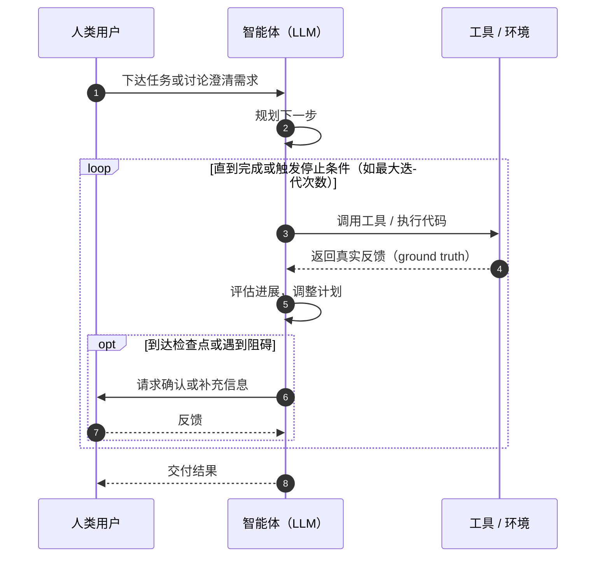

# 分镜：agent-loop-steps（自主智能体运行循环的分步高亮）

## 基本信息

- **所属笔记**：`notes/building-effective-agents.md`
- **插入位置**：`## 图解` → `### 图 4：自主智能体的运行循环`。在现有 mermaid 代码块之后紧跟分步块，现有图解文字保留不动。**不新画图**，只在现有 mermaid 图上逐步点亮。
- **组件类型**：辅助方案 G（mermaid 分步高亮）。
- **一句话机制**：智能体本质上是“LLM 根据环境反馈调用工具，循环往复”：人类给出任务，智能体规划后进入“调用工具 → 拿到真实反馈 → 评估进展”的循环，必要时停下来问人，完成或触发停止条件时交付结果。
- **形式**：分步（8 步），第 6 步可以自动循环演示“又跑了一轮”（带暂停按钮；减少动态效果时不自动循环，改为点“再来一轮”按钮）。

## 现有 mermaid 源码（笔记中原样，不改）



## 可点亮的元素（按 mermaid 源码命名，等大厨定语法再对齐）

这是 sequenceDiagram，不是 flowchart，没有“节点 id”。下面先用源码里的写法指代：参与者用别名，消息用 `autonumber` 的序号（图上本来就显示 1–8），两个块用关键字加标签。

| 引用名（暂定） | 源码中对应的内容 | 图上显示 |
|---|---|---|
| `H` | `participant H as 人类用户` | 参与者“人类用户” |
| `A` | `participant A as 智能体（LLM）` | 参与者“智能体（LLM）” |
| `T` | `participant T as 工具 / 环境` | 参与者“工具 / 环境” |
| `msg1` | `H->>A: 下达任务或讨论澄清需求` | 消息 ① |
| `msg2` | `A->>A: 规划下一步` | 消息 ② |
| `msg3` | `A->>T: 调用工具 / 执行代码` | 消息 ③ |
| `msg4` | `T-->>A: 返回真实反馈（ground truth）` | 消息 ④ |
| `msg5` | `A->>A: 评估进展，调整计划` | 消息 ⑤ |
| `msg6` | `A->>H: 请求确认或补充信息` | 消息 ⑥ |
| `msg7` | `H-->>A: 反馈` | 消息 ⑦ |
| `msg8` | `A-->>H: 交付结果` | 消息 ⑧ |
| `loop` | `loop 直到完成或触发停止条件（如最大迭代次数）` | 外层循环框 |
| `opt` | `opt 到达检查点或遇到阻碍` | 内层可选框 |

**给大厨的参考（笔者在本机用 mermaid-cli 11.17 渲染这段源码观察到的，站点用的是 mermaid ^12.2，结构可能不同，仅供参考）**：

- 生成的 SVG 里，消息没有 id，`messageText`、`sequenceNumber` 各 8 个，按源码顺序排列。
- 参与者的元素 id 就是别名 `H` / `A` / `T`，但顶部和底部各出现一次，id 重复。
- `loop` / `opt` 框由 `loopLine`、`loopText`、`labelBox`、`labelText` 组成。

所以按“第 n 条消息”定位，可能比按 id 定位更稳。具体怎么定位由大厨决定。

## 分步说明（8 步）

| 步 | 点亮 | 说明文字 |
|---|---|---|
| 1 | `H`、`A`、`msg1` | **起点**：智能体从人类的一条指令开始，或者先和人讨论，把任务说清楚。 |
| 2 | `A`、`msg2` | **规划**：任务清楚后，智能体自己规划下一步怎么做，不需要人逐步指挥。 |
| 3 | `loop`、`A`、`T`、`msg3` | **进入循环，调用工具**：智能体调用工具或执行代码，真正对环境动手。 |
| 4 | `loop`、`T`、`A`、`msg4` | **拿到真实反馈**：每一步都从环境拿回真实结果（工具返回值、代码运行结果），而不是只凭自己的推测。原文把这称为 ground truth。 |
| 5 | `loop`、`A`、`msg5` | **评估进展**：根据反馈判断离目标还有多远，调整接下来的计划。 |
| 6 | `loop`、`msg3` → `msg4` → `msg5` 依次再亮一遍 | **再跑一轮**：步数事先无法预估，循环一轮接一轮地进行。图上计数器显示“第 2 轮、第 3 轮……”。这正是智能体和写死步骤的工作流的区别。 |
| 7 | `opt`、`A`、`H`、`msg6`、`msg7` | **必要时问人**：到了检查点或遇到阻碍时，智能体可以停下来请人确认或补充信息，拿到反馈后继续循环。 |
| 8 | `loop` 的标签、`A`、`H`、`msg8` | **停止并交付**：任务完成就结束；也常设置最大迭代次数之类的停止条件，防止失控。实现往往很简单，难点在把工具和工具文档设计好。 |

第 6 步的“轮”计数为示意，最多演示到第 3 轮后停下，不暗示真实智能体的轮数。

## 参数

| 参数 | 范围 | 默认值 | 说明 |
|---|---|---|---|
| 当前步 | 1 – 8 | 1 | 上一步 / 下一步，键盘左右键 |
| 第 6 步自动循环 | 开 / 关 | 开（减少动态效果时为关） | 每轮约 3 秒，最多 2 次额外循环（显示到第 3 轮）；必须有暂停按钮 |

## 高亮样式要求（交给大厨）

- 高亮用站点 CSS 提供的类，**内容侧不写** `classDef`、`style` 或颜色，遵守 CONTENT-GUIDE 的 mermaid 规范。
- 未点亮的元素降低透明度（例如 0.35），点亮的消息线和文字用 `--accent`。
- 主题切换时 mermaid 会重新渲染，高亮需要在重渲染后按当前步重新挂上。
- 放大查看对话框里的克隆 SVG 是否也同步高亮，由大厨决定。笔者建议放大时显示全部、不高亮。

## 静态兜底

- 就是现有的 mermaid 图 4 本身（不点亮任何元素），外加现有图解文字。
- 在图下加一个有序列表，列出 8 步说明文字。列表在无 JS 时可见；有 JS 时变成播放器下方的当前步说明（读屏用 aria-live 播报）。

## 替代文字

“时序图：人类用户、智能体和工具 / 环境三方。人类下达任务，智能体规划后进入循环：调用工具，拿到真实反馈，评估进展；遇到检查点或阻碍时向人类请求确认。循环直到任务完成或触发停止条件（如最大迭代次数），最后把结果交付给人类。”

（mermaid 图本身的替代文字由站点统一处理；这里是分步组件的整体说明。）

## 图上必须标注的提示

- 第 6 步注明：“轮数为示意。”
- 不需要“示意数据”标注（没有数字）。
- 不要额外加入原文没有的环节（如“记忆”“反思模块”）；本图只表达原文 Agents 一节写到的步骤。

## 已核对的内容

原文：Building effective agents（Anthropic 工程博客），“Building blocks, workflows, and agents” → “Agents” 小节。

| 分镜中的说法 | 原文 | 核对结果 |
|---|---|---|
| 从人类的指令或与人类的交互讨论开始 | “Agents begin their work with either a command from, or interactive discussion with, the human user.” | 一致 |
| 任务清楚后自己规划、独立行动，可能回来找人要信息或判断 | 同段 “Once the task is clear, agents plan and operate independently, potentially returning to the human for further information or judgement.” | 一致 |
| 每一步从环境获得 ground truth（工具调用结果、代码执行）以评估进展 | 同段 | 一致 |
| 可在检查点或遇到阻碍时暂停，等人反馈 | 同段 | 一致 |
| 完成即终止；也常设置停止条件（如最大迭代次数）以保持控制 | 同段 | 一致 |
| 实现往往很简单，通常就是 LLM 根据环境反馈在循环中使用工具；因此工具集和文档要设计好 | 下一段 | 一致 |
| 步数难以预估、无法写死路径时才适合用智能体 | “When to use agents” 段 | 一致（第 6 步说明用到） |

**版权提醒**：原文 Agents 小节配有 “Autonomous agent” 和 “High-level flow of a coding agent” 两张图。本组件只在笔记自己的 mermaid 图 4 上点亮，不参考、不复刻原文配图。

本分镜没有「待核实」项。需要大厨确认的是语法和定位方式（见“可点亮的元素”），不属于内容核实。

## 代码块草稿（语法待大厨确认）

按方案写法，紧跟在现有 mermaid 代码块之后：

```anim
id: agent-loop-steps
# 语法待大厨确认（方案里也可能写成 ```anim-steps）；元素引用名待与大厨对齐
component: mermaid-steps
target: previous-mermaid
caption: 自主智能体运行循环的分步演示
alt: 时序图：人类用户、智能体和工具 / 环境三方。人类下达任务，智能体规划后进入循环：调用工具，拿到真实反馈，评估进展；遇到检查点或阻碍时向人类请求确认。循环直到任务完成或触发停止条件（如最大迭代次数），最后把结果交付给人类。
steps:
  - { on: [H, A, msg1], text: "起点：智能体从人类的一条指令或一次讨论开始，先把任务说清楚" }
  - { on: [A, msg2], text: "规划：任务清楚后，智能体自己规划下一步" }
  - { on: [loop, A, T, msg3], text: "进入循环：调用工具或执行代码" }
  - { on: [loop, T, A, msg4], text: "每一步都从环境拿回真实结果（ground truth）" }
  - { on: [loop, A, msg5], text: "根据反馈评估进展，调整计划" }
  - { on: [loop], sequence: [msg3, msg4, msg5], repeat: 2, counter: "第 {n} 轮", text: "步数事先无法预估，循环一轮接一轮（轮数为示意）" }
  - { on: [opt, A, H, msg6, msg7], text: "到检查点或遇到阻碍时，停下来请人确认或补充信息" }
  - { on: [loop, A, H, msg8], text: "完成即结束，也常设最大迭代次数等停止条件；最后交付结果" }
```
