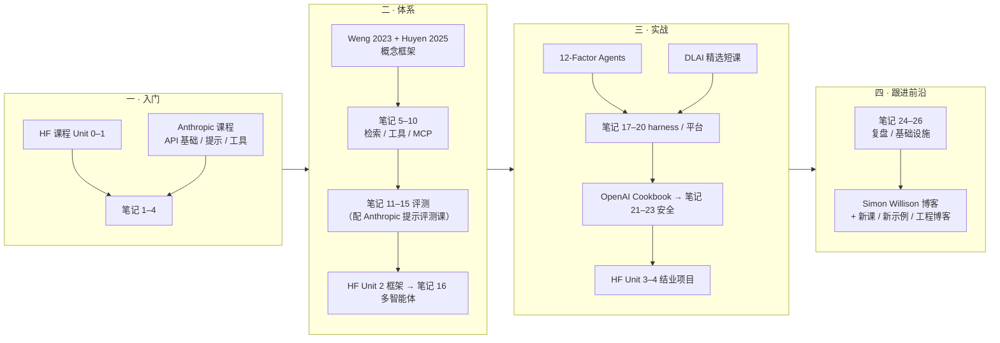

# 智能体工程学习路线 · 大纲（审阅稿）

> 状态：**大纲，待用户确认**。确认之前不写资源导读页，也不改站点代码。
> 范围：现有 26 篇 Anthropic 工程博客笔记（`notes/`），加上 8 个外部资源，合成一条四阶段学习路线：入门 → 体系 → 实战 → 跟进前沿。
> 核实时间：2026-10-17（北京时间）。8 个资源都逐一打开核对过课程目录或文章结构，核对方法和发现见第 1 节。下文对资源内容的描述都是笔者转述，不是原文翻译。

---

## 0. 一页总览

| 阶段 | 目标 | Anthropic 笔记（order） | 外部资源（主阶段） | 估计投入（笔者估算） |
|---|---|---|---|---|
| 一 · 入门 | 建立“LLM + 工具循环”的直觉，能调 API、写提示、定义工具，能用 Claude Code 干活 | 1–4 | Hugging Face Agents Course（Unit 0–1）、Anthropic 官方课程（API 基础 / 提示工程教程 / 工具使用） | 2–3 周 |
| 二 · 体系 | 建立完整概念框架：规划、记忆、工具、检索、MCP、评测、多智能体 | 5–16 | Lilian Weng《LLM Powered Autonomous Agents》、Chip Huyen《Agents》；回看 Anthropic 课程（提示评测）、HF Unit 2 | 4–6 周 |
| 三 · 实战 | 面向生产：长任务 harness、可控的控制流、安全隔离、评测闭环、完整项目 | 17–23 | 12-Factor Agents、DeepLearning.AI 短课程（精选）、OpenAI Cookbook（agents / evals 主题）；HF Unit 3–4 作为结业项目 | 4–6 周 |
| 四 · 跟进前沿 | 理解规模化后的可靠性与基础设施问题，建立持续跟进的信息源 | 24–26 | Simon Willison 的博客；持续关注 DLAI 新课、Cookbook 新示例、Anthropic 工程博客 | 长期 |

**好处是现有笔记的 `order` 一个都不用改**：四个阶段正好对应 order 1–4、5–16、17–23、24–26，外部资源只是插在这些笔记之间。



---

## 1. 核实记录与需要注意的事实

| 资源 | 怎么核实的 | 核实到的关键事实 / 疑点 |
|---|---|---|
| HF Agents Course | 打开课程首页（unit0/introduction），并读取官方仓库 `huggingface/agents-course` 的 `units/en/_toctree.yml` | 结构：Unit 0 入门 → Unit 1 智能体基础 → Unit 2 框架（2.1 smolagents / 2.2 LlamaIndex / 2.3 LangGraph）→ Unit 3 Agentic RAG 用例 → Unit 4 结业项目（GAIA 基准 + 排行榜 + 证书），另有 3 个附加单元（函数调用微调、可观测性与评测、宝可梦对战智能体）。前置要求：Python 基础和 LLM 基础。建议节奏：每章 1 周、每周 3–4 小时。**官方有简体中文版**（`/learn/agents-course/zh-CN/...`，HTTP 200）。仓库在 2026-10-14 仍有更新 |
| Anthropic courses | 读取仓库 README 和 5 门课各自的 README；用 GitHub API 查仓库状态 | 5 门课，官方建议按顺序学：API 基础 → 提示工程交互教程（9 章 + 附录）→ 真实场景提示（5 课）→ 提示评测（9 课，后半用 promptfoo）→ 工具使用（6 课）。⚠️ **仓库已归档（archived = true）**，README 说明课程多用 Claude 3 Haiku 来省费用，内容偏旧 |
| DeepLearning.AI 短课程 | 打开 `/short-courses/`（**现已重定向到 `/courses`** 总目录），从页面数据中解析出 131 个条目；逐个打开下文推荐课程的页面，核对课时目录、时长和讲师 | 目录混合了短课、长课和专项课程。和本路线强相关的有：与 Anthropic 合作的 4 门（Computer Use、MCP、Claude Code、Agent Skills）、Evaluating AI Agents、Andrew Ng 的 Agentic AI（长课，约 10 小时，不属于短课）等。课程页写着证书或成就需要 PRO；课程本身是否免费，页面上没看到明确说明，**未核实** |
| Lilian Weng 文章 | 抓取原文，提取标题层级和各节要点 | 发表于 2023-06-23。结构：系统总览 → 组件一 规划（任务分解、自我反思）→ 组件二 记忆（记忆类型、MIPS 近似最近邻）→ 组件三 工具使用 → 案例（科学发现智能体、生成式智能体模拟、AutoGPT 等概念验证）→ 挑战（有限上下文、长程规划、自然语言接口的可靠性）。⚠️ 写于 AutoGPT 时代，例子偏旧，但框架经典 |
| Chip Huyen 文章 | 抓取原文，提取标题层级和各节要点 | 发表于 2025-01-07，作者注明改编自其著作《AI Engineering》（2025）的智能体章节。结构：智能体概述 → 工具（知识增强 / 能力扩展 / 写操作）→ 规划（基础模型能否规划、计划生成、函数调用、规划粒度、复杂计划、反思与纠错、工具选择）→ 失败模式与评测（规划失败、工具失败、效率）→ 结论。作者在文中提到自己的框架与 Anthropic《Building effective agents》概念一致，但更侧重“为什么”以及规划、工具选择和失败模式 |
| 12-Factor Agents | 读取仓库 README，用 GitHub API 查仓库状态 | 作者 Dex（HumanLayer）。一节“软件简史”加 12 条原则，另有附录“Factor 13：预取可能需要的上下文”。README 明确引用 Anthropic《Building effective agents》。许可：**内容和图片 CC BY-SA 4.0，代码 Apache 2.0**。仓库最近一次推送是 2025-09-21 |
| OpenAI Cookbook | 打开 cookbook.openai.com（**现已重定向到 `developers.openai.com/cookbook`**），列出主题页（agents / evals / guardrails / codex 等），逐个打开下文推荐示例核对标题；GitHub 仓库是 MIT 许可，2026-10-17 仍有推送 | agents 主题页列出了 32 个示例（可能有分页，未逐页翻看）。另外看到：一个示例说明 **OpenAI 正在逐步关闭 Evals 产品，推荐改用 Promptfoo**；还有一篇《从 Claude Agent SDK 迁移到 OpenAI Agents SDK》，属于厂商视角的内容。guardrails 主题页没解析到示例 |
| Simon Willison 博客 | 打开首页、Guides 页，几个关键标签页，以及两篇代表性文章 | 几乎每天更新。有一份 16 章的 **Agentic Engineering Patterns** 指南（编码智能体实践）。标签规模（2026-10-17）：coding-agents 259、prompt-injection 163、ai-agents 111、lethal-trifecta 30、agent-definitions 19。代表作：2025-06-16《The lethal trifecta for AI agents》、2025-09-18 关于“agent”定义的文章。首页有赞助内容，引用时需要注意区分 |

---

## 2. 八个资源逐个说明

> 每个资源按五项写：是什么 / 放在哪个阶段、为什么 / 建议看哪些部分 / 搭配哪几篇笔记 / 注意事项。笔记一律用现有 slug。

### 2.1 Hugging Face AI Agents Course
- **是什么**：Hugging Face 的免费智能体课程，理论加动手（Spaces 预配环境），有小测验、作业、学生排行榜和证书；用到 smolagents、LlamaIndex、LangGraph。有官方简体中文版。
- **阶段**：主阶段是**入门**（Unit 0–1）；Unit 2 放在**体系**末尾，Unit 3–4 和附加单元 2 放在**实战**作为结业项目。
- **理由**：Unit 1 用“思考 → 行动 → 观察”循环、消息与特殊 token、工具、手写的 dummy agent，从零讲清智能体的机制，正好接 Anthropic 偏原则性的第 1 篇。课程跨越多个阶段，适合当“主线练手项目”。
- **建议看**：
  - 入门：Unit 1 全部（What is an Agent、What are LLMs、Messages and Special Tokens、Tools、Thought / Action / Observation、Dummy Agent Library、第一个 smolagents 智能体）。
  - 体系：Unit 2 **三个框架选一个**深入即可（推荐 2.1 smolagents，其中“代码动作 vs JSON 动作”和 Multi-Agent Systems 两节，与笔记 8、16 呼应）。
  - 实战：Unit 3 Agentic RAG；Unit 4 GAIA 结业项目；附加单元 2（可观测性与评测）。附加单元 1（微调）、3（游戏）可选。
- **搭配笔记**：`building-effective-agents`、`writing-tools-for-agents`（Unit 1）；`code-execution-with-mcp`、`multi-agent-research-system`（Unit 2）；`contextual-retrieval`（Unit 3）；`demystifying-evals-for-ai-agents`、`swe-bench-sonnet`（Unit 4 与附加单元 2）。
- **注意**：框架 API 变化快，导读只讲概念和练习目标，不复述代码；HF 课程偏开源模型和自家框架，和 Anthropic 的“少用框架、先用 API”观点有张力，正好可以对照讨论。

### 2.2 Anthropic 官方课程（anthropics/courses）
- **是什么**：Anthropic 的 5 门 Jupyter 教程：API 基础、提示工程交互教程、真实场景提示、提示评测、工具使用。
- **阶段**：主阶段是**入门**；“提示评测”放到**体系**的评测段回看；“真实场景提示”可选。
- **理由**：这是最直接的“Claude API 手感”训练，填补了笔记只讲思路、不教基础调用的空白；工具使用课是笔记 3 的前置知识。
- **建议看**：
  - 入门：API 基础（取 key、消息格式、模型、参数、流式、视觉）；提示工程教程第 1–9 章（附录中的提示链、工具使用、检索可选）；工具使用 6 课（第一个工具、用工具强制 JSON、完整流程、tool choice、多工具聊天机器人）。
  - 体系：提示评测第 1–4 课（评测 101、人工评分、代码评分、分类评测），第 5–9 课的 promptfoo 部分选看。
- **搭配笔记**：`building-effective-agents`、`effective-context-engineering-for-ai-agents`、`writing-tools-for-agents`（入门）；`demystifying-evals-for-ai-agents`（体系）。
- **注意**：⚠️ 仓库已归档，示例模型是 Claude 3 系列。导读要注明：概念仍然适用，但模型名、参数和 API 细节以现行文档为准。建议用户决定是否保留（见第 6 节）。

### 2.3 DeepLearning.AI 短课程（精选）
- **是什么**：DeepLearning.AI 的课程目录（`/short-courses/` 已重定向到 `/courses`），多为 1–2.5 小时的视频加代码短课，很多与厂商合作制作。
- **阶段**：主阶段是**实战**（与 Anthropic 合作的几门）；Agentic AI 长课可放在**体系**作为可选视频课；“新课”列表放在**跟进前沿**。
- **理由**：它不是一门连贯的课，而是一个目录，必须精选。与 Anthropic 合作的几门恰好对应 MCP、Claude Code、Skills 这些实战主题，可以把笔记里的原则变成可操作的步骤。
- **建议看**（都核对过课程页的目录）：

| 课程 | 发布 | 时长 / 课时（课程页数据） | 核心内容（概括） | 放在 | 搭配笔记 |
|---|---|---|---|---|---|
| Building toward Computer Use with Anthropic | 2025-01-22 | 1h47m，9 节视频 | API、多模态、真实场景提示、提示缓存、工具使用，最后是 Computer Use | 入门（可选） | `writing-tools-for-agents` |
| Agentic AI（Andrew Ng，长课） | 2025-09-30，页面显示 2026-08-31 更新 | 9h55m，31 节视频 | 反思、工具使用、评测与错误分析、规划、多智能体五个模块 | 体系（可选） | `building-effective-agents`、`demystifying-evals-for-ai-agents`、`multi-agent-research-system` |
| MCP: Build Rich-Context AI Apps with Anthropic | 2025-05-14 | 1h58m，11 节视频 | MCP 架构，编写 server 和 client，prompt 与 resource，配置 Claude Desktop，远程 server | 实战 | `code-execution-with-mcp`、`desktop-extensions`、`advanced-tool-use` |
| Claude Code: A Highly Agentic Coding Assistant | 2025-08-06 | 约 2h | 理解代码库、加功能、测试调试重构、并行多功能、GitHub 集成与 hooks、Figma 转 Web 应用 | 实战 | `claude-code-best-practices`、`claude-code-sandboxing` |
| Agent Skills with Anthropic | 2026-01-28 | 2h19m，10 节视频 | 为什么用 Skills；Skills 与工具、MCP、子智能体的区别；预置与自定义 Skills；在 API、Claude Code、Agent SDK 中使用 | 实战 | `equipping-agents-for-the-real-world-with-agent-skills` |
| Evaluating AI Agents（与 Arize 合作） | 2025-02-19 | 2h36m，15 节视频 | 拆解智能体、追踪、路由与技能评测、轨迹评测、结构化实验、改进 LLM 评委、监控 | 实战 | `demystifying-evals-for-ai-agents`、`infrastructure-noise` |

  另有几门可以作为备选（只核对过目录里的标题和简介，没逐课打开）：Building Coding Agents with Tool Execution（沙箱中执行代码）、Agent Memory: Building Memory-Aware Agents、Spec-Driven Development with Coding Agents、AI Code Review、Governing AI Agents。
- **注意**：课程页显示证书或成就需要 PRO，是否免费未核实；多为厂商合作课，导读要说明立场；模型版本以课程录制时为准。

### 2.4 Lilian Weng《LLM Powered Autonomous Agents》（2023-06-23）
- **是什么**：一篇高引用的综述长文，提出“LLM 作为大脑 + 规划 + 记忆 + 工具使用”的经典分解，并系统梳理了 CoT、ToT、ReAct、Reflexion、MRKL 等方法。
- **阶段**：**体系**第一站。
- **理由**：入门阶段先动手，体系阶段需要一张“地图”。这篇提供了学术脉络和统一的组件划分，后面读检索、记忆、工具相关笔记时都能对号入座。
- **建议看**：系统总览；规划（任务分解、自我反思：ReAct、Reflexion 等）；记忆（记忆类型与外部向量存储，MIPS 一节可略读）；工具使用；**挑战**一节（有限上下文、长程规划、自然语言接口不可靠）——拿它对照 2025–2026 年的笔记，看哪些问题已被工程手段缓解。案例部分可略读。
- **搭配笔记**：`effective-context-engineering-for-ai-agents`（有限上下文 → 上下文工程）、`contextual-retrieval`（长期记忆 / 检索）、`claude-think-tool`（反思 / 思考）、`effective-harnesses-for-long-running-agents`（长程规划的工程解法）。
- **注意**：⚠️ 2023 年的文章，AutoGPT 等例子已过时。导读要加“时代背景”提示，并引导读者做“当年的挑战 → 今天的做法”对照。

### 2.5 Chip Huyen《Agents》（2025-01-07）
- **是什么**：改编自《AI Engineering》一书的智能体章节，按“环境与工具 → 规划 → 失败模式与评测”组织，偏工程视角。
- **阶段**：**体系**，紧接在 Weng 之后。
- **理由**：Weng 给出组件地图，Huyen 讲为什么、怎么做、怎么坏：例如把工具分为知识增强、能力扩展、写操作三类；主张把规划与执行解耦，先验证计划再执行；从规划失败、工具失败、效率三个方面评测。正好衔接评测模块。
- **建议看**：智能体概述（环境与工具清单）；工具三类（尤其“写操作”的风险）；规划全节（规划粒度、复杂计划、反思与纠错、工具选择）；失败模式与评测全节。“基础模型能否规划”一节可略读。
- **搭配笔记**：`building-effective-agents`（作者自己点名的对照对象）、`writing-tools-for-agents`、`advanced-tool-use`（工具选择）、`demystifying-evals-for-ai-agents`（失败模式 → 评测）、`claude-code-auto-mode`（写操作风险 → 权限控制，属于前向链接）。
- **注意**：文中引用了一些外部观点（例如 LeCun 认为自回归 LLM 不能规划），导读转述时要标明是谁的观点。

### 2.6 12-Factor Agents（HumanLayer）
- **是什么**：仿照“12-Factor App”，总结出 12 条（外加附录 1 条）构建生产级 LLM 应用的原则。核心观点：好的“智能体”大多是确定性软件，只在关键点嵌入 LLM 步骤；与其全盘采用框架，不如把小而模块化的智能体概念融进现有产品。
- **阶段**：**实战**第一站。
- **理由**：从“智能体能做什么”转向“怎么做到可上线”，它给出可以逐条对照的检查清单（掌控提示、掌控上下文窗口、掌控控制流、统一执行状态与业务状态、通过工具调用联系人类、小而专注的智能体、无状态 reducer 等），和实战阶段的 harness、平台、安全笔记一一呼应。
- **建议看**：README 中的“软件简史”和“为什么需要 12-factor”（理解 70–80% 质量瓶颈的叙事）；全部 12 条（每条一页，可以跳读）；附录 Factor 13（预取上下文）。重点：第 3 条（上下文窗口）、第 5–6 条（状态、暂停与恢复）、第 7 条（联系人类）、第 8 条（控制流）、第 10 条（小而专注的智能体）、第 12 条（无状态 reducer）。
- **搭配笔记**：`building-effective-agents`（README 直接引用）、`effective-context-engineering-for-ai-agents`（第 3 条）、`effective-harnesses-for-long-running-agents` 和 `managed-agents`（状态外置、暂停与恢复、无状态 harness，对应第 5、6、12 条）、`claude-code-auto-mode`（人类审批，对应第 7 条）、`multi-agent-research-system`（第 10 条）。
- **注意**：内容采用 CC BY-SA 4.0，导读只做转述和链接，**不复用原图**（复用就要遵守“相同方式共享”）；作者自述示例多用 TypeScript；作者明确说不讨论 MCP。

### 2.7 OpenAI Cookbook
- **是什么**：OpenAI 官方的示例与指南合集（现已迁到 `developers.openai.com/cookbook`），按主题组织（agents、evals、codex、multimodal 等），多为可运行的 notebook。
- **阶段**：**实战**。
- **理由**：跨厂商的实现参考，可以对照同一问题的另一套做法（会话记忆、压缩、评测闭环、沙箱智能体），避免只从单一厂商视角学习。
- **建议看**（都核对过标题）：
  - 上下文与记忆：*Context Engineering – Short-Term Memory Management with Sessions*；*Context Engineering for Personalization – State Management with Long-Term Memory Notes*；*Building Reliable Agents with Memory and Compaction*。
  - 评测闭环：*Build an Agent Improvement Loop with Traces, Evals, and Codex*；*Macro Evals for Agentic Systems*；*Optimizing Customer Support Agents for Cost and Quality*。
  - 编排与沙箱：*Orchestrating Agents: Routines and Handoffs*（较早的经典示例）；*Migrate a Legacy Codebase with Sandbox Agents*。
  - 工具调用基础（入门可回看）：*How to call functions with chat models*。
  - 跨厂商对照（选读）：*Skills in OpenAI API*（对照 Agent Skills 开放标准）。
- **搭配笔记**：`effective-context-engineering-for-ai-agents`、`effective-harnesses-for-long-running-agents`（记忆与压缩）；`demystifying-evals-for-ai-agents`、`harness-design-long-running-apps`（评测闭环、评估者）；`multi-agent-research-system`（交接与编排）；`claude-code-sandboxing`、`how-we-contain-claude`（沙箱智能体）；`equipping-agents-for-the-real-world-with-agent-skills`（Skills）。
- **注意**：内容更新很快，部分示例绑定特定模型或产品（页面里有当前模型名、OpenAI Agents SDK 等）；OpenAI Evals 产品正在下线，示例推荐 Promptfoo；还有《从 Claude Agent SDK 迁移》这类竞品迁移文章，导读要保持中立，只讲方法。

### 2.8 Simon Willison 的博客（simonwillison.net）
- **是什么**：Datasette 作者的个人博客，几乎每天更新，有长文、链接评注、摘录、TIL 和专题指南，长期追踪 LLM、编码智能体和提示注入安全。
- **阶段**：**跟进前沿**。
- **理由**：更新频率高，有独立判断，经常第一时间点评各家发布（包括 Anthropic 的文章）。它最适合作为长期的信息源，而不是系统教材。
- **建议看**：
  - 入口一：**Agentic Engineering Patterns** 指南（16 章，涉及编码智能体如何工作、配合 Git、子智能体、红/绿 TDD、先跑测试、人工测试、反模式等），可以和 Claude Code 系列笔记一起回看。
  - 入口二：代表文章《The lethal trifecta for AI agents》（2025-06-16：私有数据、不可信内容、对外通信三者叠加的风险）和关于“agent”定义的文章（2025-09-18：智能体就是为达成目标、在循环中运行工具）。
  - 入口三：订阅标签 `coding-agents`、`prompt-injection`、`lethal-trifecta`、`ai-agents`，或订阅 newsletter。
- **搭配笔记**：`how-we-contain-claude`、`claude-code-sandboxing`、`claude-code-auto-mode`（致命三要素 ↔ 出站控制与凭证隔离）；`claude-code-best-practices`（Agentic Engineering Patterns）；`building-effective-agents`（智能体定义）；`redesigning-source-control`、`april-23-postmortem`（规模化与质量这类前沿话题）。
- **注意**：首页有赞助位；内容量大，导读只给入口和阅读方法，不做整站总结；个人博客观点应标注为作者观点。

---

## 3. 完整学习路线（26 篇笔记 + 8 个资源）

> 标记：📘 = Anthropic 笔记（链接用 `./slug.md`）；🔗 = 外部资源。同一资源可能在不同位置出现不同部分。

### 阶段一 · 入门（建立直觉，能动手）
1. 🔗 **HF Agents Course · Unit 0–1**：智能体是什么，“思考 → 行动 → 观察”循环，动手做第一个智能体。
2. 📘 [`building-effective-agents`](./notes/building-effective-agents.md)（1）：工作流 vs 智能体，简单优先。
3. 🔗 **Anthropic 课程 · API 基础 + 提示工程交互教程**：调用 API，掌握提示基本功。
4. 📘 [`effective-context-engineering-for-ai-agents`](./notes/effective-context-engineering-for-ai-agents.md)（2）：上下文是有限预算。
5. 🔗 **Anthropic 课程 · 工具使用**：亲手定义和调用工具。
6. 📘 [`writing-tools-for-agents`](./notes/writing-tools-for-agents.md)（3）：怎样设计好用的工具。
7. 📘 [`claude-code-best-practices`](./notes/claude-code-best-practices.md)（4）：在 Claude Code 中实践前面的概念。
   - 可选：🔗 DLAI《Building toward Computer Use with Anthropic》。

### 阶段二 · 体系（建立概念地图）
8. 🔗 **Lilian Weng《LLM Powered Autonomous Agents》**：规划、记忆、工具的经典分解，以及 2023 年的挑战清单。
9. 🔗 **Chip Huyen《Agents》**：工具分类、规划与执行解耦、失败模式。
10. 📘 [`contextual-retrieval`](./notes/contextual-retrieval.md)（5）
11. 📘 [`claude-think-tool`](./notes/claude-think-tool.md)（6）
12. 📘 [`equipping-agents-for-the-real-world-with-agent-skills`](./notes/equipping-agents-for-the-real-world-with-agent-skills.md)（7）
13. 📘 [`code-execution-with-mcp`](./notes/code-execution-with-mcp.md)（8）
14. 📘 [`advanced-tool-use`](./notes/advanced-tool-use.md)（9）
15. 📘 [`desktop-extensions`](./notes/desktop-extensions.md)（10）
16. 🔗 **Anthropic 课程 · 提示评测**（回看，第 1–4 课为主）：先写出第一批评测。
17. 📘 [`demystifying-evals-for-ai-agents`](./notes/demystifying-evals-for-ai-agents.md)（11）
18. 📘 [`swe-bench-sonnet`](./notes/swe-bench-sonnet.md)（12）
19. 📘 [`infrastructure-noise`](./notes/infrastructure-noise.md)（13）
20. 📘 [`eval-awareness-browsecomp`](./notes/eval-awareness-browsecomp.md)（14）
21. 📘 [`ai-resistant-technical-evaluations`](./notes/ai-resistant-technical-evaluations.md)（15）
22. 🔗 **HF Agents Course · Unit 2**（选一个框架，建议 smolagents，含多智能体一节）
23. 📘 [`multi-agent-research-system`](./notes/multi-agent-research-system.md)（16）
    - 可选：🔗 DLAI《Agentic AI》（Andrew Ng，长课），用视频把本阶段串一遍。

### 阶段三 · 实战（面向生产）
24. 🔗 **12-Factor Agents**：生产级原则清单，读完后带着清单看下面的笔记。
25. 📘 [`effective-harnesses-for-long-running-agents`](./notes/effective-harnesses-for-long-running-agents.md)（17）
26. 📘 [`harness-design-long-running-apps`](./notes/harness-design-long-running-apps.md)（18）
27. 🔗 **DLAI 精选：MCP / Claude Code / Agent Skills / Evaluating AI Agents**：把前面的 MCP、Skills、评测笔记落到操作层。
28. 📘 [`building-c-compiler`](./notes/building-c-compiler.md)（19）
29. 📘 [`managed-agents`](./notes/managed-agents.md)（20）
30. 🔗 **OpenAI Cookbook · agents / evals 精选**：记忆与压缩、评测闭环、编排、沙箱智能体的跨厂商对照。
31. 📘 [`claude-code-sandboxing`](./notes/claude-code-sandboxing.md)（21）
32. 📘 [`claude-code-auto-mode`](./notes/claude-code-auto-mode.md)（22）
33. 📘 [`how-we-contain-claude`](./notes/how-we-contain-claude.md)（23）
34. 🔗 **HF Agents Course · Unit 3–4 + 附加单元 2**（结业项目）：Agentic RAG、GAIA 基准、可观测性与评测，把全阶段串起来做一个可评测的智能体。

### 阶段四 · 跟进前沿（规模化与持续学习）
35. 📘 [`a-postmortem-of-three-recent-issues`](./notes/a-postmortem-of-three-recent-issues.md)（24）
36. 📘 [`april-23-postmortem`](./notes/april-23-postmortem.md)（25）
37. 📘 [`redesigning-source-control`](./notes/redesigning-source-control.md)（26）
38. 🔗 **Simon Willison 博客**：Agentic Engineering Patterns、致命三要素、标签订阅。
39. 🔗 **持续跟进清单**：Anthropic 工程博客新文章（按现有模板补笔记）；DLAI 课程目录的新课（2026 年已有 Agent Memory、Spec-Driven Development、AI Code Review、Building Adaptive AI Agents 等）；Cookbook 的新示例；定期回查笔记里的“🔄 后续更新”提示。

> 注：上面的链接写成 `./notes/xxx.md`，是因为本文件在项目根目录。将来如果做成站内页面，要按第 5 节的约定改写。

---

## 4. 资源导读页模板（建议）

### 4.1 文件位置与命名
- 建议放在新目录 `/workspace/anthropic-eng-notes/resources/<slug>.md`，**不要放进 `notes/`**（原因见第 5 节）。
- slug 全小写、短横线连接，建议加 `r-` 前缀，避免将来和笔记 slug 冲突。暂定：
  - `r-hf-agents-course`
  - `r-anthropic-courses`
  - `r-deeplearning-ai-short-courses`
  - `r-lilian-weng-llm-agents`
  - `r-chip-huyen-agents`
  - `r-12-factor-agents`
  - `r-openai-cookbook`
  - `r-simon-willison`

### 4.2 frontmatter（建议字段）

```yaml
---
title_zh: "Hugging Face AI 智能体课程"          # 必填
title_en: "Hugging Face AI Agents Course"        # 必填
slug: r-hf-agents-course                          # 必填，与文件名一致，^[a-z0-9-]+$
kind: course                                      # 必填：course | article | guide | repo | cookbook | blog | catalog
stage: 1                                          # 必填：主阶段 1 入门 / 2 体系 / 3 实战 / 4 跟进前沿
route:                                            # 必填：在路线中出现的位置（可以多次）
  - step: 1
    part: "Unit 0–1"
    after: null                                   # 插在哪篇笔记之后（笔记 slug；null 表示阶段开头）
  - step: 22
    part: "Unit 2（任选一个框架）"
    after: ai-resistant-technical-evaluations
  - step: 34
    part: "Unit 3–4 + 附加单元 2"
    after: how-we-contain-claude
source_url: "https://huggingface.co/learn/agents-course"   # 必填，合法 URL
source_url_zh: "https://huggingface.co/learn/agents-course/zh-CN/unit0/introduction"  # 可选：官方中文版
provider: "Hugging Face"                          # 必填：机构或作者
authors_en: ["Ben Burtenshaw", "Sergio Paniego"]  # 可选
published: 2023-06-23                             # 可选：文章类填；课程或目录类可以不填
last_checked: 2026-10-17                          # 必填：最后核实日期
status: active                                    # 必填：active | archived | dated（内容偏旧但仍有价值）
cost: "免费"                                      # 可选：只写核实过的信息，没核实就不填
license_note: ""                                  # 可选：例如 "内容 CC BY-SA 4.0，未复用原图"
estimated_hours: 20                               # 可选：笔者估算，正文注明是估算
summary: "……"                                     # 必填：一句话导读
pairs_with: [building-effective-agents, writing-tools-for-agents]  # 必填：搭配的笔记 slug，构建时校验存在
tags: [course, hands-on, smolagents]              # 必填
source_note: "仓库已归档……"                       # 可选：显示为提醒框（沿用笔记的同名字段）
---
```

### 4.3 正文固定小节
1. **一句话导读**：是什么、适合谁。
2. **为什么放在这个阶段**：与前后笔记的关系。
3. **结构速览**：课程章节或文章结构的**自写概括**（表格），不复制原文目录描述。
4. **建议看哪些部分**：必看 / 选看 / 可略，各自附原文链接，并说明理由。
5. **与 Anthropic 笔记对照**：观点一致的地方、有分歧的地方、互补的地方（链接 `./slug.md`）。
6. **学习任务**：笔者设计的 2–4 个练习或自测问题。
7. **注意事项**：时效、厂商立场、许可、是否收费（只写核实过的）。
8. **关键原话**（可选，最多 1–2 句短引用，英文原文 + 中文）。
9. **延伸阅读**：站内笔记、原文中的相关链接。
10. **页脚**：`*本导读依据 YYYY-MM-DD 访问的在线内容撰写，仅为导读与总结。原文：作者 / 机构,《标题》, <URL>。*`

版权约束沿用笔记规则：用自己的话写、不搬全文、不全译、每页最多 1–2 句短引用、附原文链接、不编造；对 CC BY-SA 的内容不复用图片和大段文字。

---

## 5. 与现有 Astro 站点的兼容性（只提建议，不改代码）

我读了 `site/src/content.config.ts`、`src/lib/notes.ts`、`src/lib/remark-plugins.mjs` 和 `site/README.md`，发现几个约束：

| 约束 | 影响 | 建议 |
|---|---|---|
| `notes` 集合用 `glob('*.md')` 读取 `../notes/` 下**所有** `.md` | 导读页如果放进 `notes/`，就会被当作笔记校验：`order` 要求 1–26 且不重复，`module` 要求 A–F 开头，**构建会失败** | 导读页放在独立目录 `resources/`；由建站方新增一个 `resources` 集合（独立 schema，见 4.2），用 `glob` 读取 `../resources`，路径可以照搬 `NOTES_DIR` 的做法，例如 `RESOURCES_DIR` |
| 页面路由只有 `src/pages/notes/[slug].astro` 和首页 | 没有页面能渲染导读 | 建站方新增 `src/pages/resources/[slug].astro`，以及一个“学习路线”页（例如 `src/pages/path.astro`），按 `route.step` 把笔记和资源合并成一个列表 |
| `remarkNoteLinks` 会把**任何** `./xxx.md` 都改写成 `/notes/xxx/` | 导读页里用 `./slug.md` 链接笔记**没问题**；但笔记里如果写 `./r-xxx.md` 链接导读，会被错误改写成 `/notes/r-xxx/` | 方案 A：笔记暂不反向链接导读（不动笔记）。方案 B：插件按前缀分流，例如 `r-` 开头的 slug 改写为 `/resources/…/`（这就是 `r-` 前缀的另一个用途） |
| `getSortedNotes` 只检查笔记的 slug 和 order | 资源的 `pairs_with` 和 `route.after` 写错时不会报错 | 新集合加校验：`pairs_with` 和 `route.after` 必须是存在的笔记 slug，`route.step` 全局不重复（与笔记 order 的映射由路线页计算） |
| 笔记 schema 里 `published` 必填 | 课程和目录类资源没有单一的发布日期 | 新 schema 中 `published` 设为可选，另设必填的 `last_checked` |
| `source_note` 在笔记页显示为提醒框 | 资源也需要提示时效，例如“仓库已归档” | 新集合复用同名字段和同样的样式 |

零代码过渡方案：先把导读写进 `resources/`，站点暂不渲染，不影响现有构建；等建站方加好集合和页面后再上线。本文件 `learning-path.md` 在项目根目录，同样不影响构建。

---

## 6. 需要用户拿主意的地方

1. **Anthropic 官方课程已归档且偏旧（Claude 3 系列）**：继续作为入门主资源（导读里注明“概念有效，细节以现行文档为准”），还是降为选读、改用官方现行文档？
2. **跨阶段资源怎么呈现**：HF 课程分三段出现在路线里，Anthropic 课程分两段。是保持“主阶段 + 回看”这种写法，还是每个资源只出现一次？
3. **DeepLearning.AI 选哪几门**：我精选了 6 门（4 门 Anthropic 合作课、Evaluating AI Agents、Agentic AI 长课），另列了 5 门备选。要不要增删？Agentic AI 是长课，不属于“短课程”，要不要纳入？是否收费未核实，导读要不要提费用？
4. **OpenAI Cookbook 的厂商立场**：它含有 OpenAI 产品专属内容和“从 Claude Agent SDK 迁移”这类文章。是作为“跨厂商对照”纳入（我的建议），还是只选与厂商无关的示例？
5. **Lilian Weng 2023 年的文章**：作为“经典框架 + 时代背景”放在体系阶段第一站，还是降为选读？
6. **Simon Willison 博客的范围**：只推荐 Agentic Engineering Patterns 指南和 2–3 篇代表作，还是另外维护一个“每月精选”栏目（会增加长期维护量）？
7. **HF 课程用中文版还是英文版**：官方有简体中文版，`source_url` 用英文原版、另附 `source_url_zh`？中文版和英文版是否同步未核实。
8. **站点改动**：是否请建站方新增 `resources` 集合、资源页和路线页（第 5 节）？笔记要不要反向链接导读（涉及链接插件）？slug 用不用 `r-` 前缀？
9. **工作量与时间估算**：各阶段的周数是笔者估算。要不要在导读页显示？
10. **导读的写法深度**：每个资源一页，还是 DLAI、Cookbook 这类“目录型”资源按课程或示例拆成多页？

---

## 7. 未核实 / 待确认

- DLAI 课程是否免费（页面只显示证书或成就需要 PRO）；`/short-courses/` 已重定向到 `/courses`，总目录里的“短课”标记取自页面数据中的 `type` 字段。
- DLAI 的 5 门备选课程只看了目录里的标题和简介，没有逐课打开。
- OpenAI Cookbook 的 agents 主题页可能有分页，只看了首屏的 32 个示例；guardrails 主题页没解析到示例；所列示例都核对过标题，但没核对正文细节和对应的模型版本。
- HF 课程中文版与英文版是否同步；“建议节奏”是一张图，没有读取具体内容。
- Lilian Weng 的文章发表后是否修订过，没有比对历史版本。
- 12-Factor Agents 的 12 条原则只读了 README 中的标题和导言，各条单页的细节留到写导读时再细读。
- Simon Willison 博客的标签计数随时变化，以上是 2026-10-17 的数据。

*本大纲依据 2026-10-17 访问的各资源在线内容整理，只做导读和结构概括，没有搬运原文。*
