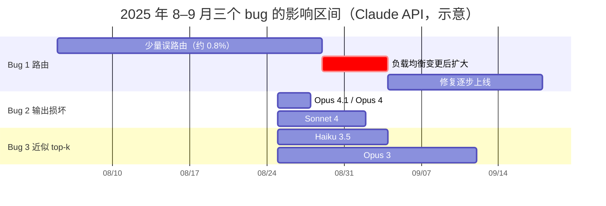
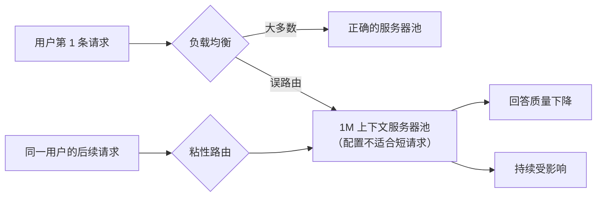
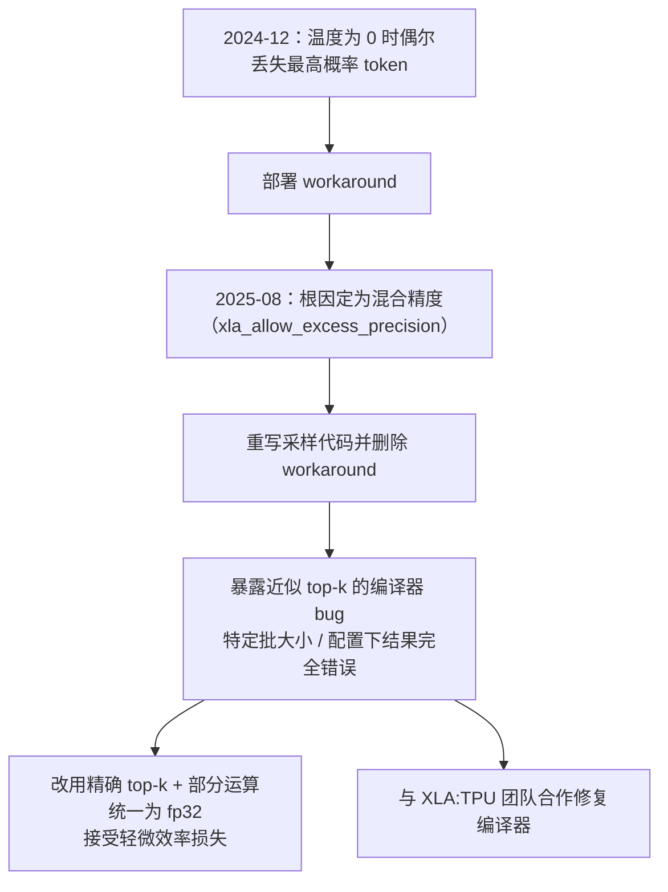
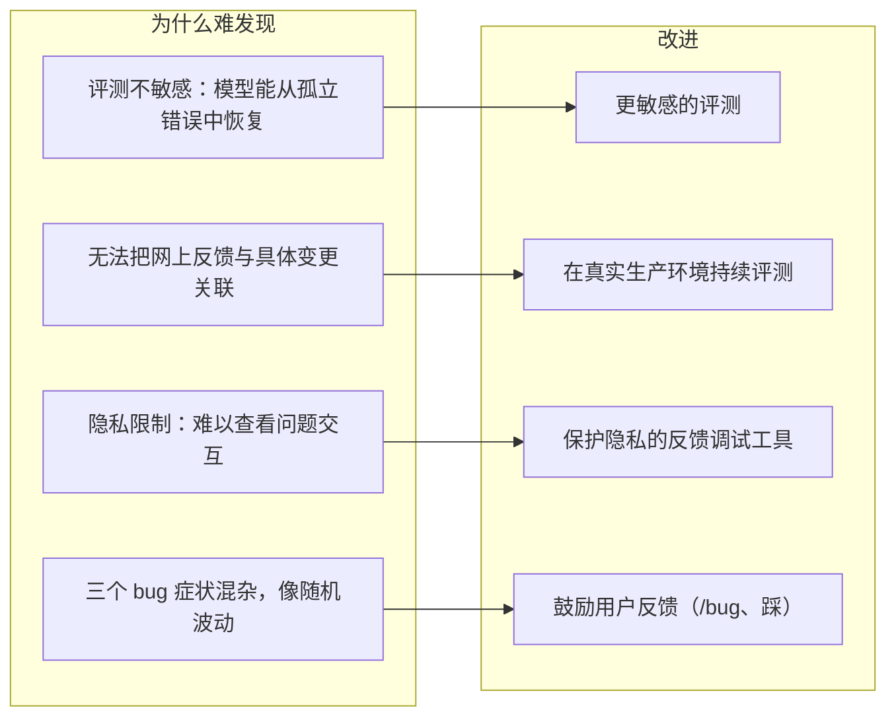

## 一句话总结

模型本身没变，变的是周围的基础设施——路由、运行时优化、编译器——而且三个 bug 同时发生、互相掩盖；常规评测抓不到，靠的是用户持续反馈才把它们分离出来。

## 为什么重要

- **少见的、面向公众的推理基础设施技术复盘**，涉及多硬件平台部署、采样实现、混合精度等细节。
- **回答了用户最关心的问题**：质量下降是否有意为之？原文明确否认。
- **对任何做 LLM 服务或应用的人都有借鉴**：“粘性路由放大影响”“一个旧的 workaround 掩盖了更深的 bug”“评测不敏感，因为模型能从孤立错误中恢复”。
- **为[第 25 篇](./april-23-postmortem.md)（4 月 23 日复盘）提供了对照。**

## 核心概念（中英对照）

| 中文 | English | 简要解释（笔者概括） |
|---|---|---|
| 事后复盘 | postmortem | 对事故原因、检测、修复和改进的回顾。 |
| 粘性路由 | sticky routing | 一旦被某台服务器处理，后续请求很可能继续由它处理。 |
| 负载均衡 | load balancing | 把请求分配到不同服务器池。 |
| 1M token 上下文窗口 | 1M token context window | 当时即将推出的长上下文配置，需要专门的服务器。 |
| 输出损坏 | output corruption | 给本应罕见的 token 赋予了高概率。 |
| top-p 采样 | top-p (nucleus) sampling | 只在累积概率达到阈值（通常 0.99 或 0.999）的 token 中采样。 |
| top-k（近似 / 精确） | approximate / exact top-k | 找出概率最高的 k 个 token；近似版本更快，但允许低概率端不精确。 |
| XLA:TPU 编译器 | XLA:TPU compiler | 把 XLA 高层优化语言（常由 JAX 编写）编译为 TPU 指令。 |
| 混合精度 | mixed precision (bf16 / fp32) | 模型用 bf16 计算概率，向量处理器原生是 fp32。 |
| 超额精度标志 | `xla_allow_excess_precision` | 允许编译器把部分运算提升为 fp32，默认开启。 |
| 金丝雀部署 | canary deployment | 先部署到一小部分流量。 |
| 分布式排序 | distributed sort | 模型分布在数十颗乃至更多芯片上，排序需要跨芯片协调。 |

## 方法 / 步骤

### 1. 背景：多平台、严格等价

- Claude 通过第一方 API、Amazon Bedrock、Google Cloud Vertex AI 提供服务，部署在 AWS Trainium、NVIDIA GPU、Google TPU 上。
- 各平台需要不同优化，但有严格的等价标准：无论哪个平台处理请求，质量都应相同。因此任何基础设施变更都要在所有平台和配置上仔细验证。
- 8 月初开始有用户报告质量下降，起初很难与正常的反馈波动区分；到 8 月下旬，报告越来越频繁和持久，才启动调查。

### 2. 时间线

```text
8/5   Bug 1：部分 Sonnet 4 请求被误路由到 1M 上下文服务器（约 0.8%）
8/25  Bug 2：TPU 服务器配置错误导致输出损坏
8/25  Bug 3：采样代码改动触发 XLA:TPU 潜在 bug（原文另一处写 8/26 部署了采样代码重写）
8/29  一次常规负载均衡变更让 Bug 1 的影响扩大
8/31  最坏的一小时：16% 的 Sonnet 4 请求受 Bug 1 影响
9/2   回滚 Bug 2
9/4   修复 Bug 1 的路由逻辑；回滚 Haiku 3.5 上的 Bug 3
9/12  回滚 Opus 3 上的 Bug 3
9/16–18 Bug 1 的修复在各平台全部上线
```

### 3. 三个 bug

| | 原因 | 影响 | 修复 |
|---|---|---|---|
| 1. 上下文窗口路由错误 | 部分 Sonnet 4 短上下文请求被路由到为 1M 上下文配置的服务器；8/29 的负载均衡变更使其扩大 | 起初 0.8%，8/31 最坏一小时 16%；这段时间约 30% 的 Claude Code 用户至少有一条消息被误路由；Bedrock 峰值 0.18%；Vertex AI 低于 0.0004%。**粘性路由**让部分用户受影响更严重 | 修正路由逻辑，9/4 部署，第一方和 Vertex 在 9/16、Bedrock 在 9/18 完成 |
| 2. 输出损坏 | TPU 服务器上的一项运行时性能优化配置错误，偶尔给本应罕见的 token 赋予高概率 | 英文提示中出现泰文或中文字符、代码中出现明显语法错误；影响 Opus 4.1 和 Opus 4（8/25–28）、Sonnet 4（8/25–9/2）；第三方平台未受影响 | 9/2 回滚；在部署流程中加入意外字符输出的检测测试 |
| 3. 近似 top-k 编译错误 | 改进 token 选择的代码触发 XLA:TPU 编译器的潜在 bug | 已确认影响 Haiku 3.5，可能影响部分 Sonnet 4 和 Opus 3（仅 Claude API） | 分别回滚 Haiku 3.5 和 Opus 3；Sonnet 4 上无法复现，但出于谨慎也回滚；与 XLA:TPU 团队合作修复编译器；改用增强精度的精确 top-k |

### 4. 深入：XLA 编译器 bug 是怎么回事

1. 生成时先算出每个候选 token 的概率，再从分布中采样；用 top-p 避免无意义的输出。在 TPU 上，模型跨多颗芯片运行，排序需要跨芯片协调。
2. **2024 年 12 月**：发现温度为 0 时 TPU 实现偶尔会丢掉概率最高的 token，于是部署了一个 workaround。
3. **根因是混合精度**：概率以 bf16 计算，但向量处理器原生 fp32，XLA 可以把部分运算提升为 fp32（由 `xla_allow_excess_precision` 控制，默认开启）。本应对“最高概率 token”取得一致的运算运行在不同精度上，结论不一致，最高概率 token 有时就从候选中消失了。原文指出这其实是该标志的预期行为。
4. **8 月**：重写采样代码修复精度问题，并改进对 top-p 阈值附近概率的处理；以为根因已经解决，于是**删掉了 12 月的 workaround**。
5. 结果暴露了更深的 bug：**近似 top-k**（一项性能优化）在某些批大小和模型配置下会返回完全错误的结果——12 月的 workaround 一直在无意中掩盖它。近似算法本来只允许低概率端不精确，这个 bug 却丢掉了最高概率的 token。
6. 这个 bug 的表现极不稳定：取决于前后运行了什么运算、是否开启调试工具；同一个提示这次正常、下次就出错。在 CPU 上运行复现代码结果是正确的。
7. 调查中发现精确 top-k 已经不再有过去那种难以承受的性能代价 → 改用精确 top-k，并把部分运算统一到 fp32；接受轻微的效率损失，因为**模型质量没有商量余地**。原文提示：修正后的实现可能导致 top-p 阈值附近的 token 取舍略有不同，少数情况下用户可能需要重新调整 top-p。

### 5. 为什么发现得这么慢

- 常规验证依赖基准、安全评测、性能指标、抽查和金丝雀部署，但**评测没有抓到用户报告的退化**，部分原因是 Claude 往往能从孤立的错误中恢复过来。
- **隐私实践**限制了工程师访问用户与 Claude 的交互（尤其是没有作为反馈提交的），保护了隐私，但也让工程师难以查看和复现问题交互。
- 每个 bug 在不同平台上以不同频率产生不同症状，混在一起看起来像随机、不一致的退化。
- 更根本的是**过度依赖嘈杂的评测**：知道网上报告在增加，却没有清晰的方式把它们与最近的变更联系起来；8/29 负面报告激增时，没有立即想到那次常规负载均衡变更。

### 6. 改进措施

- **更敏感的评测**：能更可靠地区分正常和损坏的实现。
- **在更多地方做质量评测**：在真实生产系统上持续运行，以发现路由这类错误。
- **更快的调试工具**：在不牺牲用户隐私的前提下更好地调试社区反馈；复用这次开发的专用工具缩短未来的修复时间。
- **用户反馈仍然关键**：Claude Code 中的 `/bug` 命令、Claude 应用中的“踩”按钮；也欢迎开发者和研究者分享他们的评估方法。

## 图解

### 图 1：三个 bug 的重叠时间线



### 图 2：粘性路由如何放大影响



### 图 3：一个 workaround 如何掩盖更深的 bug



### 图 4：检测困难的原因与改进



图解：左边是难发现的四个原因——评测不够敏感、隐私限制让工程师难以查看出问题的交互、三个 bug 症状混杂、网上反馈难以对应到具体变更；右边是逐条对应的改进。

## 关键原话

> "We never reduce model quality due to demand, time of day, or server load."
> —— 我们从不因需求、时段或服务器负载而降低模型质量。

## 实践建议

- [ ] 在真实生产流量上持续运行能区分“正常 / 损坏”的质量评测，而不仅在上线前。
- [ ] 部署流程中加入针对已知症状的检测（例如意外的字符集、明显的语法错误）。
- [ ] 删除旧的 workaround 前，先确认它是否在掩盖别的问题，并单独验证。
- [ ] 注意粘性路由、会话亲和等机制可能放大少数错误的影响。
- [ ] 每次基础设施变更（包括“例行”的负载均衡调整）都要能与质量信号对齐，方便事后关联。
- [ ] 性能优化（近似算法、精度提升）要有与精确实现对比的回归测试。
- [ ] **笔者补充**：作为 API 用户，如果感觉质量异常，记录具体请求时间、模型、平台和样例，通过 `/bug` 或官方渠道反馈，这类具体报告正是定位问题的关键。

## 延伸阅读

**站内笔记**
- 第 25 篇：[4 月 23 日事后复盘](./april-23-postmortem.md)
- 第 13 篇：[基础设施噪声](./infrastructure-noise.md) — 基础设施如何影响评测结果。
- 第 11 篇：[揭秘智能体评测](./demystifying-evals-for-ai-agents.md)
- 第 26 篇：[重新设计源代码控制](./redesigning-source-control.md)

**原文引用的资源**
- [上下文窗口文档（含 1M token）](https://docs.claude.com/en/docs/build-with-claude/context-windows)
- [XLA 架构](https://openxla.org/xla/architecture)
- [JAX 近似 top-k（`approx_max_k`）](https://docs.jax.dev/en/latest/_autosummary/jax.lax.approx_max_k.html)
- [近似 top-k 算法论文](https://arxiv.org/pdf/2206.14286)
- [温度（术语表）](https://docs.claude.com/en/docs/about-claude/glossary#temperature)

---

*本笔记依据 2026-10-17 抓取的在线原文撰写。原文：Anthropic,[《A postmortem of three recent issues》](https://www.anthropic.com/engineering/a-postmortem-of-three-recent-issues)。*
