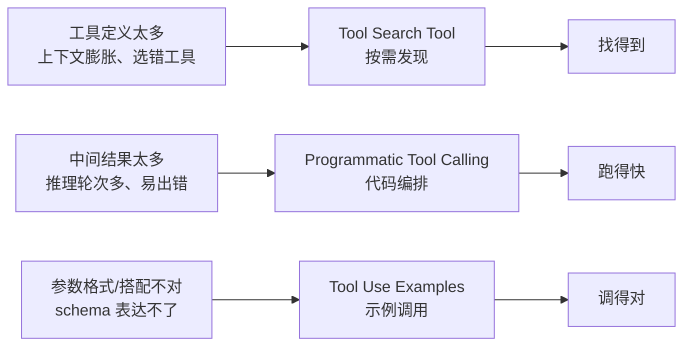
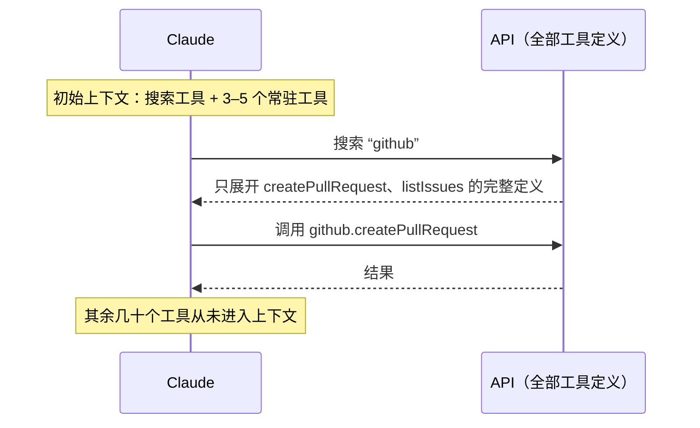
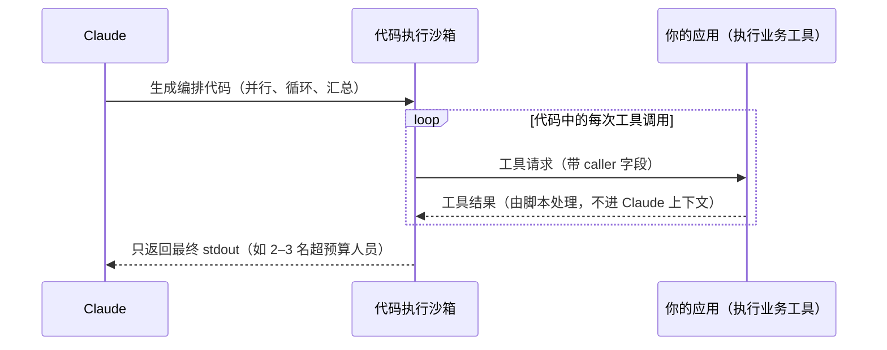

> ℹ️ 原文发表时这三项功能为测试版（beta），API 字段名和版本号以官方文档为准。

## 一句话总结

当智能体面对成百上千个工具时，要解决三个问题：工具怎么找（按需搜索）、怎么高效地调（用代码编排）、怎么调对（给示例）。Anthropic 为此分别提供了三项平台功能。

## 为什么重要

- **它是[第 8 篇](./code-execution-with-mcp.md)《用代码执行调用 MCP》思路的产品化**：按需发现和代码编排都成了 API 原生能力。
- **给出了可以量化的收益**，并且每项功能都写明了“什么时候用、什么时候不必用”。
- **提出“按最大瓶颈逐层叠加”的方法**，避免一上来就堆复杂度，与“简单优先”一脉相承。

## 核心概念（中英对照）

| 中文 | English | 简要解释（笔者概括） |
|---|---|---|
| 工具搜索工具 | Tool Search Tool | 一个专门用来搜索其他工具的工具，按需把匹配的工具定义展开进上下文。 |
| 延迟加载 | defer_loading | 标记为 true 的工具一开始不进上下文，只能被搜索发现。 |
| 程序化工具调用 | Programmatic Tool Calling (PTC) | Claude 写 Python 代码在沙箱中调用多个工具，只有最终输出回到上下文。 |
| 允许的调用方 | allowed_callers | 声明某个工具允许被代码执行环境调用。 |
| 代码执行工具 | Code Execution tool | 平台提供的沙箱化执行环境。 |
| 工具使用示例 | Tool Use Examples (input_examples) | 在工具定义里附上示例调用，展示格式约定和参数搭配。 |
| 推理轮次 | inference pass | 每次传统工具调用都要模型完整推理一轮。 |
| 幂等 | idempotent | 重复执行结果一样，适合安全重试。 |
| 上下文污染 | context pollution | 无关的中间结果挤占上下文。 |

## 方法 / 步骤

### 1. Tool Search Tool：解决“工具定义太多”

**问题**：原文举例，GitHub、Slack、Sentry、Grafana、Splunk 五个服务器共 58 个工具，对话开始前就约占 55K token；再加 Jira 等很快超过 100K；Anthropic 内部见过优化前工具定义占 134K token 的情况。另一个常见失败是名字相近的工具选错、参数填错。

**做法**：
- 把全部工具定义交给 API，但大部分标记 `defer_loading: true`；上下文里一开始只有搜索工具本身和少数常用工具。
- Claude 需要某类能力时先搜索，命中的工具定义才展开进上下文。
- MCP 服务器可以整体延迟加载，同时保留个别高频工具常驻。
- 平台内置基于正则和基于 BM25 的搜索，也可以用嵌入等方式自定义。
- 不会破坏提示缓存：被延迟的工具一开始就不在提示里，系统提示和核心工具定义仍可缓存。

**效果（原文数据）**：示例中开工前的上下文消耗从约 77K 降到约 8.7K token（约减少 85%）；大工具库的 MCP 评测准确率，Opus 4 从 49% 升到 74%，Opus 4.5 从 79.5% 升到 88.1%。

**何时用**：工具定义超过约 10K token、出现选错工具问题、接入多个 MCP 服务器、工具数在 10 个以上。工具少、每次会话都会用到全部工具、定义很短时收益有限（多了一步搜索带来的延迟）。

### 2. Programmatic Tool Calling：解决“中间结果太多、推理轮次太多”

**问题**：例如分析 10MB 日志时整份文件进上下文，而实际只需要错误频率统计；而且每次工具调用都要一轮推理，还要模型“目测”数据再综合，既慢又容易出错。

**做法**（四步）：
1. 在工具列表中加入代码执行工具，并在业务工具上设置 `allowed_callers`，声明允许被代码调用；API 会把这些工具转换成可调用的 Python 函数。
2. Claude 生成一段编排代码（可以并行调用、循环、条件判断、汇总）。
3. 代码运行到需要某个工具时暂停，你会收到带 `caller` 字段的工具请求；你返回的结果交给**脚本**处理，而不是放进 Claude 的上下文。
4. 代码执行完，只有它的输出（stdout）回到 Claude。

**原文例子（概括）**：查“哪些人超出了 Q3 差旅预算”。传统方式需要拉取 20 个人各自几十到上百条报销明细，2,000 多条全部进上下文；PTC 方式下由脚本并行拉取、按职级查预算、求和比较，Claude 只看到超标的两三个人。

**效果（原文数据）**：复杂研究任务平均 token 从 43,588 降到 27,297（减少 37%）；一段代码里编排 20 多次调用，可以省掉 19 次以上的推理轮次；内部知识检索准确率从 25.6% 升到 28.5%，GIA 基准从 46.5% 升到 51.2%。

**何时用**：大数据集只需要聚合或摘要；三个以上相互依赖的工具调用；需要先过滤、排序、转换再给模型看；中间数据不应影响模型推理；对很多对象做并行操作。简单的单次调用、需要模型逐条推理中间结果、返回很小的快速查询则不必用。

### 3. Tool Use Examples：解决“schema 合法但用法不对”

**问题**：JSON Schema 能定义类型、必填项、枚举，但表达不了用法：日期用什么格式、ID 长什么样、嵌套对象什么时候填、可选参数之间怎么搭配。

**做法**：在工具定义中加入 `input_examples`。原文以创建工单工具为例，给了三个示例：信息齐全的紧急缺陷（带联系方式和升级配置）、只有部分字段的功能请求、只有标题的内部任务。模型从中学到日期格式、ID 规则、标签命名风格，以及“什么情况填哪些可选字段”。

**效果（原文数据）**：复杂参数处理的准确率从 72% 提升到 90%。

**何时用**：复杂嵌套结构、可选参数多且如何搭配很重要、领域特有约定、需要用示例区分相似工具。参数单一且用法明显、URL / 邮箱这类模型本来就懂的标准格式、更适合用 schema 约束来校验的情况则不必用。

### 4. 组合使用的最佳实践

- **从最大瓶颈开始**：工具定义膨胀 → Tool Search；中间结果污染 → PTC；参数错误 → Examples。之后再按需叠加，三者互补（找得到、跑得快、调得对）。
- **为搜索写好名称和描述**：搜索是按名称和描述匹配的，描述越具体，越容易被搜到；在系统提示里简要说明有哪些类别的工具可以搜；最常用的三到五个工具保持常驻，其余延迟加载。
- **为 PTC 写清返回格式**：模型要写代码解析返回值，所以要在描述里写明字段和类型；适合开放给代码调用的是可以并行的独立操作、可安全重试的幂等操作。
- **写示例的原则**：使用真实感的数据（不要写 "string"）；覆盖最少字段、部分字段、完整字段三种情况；每个工具 1–5 个；只在 schema 说不清的地方加示例。

## 图解

### 图 1：三项功能分别解决哪个瓶颈

图解：三项功能各对一个瓶颈——工具定义太多造成上下文膨胀和选错工具，中间结果太多造成推理轮次多、易出错，参数格式与搭配则是 schema 表达不了的。

### 图 2：Tool Search Tool 的加载过程

图解：以搜索 “github” 为例，只有命中的 `createPullRequest`、`listIssues` 等工具展开完整定义，其余几十个工具始终不进上下文（示意）。

### 图 3：Programmatic Tool Calling 的请求-响应循环

图解：Claude 在代码执行沙箱里生成编排代码，沙箱逐个向你的应用发起工具请求，中间结果由脚本处理，最后只把 stdout 交回 Claude。

## 关键原话

> "JSON schemas define what's structurally valid, but can't express usage patterns"
> —— JSON Schema 定义的是结构上什么合法，却表达不了用法模式。

## 实践建议

- [ ] 先测量：工具定义占多少 token？选错工具、参数错误、上下文被中间结果占满，哪个问题最突出？
- [ ] 工具定义超过约 10K token 或工具数超过 10 个：启用搜索，常用的三到五个保持常驻。
- [ ] 改写含糊的工具名和描述（例如“执行订单查询”），让搜索能命中。
- [ ] 对“批量拉取再汇总”的任务开放代码调用，并在描述中写清返回结构。
- [ ] 只对有副作用但可以重复执行的工具开放程序化调用；非幂等的写操作要谨慎。
- [ ] 为参数最复杂的两三个工具补 1–5 个真实感示例。
- [ ] **笔者补充**：上线前用同一套评测分别比较“未开启 / 单项开启 / 组合开启”，确认收益确实来自你以为的那项功能。

## 延伸阅读

**站内笔记**
- 第 8 篇：[用代码执行调用 MCP](./code-execution-with-mcp.md)
- 第 3 篇：[为智能体编写高效工具](./writing-tools-for-agents.md)
- 第 2 篇：[上下文工程](./effective-context-engineering-for-ai-agents.md)

**原文引用的资源**
- [Tool Search Tool 文档](https://platform.claude.com/docs/en/agents-and-tools/tool-use/tool-search-tool)
- [Programmatic Tool Calling 文档](https://platform.claude.com/docs/en/agents-and-tools/tool-use/programmatic-tool-calling)
- [Tool Use Examples 文档](https://platform.claude.com/docs/en/agents-and-tools/tool-use/implement-tool-use#providing-tool-use-examples)
- [GIA 基准论文](https://arxiv.org/abs/2311.12983)

---

*本笔记依据 2026-10-17 抓取的在线原文撰写。原文：Anthropic,[《Introducing advanced tool use on the Claude Developer Platform》](https://www.anthropic.com/engineering/advanced-tool-use)。*
