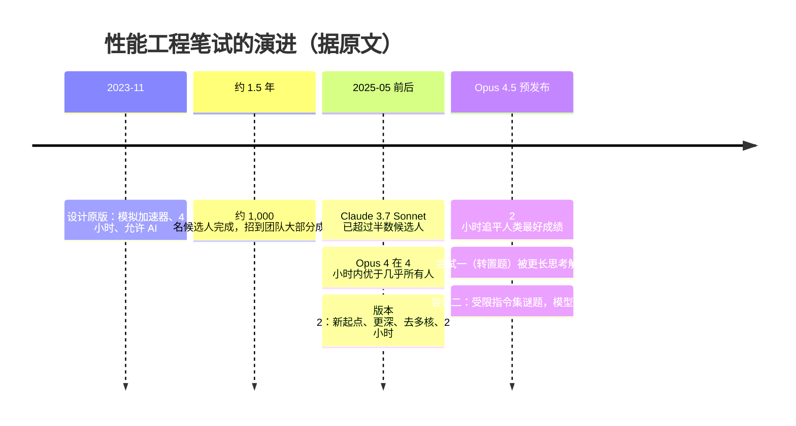
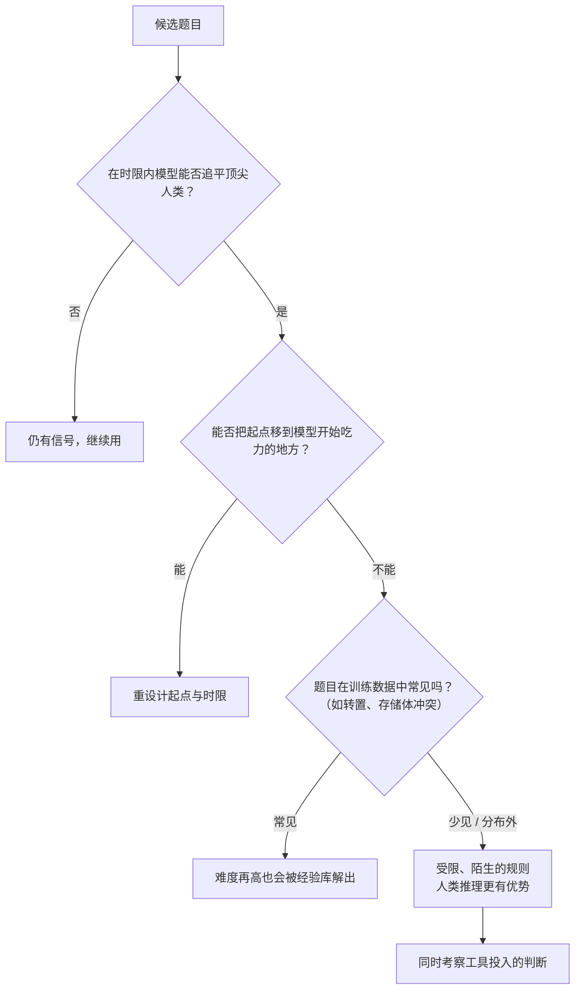

> ℹ️ 注：原文 URL 中的 slug 带大写字母（`AI-resistant-technical-evaluations`），本站按规范统一为小写。

## 一句话总结

当模型在限定时间内的表现追上最优秀的候选人时，“允许使用 AI”的笔试必须换一种思路：考人类在**陌生问题**上的推理能力，而不是模型见过大量训练数据的常规难题。

## 为什么重要

- **把“评测”思维迁移到“评估人”**：评测饱和、模型绕过评测这些问题，在招聘场景中同样存在。
- **对“抗 AI”的一个深刻观察**：难不等于抗 AI；模型的优势来自庞大的经验库，所以需要的是“分布外”的问题。
- **呈现了一条随模型代际演进的真实时间线**，可以感受到能力增长的速度。
- 也是一个很好的笔试 / 面试设计案例（高信号、无需特定领域知识、有趣）。

## 核心概念（中英对照）

| 中文 | English | 简要解释（笔者概括） |
|---|---|---|
| 家庭作业式笔试 | take-home test | 候选人在自己的环境中限时完成的题目。 |
| 抗 AI | AI-resistant | 在允许使用 AI 的前提下仍能区分候选人能力。 |
| 信号 | signal | 测试结果能区分不同能力水平的程度。 |
| 模拟加速器 | simulated accelerator | 作者用 Python 写的、类似 TPU 的虚拟机器。 |
| 草稿存储器 | scratchpad memory | 需要手动管理的片上内存。 |
| 超长指令字 | VLIW | 每个周期多个执行单元并行，需要高效打包指令。 |
| 单指令多数据 | SIMD | 一条指令处理多个元素的向量运算。 |
| 存储体冲突 | bank conflict | 多个访问落到同一存储体导致的性能问题。 |
| 测试时计算 | test-time compute | 推理阶段投入更多计算（更长时间、更多思考）以提升结果。 |
| 分布外 | out of distribution | 与训练数据差别很大的问题。 |
| 时钟周期数 | cycle count | 笔试的评分指标，越少越好。 |

## 方法 / 步骤

### 1. 原版笔试的设计（2023 年底）

**背景**：为 Claude 3 Opus 的训练与发布扩充性能工程师，候选人多到常规面试流程处理不过来。作者花了两周设计一份笔试。

**形式上的优势**：
- 更长的时间窗（最初 4 小时，后来改为 2 小时），更接近真实工作节奏；
- 真实环境：没人盯着，使用自己的编辑器；
- 有时间理解现有系统、编写调试工具；
- **明确允许使用 AI**：问题够长，AI 难以完整解决，候选人仍要展示自己的能力。

**通用设计原则**：贴近真实工作；高信号（不依赖单一灵感，给候选人多次展示的机会，分数分布宽，深度足够，强者也做不完）；不需要特定领域知识；有趣（快速的开发反馈、有深度、有创造空间）。

**题目**：在一个类 TPU 的 Python 模拟器上优化代码，配有可热重载的指令追踪视图。机器特性包括手动管理的草稿存储器、VLIW、SIMD、多核。任务是并行树遍历（刻意不带深度学习色彩），从完全串行的实现出发，逐步利用并行性；原版还埋了一个需要先调试的 bug。

**效果**：一年半里约 1,000 名候选人完成，帮助招到了团队大部分成员；尤其适合简历经历有限的人（几位表现最好的工程师本科毕业就直接加入）。很多人因为觉得有趣而超时做下去。

### 2. 三次被模型击败与重设计

| 阶段 | 发生了什么 | 应对 |
|---|---|---|
| Claude 3.7 Sonnet（2025-05 前） | 已有超过一半候选人还不如把题完全交给 Claude Code | — |
| Claude Opus 4（预发布版） | 4 小时内的结果优于几乎所有人类 | **版本 2**：用 Opus 4 找出它开始吃力的位置作为新起点；重写更干净的初始代码；增加机器特性以加深深度；去掉模型已经解决、只会拖慢反馈的多核部分；时限缩短到 2 小时（4 小时的排期开销导致流程拖延数周）；更强调巧妙的优化洞察，而不是调试和代码量 |
| Claude Opus 4.5（预发布版） | 不到 1 小时达到及格线；之后以为遇到内存带宽瓶颈而停下（大多数人也会这么想）；被告知可达到的周期数后找到利用题目结构的技巧；2 小时时追平该时限内的人类最好成绩，并且在测试时计算 harness 中可以继续提升 | 需要全新的题目 |

### 3. 考虑过的选项

- **禁止 AI**：作者不愿意这么做——除了难以执行，他认为人在有 AI 的环境中仍应有办法脱颖而出，就像真实工作那样。
- **把标准提高到“大幅超过 Claude Code 单独做的结果”**：担心人类读题就要花一半时间，而 Claude 很快，人只能跟在后面理解它做了什么，最优策略可能变成旁观。
- 现在的真实工作更多是棘手的调试、系统设计、性能分析、验证正确性、让 Claude 的代码更简洁——这些都很难在短时间内客观测试。

### 4. 尝试一：换一道更难的优化题（失败）

选了作者在工作中做过的一个棘手内核优化（在二维寄存器上高效转置数据、避免存储体冲突），简化后由 Claude 在一天内实现进模拟器。Opus 4.5 想出了作者都没想到的思路：不转置数据，而是转置整个计算。作者修补题目排除这条路后，模型起初找不到最优解，但用更长的思考预算再试一次——解出来了，还知道修复存储体冲突的技巧。

**教训**：这类问题在很多平台上都有工程师反复钻研过，训练数据很多；作者是从第一性原理得出解法的，但模型可以调用更大的经验库。

### 5. 尝试二：走得更“怪”（成功）

- 需要**足够分布外**的问题，这与“像真实工作”的目标冲突。
- 灵感来自 Zachtronics 系列编程解谜游戏：指令集极小、限制极严，迫使人用非常规方式编程。
- 新笔试是一组谜题：使用一个很小、限制很多的指令集，以最少指令数为优化目标。作者做了一道中等难度题测试 Opus 4.5——失败；补齐更多谜题，并请同事确认不如作者熟悉问题的人也能超过 Claude。
- 刻意**不提供可视化或调试工具**，只检查解法是否有效。要不要投入、怎样投入工具（写精心设计的打印语句，或者让编码模型几分钟生成一个交互式调试器）本身就是考察内容。
- 早期结果：由更多相互独立的子问题组成，方差可能更低；分数与候选人过往工作水平相关性良好。

### 6. 开放挑战

原版笔试已在 GitHub 公开，不限时间。原文称：时间足够长时，人类专家仍领先当前模型，人类提交过的最快解法明显优于 Claude 即使投入大量测试时计算后的结果。原文给出的参考周期数（越低越好）摘录：Opus 4 在 harness 中跑数小时为 2164；Opus 4.5 在普通 Claude Code 会话中为 1790（约等于人类 2 小时内的最好成绩）；Opus 4.5 在 harness 中 2 小时为 1579、11.5 小时为 1487；在改进后的 harness 中跑数小时为 1363。

## 图解

### 图 1：笔试与模型能力的“军备竞赛”时间线

### 图 2：什么样的题目对 AI 更有抵抗力

## 关键原话

> "The original worked because it resembled real work. The replacement works because it simulates novel work."
> —— 原版有效，是因为它像真实工作；替代版有效，是因为它模拟了全新的工作。

## 实践建议

- [ ] 每次有新模型发布，就用它把自己的笔试 / 面试题完整做一遍。
- [ ] 题目要有足够深度和宽的分数分布，避免“一个灵感定胜负”。
- [ ] 想让题目抗 AI，先问“这类问题在网上有多少现成讨论”，常见的优化 / 算法套路很难抗住。
- [ ] 考虑使用规则全新、自洽的小型环境（受限指令集、自定义规则），考察从零推理的能力。
- [ ] 把“是否以及如何构建调试工具”纳入考察，而不是把工具都准备好。
- [ ] 新题上线前，请不熟悉题目的同事试做，确认人类在时限内可以超过模型。
- [ ] **笔者补充**：保留历届题目在新模型上的表现记录，它本身就是一份很直观的能力演进曲线。

## 延伸阅读

**站内笔记**
- 第 11 篇：[揭秘智能体评测](./demystifying-evals-for-ai-agents.md) — 饱和与“爬山”的概念。
- 第 14 篇：[BrowseComp 中的评测察觉](./eval-awareness-browsecomp.md)
- 第 4 篇：[Claude Code 最佳实践](./claude-code-best-practices.md)

**原文引用的资源**
- 原版笔试（开放挑战）：<https://github.com/anthropics/original_performance_takehome>

---

*本笔记依据 2026-10-17 抓取的在线原文撰写。原文：Anthropic,《Designing AI-resistant technical evaluations》, <https://www.anthropic.com/engineering/AI-resistant-technical-evaluations>。*
