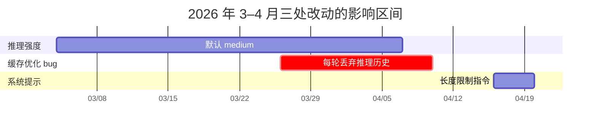
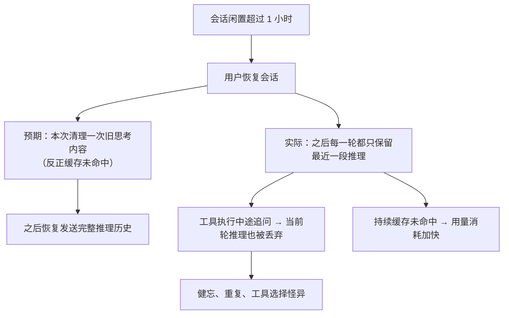
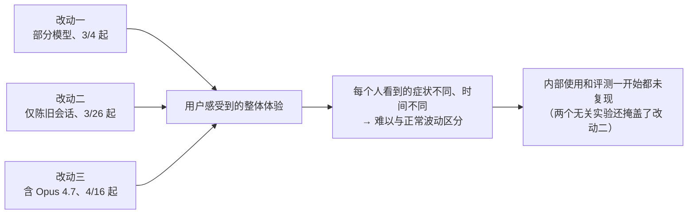
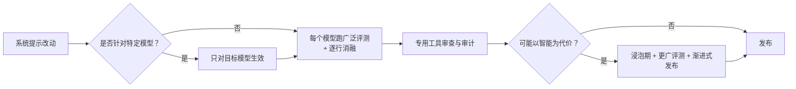

## 一句话总结

模型权重和推理层都没动，质量问题来自 harness 层的三个“看起来合理”的改动；它们各自影响不同的流量切片和时间段，叠在一起就像一次广泛而不一致的退化，内部评测和日常使用一开始都没能复现。

## 为什么重要

- **与第 24 篇形成对照**：上次是推理基础设施的 bug，这次是产品 / harness 层的改动——说明“同一个模型”的体验同样取决于外面那层。
- **三个非常具体的教训**：默认值的选择本身就是产品决策；与缓存、上下文管理、扩展思考交叉的 bug 很难被常规测试发现；一行系统提示就能明显影响智能。
- **展示了排查方法**：用更广的评测集做系统提示消融、用新模型回测代码审查。

## 核心概念（中英对照）

| 中文 | English | 简要解释（笔者概括） |
|---|---|---|
| 推理强度 | reasoning effort | 思考多少与延迟、用量之间的取舍；作为 effort 参数发给 Messages API，用户可以用 `/effort` 调整。 |
| 测试时计算曲线 | test-time-compute curve | 推理计算量与输出质量之间的关系曲线。 |
| 提示缓存 | prompt caching | 缓存输入 token，让连续的 API 调用更便宜、更快；闲置一段时间后被驱逐。 |
| 缓存未命中 | cache miss | 请求无法复用缓存，需要按未缓存 token 计费和处理。 |
| 清理思考内容 | clearing thinking (`clear_thinking_20251015`, `keep:1`) | 通过 API 头部只保留最近一段推理块。 |
| 扩展思考 | extended thinking | 模型在回答前的推理内容，通常保留在对话历史中。 |
| 冗长度 | verbosity | 输出的长度和啰嗦程度。 |
| 消融实验 | ablation | 逐行移除系统提示，观察每一行的影响。 |
| 浸泡期 | soak period | 改动上线后观察一段时间再扩大范围。 |
| 渐进式发布 | gradual rollout | 分阶段扩大受影响的用户范围。 |
| 内部试用 | dogfooding | 公司内部自己使用产品。 |

## 方法 / 步骤

### 1. 总览

| 改动 | 上线 | 修复 / 回滚 | 影响的模型 | 用户感受 |
|---|---|---|---|---|
| 默认推理强度 high → medium | 3 月 4 日 | 4 月 7 日回滚 | Sonnet 4.6、Opus 4.6 | 变笨了 |
| 闲置会话清理旧思考内容的 bug | 3 月 26 日 | 4 月 10 日修复（v2.1.101） | Sonnet 4.6、Opus 4.6 | 健忘、重复、工具选择怪异；用量消耗得更快 |
| 降低冗长度的系统提示 | 4 月 16 日 | 4 月 20 日回滚 | Sonnet 4.6、Opus 4.6、Opus 4.7 | 编码质量下降 |

- API 和推理层不受影响，原文表示可以立即确认这一点。
- 3 月初就开始调查，但起初难以与正常的反馈波动区分，内部使用和评测也没能复现。
- 4 月 23 日为所有订阅用户重置用量额度。

### 2. 改动一：默认推理强度

- 2 月 Opus 4.6 上线 Claude Code 时，默认强度为 high；随后有反馈说 high 模式偶尔思考太久，界面像卡住，延迟和 token 用量过大。
- 一般来说思考越久输出越好；强度级别就是让用户选择这个取舍。产品层在测试时计算曲线上选一个点作为默认值。
- 内部评测显示，对大多数任务，medium 智能略低但延迟显著降低，也没有偶发的超长尾延迟，还能让用量额度更耐用 → 改为默认 medium，并在产品内弹窗说明。
- 用户很快反馈 Claude Code 变笨了。尽管做了多次设计迭代提醒用户可以修改（启动提示、内联强度选择器、恢复 ultrathink），大多数用户仍停留在默认值。
- **原文承认这是错误的取舍**。4 月 7 日回滚：现在 Opus 4.7 默认 xhigh，其他模型默认 high。

### 3. 改动二：丢弃推理历史的缓存优化

- 正常情况下，推理内容保留在对话历史中，让 Claude 在后续每一轮都知道自己为什么做了那些编辑和工具调用。
- 设计意图：会话闲置超过一小时后，反正会缓存未命中，不如清掉旧的思考段，减少发给 API 的未缓存 token，降低恢复会话的成本；之后恢复发送完整推理历史。
- **bug**：不是清理一次，而是在之后的每一轮都清理——会话一旦越过闲置阈值，此后该进程的每个请求都告诉 API 只保留最近一段推理。更糟的是，如果在 Claude 执行工具的过程中发送追问，就开启了新的一轮，连当前轮的推理也会被丢掉。Claude 继续执行，却越来越不记得自己为什么这么做。
- 由于不断丢弃思考块，这些请求还持续缓存未命中——原文认为这就是“用量额度消耗得比预期快”的原因。
- **为什么难以复现**：两个不相关的实验（一个仅限内部的消息排队服务端实验，以及一个改变思考内容显示方式的改动）在大多数 CLI 会话中压住了这个 bug，即使测试外部构建也没发现。
- 这个 bug 处在 Claude Code 上下文管理、Anthropic API 与扩展思考的交叉点，通过了多轮人工和自动代码审查、单元测试、端到端测试、自动验证和内部试用；又只出现在“陈旧会话”这种边缘情况，花了一周多才确认根因。
- **回测**：用 Opus 4.7 对引入问题的 PR 跑 Code Review，在提供收集完整上下文所需的代码仓库时，Opus 4.7 找到了这个 bug，Opus 4.6 没有 → 现在正在为代码审查加入更多仓库作为上下文。

### 4. 改动三：降低冗长度的系统提示

- Opus 4.7 比前代明显更冗长：在难题上更聪明，但输出 token 更多。发布前几周开始为它调优 Claude Code。
- 降低冗长度的手段包括模型训练、提示、改进思考内容的产品体验，最终都用了；但系统提示中加入的一条**长度限制**（要求工具调用之间的文字和最终回答都控制在很短的字数以内，除非任务需要更多细节）对 Claude Code 的智能产生了超出预期的影响。
- 内部测试了几周、所跑的评测集都没有退化，于是 4 月 16 日随 Opus 4.7 上线。
- 调查中用**更广的评测集做消融**，其中一项评测显示 Opus 4.6 和 4.7 都下降了 3%，4 月 20 日立即回滚。

### 5. 之后的改进

- 让更大比例的内部员工使用**与公开版完全相同的构建**，而不是测试新功能用的内部版。
- 改进内部的 Code Review 工具，并向客户发布改进版。
- **更严格地管控系统提示改动**：每次改动都对每个模型跑广泛的评测；持续做逐行消融；新建工具让提示改动更容易审查和审计；在 CLAUDE.md 中加入指引，确保针对特定模型的改动只作用于该模型。
- 对任何可能以智能为代价的改动：加浸泡期、更广的评测集、渐进式发布。
- 新开 X 账号 @ClaudeDevs 解释产品决策，并在 GitHub 上用集中的帖子同步更新。
- 感谢使用 `/feedback` 或在网上发布具体、可复现示例的用户——正是这些反馈帮助定位了问题。

## 图解

### 图 1：三个改动的时间线

### 图 2：思考内容清理 bug：预期 vs 实际

### 图 3：为什么叠加起来像“广泛而不一致的退化”

### 图 4：系统提示改动的新流程

## 关键原话

> "We never intentionally degrade our models, and we were able to immediately confirm that our API and inference layer were unaffected."
> —— 我们从不故意降低模型质量，并且能够立即确认 API 和推理层没有受到影响。

## 实践建议

- [ ] 如果觉得 Claude Code “变笨了”，先检查当前的推理强度（`/effort`），复杂任务用更高强度。
- [ ] 长时间闲置后恢复的会话出现健忘或重复时，考虑新开会话，并通过 `/feedback` 附上具体示例反馈。
- [ ] 自己搭 harness 时，修改默认值要当作产品决策，评估的不只是平均延迟和平均智能，还有用户是否会去改默认值。
- [ ] 任何裁剪上下文（尤其是推理历史）的优化，都要有专门测试覆盖“只执行一次”的语义和中途插话等边缘情况。
- [ ] 改系统提示时做逐行消融，用比平时更广的评测集；看似无害的长度限制也可能损害智能。
- [ ] 内部团队要使用与用户完全相同的构建。
- [ ] 代码审查工具要能获取跨仓库的完整上下文。
- [ ] **笔者补充**：缓存命中率异常下降可以作为质量问题的早期信号，值得纳入监控。

## 延伸阅读

**站内笔记**
- 第 24 篇：[近期三个问题的事后复盘](./a-postmortem-of-three-recent-issues.md) — 基础设施层的对照。
- 第 4 篇：[Claude Code 最佳实践](./claude-code-best-practices.md) — 推理强度、上下文管理。
- 第 6 篇：[think 工具](./claude-think-tool.md) — 扩展思考相关。
- 第 2 篇：[上下文工程](./effective-context-engineering-for-ai-agents.md)
- 第 13 篇：[基础设施噪声](./infrastructure-noise.md)

**原文引用的资源**
- Claude Code Code Review 文档：<https://code.claude.com/docs/en/code-review>
- 提示缓存经验（Claude 博客）：<https://claude.com/blog/lessons-from-building-claude-code-prompt-caching-is-everything>
- Claude Opus 4.7 发布说明：<https://www.anthropic.com/news/claude-opus-4-7>

---

*本笔记依据 2026-10-17 抓取的在线原文撰写。原文：Anthropic,《An update on recent Claude Code quality reports》, <https://www.anthropic.com/engineering/april-23-postmortem>。*
