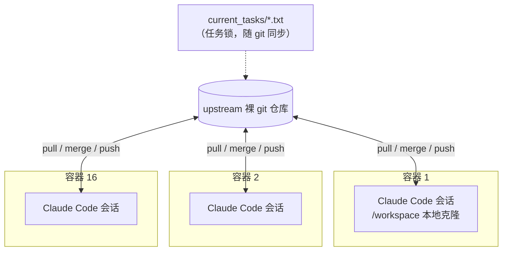
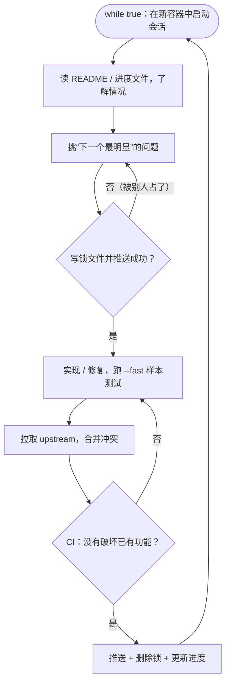
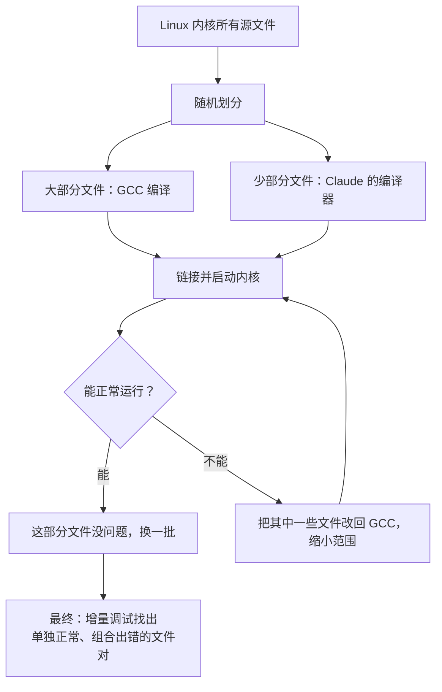

## 一句话总结

让很多个 Claude 在无限循环里并行地对同一个仓库干活，真正的功夫不在编排，而在**环境**：测试要近乎完美、输出要照顾模型的弱点、任务要能被拆开并行，否则 16 个智能体只会撞在同一个 bug 上。

## 为什么重要

- **一个极限压力测试**：作者把它当作能力基准，跨 Claude 4 系列反复运行，观察“今天的模型勉强能做到什么”。
- **非常具体的 harness 经验**：基于文件锁的任务认领、面向 LLM 的测试输出设计、用已知正确的编译器作为预言机来打开并行。
- **坦率记录局限和不安**：测试通过不等于真的完成；自主开发存在真实风险。
- **与第 17、18 篇互补**：那两篇是“一个智能体跨多个会话”，本文是“多个智能体同时并行”。

## 核心概念（中英对照）

| 中文 | English | 简要解释（笔者概括） |
|---|---|---|
| 智能体团队 | agent teams | 多个 Claude 实例在共享代码库上并行工作，无需人类主动干预。 |
| 循环 harness | loop harness (cf. Ralph-loop) | 用一个 `while true` 循环不断启动新的 Claude Code 会话。 |
| 任务锁 | task lock (`current_tasks/`) | 智能体通过写一个文本文件认领任务；git 同步迫使冲突方换任务。 |
| 编排智能体 | orchestration agent | 本文**没有**使用；每个智能体自己决定做什么。 |
| 任务验证器 | task verifier | 判断任务是否完成的测试；必须近乎完美，否则模型会去解错误的问题。 |
| 上下文污染 | context window pollution | 测试输出过多无用字节，挤占上下文。 |
| 时间盲 | time blindness | 模型感知不到时间，可能花几个小时跑测试而没有进展。 |
| 已知正确的预言机 | known-good oracle (GCC) | 用 GCC 编译大部分文件，只把一部分交给待测编译器，从而定位问题。 |
| 增量调试 | delta debugging | 找出“单独没问题、放在一起才失败”的文件组合。 |
| 静态单赋值中间表示 | SSA IR | 作者唯一明确指定的设计点，用来支持多轮优化。 |
| 净室实现 | clean-room implementation | 开发过程中 Claude 无法联网，只依赖 Rust 标准库。 |

## 方法 / 步骤

### 1. 让 Claude 长时间自主运行

- Claude Code 这类脚手架默认需要人在场：任务一长，模型做到一部分就会停下来等输入。
- 作者的 harness 把 Claude 放进一个**无限循环**：每次以提示文件启动一个新会话，日志按当前 commit 命名；做完一个任务立刻拿下一个。原文特别提醒要在容器里运行，不要在自己的机器上运行（因为跳过了权限确认）。
- 提示要求：把问题拆小、记录正在做什么、决定下一步，一直做到完美。原文提到一次意外：Claude 误执行了杀掉 bash 的命令，把自己连同循环一起结束了。

### 2. 并行化的极简实现

- 一个裸 git 仓库作为 upstream；每个智能体一个 Docker 容器，挂载 upstream、克隆到本地工作区，完成后推回去。
- **同步算法**：
  1. 在 `current_tasks/` 下写一个文件来“锁定”任务；两个智能体抢同一任务时，git 同步会让后来者改选其他任务。
  2. 完成任务 → 拉取 upstream → 合并他人改动 → 推送 → 删除锁。合并冲突很频繁，但 Claude 能处理。
  3. 循环在新容器中启动新会话，周而复始。
- 没有智能体间的其他通信，没有高层目标管理流程，也没有编排智能体；Claude 通常会挑“下一个最明显”的问题，卡住时会维护一份失败方法与剩余任务的文档。

### 3. 经验一：写极高质量的测试

- Claude 会自主解决你给它的问题，所以**验证器必须近乎完美**，否则它会解决错误的问题。
- 工作包括：寻找高质量编译器测试集、为开源软件包写验证器和构建脚本、观察 Claude 犯的错并据此设计新测试。
- 项目后期 Claude 经常在加新功能时破坏旧功能，于是加了 CI 流水线和更严格的约束：新提交不能破坏已有代码。

### 4. 经验二：站在 Claude 的角度

- 每个智能体都在全新容器中、没有任何上下文地开始，定位情况要花很多时间 → 要求维护详尽的 README 和频繁更新的进度文件。
- 针对模型的固有局限设计测试输出：

| 局限 | 对策 |
|---|---|
| 上下文污染 | 只打印几行，重要信息写入日志文件；错误行以 `ERROR` 开头并把原因写在同一行，方便 grep；预先算好汇总统计 |
| 时间盲 | 低频打印进度；默认提供 `--fast` 选项，只跑 1% 或 10% 的随机样本——对每个智能体是确定的，不同虚拟机之间随机，因此整体仍覆盖全部文件，而每个智能体都能准确发现回归 |

### 5. 经验三：让并行变得容易

- 失败测试很多且彼此独立时，并行是平凡的：每个智能体挑不同的失败测试。测试集通过率达到 99% 后，改为每个智能体负责让一个不同的开源项目编译通过（SQLite、Redis、libjpeg、MQuickJS、Lua 等）。
- **编译 Linux 内核时卡住了**：内核是一个巨大的单一任务，所有智能体撞上同一个 bug、各自修复、再互相覆盖，16 个智能体等于没用。
- **解法：以 GCC 为已知正确的预言机**。随机让 GCC 编译内核的大部分文件，只让 Claude 的编译器编译剩下的部分：内核能运行，说明问题不在这部分文件；不能运行，就把其中一些再交给 GCC，逐步缩小范围。这样每个智能体可以在不同文件上修不同的 bug。之后还需要用增量调试找出“单独没问题、合在一起出错”的文件对。

### 6. 经验四：多种角色

- LLM 写的代码经常重复实现已有功能 → 一个智能体专门合并重复代码。
- 其他角色：提升编译器自身性能；提升生成代码的效率；以 Rust 开发者视角批评设计并做结构性改进；维护文档。

### 7. 结果与局限（Opus 4.6）

- 以往的 Opus 4 模型勉强能写出能用的编译器；Opus 4.5 首次能通过大型测试集，但仍编译不了真正的大项目。
- Opus 4.6：近 2000 个会话、两周、约 20 亿输入 token 和 1.4 亿输出 token，总成本略低于 2 万美元。作者认为这比任何 Max 订阅都贵得多，但只是他自己（更别说一个团队）完成同样工作的成本的一小部分。
- 产物：10 万行、只依赖 Rust 标准库；能构建可启动的 Linux 6.9（x86、ARM、RISC-V），还能编译 QEMU、FFmpeg、SQLite、PostgreSQL、Redis；在包括 GCC torture 测试集在内的大多数编译器测试集上通过率约 99%；能编译并运行 Doom。
- 局限：

| 局限 | 说明 |
|---|---|
| 16 位 x86 | 从实模式启动 Linux 所需的 16 位代码生成没做出来（产物超过 60KB，远超 Linux 的 32KB 限制），这一阶段调用 GCC；ARM、RISC-V 可以完全自举 |
| 汇编器与链接器 | 是最后才开始做的部分，仍有 bug；演示视频使用的是 GCC 的汇编器和链接器 |
| 兼容性 | 能编译很多项目但不是全部，还不能直接替代真正的编译器 |
| 生成代码效率 | 开满优化也不如关闭所有优化的 GCC |
| 代码质量 | Rust 代码尚可，但远不及专家水平 |

- 作者认为这已接近 Opus 能力的极限：多次尝试修复上述问题都没完全成功，新功能和修复经常破坏已有功能。

### 8. 展望与不安

- 产品形态的演进：IDE 补全 → 根据文档字符串补全函数 → Claude Code 结对编程；这些都假设“用户定义任务、模型跑几秒到几分钟、用户再跟进”。智能体团队展示了自主完成整个复杂项目的可能。
- 风险：人在场时可以实时把控质量；自主系统很容易“看到测试通过就以为完成了”，而事实很少如此。作者曾从事渗透测试，对“部署自己从未亲自验证过的软件”深感担忧。

## 图解

### 图 1：并行智能体团队的结构

### 图 2：单个智能体的工作循环

图解：每个智能体在新容器里循环——读进度、挑问题、写锁文件认领任务（推送失败说明已被别人占用），实现后跑 `--fast` 样本测试，合并 upstream、过 CI，再推送、删锁、更新进度。

### 图 3：用 GCC 作为预言机拆分内核编译

## 关键原话

> "it's important that the task verifier is nearly perfect, otherwise Claude will solve the wrong problem."
> —— 任务验证器必须近乎完美，否则 Claude 会去解决错误的问题。

> "it is easy to see tests pass and assume the job is done, when this is rarely the case."
> —— 看到测试通过就以为完成了，这很容易，但事实很少如此。

## 实践建议

- [ ] 跳过权限确认的自主循环只在隔离容器中运行。
- [ ] 投入最多精力的地方是测试和反馈环境，而不是编排逻辑。
- [ ] 测试输出要短：细节写入日志，错误行统一前缀，汇总统计预先算好。
- [ ] 提供确定性抽样的快速测试模式，防止模型把时间耗在全量测试上。
- [ ] 用文件锁 + git 同步做最简单的任务认领，先不要上复杂的编排。
- [ ] 遇到“所有智能体卡在同一个大任务上”，寻找已知正确的参照实现，把大任务拆成可并行的小块。
- [ ] 加 CI，禁止新提交破坏已有功能。
- [ ] 安排专门角色：去重、性能、文档、代码质量审查。
- [ ] **笔者补充**：对自主生成的代码，上线前仍要有人亲自验证关键路径——原作者本人也对此表示担忧。

## 延伸阅读

**站内笔记**
- 第 17 篇：[长时运行智能体的有效 harness](./effective-harnesses-for-long-running-agents.md)
- 第 18 篇：[长时应用开发的 harness 设计](./harness-design-long-running-apps.md)
- 第 16 篇：[多智能体研究系统](./multi-agent-research-system.md) — 有编排者的多智能体架构，可与本文的“无编排者”对比。
- 第 21 篇：[Claude Code 沙箱](./claude-code-sandboxing.md) — 自主运行时的隔离。
- 第 15 篇：[抗 AI 的技术评估](./ai-resistant-technical-evaluations.md) — 同样以“推到极限”观察模型能力。

**原文引用的资源**
- [编译器源码](https://github.com/anthropics/claudes-c-compiler)
- [GCC torture 测试集](https://gcc.gnu.org/onlinedocs/gccint/Torture-Tests.html)

---

*本笔记依据 2026-10-17 抓取的在线原文撰写。原文：Anthropic,[《Building a C compiler with a team of parallel Claudes》](https://www.anthropic.com/engineering/building-c-compiler)。*
