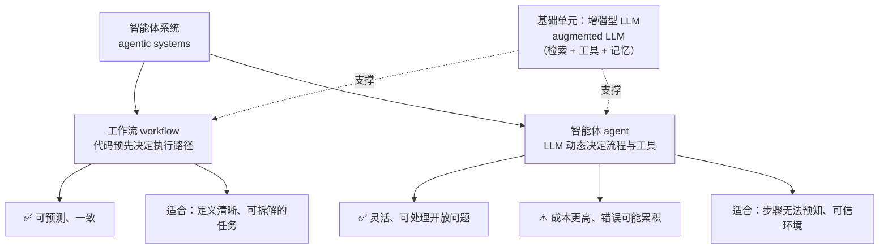
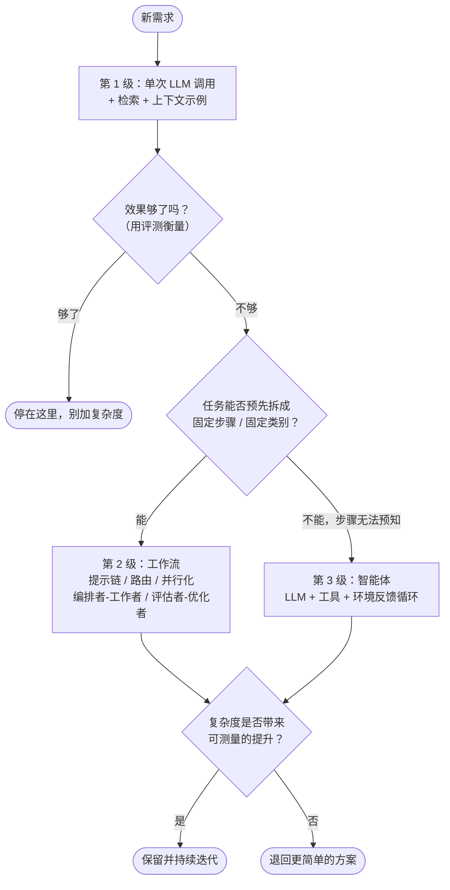
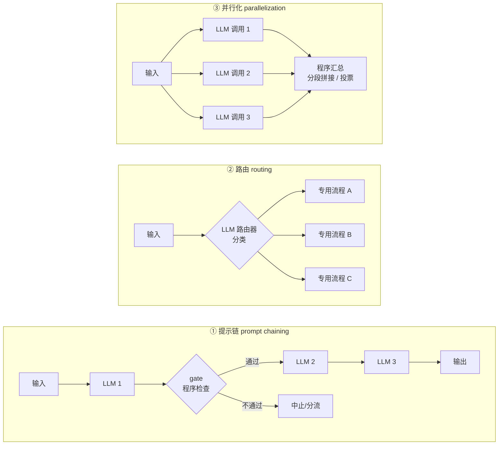
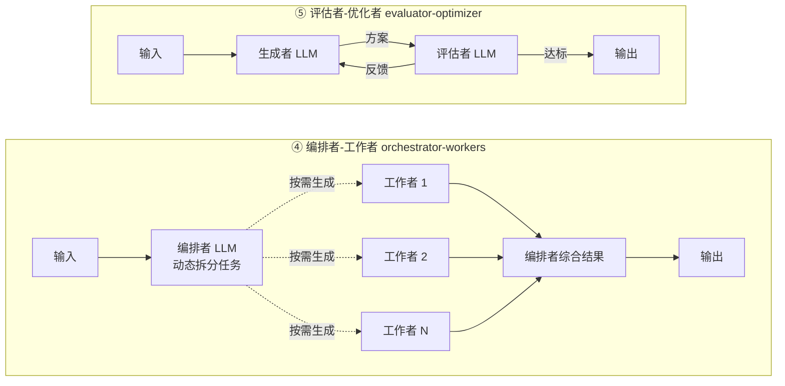
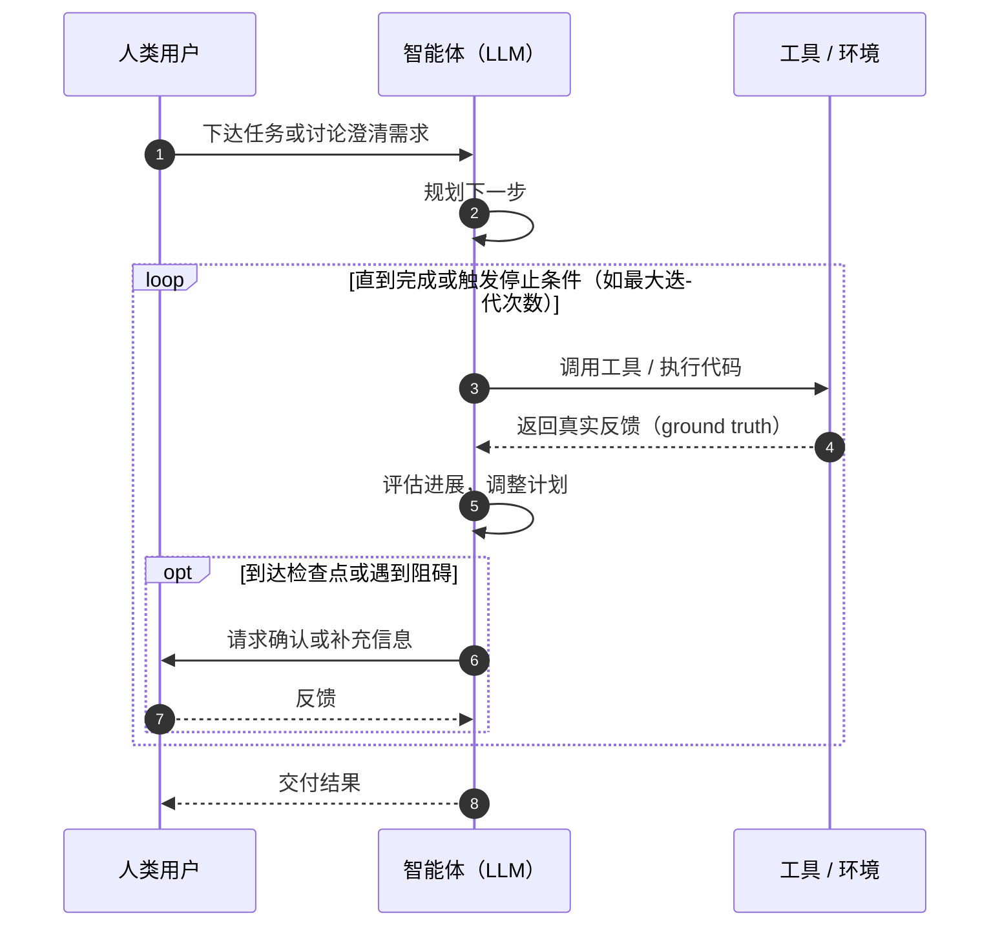

## 一句话总结

做 LLM 应用别一上来就搞复杂智能体：先把单次调用做好，必要时用固定编排的“工作流”，只有在任务开放、步骤无法预知时才交给“智能体”自主决策，并且每加一层复杂度都要用效果证明它值得。

## 为什么重要

- **它是整个工程博客的“总纲”。** 后来的多智能体研究系统、长时任务 harness、评测、上下文工程等文章，都在沿用这篇定下的术语（工作流 / 智能体 / 增强型 LLM）和“简单优先”的立场。
- **给“智能体”一个可操作的定义。** 业界对 agent 的说法很混乱，这篇用一个架构上的区分把问题讲清楚：*流程由代码决定*还是*由模型决定*。
- **提供了一套可复用的“模式词汇表”。** 提示链、路由、并行化、编排者-工作者、评估者-优化者，几乎能覆盖大部分生产中的 LLM 编排需求，方便团队交流和选型。
- **把工具设计提升到与提示词同等的地位。** 提出“智能体-计算机接口（ACI）”的概念，后续《Writing effective tools for agents》一文正是对此的展开。
- **对框架保持警惕。** 提醒开发者框架的抽象层会掩盖真实的提示和响应，这对调试和成本控制都很关键。

## 核心概念（中英对照）

| 中文 | English | 简要解释（笔者概括） |
|---|---|---|
| 智能体系统 | agentic system | 工作流和智能体的统称，泛指让 LLM 配合工具完成多步任务的系统。 |
| 工作流 | workflow | LLM 与工具按**开发者预先写好的代码路径**被编排执行，可预测、可控。 |
| 智能体 | agent | 由 **LLM 自己动态决定**下一步做什么、用什么工具、何时结束。 |
| 增强型 LLM | augmented LLM | 接入了检索、工具、记忆等能力的 LLM，是所有模式的基础单元。 |
| 提示链 | prompt chaining | 把任务拆成固定的顺序步骤，上一步输出作为下一步输入，中间可插程序检查。 |
| 关卡 / 检查点 | gate | 提示链中间用代码做的校验，不通过就中止或分流。 |
| 路由 | routing | 先给输入分类，再交给专门的下游处理（不同提示、工具或模型）。 |
| 并行化 | parallelization | 多个 LLM 调用同时进行，结果由程序汇总；分“分段”和“投票”两种。 |
| 分段 | sectioning | 把任务切成互相独立的子任务并行处理。 |
| 投票 | voting | 同一任务跑多次，用多样化结果提高置信度。 |
| 编排者-工作者 | orchestrator-workers | 中心 LLM 根据具体输入**动态**拆解任务、分派给工作者 LLM，再综合结果。 |
| 评估者-优化者 | evaluator-optimizer | 一个 LLM 生成，另一个 LLM 评估并给反馈，循环改进。 |
| 环境反馈 / 真实情况 | ground truth (from the environment) | 智能体每一步从工具结果、代码执行等环境中拿到的真实信号，用来判断进展。 |
| 停止条件 | stopping condition | 例如最大迭代次数，用来保证智能体可控。 |
| 智能体-计算机接口 | agent-computer interface (ACI) | 类比人机界面（HCI），指工具的定义、参数、文档对模型是否友好。 |
| 防呆设计 | poka-yoke | 来自制造业的概念：把接口设计得让人（或模型）很难用错。 |

## 方法 / 步骤

### 1. 先回答：要不要做智能体？

原文的立场非常明确：**能简单就简单**。笔者把它整理成一个三级阶梯：

1. **优化单次 LLM 调用**：配合检索和上下文示例，很多应用到这一步就够了。
2. **工作流**：任务定义清晰、步骤可以预先确定时使用，换来可预测性和一致性。
3. **智能体**：任务开放、步骤数量无法预知、需要模型在大规模场景下灵活决策时才使用。

代价要算清楚：智能体系统通常是**用更高的延迟和成本换取更好的任务表现**；自主性还会带来更高成本和**错误累积**的风险。

### 2. 关于框架的态度

- 原文列举了若干框架（Claude Agent SDK、AWS 的 Strands Agents SDK、图形化的 Rivet 与 Vellum），承认它们能简化调用模型、定义解析工具、串联调用等底层工作。
- 但抽象层会**遮住底层的提示与响应**，让调试变难，也容易诱使人加上不必要的复杂度。
- 建议：**先直接用 LLM API**，很多模式几行代码就能实现；如果用框架，务必搞懂它底层做了什么——对底层的错误假设是常见的出错来源。

### 3. 基础单元：增强型 LLM

- 让 LLM 具备检索、工具、记忆能力，并且模型能主动使用（自己生成检索词、选工具、决定记住什么）。
- 两个实现重点：**贴合具体用例**定制这些能力；给 LLM 提供**简单、文档清晰**的接口。
- 原文提到 MCP（Model Context Protocol）是接入第三方工具生态的一种方式。

### 4. 五种工作流模式

| 模式 | 怎么做 | 适用条件 | 原文举的例子（概括） |
|---|---|---|---|
| 提示链 | 固定顺序拆步，每步处理上一步输出，可加 gate | 任务能干净地拆成固定子任务；用延迟换准确率（每步更简单） | 先写营销文案再翻译；先写大纲、检查大纲、再成文 |
| 路由 | 先分类，再分发到专门流程 | 存在明显不同的类别，且分类本身能做准 | 客服问题按类型分流；简单问题给小模型、难题给强模型 |
| 并行化 | 分段：独立子任务并行；投票：同一任务多次 | 需要提速，或需要多视角 / 多次尝试提高置信度 | 一个调用答题、另一个调用做内容审查；多个提示分别审查代码漏洞 |
| 编排者-工作者 | 中心 LLM 动态拆任务、分派、汇总 | 子任务**无法预先确定**（与并行化的关键区别） | 每次要改多个文件的编码产品；多来源信息搜集 |
| 评估者-优化者 | 生成 → 评估反馈 → 再生成的循环 | 有清晰评估标准，且迭代改进有可测收益；人类反馈能让结果变好、LLM 也能给出类似反馈 | 文学翻译；需要多轮搜索的复杂检索 |

> 笔者提示：并行化和编排者-工作者“长得很像”，区分点只有一个——子任务是**写死的**还是**模型临场决定的**。

### 5. 智能体：本质是一个循环

- 起点：用户下指令或与用户讨论清楚任务。
- 执行：智能体自行规划、行动；**每一步都要从环境拿到真实反馈**（工具结果、代码执行结果）来评估进展。
- 人类介入：可在检查点或遇到阻碍时停下来请人确认。
- 结束：任务完成即终止，也常设置最大迭代次数等停止条件。
- 实现上往往很简单——就是“LLM 根据环境反馈调用工具，循环往复”；因此**工具集和工具文档的设计**至关重要。
- 适用：开放式问题、步骤难以预估、无法写死路径，并且你对模型的决策有一定信任；适合在**可信环境**中扩展任务规模。
- 风险控制：在沙箱环境中充分测试，并配合合适的护栏（guardrails）。
- 原文自己的例子：解决 SWE-bench 任务的编码智能体；“computer use”参考实现。

### 6. 组合与定制

这些模式不是教条，而是可以拼装的积木。成功的关键是**测量效果、迭代实现**，并且只在复杂度**被证明能改善结果**时才增加它。

### 7. 三条核心原则

1. **简单（simplicity）**：保持智能体设计简洁。
2. **透明（transparency）**：显式展示智能体的规划步骤。
3. **精心打磨 ACI**：充分的工具文档和测试。

框架适合快速起步，进入生产后不要犹豫去**减少抽象层**、用基础组件构建。

### 8. 附录要点（一）：两个落地领域

原文认为智能体最有价值的任务通常同时具备：既要对话又要行动、成功标准清晰、能形成反馈回路、有有意义的人工监督。

- **客户支持**：对话流程天然 + 需要查客户数据、订单、知识库 + 退款、改工单等动作可程序化 + 成功可按“问题是否解决”衡量。原文提到有公司按“成功解决次数”计费，体现了对效果的信心。
- **编码智能体**：代码可以用自动化测试验证、可以用测试结果迭代、问题空间结构化、质量可客观衡量；但**人工评审仍然关键**，用来确认方案符合更大的系统要求。

### 9. 附录要点（二）：给工具做“提示工程”

- 同一个动作可以有多种表达格式（例如改文件用 diff 还是整文件重写；结构化输出把代码放 Markdown 还是 JSON），对程序是等价的，但**对 LLM 的难度差别很大**：写 diff 需要预先知道改动行数，代码塞进 JSON 需要大量转义。
- 选格式的建议：
  - 给模型足够的 token 先“想一想”，避免把自己写进死胡同；
  - 格式尽量贴近模型在互联网文本里常见的样子；
  - 去掉格式负担，比如精确计数几千行、给代码做字符串转义。
- 做好 ACI 的方法：
  - 站在模型角度看：仅凭描述和参数，能否一眼看懂怎么用？好的工具定义通常包括示例用法、边界情况、输入格式要求，以及与其他工具的明确边界；
  - 像给团队新人写 docstring 一样改参数名和描述，相似工具多时尤其重要；
  - 用大量样例输入测试模型怎么用工具，观察错误并迭代；
  - 做防呆（poka-yoke）：调整参数设计，让模型更难犯错。
- 原文案例：做 SWE-bench 智能体时，团队**花在优化工具上的时间比优化整体提示还多**；模型在切换出根目录后使用相对路径容易出错，于是把工具改成**必须使用绝对路径**，问题随之消失。

## 图解

### 图 1：智能体系统的分类——工作流 vs 智能体



### 图 2：复杂度阶梯——什么时候该往上走一级



### 图 3：五种工作流模式一览





图解：编排者-工作者模式里，编排者 LLM 动态拆分任务并综合各工作者的结果；评估者-优化者模式里，生成者 LLM 出方案，评估者 LLM 给反馈，直到达标。

### 图 4：自主智能体的运行循环



```anim-steps
id: agent-loop-steps
caption: 自主智能体运行循环的分步演示
alt: 时序图：人类用户、智能体和工具 / 环境三方。人类下达任务，智能体规划后进入循环：调用工具，拿到真实反馈，评估进展；遇到检查点或阻碍时向人类请求确认。循环直到任务完成或触发停止条件（如最大迭代次数），最后把结果交付给人类。
steps:
  - { highlight: [H, A, "msg:1"], text: "起点：智能体从人类的一条指令或一次讨论开始，先把任务说清楚" }
  - { highlight: [A, "msg:2"], text: "规划：任务清楚后，智能体自己规划下一步" }
  - { highlight: ["block:1", A, T, "msg:3"], text: "进入循环：调用工具或执行代码" }
  - { highlight: ["block:1", T, A, "msg:4"], text: "每一步都从环境拿回真实结果（ground truth）" }
  - { highlight: ["block:1", A, "msg:5"], text: "根据反馈评估进展，调整计划" }
  - { highlight: ["block:1"], sequence: ["msg:3", "msg:4", "msg:5"], repeat: 2, counter: "第 {n} 轮", text: "步数事先无法预估，循环一轮接一轮（轮数为示意）" }
  - { highlight: ["block:2", A, H, "msg:6", "msg:7"], text: "到检查点或遇到阻碍时，停下来请人确认或补充信息" }
  - { highlight: ["block:1", A, H, "msg:8"], text: "完成即结束，也常设最大迭代次数等停止条件；最后交付结果" }
```

## 关键原话

> "They are typically just LLMs using tools based on environmental feedback in a loop."
> —— 智能体通常不过就是：LLM 根据环境反馈、在循环中调用工具。

> "you should consider adding complexity only when it demonstrably improves outcomes."
> —— 只有当复杂度能被证明改善结果时，才考虑增加它。

## 实践建议

**选型 checklist**

- [ ] 先做一个只用单次调用（+检索/示例）的基线，并配套一个最小评测集；没有基线就无法判断后续复杂度是否值得。
- [ ] 能用固定步骤描述的任务，优先用工作流；把“子任务是否可预知”作为选择并行化还是编排者-工作者的判断标准。
- [ ] 上智能体之前，确认三件事：环境是否可信 / 可沙箱化；有没有清晰的完成标准；有没有停止条件和人工检查点。
- [ ] 使用框架时，至少能打印出每一次实际发给模型的完整提示和收到的原始响应。

**工具（ACI）checklist**

- [ ] 让一位没参与开发的同事只看工具描述去用它，卡住的地方就是模型也会卡住的地方。
- [ ] 工具描述里写清：用途、示例、边界情况、输入格式、与相似工具的区别。
- [ ] 尽量消除格式负担（转义、行数计数），优先选模型“见得多”的格式。
- [ ] 用参数设计防呆，例如强制绝对路径、用枚举代替自由文本。
- [ ] 跑一批样例输入，统计模型用错工具的类型，针对性改名、改描述、改参数。

**笔者补充**（非原文观点）

- 把这篇的五种模式当作“画架构图的词汇”，在设计评审时先说清系统属于哪种模式（或哪几种的组合），能显著减少沟通成本。
- 原文发表于 2024 年底，后续 Anthropic 在长时任务和托管智能体方面的文章（见下方延伸阅读）对“harness 应该做多少事”有新的反思，建议对照阅读。

## 延伸阅读

**站内笔记（按推荐顺序）**

- 第 2 篇：[上下文工程](./effective-context-engineering-for-ai-agents.md) — 把“增强型 LLM”的上下文管理讲深。
- 第 3 篇：[为智能体编写高效工具](./writing-tools-for-agents.md) — 本文附录 2（ACI）的系统展开。
- 第 12 篇：[SWE-bench Verified 与 Claude 3.5 Sonnet](./swe-bench-sonnet.md) — 本文多次提到的编码智能体案例。
- 第 16 篇：[多智能体研究系统](./multi-agent-research-system.md) — 编排者-工作者模式的生产级实现。
- 第 20 篇：[Managed Agents](./managed-agents.md) — 原文顶部注释推荐的“当前做法”。

**原文中引用的官方资源**

- [基础工作流模式 cookbook](https://platform.claude.com/cookbook/patterns-agents-basic-workflows)
- [Claude Agent SDK 文档](https://platform.claude.com/docs/en/agent-sdk/overview)
- [Managed Agents 文档](https://platform.claude.com/docs/en/managed-agents/overview)
- [Model Context Protocol 介绍](https://www.anthropic.com/news/model-context-protocol)
- [Computer use 参考实现](https://github.com/anthropics/anthropic-quickstarts/tree/main/computer-use-demo)

---

*本笔记依据 2026-10-17 抓取的在线原文撰写。原文：Anthropic,[《Building effective agents》](https://www.anthropic.com/engineering/building-effective-agents)。*
