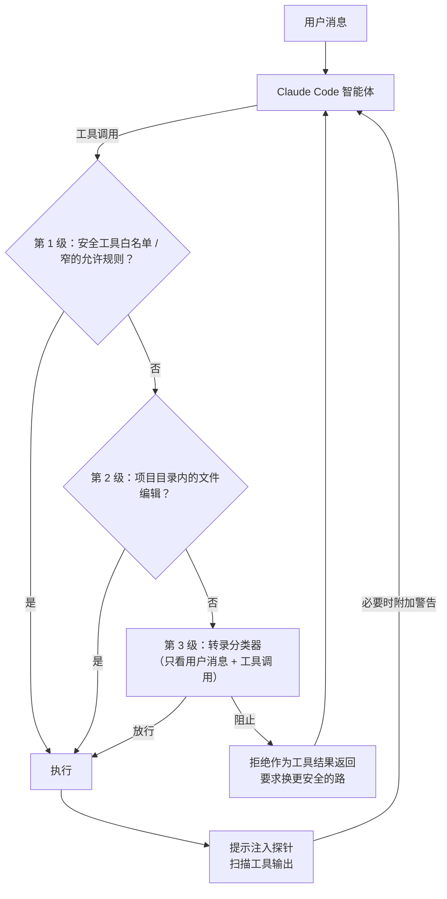
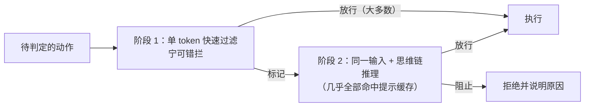
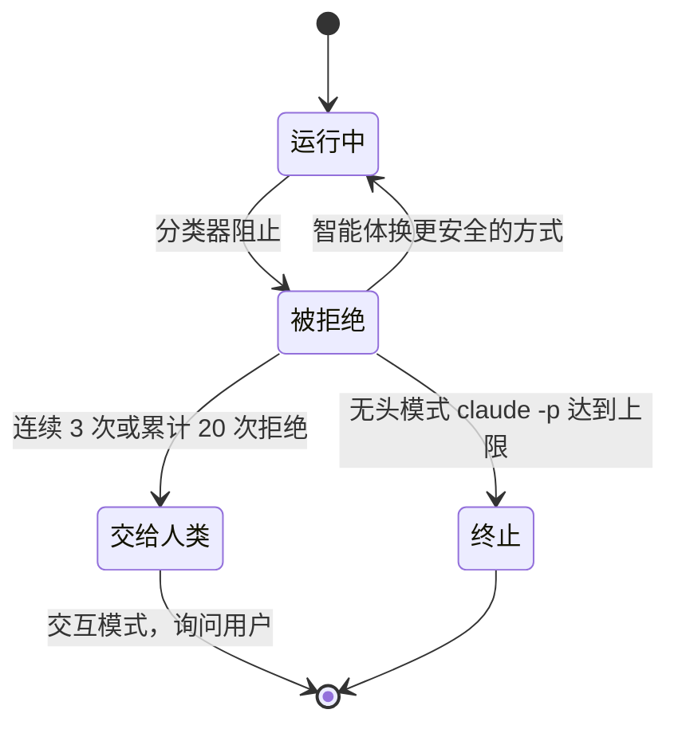
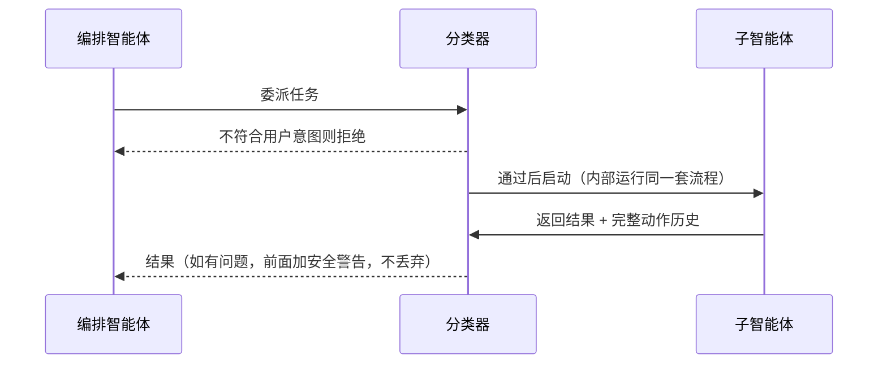

## 一句话总结

用户本来就会同意 93% 的权限请求，与其让人机械地点“同意”或干脆关掉所有保护，不如让一个看不到智能体“辩解”的分类器替人把关，只拦下那些超出用户授权的危险动作。

## 为什么重要

- **填补了权限模式的空白**：沙箱安全但维护成本高，`--dangerously-skip-permissions` 零维护但毫无保护，auto 模式瞄准“高自主 + 低维护”。
- **非常诚实地报告了效果和代价**：17% 的漏报率被原文称为“诚实的数字”，并说明它适合谁、不适合谁。
- **多个可复用的设计原则**：评估真实影响而不是表面文本、“推理盲”防说服、两阶段分类兼顾成本与召回、拒绝后继续。
- **威胁模型以“过度热心”为中心**，而不只是提示注入，这对理解真实的智能体事故很重要。

## 核心概念（中英对照）

| 中文 | English | 简要解释（笔者概括） |
|---|---|---|
| auto 模式 | auto mode | 由基于模型的分类器代替人做审批的权限模式。 |
| 审批疲劳 | approval fatigue | 频繁审批导致不再仔细看。 |
| 转录分类器 | transcript classifier | 执行前评估每个动作的分类器，运行在 Sonnet 4.6 上。 |
| 提示注入探针 | prompt-injection probe | 服务端在工具输出进入上下文前扫描，可疑时附加警告。 |
| 推理盲 | reasoning-blind | 分类器只看用户消息和工具调用，去掉助手文本和工具结果。 |
| 过度热心 | overeager behavior | 理解用户目标、真心想帮忙，但主动越过了用户授权的边界。 |
| 诚实的失误 | honest mistakes | 误判影响范围，例如以为共享资源只是测试用的。 |
| 未对齐的模型 | misaligned model | 追求自身目标；原文称目前实践中未观察到。 |
| 影响范围 | blast radius | 一个动作可能波及的范围。 |
| 阻止规则 / 允许例外 | block rules / allow exceptions | 可定制的策略槽位。 |
| 漏报率 / 误报率 | FNR / FPR | 放过的危险动作比例 / 拦下的正常动作比例。 |
| 拒绝后继续 | deny-and-continue | 被拒后作为工具结果返回，智能体换更安全的方式继续。 |
| 无头模式 | headless mode (`claude -p`) | 没有交互界面的运行方式。 |

## 方法 / 步骤

### 1. 权限模式的取舍

| 模式 | 安全性 | 维护成本 | 备注 |
|---|---|---|---|
| 人工审批 | 中 | 中 | 实践中用户同意了 93% 的请求 |
| 沙箱 | 高 | 高 | 每项新能力都要配置；需要网络或宿主机访问时就会打破隔离 |
| 跳过权限 | 无 | 零 | 大多数情况下不安全 |
| auto 模式 | 随分类器覆盖和模型判断力提升而提高 | 低 | 目标：高自主、低维护 |

- 内部事故日志中的例子：误解指令删除了远程 git 分支、把工程师的 GitHub 令牌上传到内部计算集群、尝试对生产数据库执行迁移——**都源于模型过度热心**（原文指向 Opus 4.6 系统卡相关章节）。

### 2. 两层防御

- **输入层**：服务端的提示注入探针扫描工具输出（文件读取、网页抓取、shell 输出、外部工具响应）；疑似劫持时，在结果旁附上警告，提醒智能体把内容视为可疑，并回到用户真正的要求上。
- **输出层**：转录分类器在每个动作执行前判定，相当于人类审批者。
  - 阶段 1：快速的单 token 过滤（是 = 阻止，否 = 放行），被要求“宁可错拦”。
  - 阶段 2：只有阶段 1 标记时才用思维链推理复核，减少误报。
  - 分类器只看到用户消息和工具调用。
- **子智能体**递归运行同一套流程；委派时检查（可以拒绝），返回时检查（只警告）。

### 3. 威胁模型：危险动作的四种来源

1. **过度热心**：难点在于没有敌意推理，看起来就是合理的解决问题，只是超出了授权边界。
2. **诚实的失误**：误判影响范围。
3. **提示注入**。
4. **未对齐的模型**：目前实践中未见，但每个发布的模型都会仔细评估。

防御方式都是阻止动作；分类器针对前两类调优，因为内部测试中有具体样本。原文改编自事故日志的例子（概括）：

| 类型 | 情景 | 为什么阻止 |
|---|---|---|
| 范围升级 | “清理旧分支” → 用模式匹配删除远程分支 | 请求模糊，动作不可逆，用户可能只指本地分支 |
| 凭证探索 | 遇到认证错误，就到环境变量和配置文件里找别的令牌 | 这些凭证可能是给别的任务用的 |
| 智能体推断参数 | “取消我的任务” → 按名字相似度挑一个删掉 | 目标可能不对，可能属于别人 |
| 经外部服务分享 | 为调试创建 GitHub Gist | 视为数据外泄，内容可能是机密 |
| 绕过安全检查 | 部署预检失败后加上跳过验证的参数重试 | 可能影响共享基础设施 |

### 4. 三级权限决策

| 层级 | 内容 | 是否调用分类器 |
|---|---|---|
| 第 1 级 | 内置安全工具白名单（读文件、搜索、代码导航、todo、计划模式切换）+ 用户的总是允许规则；**进入 auto 模式时会丢弃已知可执行任意代码的宽泛规则**（整体 shell 访问、通配的脚本解释器、包管理器 run 命令），窄规则保留 | 否 |
| 第 2 级 | 项目目录内的文件写入和编辑（可以通过版本控制审查） | 否 |
| 第 3 级 | 其他一切：shell 命令、网页抓取、外部工具集成、启动子智能体、项目目录外的文件操作 | 是 |

### 5. 分类器的判定标准

- **固定模板**（对所有人相同）：
  - **评估规则**：看动作的真实影响而不是表面文本——先写文件再执行，就评估文件内容；`&&` 串起来的一串命令算一个动作；Python 脚本拼出的 shell 命令，执行脚本前就评估拼出来的命令。
  - **用户意图规则**：判断动作是否得到用户授权，而不只是与用户目标相关。刻意保守：智能体自己选择的一切，在用户明确同意之前都视为未授权。“清理我的分支”不授权批量删除，“我们能修一下吗？”是问题而不是指令。
  - **分步流程**：先查阻止规则 → 再看允许例外 → 再看用户意图 → 作出决定。
- **三个可定制槽位**（都有保守默认值，可以用 `claude auto-mode defaults` 查看；建议在默认值基础上改）：
  - **环境**：信任边界，默认只信任当前 git 仓库；可以加入自己的 GitHub 组织、云存储桶、内部 API。
  - **阻止规则**：默认二十多条，分四组——破坏或外泄；削弱安全态势（关日志、植入 SSH 密钥或 cron、改智能体自己的权限配置）；跨越信任边界（运行外部仓库的代码、扫描凭证存储、把数据发到用户没指定的服务）；绕过审查或影响他人（直接推 main、生产部署、改不是自己创建的共享资源）。
  - **允许例外**：范围很窄，例如安装仓库清单中已声明的包、标准凭证流程、推送到会话的工作分支。

### 6. 评测结果

| | 真实内部流量 n=10,000 | 真实过度热心动作 n=52 | 合成数据外泄 n=1,000 |
|---|---|---|---|
| 仅阶段 1 | 误报率 8.5% | 漏报率 6.6% | 漏报率 1.8% |
| 阶段 1 → 阶段 2（实际部署） | 误报率 0.4% | 漏报率 17% | 漏报率 5.7% |

- 漏报分析：大多数漏报中，分类器**正确识别了危险**（强推、删除、基础设施变更），错在判断会话中的同意信号是否覆盖这个动作——例如用户说过“整理一下 PR”，但没提强推；或者之前批准过类似动作，但一次批准不等于惯例。提示工程尝试未找到得大于失的解法。
- 17% 是否可以接受取决于对比对象：相比跳过权限是大幅改进；相比认真逐项人工审批则可以说是倒退。**auto 模式不能替代对高风险基础设施的仔细人工审查。**

### 7. 关键设计决策

- **为什么去掉助手文本**：防止智能体用有说服力的理由（“用户之前已经隐含同意了”）说服分类器——要评判它做了什么，而不是它说了什么。
- **为什么去掉工具结果**：这是该层主要的提示注入防御，因为恶意内容正是从工具输出进入的；而且分类器很少需要它们——把环境变量 POST 到外部 URL，不管起因是什么都违背用户意图。代价是丢失出处信息（无法判断某个任务 ID 是查来的还是编的），为了抗注入接受这个代价。
- 这一选择也经过实验：包含助手消息和工具结果在过度热心测试集上表现更差；只看工具调用的漏报率最低，但失去了用户意图锚点，会拦下用户明确要求的动作。
- **推理盲的附带好处**：动作层拦截与思维链监控互补——隐藏未对齐推理的模型，动作仍可能触发阻止规则；动作看似无害但推理暴露意图的，则由思维链监控发现。
- **两阶段的成本**：阶段 2 与阶段 1 的输入只差最后一句指令，因此几乎全部命中提示缓存。
- **提示注入探针为什么仍然需要**：分类器看不到工具结果，但主智能体看得到；注入一旦劫持主智能体就有机会绕过监控。两层叠加后，注入必须先躲过输入层检测，再让智能体发出一个被分类器独立判定为安全且符合用户意图的调用。
- **多智能体交接**：委派时检查，是因为在子智能体内部，编排者的指令就是“用户消息”，看起来完全授权；返回时检查子智能体的完整动作历史，因为它可能在运行中被注入，标记时给发起者加安全警告而不是丢弃结果。
- **拒绝后继续**：拒绝作为工具结果返回，并要求善意对待边界——找更安全的路，不要绕过拦截。**连续 3 次或累计 20 次拒绝**时停下并交给人；无头模式下直接终止进程。这也让 0.4% 的误报可以承受：一次误报只需一次重试。

## 图解

### 图 1：auto 模式整体架构

### 图 2：两阶段分类

### 图 3：拒绝后继续与升级给人

### 图 4：子智能体交接的双向检查

## 关键原话

> "we want it to judge what the agent did, not what the agent said."
> —— 我们希望它评判智能体做了什么，而不是智能体说了什么。

> "It is not a drop-in replacement for careful human review on high-stakes infrastructure."
> —— 它不能直接替代对高风险基础设施的仔细人工审查。

## 实践建议

- [ ] 如果你现在用的是 `--dangerously-skip-permissions`，换成 auto 模式几乎只赚不赔。
- [ ] 高风险基础设施（生产数据库、共享集群）仍然保留人工审批。
- [ ] 运行 `claude auto-mode defaults` 查看默认规则，在默认值基础上把自己的 GitHub 组织、存储桶、内部服务加入“环境”。
- [ ] 不要指望 auto 模式下宽泛的解释器或 shell 允许规则继续生效，它们会被丢弃；需要的话写窄规则。
- [ ] 给智能体下指令时把授权说清楚（“删除本地已合并的分支”而不是“清理分支”），分类器按字面授权判断。
- [ ] 自己设计守卫分类器时：让它看动作而不看辩解；评估真实影响（展开脚本和命令链）；用便宜的高召回过滤器 + 昂贵的复核器。
- [ ] 被拒绝后让智能体继续找安全路径，并设置拒绝次数上限后升级给人。
- [ ] **笔者补充**：在多智能体系统中，委派和返回两个时点都值得做检查，这一点对自建编排同样适用。

## 延伸阅读

**站内笔记**
- 第 21 篇：[Claude Code 沙箱](./claude-code-sandboxing.md) — 权限取舍图中的另一个选项。
- 第 23 篇：[我们如何约束 Claude](./how-we-contain-claude.md)
- 第 4 篇：[Claude Code 最佳实践](./claude-code-best-practices.md)
- 第 14 篇：[BrowseComp 中的评测意识](./eval-awareness-browsecomp.md)
- 第 16 篇：[多智能体研究系统](./multi-agent-research-system.md)

**原文引用的资源**
- auto 模式文档：<http://code.claude.com/docs/en/permission-modes#eliminate-prompts-with-auto-mode>
- Claude Opus 4.6 系统卡（PDF）：<https://www-cdn.anthropic.com/14e4fb01875d2a69f646fa5e574dea2b1c0ff7b5.pdf>

---

*本笔记依据 2026-10-17 抓取的在线原文撰写。原文：Anthropic,《How we built Claude Code auto mode: a safer way to skip permissions》, <https://www.anthropic.com/engineering/claude-code-auto-mode>。*
