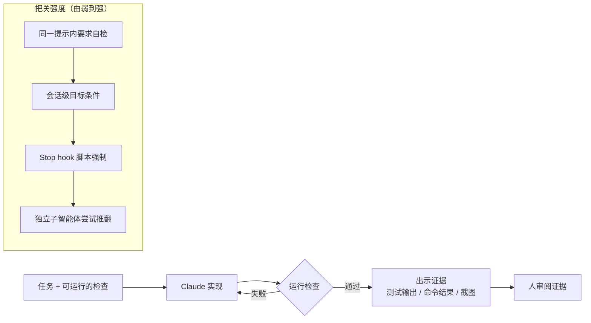
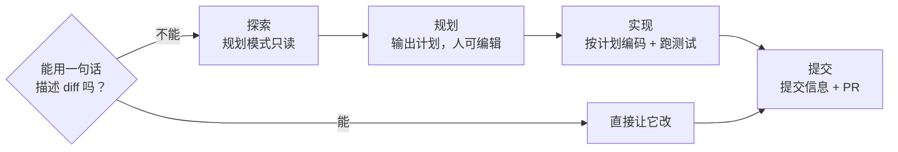
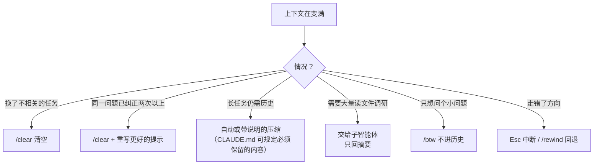
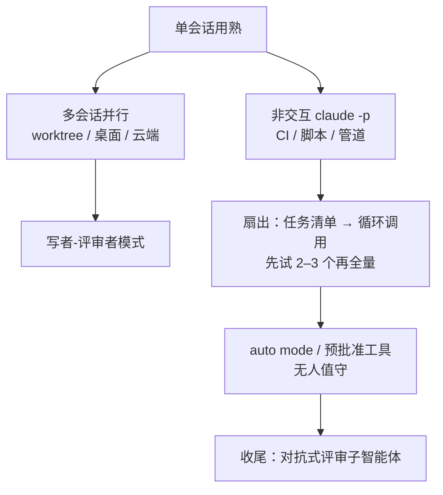

> ⚠️ **重要说明**：原博文已改为**持续更新的官方文档**，原 URL 会自动跳转到文档页。本笔记依据 **2026-10-17 读取的文档版本**撰写，并不代表 2025 年 4 月原博文的内容。文档会持续变化，命令、参数、版本号和“实验性 / 研究预览”等状态请以官方文档为准。

## 一句话总结

用好 Claude Code 的关键，是围绕“上下文会很快填满、越满越差”这个约束来工作：让它能自我验证，先想清楚再动手，喂精准的上下文，及时清理和纠偏，然后再通过并行和自动化扩大规模。

## 为什么重要

- **把前几篇的概念落到日常工具里**：上下文工程（压缩、子智能体、即时检索）、工具设计（CLI 优先）、评测思维（可运行的检查）都在这里变成了具体操作。
- **最适合边学边练**：大部分建议都能在一个真实仓库里立即尝试。
- **它是一份“活文档”**：本身就在演示 Anthropic 如何随产品变化持续更新实践指南。

## 核心概念（中英对照）

| 中文 | English | 简要解释（笔者概括） |
|---|---|---|
| 智能体式编码 | agentic coding | 由智能体读文件、跑命令、改代码、自主推进，人负责描述目标与把关。 |
| 上下文窗口 | context window | 一切消息、读过的文件、命令输出都在其中，是最重要的资源。 |
| 验证手段 | verification / check | 测试、构建退出码、lint、截图对比等能产生通过 / 失败信号的检查。 |
| 规划模式 | plan mode | 只读探索与规划、不做修改的模式。 |
| CLAUDE.md | CLAUDE.md | 每次会话开始都会读取的项目说明文件。 |
| 钩子 | hooks | 在工作流特定节点自动运行的脚本，确定性地执行，而不是“建议”。 |
| 技能 | skills | `.claude/skills/` 下的 SKILL.md，按需加载的领域知识或可调用流程。 |
| 子智能体 | subagent | 拥有独立上下文和工具权限的专用助手，适合调查和评审。 |
| 插件 | plugins | 把技能、hooks、子智能体、MCP 服务器打包成可安装单元。 |
| 权限白名单 | permission allowlist | 预先允许可信工具，减少审批弹窗。 |
| 沙箱 | sandboxing | 操作系统级的文件系统与网络隔离。 |
| 自动模式 | auto mode | 由分类器模型代替人审查大多数操作，只拦截有风险的。 |
| 压缩 | compaction | 接近上限时自动或手动总结历史以释放空间。 |
| 检查点 / 回退 | checkpoint / rewind | 每轮自动快照，可回退对话、代码或两者。 |
| 非交互模式 | non-interactive mode (`claude -p`) | 在 CI、脚本中无人值守运行。 |
| 工作树 | git worktree | 隔离的检出目录，让并行会话互不冲突。 |
| 扇出 | fan-out | 把大批量任务分发给多个并行调用。 |
| 对抗式评审 | adversarial review | 用全新上下文的子智能体审查 diff、找缺口。 |

## 方法 / 步骤

### 0. 根本约束：上下文

上下文窗口装着整个会话：每条消息、每个读过的文件、每次命令输出。一次调试或一次代码库探索就可能用掉数万 token；窗口越满，模型越容易“忘记”早先的指令或犯错。文档里的绝大多数建议都由此推出。

### 1. 让 Claude 能验证自己的工作

- 没有可运行的检查，“看起来完成了”就是唯一信号，你就成了验证环节；有了能返回通过 / 失败的检查，循环就能自己闭合。
- 提示写法对比（概括）：与其说“实现一个校验邮箱的函数”，不如给出若干测试用例并要求实现后运行测试；改 UI 时贴设计截图，并要求截图对比差异；报构建失败时贴出错误，要求修根因而不是压掉报错。
- 检查的“把关强度”由弱到强：同一条提示里要求运行检查并迭代 → 设为会话级目标条件（文档中的 `/goal`，每轮后由独立评估者复查）→ 用 Stop hook 以脚本强制把关 → 由验证子智能体或另一个全新模型尝试推翻结果，让“干活的”和“打分的”不是同一个。
- 让 Claude **出示证据**（测试输出、运行的命令与返回、截图），而不是只说“成功了”。

### 2. 先探索，再规划，再编码

| 阶段 | 做什么 |
|---|---|
| 探索 | 进入规划模式，只读文件、回答问题，不做修改 |
| 规划 | 让它给出详细实现计划（改哪些文件、流程如何），可以在编辑器里直接改计划 |
| 实现 | 退出规划模式，按计划编码并对照计划验证（写测试、跑测试） |
| 提交 | 让它写描述清楚的提交信息并开 PR |

规划有开销：改错字、加一行日志、改个变量名这类小事直接做。文档的判断标准是：如果你能用一句话描述 diff，就跳过规划。

### 3. 提示要具体，并提供丰富素材

- 四种具体化方式：限定范围（哪个文件、什么场景、测试偏好）；指向信息源（例如让它查某个类的 git 历史）；引用已有模式（指出仓库里可模仿的组件）；描述症状（现象、可能位置、怎样算修好，并先写一个能复现的失败测试）。
- 探索阶段可以故意问得模糊，看它会提出什么。
- 素材：用 `@` 引用文件、直接粘贴图片、给文档 URL、用管道把数据传进去、让它自己用 Bash / MCP 去取。

### 4. 配置环境

| 配置项 | 要点（概括） |
|---|---|
| CLAUDE.md | 可用 `/init` 生成初稿。只写全局适用的内容：猜不到的命令、与默认不同的代码风格、测试方式、仓库礼仪、项目特有的架构决策、环境怪癖、不明显的坑。不写能从代码读出的、语言通用惯例、详细 API 文档、频繁变化的信息、长教程、逐文件说明、空话。每一行都问一句“删掉它会不会让 Claude 犯错”。太长会导致规则被忽略。当代码一样维护并提交到 git。 |
| 权限 | 用白名单预先批准可信工具；开启沙箱让沙箱内命令免审批；文档称在较新版本中 auto mode 已是交互会话的默认起始权限模式（具体以文档为准）。 |
| CLI 工具 | 与外部服务交互时，CLI（如 gh、aws、gcloud）是最省上下文的方式；也可以让 Claude 读 `--help` 自学新 CLI。 |
| MCP 服务器 | 用 `claude mcp add` 接入 Notion、Figma、数据库等。 |
| Hooks | 必须每次无例外执行的动作用 hook（例如每次编辑后跑 eslint、禁止写 migrations 目录）；CLAUDE.md 只是建议，hook 是确定性的。 |
| Skills | 在 `.claude/skills/` 下放领域约定或可直接调用的流程；有副作用、需要手动触发的流程可以禁止模型自动调用。 |
| 子智能体 | 在 `.claude/agents/` 定义专用助手（如安全评审），有独立上下文和工具集。 |
| 插件 | 安装打包好的技能、hooks、子智能体、MCP；强类型语言推荐装代码智能插件。 |

### 5. 有效沟通

- 像问资深同事一样问代码库问题，这也是很好的新人上手方式。
- 大功能先让 Claude **采访你**，把技术实现、UI/UX、边界情况、权衡都问清楚，写成 SPEC.md，再开一个**新会话**按规格实现。好的规格是自包含的：点明涉及的文件和接口、写清不做什么、最后有端到端验证步骤。

### 6. 管理会话

- **尽早纠偏**：Esc 中断（上下文保留）；双击 Esc 或 `/rewind` 回退对话 / 代码；让它“撤销”；无关任务之间 `/clear`。
- **同一问题纠正超过两次**，说明上下文里堆满了失败尝试——清空，带着学到的东西写一个更好的初始提示重来。
- **积极管理上下文**：任务间频繁 `/clear`；自动压缩会保留代码模式、文件状态、关键决策；可用带说明的 `/compact` 或只压缩部分对话；可以在 CLAUDE.md 里规定压缩时必须保留的内容；不需要留在上下文里的小问题用 `/btw`。
- **调查交给子智能体**：它们在独立窗口里读大量文件，只回报摘要。
- **检查点**：每轮自动快照，可以大胆尝试再回退；但检查点只跟踪 Claude 文件编辑工具做的改动，不记录 Bash 或外部进程的修改，**不能替代 git**。
- **恢复会话**：给会话命名，像分支一样管理，用 `--continue` / `--resume` 接着做。

### 7. 自动化与规模化

- **非交互模式** `claude -p`：用于 CI、pre-commit、脚本，支持纯文本、JSON、流式 JSON 输出。
- **多会话并行**：git worktree、会话间消息、桌面应用、云端会话，以及文档中标为研究预览或实验性的 agent view、agent teams。
- **写者 / 评审者模式**：一个会话实现，另一个全新会话评审（不偏向自己刚写的代码）；测试同理，一个写测试，一个写代码去通过测试。
- **扇出**：让 Claude 先生成任务清单 → 写脚本循环调用 `claude -p`，用 `--allowedTools` 预批准所需工具、拒绝其余 → 先在 2–3 个文件上调好提示再全量跑；也可以用内置的批量命令拆给多个子智能体。
- **auto mode** 无人值守运行，由分类器在后台拦截越权、未知基础设施、恶意内容驱动的操作。
- **对抗式评审**：收尾前用全新上下文的子智能体对照计划审查 diff；但要告诉它只报影响正确性或需求的缺口，否则“为找问题而找问题”会导致过度工程。

### 8. 五种常见失败模式

| 失败模式 | 表现 | 解法 |
|---|---|---|
| 大杂烩会话 | 一个会话里穿插不相关任务 | 任务之间 `/clear` |
| 反复纠正 | 越纠越乱，上下文被失败方案污染 | 两次失败后清空，重写更好的提示 |
| 过度详细的 CLAUDE.md | 太长，重要规则被淹没 | 无情删减；已经做对的就删掉或改成 hook |
| 信任-验证缺口 | 看似合理但漏了边界情况 | 始终提供验证；无法验证就不要发布 |
| 无限探索 | 不限定范围的“调查”读了几百个文件 | 缩小范围，或交给子智能体 |

文档最后强调这些都是起点而非铁律：有时就该让上下文累积、跳过规划、或故意给模糊提示；要观察什么有效，逐渐培养直觉。

## 图解

### 图 1：带验证的工作循环（以及把关强度的阶梯）

### 图 2：探索 → 规划 → 实现 → 提交

### 图 3：上下文管理工具箱

### 图 4：规模化的几种方式

## 关键原话

> "Claude’s context window fills up fast, and performance degrades as it fills."
> —— Claude 的上下文窗口很快就会填满，而且越满表现越差。

> "If you can’t verify it, don’t ship it."
> —— 无法验证的东西，就不要发布。

## 实践建议

- [ ] 每个任务都附一个可运行的检查（测试、构建、lint、截图对比），并要求 Claude 贴出运行证据。
- [ ] 用 `/init` 生成 CLAUDE.md 后立刻删减到只剩“删了会出错”的内容；提交到 git，团队共同维护。
- [ ] 把“必须每次做”的规则从 CLAUDE.md 挪到 hooks。
- [ ] 不熟悉的代码先用规划模式；一句话能说清的改动直接做。
- [ ] 养成任务间 `/clear` 的习惯；纠正两次不行就重开。
- [ ] 大功能：采访 → SPEC.md → 新会话实现 → 子智能体对照 SPEC 评审。
- [ ] 批量迁移：先在少量文件上试跑调好提示，再扇出；无人值守时只预批准必需工具。
- [ ] 检查点不能替代 git：重要节点手动提交。
- [ ] **笔者补充**：团队内共享一份“好提示 / 坏提示”对照表，比口头传授更有效。

## 延伸阅读

**站内笔记**
- 第 2 篇：[上下文工程](./effective-context-engineering-for-ai-agents.md)
- 第 7 篇：[Agent Skills](./equipping-agents-for-the-real-world-with-agent-skills.md)
- 第 21 篇：[Claude Code 沙箱](./claude-code-sandboxing.md)、第 22 篇：[Claude Code auto mode](./claude-code-auto-mode.md)
- 第 19 篇：[用并行 Claude 团队写 C 编译器](./building-c-compiler.md) — 多会话并行的极端案例。

**官方资源**
- 当前文档：<https://code.claude.com/docs/en/best-practices>
- 原博文 URL（现重定向）：<https://www.anthropic.com/engineering/claude-code-best-practices>

---

*本笔记依据 2026-10-17 读取的 Claude Code 官方文档版本撰写（原博文已改为持续更新的文档）。原链接：<https://www.anthropic.com/engineering/claude-code-best-practices>。*
