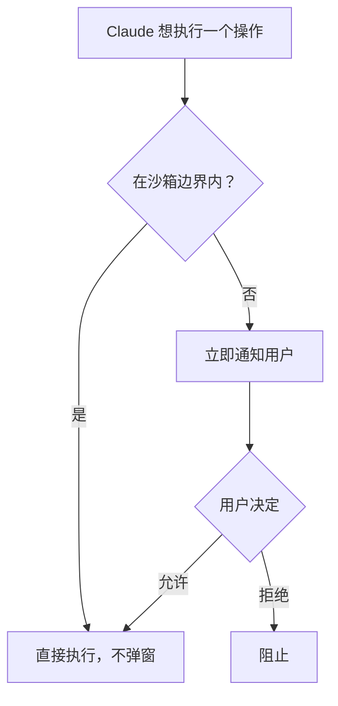
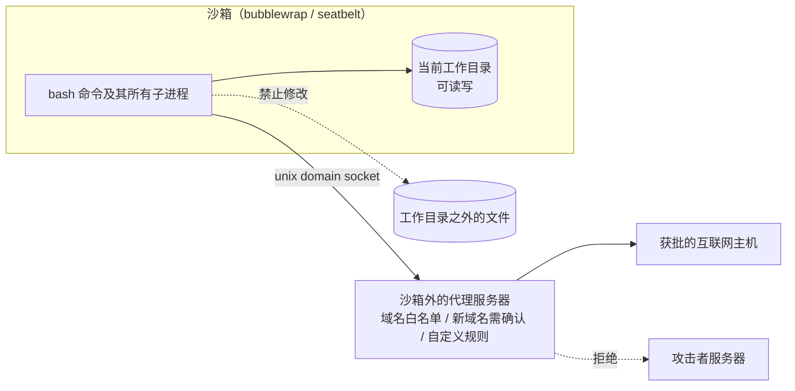
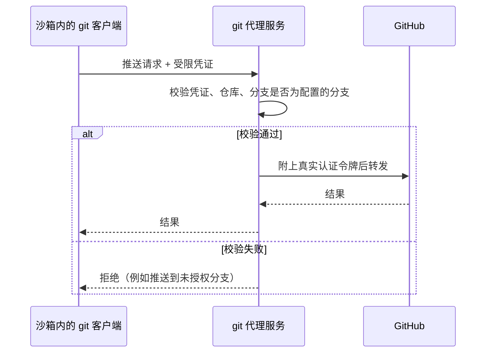

## 一句话总结

与其让用户为每个动作点“同意”，不如事先划好边界——只能写这些目录、只能连这些域名——边界内放手让 Claude 干，越界才问人；这样安全性和自主性可以同时提升。

## 为什么重要

- **指出了权限弹窗模式的内在缺陷**：审批疲劳会让人不看就点，安全性反而下降。
- **给出“文件系统 + 网络”双重隔离缺一不可的清晰论证**，适用于任何智能体。
- **开源了沙箱运行时**，可以用于任意进程、智能体和 MCP 服务器。
- **是第 22 篇（auto 模式）和第 23 篇（我们如何约束 Claude）的基础。**

## 核心概念（中英对照）

| 中文 | English | 简要解释（笔者概括） |
|---|---|---|
| 基于权限的模型 | permission-based model | 默认只读，修改文件或执行命令前要征得同意（echo、cat 等安全命令除外）。 |
| 审批疲劳 | approval fatigue | 频繁审批导致用户不再仔细看自己同意了什么。 |
| 沙箱 | sandboxing | 预先定义的边界，边界内无需逐项审批。 |
| 文件系统隔离 | filesystem isolation | 只能访问或修改指定目录。 |
| 网络隔离 | network isolation | 只能连接获批的服务器。 |
| 提示注入 | prompt injection | 外部内容中藏着的恶意指令，劫持智能体行为。 |
| 数据外泄 | exfiltration | 被攻陷的智能体把 SSH 密钥等敏感信息发出去。 |
| 沙箱运行时 | sandbox runtime | 开源研究预览版，用来限制进程能访问的目录和网络主机。 |
| bubblewrap / seatbelt | Linux bubblewrap / macOS seatbelt | 沙箱运行时依赖的操作系统级隔离原语。 |
| 作用域受限的凭证 | scoped credential | 云端沙箱中 git 客户端使用的专用凭证，由代理校验。 |

## 方法 / 步骤

### 1. 问题：权限弹窗不是好的安全机制

- Claude Code 默认只读，大多数操作需要显式审批。
- 不停点“同意”既拖慢开发，又会造成审批疲劳，反而让开发更不安全。

### 2. 思路：两道边界，缺一不可

| 只有一道边界时 | 后果 |
|---|---|
| 没有网络隔离 | 被攻陷的智能体可以把 SSH 密钥等敏感文件外泄 |
| 没有文件系统隔离 | 被攻陷的智能体可以轻易逃出沙箱，从而获得网络访问 |

### 3. 功能一：沙箱化的 bash 工具

- 新的沙箱运行时（beta / 研究预览，并已开源）：精确定义智能体可以访问的目录和网络主机，**不需要启动和管理容器**；可以给任意进程、智能体和 MCP 服务器加沙箱。
- 在 Claude Code 中用它包住 bash 工具：边界内的命令无需审批；试图越界时立刻通知用户，由用户决定是否放行。
- 基于 Linux bubblewrap 和 macOS seatbelt 在操作系统层强制执行，**覆盖命令派生的所有脚本、程序和子进程**，不只是 Claude Code 的直接操作。
- 具体边界：
  - **文件系统**：当前工作目录可读写，阻止修改目录之外的任何文件。
  - **网络**：只能通过一个 unix domain socket 访问网络，该 socket 连接到沙箱外运行的代理服务器；代理限制可以连接的域名，并负责对新请求的域名征求用户确认；还可以自定义代理，对出站流量执行任意规则。
  - 两者都可以配置允许或禁止的路径和域名。
- 效果：即使提示注入成功，也被完全隔离——偷不走 SSH 密钥，也连不上攻击者的服务器。内部使用中**权限弹窗减少 84%**。
- 入口：在 Claude Code 中运行 `/sandbox`。

### 4. 功能二：Claude Code on the web

- 每个会话在云端的隔离沙箱中运行，在沙箱内对自己的服务器拥有完全权限。
- 设计要点：**git 凭证、签名密钥等敏感凭证从不与 Claude Code 一起放在沙箱里**。
- git 交互全部经过一个自定义代理：沙箱中的 git 客户端用专门构建的受限凭证向代理认证；代理校验这个凭证和 git 操作的内容（例如只允许推送到配置好的分支），再附上真正的认证令牌转发给 GitHub。

## 图解

### 图 1：从逐项审批到边界内自主

### 图 2：沙箱化 bash 工具的两道边界

### 图 3：Claude Code on the web 的 git 代理

## 关键原话

> "effective sandboxing requires both filesystem and network isolation."
> —— 有效的沙箱必须同时具备文件系统隔离和网络隔离。

## 实践建议

- [ ] 在 Claude Code 中运行 `/sandbox`，为日常项目开启沙箱，减少弹窗。
- [ ] 同时配置文件系统和网络两道边界，不要只做一道。
- [ ] 网络默认拒绝，只放行确实需要的域名（包管理器、内部服务等）。
- [ ] 自建智能体时，考虑直接使用开源的 sandbox-runtime 包住 shell、工具和 MCP 服务器。
- [ ] 凭证不要放进智能体所在的环境；用代理在边界外附加认证并校验操作（例如限定分支）。
- [ ] **笔者补充**：定期回顾越界请求的记录，它们能告诉你边界配置是否合理、是否有异常行为。

## 延伸阅读

**站内笔记**
- 第 4 篇：[Claude Code 最佳实践](./claude-code-best-practices.md)
- 第 22 篇：[Claude Code auto 模式](./claude-code-auto-mode.md) — 在沙箱之外进一步减少审批。
- 第 23 篇：[我们如何约束 Claude](./how-we-contain-claude.md)
- 第 20 篇：[Managed Agents](./managed-agents.md) — 同样坚持“凭证不进沙箱”。
- 第 10 篇：[Desktop Extensions](./desktop-extensions.md)

**原文引用的资源**
- Claude Code 沙箱文档：<https://docs.claude.com/en/docs/claude-code/sandboxing>
- 开源 sandbox-runtime：<https://github.com/anthropic-experimental/sandbox-runtime>
- Linux bubblewrap：<https://github.com/containers/bubblewrap>
- Claude Code on the web 文档：<https://docs.claude.com/en/docs/claude-code/claude-code-on-the-web>
- 发布博文：<https://www.anthropic.com/news/claude-code-on-the-web>

---

*本笔记依据 2026-10-17 抓取的在线原文撰写。原文：Anthropic,《Beyond permission prompts: making Claude Code more secure and autonomous》, <https://www.anthropic.com/engineering/claude-code-sandboxing>。*
