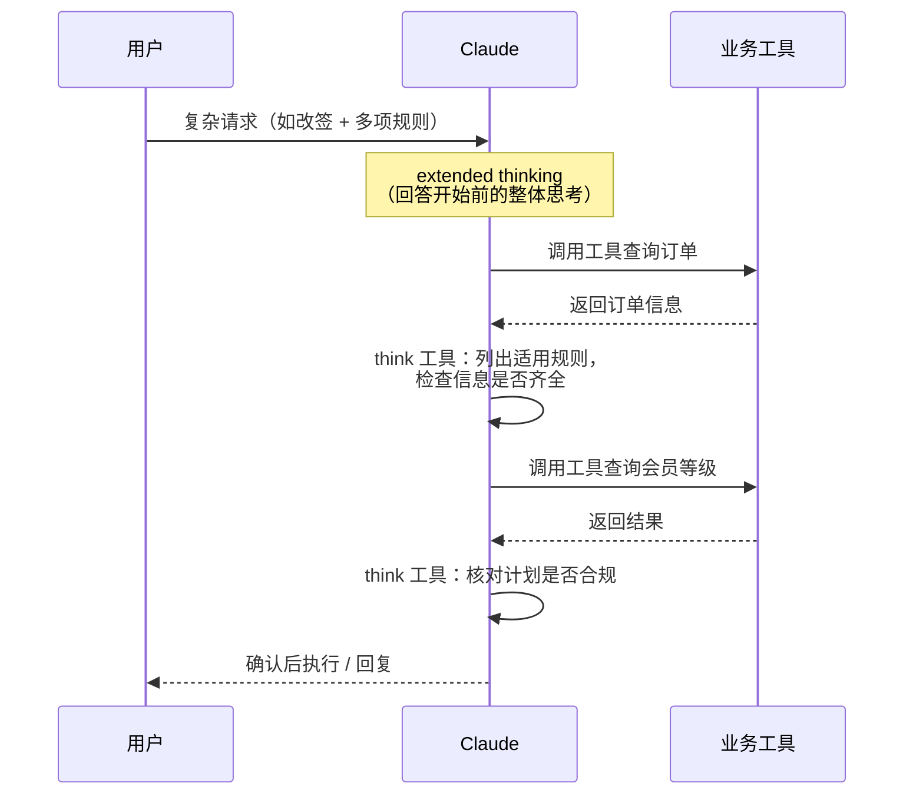
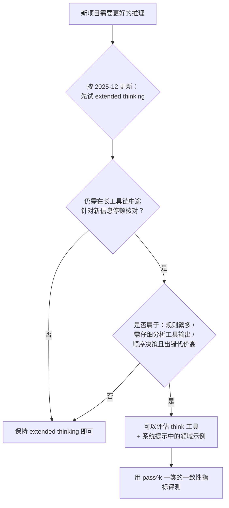
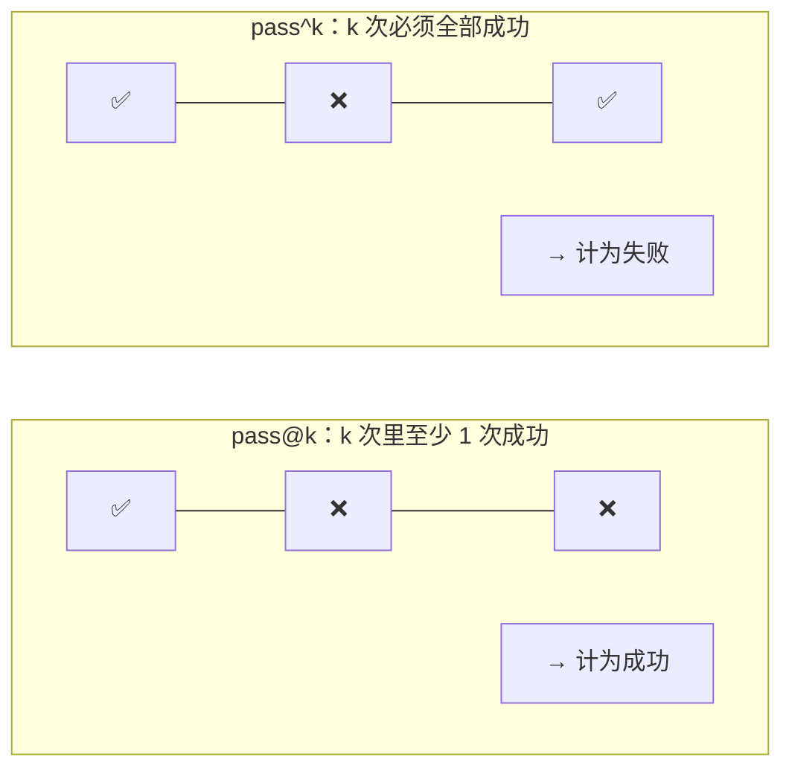

> 🔄 **原文后续更新（2025-12-15）**：官方表示 extended thinking 已经改进，**多数情况下建议改用 extended thinking**，而不是单独定义 think 工具（见 <https://platform.claude.com/docs/en/build-with-claude/extended-thinking>）。下面的内容记录的是 2025 年 3 月时的方法和实验，适合用来理解“在工具链中间留出思考空间”这一思路。

## 一句话总结

在多步工具调用中，模型拿到新信息后往往需要“停一下、核对一下”。给它一个只记录想法的空工具，并配上领域化的思考示例，就能明显提升它在规则繁多场景下的一致性。

## 为什么重要

- **一个几乎零成本的技巧**：工具定义只有几行，而且只有模型主动调用时才会生效，不影响现有工具和流程。
- **区分了两种“思考”**：回答前的整体思考（extended thinking）和执行中针对新信息的停顿思考（think 工具），有助于理解推理放在哪一步最有用。
- **展示了“提示 + 工具”的组合效果**：在困难领域，光给工具不够，配上示范怎么思考的提示才有大幅提升。
- **学会看原文更新说明**：这篇的结论后来被官方部分修正，是练习“带着时间线读技术博客”的好例子。

## 核心概念（中英对照）

| 中文 | English | 简要解释（笔者概括） |
|---|---|---|
| think 工具 | "think" tool | 不获取新信息、不改任何状态，只把一段想法追加到日志的工具。 |
| 扩展思考 | extended thinking | 模型在开始生成回答**之前**进行深入思考与规划。 |
| 草稿区 | scratchpad | 提示中把 think 工具定位为核对规则和信息的草稿空间。 |
| 策略遵循 | policy adherence | 严格按照详细的业务规则行事（例如客服退改签政策）。 |
| 顺序决策 | sequential decision making | 每一步都依赖前一步，出错代价高。 |
| τ-bench | τ-bench (tau-bench) | 模拟真实客服场景的工具使用基准，包含航空和零售领域。 |
| pass^k | pass^k | 同一任务 k 次独立尝试**全部**成功的概率，衡量一致性。 |
| pass@k | pass@k | k 次尝试中**至少一次**成功的概率。 |

## 方法 / 步骤

### 1. think 工具与 extended thinking 的分工（原文 2025-03 观点）

| | extended thinking | think 工具 |
|---|---|---|
| 发生时机 | 开始回答之前 | 回答过程中，拿到新信息之后 |
| 思考范围 | 更全面，迭代整体计划 | 更聚焦，针对新发现的信息 |
| 原文推荐场景 | 不需要顺序调用的简单工具场景、直接的指令遵循；无需工具的编码、数学、物理 | 复杂工具、长调用链中需仔细分析工具输出、规则繁多的环境、每步都依赖前一步且出错代价高的决策 |

### 2. 工具定义

结构很简单：名称 `think`，一个必填的字符串参数 `thought`；描述里写明“不会获取新信息、不会修改数据库，只记录想法，用于复杂推理或临时记忆”。原文给出的示例来自 τ-bench 的标准环境。

### 3. τ-bench 实验结果（Claude 3.7 Sonnet）

对比四种配置：基线、只用 extended thinking、只用 think 工具、think 工具 + 优化提示（航空领域）。

| 领域 | 结论（概括） |
|---|---|
| 航空（规则复杂） | think + 优化提示最好；文字部分称 pass^1 为 0.570、基线 0.370，相对提升 54%。仅用 think 或 extended thinking 都有提升，但远不如组合。 |
| 零售（规则较简单） | 不加任何提示、只给 think 工具就拿到最高的 pass^1 0.812（基线 0.783，extended thinking 0.770）。 |

> ⚠️ 笔者核对注：原文**文字**写航空领域“think + 提示” pass^1 = 0.570、基线 0.370，而同一篇文章的**表格**里 k=1 一列分别是 0.584 和 0.332。两处数字不一致，原文未解释，本笔记照录两处，不作推断。

另外两点发现：在困难领域，提示的作用很大；收益一直保持到 pass^5，说明它提升的是**一致性**，帮助处理边界和异常情况。

“优化提示”的思路（概括）：拿到工具结果之后、行动或回复之前，先用 think 工具列出适用规则、检查信息是否收齐、确认计划合规、核对工具结果；并给出几个领域内的示例思考过程（例如退票要核对哪些条件、行李费怎么按会员等级计算）。

### 4. SWE-bench 实验

在 Claude 3.7 Sonnet 的 SWE-bench 配置里加入了类似的 think 工具（描述改为：发现 bug 根源后用它构思多种修法并评估；拿到测试结果后用它想修复办法），该配置取得了当时 0.623 的最好成绩。单独看这个工具的贡献，平均提升 1.6%（原文报告的统计检验 p < .001）。

### 5. 什么时候用 / 不用

- **适合**：需要仔细分析工具输出、可能要回头改方案；规则繁多、需要核对合规；顺序决策且出错代价高。
- **不适合**：非顺序调用（只调一次，或一次并行调用多个工具）；约束不多、默认表现已够好的简单指令遵循。代价是更长的提示和更多输出 token。

### 6. 实施建议

1. 用**领域化的示例**说明何时、如何使用 think：推理应有多细、如何拆解复杂指令、常见场景的决策树、如何检查信息是否收齐。
2. 指导内容又长又复杂时，**放进系统提示**比写在工具描述里效果更好。
3. 上手步骤：先挑模型目前在规则遵循或长调用链推理上吃力的场景 → 加上工具定义和系统提示中的示例 → 观察实际使用情况并调整提示。

## 图解

### 图 1：两种“思考”发生在什么位置

### 图 2：是否使用 think 工具的决策（结合 2025-12 更新）

### 图 3：pass@k 与 pass^k 的区别

## 关键原话

> "Prompting matters significantly on difficult domains."
> —— 在困难领域，提示词的作用非常大。

## 实践建议

- [ ] **先遵循 2025-12 的更新**：优先评估 extended thinking（包括工具调用之间的交错思考）。
- [ ] 如果仍要尝试 think 工具：选规则最复杂、最容易出错的场景做对照实验，而不是全局开启。
- [ ] 准备 2–3 个领域内的“思考示例”，放进系统提示。
- [ ] 评测时不只看平均成功率，还要看 pass^k 之类的一致性指标。
- [ ] 留意额外的提示长度和输出 token 成本。
- [ ] **笔者补充**：think 的内容会写进日志，是很好的排错材料，可以定期抽查模型在“想”什么。

## 延伸阅读

**站内笔记**
- 第 3 篇：[为智能体编写高效工具](./writing-tools-for-agents.md) — 里面提到用交错思考来分析工具使用。
- 第 12 篇：[SWE-bench Verified 与 Claude 3.5 Sonnet](./swe-bench-sonnet.md)
- 第 11 篇：[揭秘智能体评测](./demystifying-evals-for-ai-agents.md) — pass@k 与 pass^k。

**原文引用的资源**
- Extended thinking 文档：<https://platform.claude.com/docs/en/build-with-claude/extended-thinking>
- τ-bench 论文：<https://arxiv.org/abs/2406.12045>
- τ-bench 航空政策：<https://github.com/sierra-research/tau-bench/blob/main/tau_bench/envs/airline/wiki.md>

---

*本笔记依据 2026-10-17 抓取的在线原文撰写。原文：Anthropic,《The "think" tool》, <https://www.anthropic.com/engineering/claude-think-tool>。*
