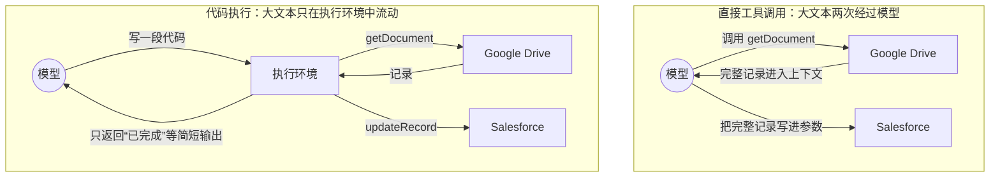
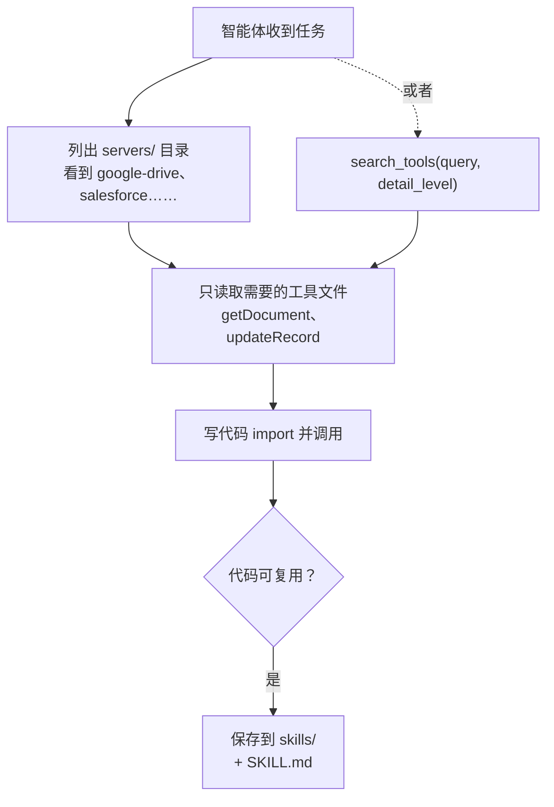
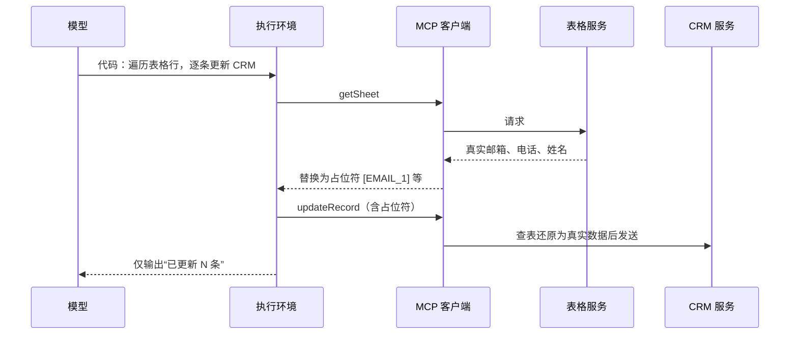

## 一句话总结

不要让每个工具定义、每个中间结果都经过模型上下文：把 MCP 工具当成代码库，让智能体写一段代码去调用，数据在执行环境里流转，模型只看必要的结果。

## 为什么重要

- **它点出了 MCP 规模化后的两大 token 浪费**，并给出了一个通用的工程解法。
- **再次体现“渐进式披露”**：与 Agent Skills 的设计思路一致，而且文中直接把“保存的可复用代码”和 Skills 联系了起来。
- **兼顾隐私与安全**：中间数据可以完全不进入模型上下文，还能做 PII 令牌化。
- **讲清了代价**：需要沙箱、资源限制、监控，是一种需要权衡的方案，而非免费的午餐。

## 核心概念（中英对照）

| 中文 | English | 简要解释（笔者概括） |
|---|---|---|
| 模型上下文协议 | Model Context Protocol (MCP) | 连接智能体与外部系统的开放标准，“实现一次，接入整个生态”。 |
| MCP 服务器 / 客户端 | MCP server / client | 服务器提供工具；客户端把工具暴露给模型并编排调用。 |
| 直接工具调用 | direct tool calling | 模型逐个调用工具，每个结果都回到上下文。 |
| 代码执行 | code execution | 智能体写代码并在执行环境中运行。 |
| 代码 API | code API | 把每个 MCP 工具生成为一个可 import 的函数文件。 |
| 渐进式披露 | progressive disclosure | 浏览文件树或调用 `search_tools`，只加载需要的工具定义。 |
| 详细程度参数 | detail level parameter | 搜索工具时选择只返回名称、名称加描述，还是完整 schema。 |
| 首 token 延迟 | time to first token | 条件判断交给代码执行，可以省去等待模型推理的时间。 |
| 个人身份信息令牌化 | PII tokenization | 客户端把敏感数据替换成占位符，模型只看到占位符。 |
| 状态持久化 | state persistence | 把中间结果写入文件，之后可恢复进度。 |
| Code Mode | Code Mode | Cloudflare 对同类做法的称呼。 |

## 方法 / 步骤

### 1. 问题：两种 token 浪费

1. **工具定义撑爆上下文**：多数 MCP 客户端一开始就把所有工具定义放进上下文；接入上千个工具时，智能体还没读到请求就可能要处理几十万 token。
2. **中间结果反复经过模型**：例如“从 Google Drive 取会议记录，附到 Salesforce 线索上”，完整记录会先作为返回结果进入上下文，再被模型原样写进下一次调用的参数里——流经两次。原文估计，两小时的会议可能多出约 5 万 token；文档更大时还可能超出上下文上限，而且模型在工具之间复制大段数据也更容易出错。

### 2. 解法：把 MCP 服务器呈现为代码

- 原文示例（TypeScript）：为每个已连接的服务器生成一个目录，每个工具一个文件，文件里是带类型的输入输出接口和一个调用底层 MCP 工具的函数。
- 智能体通过**浏览文件系统**发现工具：先列出有哪些服务器，再只读取当前任务需要的工具文件。
- 原来的“两次工具调用 + 两次大文本过上下文”，变成一段几行的代码：读取文档内容 → 直接传给更新记录的函数，大文本不经过模型。
- 原文报告：在这个例子中，token 消耗从约 15 万降到约 2,000，节省 **98.7%**。
- 原文还提到 Cloudflare 发表了类似发现（称为“Code Mode”），核心洞察相同：LLM 擅长写代码，就应该利用这一点。

### 3. 五个好处

| 好处 | 做法（概括） |
|---|---|
| 渐进式披露 | 模型按需读取工具定义；也可以提供 `search_tools`，并带一个详细程度参数。 |
| 省上下文的结果 | 在代码里先过滤、聚合、连接、抽字段，再把少量结果打印给模型。原文例子：1 万行表格过滤后只打印 5 行。 |
| 更强的控制流 | 循环、条件、错误处理用代码写，比如轮询某个频道直到出现“部署完成”的消息，不必在智能体循环里反复“调用工具 + 等待”；条件判断交给代码还能减少等待模型的延迟。 |
| 隐私保护 | 中间结果默认留在执行环境中，模型只看到你显式输出的部分。更敏感的场景，客户端可以把邮箱、电话、姓名等 PII 替换为占位符，在后续工具调用时再还原，真实数据从源系统流到目标系统而**不经过模型**；也可以借此定义确定性的数据流向规则。 |
| 状态与技能 | 中间结果写文件，可以中断后继续；智能体还能把有效的代码保存成可复用函数，再加上 SKILL.md 就成了一个技能，逐渐积累更高层的能力。 |

### 4. 代价

运行智能体生成的代码需要安全的执行环境：合适的沙箱、资源限制、监控。这些带来运维开销和安全考量，是直接工具调用所没有的。需要把省 token、降延迟、工具组合更灵活等收益，与这些实现成本放在一起权衡。

原文总结：上下文管理、工具组合、状态持久化这些问题看似新，其实软件工程里都有成熟解法，代码执行只是把这些已有模式用到智能体身上。

## 图解

### 图 1：直接工具调用 vs 代码执行（数据走向）

### 图 2：通过文件系统按需发现工具

图解：智能体可以列出 `servers/` 目录、只读取需要的工具文件（如 `getDocument`、`updateRecord`），也可以用 `search_tools(query, detail_level)` 按详略程度检索工具；可复用的代码保存为技能。

### 图 3：PII 令牌化的数据流

## 关键原话

> "LLMs are adept at writing code and developers should take advantage of this strength"
> —— LLM 很擅长写代码，开发者应该好好利用这一长处。

## 实践建议

- [ ] 统计你的智能体每次请求前光工具定义就占了多少 token；占比高就考虑按需加载。
- [ ] 找出“大结果原样搬运”的调用链（文档、表格、日志），优先改成代码内部流转。
- [ ] 提供 `search_tools` 时加一个详细程度参数。
- [ ] 代码执行环境必须有沙箱、资源上限和监控（参见[第 21 篇](./claude-code-sandboxing.md)沙箱笔记）。
- [ ] 涉及个人信息的流程，评估在客户端层做令牌化，并定义允许的数据流向。
- [ ] 把多次成功复用的代码沉淀为技能。
- [ ] **笔者补充**：对比实验时同时记录 token、延迟和成功率三项，避免只因省 token 就牺牲正确性。

## 延伸阅读

**站内笔记**
- 第 9 篇：[Advanced tool use](./advanced-tool-use.md) — 同类思路的平台功能（Tool Search、Programmatic Tool Calling）。
- 第 7 篇：[Agent Skills](./equipping-agents-for-the-real-world-with-agent-skills.md)
- 第 21 篇：[Claude Code 沙箱](./claude-code-sandboxing.md)
- 第 2 篇：[上下文工程](./effective-context-engineering-for-ai-agents.md)

**原文引用的资源**
- [MCP 官网](https://modelcontextprotocol.io/)
- [MCP 服务器列表](https://github.com/modelcontextprotocol/servers)
- [Cloudflare “Code Mode”](https://blog.cloudflare.com/code-mode/)

---

*本笔记依据 2026-10-17 抓取的在线原文撰写。原文：Anthropic,[《Code execution with MCP》](https://www.anthropic.com/engineering/code-execution-with-mcp)。*
