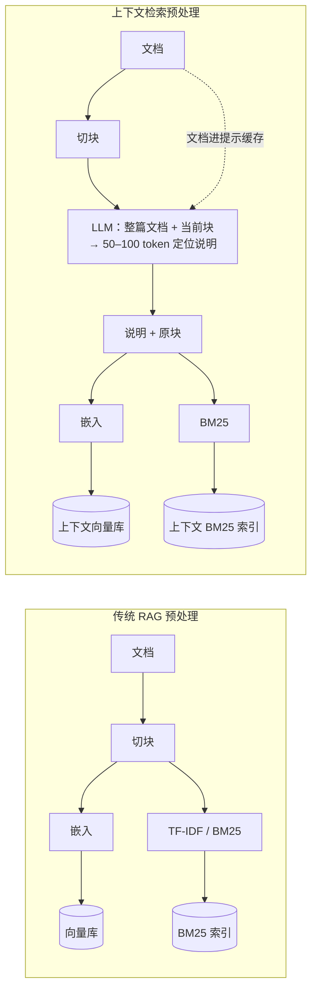
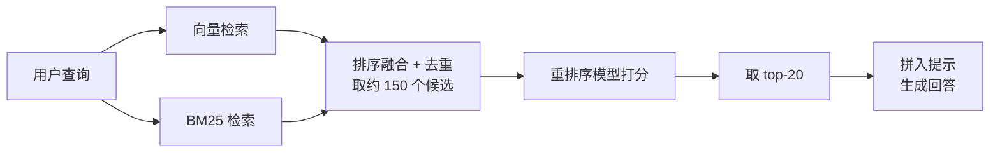
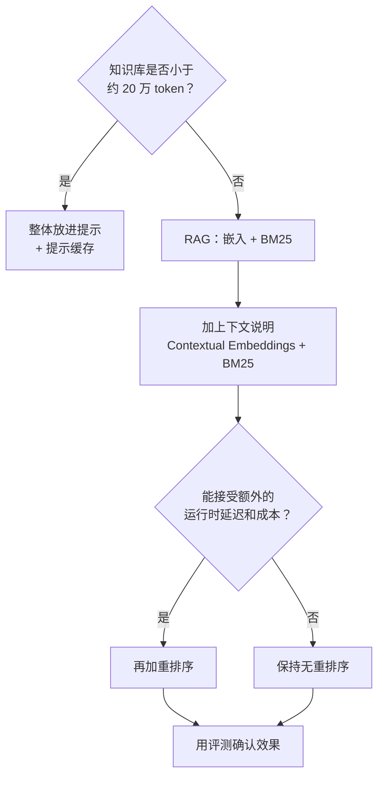

## 一句话总结

切块会让文本块“失去身份”，在嵌入和建 BM25 索引之前，先让模型给每个块写一句“这段在整篇文档里讲的是什么”，检索准确率就能显著提升，再加重排序效果还能叠加。

## 为什么重要

- **RAG 最常见的失败点在检索，而不是生成。** 这篇给出了一个只改“预处理”、不改线上架构的提升办法。
- **数据扎实。** 跨代码库、小说、ArXiv 论文、科学论文等多个领域，多种嵌入模型都做了对比，结论是“各项改进可以叠加”。
- **展示了提示缓存（prompt caching）的典型用法**：同一篇文档对应很多块时，文档只需缓存一次。
- **提醒先别急着上 RAG**：知识库很小时直接把全部内容塞进提示更简单。这和[《Building effective agents》](./building-effective-agents.md)的“简单优先”一脉相承。

## 核心概念（中英对照）

| 中文 | English | 简要解释（笔者概括） |
|---|---|---|
| 检索增强生成 | Retrieval-Augmented Generation (RAG) | 先从知识库检索相关片段，再拼进提示交给模型生成。 |
| 文本块 / 切块 | chunk / chunking | 把文档切成几百 token 的小段用于检索。 |
| 向量嵌入 | embedding | 把文本转成表达语义的向量，按语义相似度检索。 |
| BM25 | Best Matching 25 | 基于 TF-IDF 的词面匹配排序函数，擅长精确词、编号、术语。 |
| 词频-逆文档频率 | TF-IDF | 衡量一个词对某文档的重要程度，是 BM25 的基础。 |
| 排序融合 | rank fusion | 把向量检索与 BM25 的结果合并、去重。 |
| 上下文嵌入 | Contextual Embeddings | 把模型生成的块级说明拼在块前面再做嵌入。 |
| 上下文 BM25 | Contextual BM25 | 同样拼接说明后再建 BM25 索引。 |
| 重排序 | reranking | 用专门模型对初检结果打分，只保留最相关的少数块。 |
| 提示缓存 | prompt caching | 跨 API 调用缓存重复的长提示，降低延迟和成本。 |
| 召回率@20 | recall@20 | 相关文档出现在前 20 个结果中的比例；原文用 1 − recall@20 衡量“检索失败率”。 |

## 方法 / 步骤

### 0. 先判断：真的需要 RAG 吗？

原文给的经验线：知识库**小于约 20 万 token（约 500 页）**时，可以直接整体放进提示，配合提示缓存（原文称延迟降低 2 倍以上、成本最多降 90%）。只有知识库更大时才需要检索方案。

### 1. 传统 RAG 的基线做法

1. 把语料切成几百 token 的块；
2. 为每块同时生成 TF-IDF 编码和语义嵌入；
3. BM25 找精确匹配的候选，嵌入找语义相近的候选；
4. 用排序融合合并去重；
5. 取 top-K 块拼进提示。

向量 + BM25 的组合比单用向量更好：例如查询某个具体错误码时，向量可能只找到“错误码相关”的泛泛内容，BM25 能锁定那串字符。

### 2. 问题：块丢了上下文

原文的例子：一个块只写着“公司营收环比增长 3%”，但没说是哪家公司、哪个季度，这样的块很难被“某公司某季度营收增长多少”这样的问题检索到。

### 3. 解法：在块前面拼一段“定位说明”

- 对每个块，把**整篇文档 + 该块**交给模型（原文用的是 Claude 3 Haiku），要求它只输出一小段简洁的上下文说明，用于改善检索。
- 生成的说明一般 **50–100 token**，拼在块前面，**然后**再做嵌入、建 BM25 索引。
- 原文也提到别的“加上下文”思路（给块加通用文档摘要、假设文档嵌入 HyDE、基于摘要的索引），他们试过的通用摘要和摘要索引效果有限或较差，与本方法不同。

### 4. 用提示缓存压成本

同一文档的所有块共享同一份文档上下文，文档只需载入缓存一次。原文按 800 token 块、8k token 文档、50 token 指令、每块 100 token 说明估算，一次性预处理成本约为**每百万文档 token 1.02 美元**。

### 5. 再叠加重排序

1. 初检取较多候选（原文用 top-150）；
2. 把候选和查询一起送入重排序模型打分；
3. 取 top-K（原文用 top-20）进入提示。

代价是运行时多一步，带来少量延迟和成本；重排的候选越多效果越好但越慢，需要按场景权衡。原文测试用的是 Cohere 的重排序模型。

### 6. 实验结果（原文数据，top-20 检索失败率，各领域平均，嵌入用 Gemini Text 004）

| 配置 | 失败率 | 相对降低 |
|---|---|---|
| 基线（普通嵌入） | 5.7% | — |
| + Contextual Embeddings | 3.7% | 35% |
| + Contextual BM25 | 2.9% | 49% |
| + 重排序 | 1.9% | 67% |

### 7. 实施时要注意的点

- **切块方式**：块大小、边界、重叠都会影响效果。
- **嵌入模型**：所有测试模型都有提升，原文认为 Gemini 和 Voyage 的嵌入尤其好。
- **定制说明生成提示**：针对领域调整，例如附上只在其他文档里定义过的术语表。
- **块的数量**：5、10、20 中 20 最好，但信息太多也会分散模型注意力，要在自己的场景实验。
- **一定要跑评测**；生成阶段也可以尝试把“说明”和“原块”区分开传给模型。

## 图解

### 图 1：传统 RAG vs 上下文检索（预处理阶段）

图解：传统做法把切块直接写入向量库和 BM25 索引；上下文检索先让 LLM 结合整篇文档给每块写 50–100 token 的定位说明，再把“说明 + 原块”写入上下文向量库和上下文 BM25 索引。

### 图 2：完整的检索链路（含重排序）

### 图 3：选型决策

## 关键原话

> "they often destroy context."
> —— （传统 RAG 系统）常常会把上下文破坏掉。

> "All these benefits stack"
> —— 这些收益是可以叠加的。

## 实践建议

- [ ] 先估算知识库 token 数：够小就别做 RAG。
- [ ] 先搭“嵌入 + BM25 + 排序融合”的基线，并建一个带标准答案的检索评测集（用 1 − recall@K 跟踪）。
- [ ] 加上下文说明时，务必开启提示缓存，把同一文档的块放在一起处理。
- [ ] 针对领域改写说明生成提示（例如加入术语表），并用评测比较通用提示与定制提示。
- [ ] 重排序候选数和最终 K 值都做网格实验，权衡效果与延迟。
- [ ] **笔者补充**：说明文本是模型生成的，建议抽样人工检查，防止错误说明把块“贴错标签”。

## 延伸阅读

**站内笔记**
- 第 2 篇：[上下文工程](./effective-context-engineering-for-ai-agents.md) — 检索只是管理上下文的手段之一。
- 第 1 篇：[构建高效的智能体](./building-effective-agents.md) — “增强型 LLM”中的检索能力。

**原文引用的资源**
- [Contextual Embeddings cookbook](https://platform.claude.com/cookbook/capabilities-contextual-embeddings-guide)
- [Prompt caching 文档](https://docs.anthropic.com/en/docs/build-with-claude/prompt-caching)
- [原文附录 II（PDF）](https://assets.anthropic.com/m/1632cded0a125333/original/Contextual-Retrieval-Appendix-2.pdf)
- [HyDE 论文](https://arxiv.org/abs/2212.10496)

---

*本笔记依据 2026-10-17 抓取的在线原文撰写。原文：Anthropic,[《Introducing Contextual Retrieval》](https://www.anthropic.com/engineering/contextual-retrieval)。*
