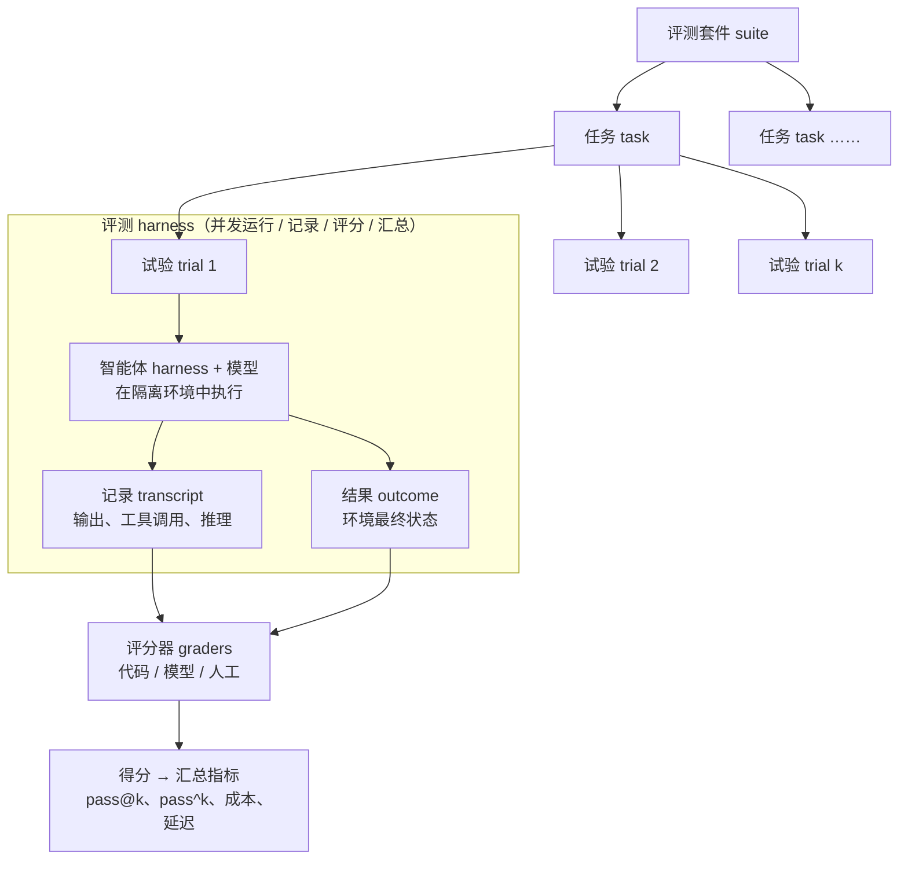
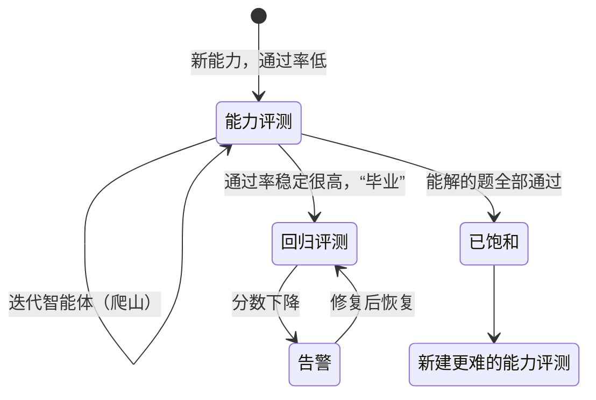

## 一句话总结

没有评测，团队只能在“修好一个、又坏一个”的被动循环里打转。尽早用 20–50 个来自真实失败的任务起步，选对评分器，读评测记录，并把评测当成需要长期维护的产品资产。

## 为什么重要

- **它是评测模块的总论**，给出了一套可以通用的术语和流程，后面几篇（基础设施噪声、评测察觉、抗 AI 笔试）都可以放进这个框架来理解。
- **专门针对“智能体”**：多轮、有状态、会改环境，错误会累积，模型还会想出评测设计者没预料到的解法。
- **非常可操作**：给出了按智能体类型划分的评分方案示例和一份八步路线图。

## 核心概念（中英对照）

| 中文 | English | 简要解释（笔者概括） |
|---|---|---|
| 评测 | eval / evaluation | 给 AI 系统一个输入，再用评分逻辑判断输出是否成功。 |
| 任务 / 测试用例 | task / problem / test case | 单个测试，有明确的输入和成功标准。 |
| 试验 | trial | 对一个任务的一次尝试；输出有随机性，所以要多次试验。 |
| 评分器 | grader | 给智能体某方面表现打分的逻辑，可以包含多个断言（检查）。 |
| 记录 / 轨迹 | transcript / trace / trajectory | 一次试验的完整记录：输出、工具调用、推理、中间结果等。 |
| 结果 | outcome | 试验结束时环境里的最终状态（例如数据库里是否真有这笔订单），不等于智能体“说”自己完成了。 |
| 评测 harness | evaluation harness | 端到端运行评测的基础设施：提供工具、并发执行、记录、评分、汇总。 |
| 智能体 harness / 脚手架 | agent harness / scaffold | 让模型作为智能体运行的系统；评测智能体时评的是“harness + 模型”。 |
| 评测套件 | evaluation suite | 一组衡量特定能力或行为的任务。 |
| 能力评测 | capability (quality) eval | 回答“它能做好什么”，起点通过率应该较低，留出提升空间。 |
| 回归评测 | regression eval | 回答“以前会的现在还会吗”，通过率应接近 100%。 |
| 以模型为评委 | LLM-as-judge | 用 LLM 按评分细则打分，需要与人工校准。 |
| 部分得分 | partial credit | 多步骤任务完成了一部分也能体现出来。 |
| 饱和 | saturation | 能解的题都过了，评测不再提供提升信号。 |
| pass@k / pass^k | pass@k / pass^k | k 次至少成功一次的概率 / k 次全部成功的概率。 |
| 评测驱动开发 | eval-driven development | 先写评测定义要实现的能力，再迭代到通过。 |
| 瑞士奶酪模型 | Swiss Cheese Model | 安全工程概念：多层防线叠加，单层漏掉的问题由其他层拦住。 |

## 方法 / 步骤

### 1. 为什么要建评测

- 早期靠手动测试、内部试用和直觉能走很远；但上线、规模扩大之后，没有评测就只能“盲飞”：等投诉、手动复现、修 bug、祈祷别的地方没坏。分不清真回归和噪声，也无法在发布前批量测试。
- 原文举了 Claude Code 的例子：先靠员工和外部用户反馈快速迭代，之后先为简洁性、文件编辑这类窄领域加评测，再扩展到过度工程等复杂行为。
- 客户案例：Descript（视频编辑智能体）按“别弄坏东西 / 照我说的做 / 做得好”三个维度建评测，从人工评分演进到由产品团队定义标准、定期人工校准的 LLM 评分；Bolt 在智能体已广泛使用后才开始建评测，三个月内搭起了包含静态分析、浏览器智能体测试应用、LLM 评委的体系。
- 评测还能加快换用新模型：有评测的团队几天就能完成评估和升级。同时还能“免费”获得延迟、token、单任务成本、错误率的基线，并成为产品与研究团队之间带宽最高的沟通渠道。成本在前期看得见，收益在后期累积，所以容易被低估。

### 2. 三类评分器

| 类型 | 典型方法 | 优点 | 缺点 |
|---|---|---|---|
| 代码评分器 | 字符串 / 正则匹配、fail-to-pass 等二元测试、静态分析、结果状态校验、工具调用校验、记录分析（轮数、token） | 快、便宜、客观、可复现、易调试 | 对合理的变体太脆弱，缺少细微判断，不适合主观任务 |
| 模型评分器 | 评分细则打分、自然语言断言、两两比较、参考答案对照、多评委共识 | 灵活、可扩展、能把握细节、能处理开放式输出 | 非确定性、比代码贵、需要与人工校准 |
| 人工评分 | 领域专家评审、众包、抽查、A/B 测试、标注一致性 | 黄金标准，可用于校准模型评分器 | 贵、慢、难以规模化找到专家 |

单个任务的综合方式可以是加权（总分超过阈值）、二元（所有评分器都通过），或者两者混合。

### 3. 能力评测 vs 回归评测

能力评测起点要低、要有“可以爬的山”；回归评测接近满分，用来防倒退。能力评测的通过率高了之后，可以“毕业”成为持续运行的回归套件。

### 4. 四类智能体怎么评（概括）

| 类型 | 评测要点 |
|---|---|
| 编码智能体 | 以确定性测试为主（代码能不能跑、测试过不过），例如 SWE-bench Verified、Terminal-Bench；还可以评记录：代码质量规则、LLM 细则评价工具使用与交互。原文的示意任务组合了单元测试、LLM 细则、静态分析、状态检查、工具调用检查和延迟 / token 指标，但强调实际中通常只需要单元测试 + 代码质量细则，其余按需添加。 |
| 对话智能体 | 交互质量本身就是被评对象；通常需要另一个 LLM 扮演用户；成功是多维度的：状态（工单已解决）、记录约束（少于 N 轮）、LLM 细则（语气是否恰当）。参考 τ-Bench、τ2-Bench。 |
| 研究智能体 | “全面”“来源可靠”乃至“正确”都依赖具体场景；专家可能意见不一、参考内容会变、输出越长越容易出错。组合使用：有据性检查（论断有检索来源支撑）、覆盖度检查（必须包含的关键事实）、来源质量检查；有客观答案的用精确匹配；LLM 细则要经常与专家判断校准。 |
| 电脑使用智能体 | 在真实或沙箱环境中运行，检查最终是否达成目标，例如 WebArena 检查 URL、页面状态和后端状态，OSWorld 检查文件系统、配置、数据库、UI 元素。浏览器场景还要在 token 效率和延迟之间取舍（DOM 快但费 token，截图慢但省 token）；原文提到 Claude for Chrome 专门评测了“在不同情境下选对工具”。 |

### 5. 非确定性：pass@k 与 pass^k

- **pass@k**：k 次中至少一次成功，k 越大越高；适合“只要有一次成功就行”的工具。编码场景通常最关心 pass@1。
- **pass^k**：k 次全部成功，k 越大越低；例如单次成功率 75%，连续 3 次全部成功约 42%；面向客户、要求每次都可靠的智能体更该看它。
- k=1 时二者相同；k 很大时一个趋近 100%，一个趋近 0。

### 6. 从零到一的八步路线

| 步骤 | 要点（概括） |
|---|---|
| 0. 尽早开始 | 不必等到有几百个任务；20–50 个来自真实失败的简单任务就是很好的起点（早期改动效果大，小样本就够）。拖得越久越难建。 |
| 1. 从已有手动检查开始 | 发布前手动验证的行为、用户常做的任务；已上线的话看 bug 跟踪和客服工单，按用户影响排序。 |
| 2. 写无歧义的任务 + 参考解 | 好任务是两位领域专家会独立给出相同判定的任务；评分器检查的一切都应能从任务描述中看出（原文举例：Terminal-Bench 审计发现有任务没指定脚本路径，测试却假定某个路径）。前沿模型在大量试验中 0% 通过，多半是任务坏了；每个任务配一个能通过所有评分器的参考解。 |
| 3. 平衡的题集 | 同时测“应该做”和“不该做”；原文以 Claude.ai 网页搜索为例，既要在该搜时搜，也要在不该搜时不搜，在触发不足和过度触发之间反复调整。 |
| 4. 稳定的 harness 与环境 | 评测中的智能体要和生产环境大致一致；每次试验从干净环境开始，避免残留文件、缓存、资源耗尽造成的相关失败；共享状态也可能虚高分数（原文观察到 Claude 翻看之前试验留下的 git 历史获得不公平优势）。 |
| 5. 精心设计评分器 | 能用确定性就用确定性，必要时用 LLM，人工用于额外验证；**评产出而不是评路径**，不要死卡工具调用顺序；多部分任务给部分得分；LLM 评委要与人工校准，允许它回答“不知道”，按维度拆开、各维度用独立评委；防止被绕过或钻空子。原文举例：Opus 4.5 在 CORE-Bench 最初只有 42%，修复过严的数值比对、含糊的任务和不可复现的随机任务，并换用约束更少的脚手架后升到 95%；METR 也发现过要求“达到阈值”、评分却要求“超过阈值”的配置错误。 |
| 6. 读评测记录 | 不读大量记录就无法知道评分器是否靠谱；失败应该“看起来公平”。 |
| 7. 监控能力评测是否饱和 | 接近饱和时，大幅能力提升只体现为小幅分数变化，容易误判（原文提到 Qodo 的一次性编码评测没能体现 Opus 4.5 在长任务上的进步，后来改建了智能体式评测）。原则：在有人深入看过细节和记录之前，不按表面分数下结论。 |
| 8. 长期维护 | 评测套件是需要明确负责人的“活”资产；原文认为最有效的做法是专门的评测团队负责基础设施，领域专家和产品团队贡献任务并自己运行。提倡评测驱动开发；产品经理、客户成功、销售人员也可以用 Claude Code 以 PR 的形式贡献评测任务。 |

### 7. 评测与其他手段的配合

| 手段 | 擅长 | 局限 |
|---|---|---|
| 自动化评测 | 快、可复现、无用户影响、可以每次提交都跑 | 前期投入大，需要持续维护，不贴近真实用法时会带来虚假信心 |
| 线上监控 | 真实规模的行为，能发现合成评测漏掉的问题 | 被动，信号嘈杂，缺少评分用的标准答案 |
| A/B 测试 | 衡量真实用户结果，控制混杂因素 | 慢，需要足够流量，难以解释“为什么” |
| 用户反馈 | 发现意料之外的问题，带真实样例 | 稀疏、有选择偏差，偏向严重问题，用户很少说明原因 |
| 人工审阅记录 | 建立对失败模式的直觉，发现细微问题 | 耗时，不能规模化，覆盖不均 |
| 系统化人工研究 | 黄金标准，可以处理主观任务、校准模型评分器 | 贵、慢，难以频繁进行 |

发布前和 CI 中以自动化评测为第一道防线；上线后用监控发现分布漂移；有足够流量时用 A/B 验证重大改动；反馈分诊和每周抽读记录作为常规；系统化人工研究留给评分器校准和主观输出。像瑞士奶酪模型一样，多层叠加。

原文附录还列了一些评测框架（Harbor、Braintrust、LangSmith、Langfuse、Arize Phoenix / AX），并提醒：框架只是工具，真正决定价值的是任务和评分器的质量。

## 图解

### 图 1：智能体评测的组成

### 图 2：从零到一的八步路线

### 图 3：能力评测“毕业”为回归评测

### 图 4：多层评估的“瑞士奶酪”

## 关键原话

> "it’s often better to grade what the agent produced, not the path it took."
> —— 通常更好的做法是评判智能体产出了什么，而不是它走了哪条路。

> "Read the transcripts!"
> —— 去读评测记录！

## 实践建议

- [ ] 本周就从 bug 跟踪和客服工单里挑 20 个真实失败，写成第一个评测套件。
- [ ] 每个任务都配一个参考解，并让另一位同事独立判断“这题算过还是没过”。
- [ ] 每个行为都同时测“应该触发”和“不应该触发”。
- [ ] 评分优先看环境的最终状态，而不是智能体自己说了什么；不死卡工具调用顺序。
- [ ] LLM 评委按维度拆开，允许回答“不知道”，并定期与人工打分对比。
- [ ] 每次试验使用全新、隔离的环境。
- [ ] 区分能力套件和回归套件，分别设定预期通过率。
- [ ] 面向客户的智能体，把 pass^k 加入看板。
- [ ] 分数异常（0% 或突然大涨）时，先读记录、查任务和评分器，再下结论。
- [ ] **笔者补充**：给评测套件建 CODEOWNERS，像管理测试代码一样管理它。

## 延伸阅读

**站内笔记**
- 第 12 篇：[SWE-bench Verified 与 Claude 3.5 Sonnet](./swe-bench-sonnet.md)
- 第 13 篇：[基础设施噪声](./infrastructure-noise.md) — 第 4 步“稳定环境”的深入案例。
- 第 14 篇：[BrowseComp 中的评测察觉](./eval-awareness-browsecomp.md) — 第 5 步“防绕过”的极端案例。
- 第 3 篇：[为智能体编写高效工具](./writing-tools-for-agents.md) — 用评测驱动工具改进。
- 第 6 篇：[think 工具](./claude-think-tool.md) — pass^k 的实际应用。

**原文引用的资源**
- τ2-bench：<https://github.com/sierra-research/tau2-bench>
- Terminal-Bench：<https://www.tbench.ai/>
- OSWorld：<https://os-world.github.io/>
- Harbor 评测框架：<https://harborframework.com/>

---

*本笔记依据 2026-10-17 抓取的在线原文撰写。原文：Anthropic,《Demystifying evals for AI agents》, <https://www.anthropic.com/engineering/demystifying-evals-for-ai-agents>。*
