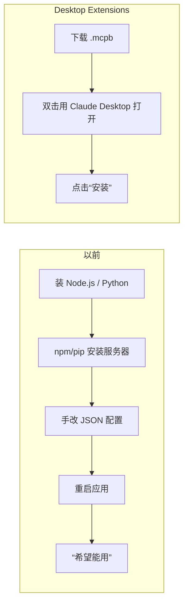
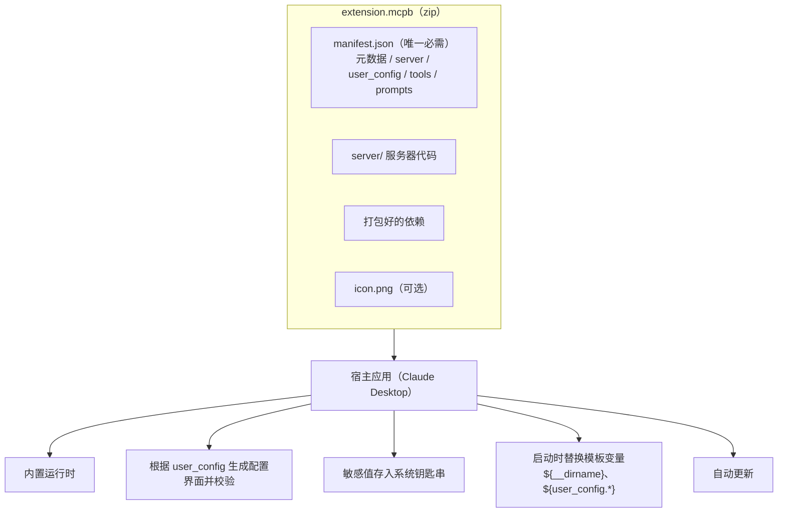
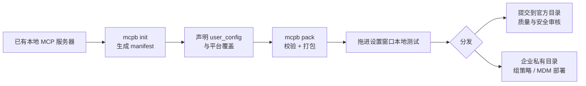

> 🔄 **原文后续更新（2025-09-11）**：扩展名从 `.dxt` 改为 **`.mcpb`（MCP Bundle）**，已有的 `.dxt` 扩展仍然可用，功能完全相同，只是改了名字。本笔记统一使用 `.mcpb`；在其他旧资料里看到 “DXT” 指的就是同一种东西。

## 一句话总结

把一个本地 MCP 服务器连同依赖和一份描述清单打包成单个文件，让普通用户也能像装浏览器插件一样“双击 → 安装”，不再需要终端和配置文件。

## 为什么重要

- **MCP 的价值要靠“装得上”才能兑现**：原文认为安装门槛让本地 MCP 服务器基本无法被非技术用户使用。
- **展示了一个“工具分发”的完整设计**：清单格式、用户配置、密钥管理、跨平台、目录审核、企业管控。
- **开放规范**：格式、工具链和参考实现都开源，目标是让其他 AI 桌面应用也能支持。
- [第 3 篇](./writing-tools-for-agents.md)《为智能体编写高效工具》里也建议用本地 MCP 服务器或桌面扩展来测试工具原型。

## 核心概念（中英对照）

| 中文 | English | 简要解释（笔者概括） |
|---|---|---|
| 桌面扩展 | Desktop Extension | 可一键安装的本地 MCP 服务器包。 |
| MCP 包 | MCP Bundle (.mcpb，旧称 .dxt) | 扩展文件的格式，本质是 zip 压缩包。 |
| 清单文件 | manifest.json | 包内唯一必需的文件，描述元数据、服务器启动方式、用户配置、功能声明、运行要求。 |
| 用户配置 | user_config | 开发者声明需要用户填写的项（如 API Key、允许访问的目录）。 |
| 模板变量 | template literals | 如 `${__dirname}`、`${user_config.xxx}`、`${HOME}`，启动时替换为真实值。 |
| 平台覆盖 | platform overrides | 针对 Windows / macOS 设置不同的命令或环境变量。 |
| 系统钥匙串 | OS keychain | 存放敏感配置的系统级安全存储。 |
| 扩展目录 | extension directory | 内置在 Claude Desktop 中、经过审核的扩展列表。 |
| 组策略 / 移动设备管理 | Group Policy / MDM | 企业在 Windows / macOS 上集中管控扩展的方式。 |

## 方法 / 步骤

### 1. 要解决的五个痛点

需要预装 Node.js、Python 等运行时；每个服务器都要手改 JSON 配置；依赖冲突和版本问题要自己解决；只能去 GitHub 上找服务器；更新要手动重装。

### 2. 包的结构

- 一个 `.mcpb` 就是一个 zip，里面有 `manifest.json`、服务器代码、打包好的依赖、可选图标。
- 支持三种服务器类型：Node.js、Python、经典二进制可执行文件。
- 宿主（Claude Desktop）负责：内置 Node.js 运行时、自动更新、把密钥存进系统钥匙串。

### 3. manifest 的关键部分

| 部分 | 作用 |
|---|---|
| 元数据 | 名称、版本、描述、作者（作者为必填）等，大多数字段可选 |
| server | 类型、入口文件、启动命令和参数（`mcp_config`），可以按平台覆盖 |
| user_config | 声明需要用户提供的配置；标记为敏感的项存入钥匙串；未填必填项时不启用扩展 |
| tools / prompts | 预先声明功能，帮助用户在安装前了解它能做什么 |

模板变量的效果：例如声明需要 `api_key`，启动服务器时宿主会把 `${user_config.api_key}` 替换为用户填的值，并把 `${__dirname}` 替换为扩展解压后的目录路径。

### 4. 打包第一个扩展的四步

1. `npx @anthropic-ai/mcpb init`：交互式生成 manifest（加 `--yes` 可快速生成最简版本）。
2. 在 manifest 中声明用户配置；宿主会生成配置界面、校验输入、安全存储，并按开发者的设置以参数或环境变量传给服务器。
3. `npx @anthropic-ai/mcpb pack`：校验 manifest 并生成 `.mcpb`。
4. 把文件拖进 Claude Desktop 的设置窗口，可以看到说明、所需权限与配置、安装按钮。

### 5. 分发、开放与安全

- **扩展目录**：Claude Desktop 内置经过筛选的目录，可以浏览、搜索、一键安装；提交流程包括遵守指南、在 Windows 和 macOS 上测试、提交、由团队做质量与安全审核。
- **开源内容**：完整规范、打包与校验工具、参考实现、TypeScript 类型与 schema；版本号刻意定为 0.1，便于和社区一起演进。
- **面向用户的安全措施**：敏感数据存放在钥匙串、自动更新、可以审计已安装的扩展。
- **面向企业的管控**：支持组策略和 MDM、预装经批准的扩展、按扩展或发布者设置黑名单、整体禁用扩展目录、部署私有扩展目录。

### 6. 用 Claude Code 来写扩展

原文提到 Anthropic 内部发现 Claude 能在很少干预下写出扩展，建议在提示中附上：先阅读 MCPB 规范（README、MANIFEST、示例），按规范生成 manifest，用 MCP SDK 实现服务器，使用 stdio 通信、清晰的 schema 与错误处理，并验证工具返回结构和 manifest 加载。原文还举了一个内部例子：把 PyBoy GameBoy 模拟器打包成扩展，让 Claude 直接操控游戏。

## 图解

### 图 1：安装方式对比

### 图 2：一个 .mcpb 包的结构与宿主职责

图解：`extension.mcpb` 本质是 zip 包，只有 `manifest.json` 必需；宿主应用（Claude Desktop）负责内置运行时、按 `user_config` 生成配置界面、把敏感值存入钥匙串、替换模板变量和自动更新。

### 图 3：开发者的打包流程与分发渠道

## 关键原话

> "Desktop Extensions represent a fundamental shift in how users interact with local AI tools."
> —— 桌面扩展代表着用户使用本地 AI 工具方式的一次根本性转变。

## 实践建议

- [ ] 新项目一律使用 `.mcpb` 扩展名和 `mcpb` 工具链；旧的 `.dxt` 包可以继续用，但建议迁移。
- [ ] 把所有密钥都声明为敏感的 `user_config`，不要写死在代码或配置文件里。
- [ ] 在 manifest 里写清 tools / prompts，方便用户在安装前判断。
- [ ] 同时在 Windows 和 macOS 上测试，必要时使用平台覆盖。
- [ ] 企业内部推广时，优先用私有目录 + 黑名单 / 预装策略，而不是让员工自由安装。
- [ ] **笔者补充**：安装第三方扩展前，像审计 Agent Skills 一样审查它的代码和网络访问。

## 延伸阅读

**站内笔记**
- 第 3 篇：[为智能体编写高效工具](./writing-tools-for-agents.md)
- 第 8 篇：[用代码执行调用 MCP](./code-execution-with-mcp.md)
- 第 7 篇：[Agent Skills](./equipping-agents-for-the-real-world-with-agent-skills.md)

**原文引用的资源**
- [MCPB 规范仓库（原文示例提示词中给出的地址）](https://github.com/anthropics/mcpb)
- [Manifest 规范](https://github.com/anthropics/mcpb/blob/main/MANIFEST.md)
- [原文正文超链接仍指向旧仓库名](https://github.com/anthropics/dxt)

---

*本笔记依据 2026-10-17 抓取的在线原文撰写。原文：Anthropic,[《Desktop Extensions: One-click MCP server installation for Claude Desktop》](https://www.anthropic.com/engineering/desktop-extensions)。*
