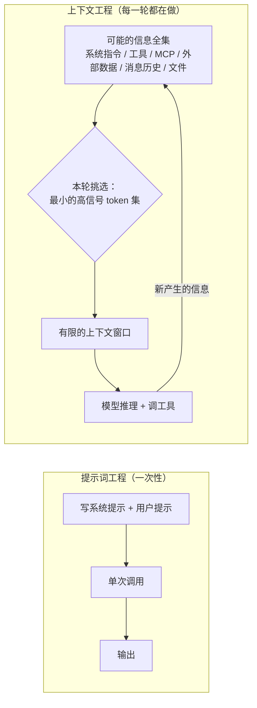
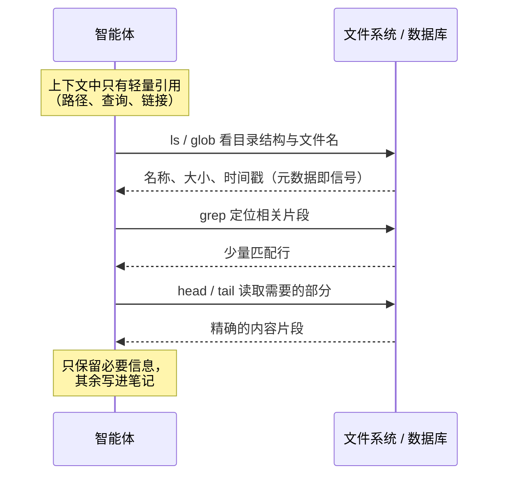
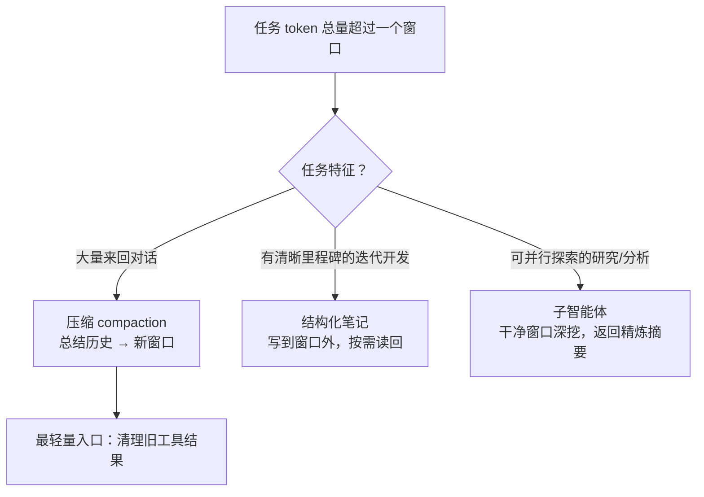

## 一句话总结

智能体越来越多轮、越来越长时，问题已经不止是“提示词怎么写”，而是“每一步该让模型看到哪些信息”：要用尽量少、信号尽量强的 token 去换取期望的行为。

## 为什么重要

- **给“提示词工程之后是什么”一个清晰答案**：提示词工程是写好指令，上下文工程是持续管理整个上下文状态（系统指令、工具、MCP、外部数据、消息历史等）。
- **解释了“为什么上下文越长效果可能越差”**（context rot、注意力预算），这是之后很多工程决策的出发点。
- **是全站的第二个核心心智模型**：Agent Skills 的渐进式披露、MCP 代码执行、长时任务 harness、多智能体研究系统，几乎都是这里几种策略的具体化。

## 核心概念（中英对照）

| 中文 | English | 简要解释（笔者概括） |
|---|---|---|
| 上下文工程 | context engineering | 在推理时持续挑选、维护最优 token 集合的一系列策略。 |
| 提示词工程 | prompt engineering | 编写和组织 LLM 指令（尤其系统提示）以获得最佳输出。 |
| 上下文腐化 | context rot | 窗口里的 token 越多，模型准确回忆其中信息的能力越下降。 |
| 注意力预算 | attention budget | 每多一个 token 都会消耗模型有限的“注意力”。 |
| 恰当的高度 | right altitude | 系统提示既不写死脆弱的 if-else 逻辑，也不空泛到缺少具体信号。 |
| 少样本提示 | few-shot prompting | 给示例；原文建议给多样而典型的示例，而非堆砌边界条件。 |
| 即时上下文 | just-in-time context | 只保存轻量引用（路径、查询、链接），需要时再用工具加载。 |
| 渐进式披露 | progressive disclosure | 让智能体通过探索逐层发现所需上下文。 |
| 混合策略 | hybrid strategy | 部分数据预先放入，其余由智能体自主探索获取。 |
| 长时任务 | long-horizon task | token 总量超过单个窗口、持续数十分钟到数小时的任务。 |
| 压缩 | compaction | 接近上限时总结对话，用摘要开启新窗口。 |
| 工具结果清理 | tool result clearing | 清掉历史深处已无用的原始工具输出，是最轻量的压缩。 |
| 结构化笔记 / 智能体记忆 | structured note-taking / agentic memory | 智能体把笔记写到窗口之外，之后再读回。 |
| 子智能体架构 | sub-agent architecture | 子智能体用干净窗口深挖，只返回精炼摘要给主智能体。 |

## 方法 / 步骤

### 1. 为什么上下文是稀缺资源

- 模型和人一样，信息多到一定程度会“分心”。原文引用大海捞针类测试中观察到的 context rot：不同模型下降程度不同，但都存在。
- 原文给出的架构层面解释：transformer 中每个 token 都要和其他 token 建立关系（n 个 token 有 n² 对关系），长度越大越“摊薄”；训练数据中短序列更多，模型处理全局长依赖的经验较少；位置编码插值等技术能拉长窗口，但会损失一些位置理解。
- 结果是一条**渐变曲线而不是断崖**：长上下文下仍然能用，但检索和长程推理的精度会下降。
- 指导原则：**找到能最大化期望结果概率的、最小的高信号 token 集合**。

### 2. 静态上下文的各个组成部分怎么写

| 组成 | 原文建议（概括） |
|---|---|
| 系统提示 | 语言简单直接，找准“高度”：介于写死的脆弱逻辑与空泛指导之间。可用 XML 标签或 Markdown 标题分区（背景、指令、工具指引、输出说明等），但格式本身的重要性在下降。追求“能完整描述期望行为的最小信息集”——最小不等于短。先用最强模型测极简提示，再按观察到的失败补指令和示例。 |
| 工具 | 工具是智能体与信息/行动空间之间的契约：返回要省 token，要引导高效行为；功能自包含、对错误鲁棒、用途清晰、重叠少。常见失败是工具集臃肿、选哪个工具很模糊——人类工程师都说不清该用哪个，模型也做不到。 |
| 示例 | 继续强烈推荐 few-shot，但不要把一长串边界情况塞进提示，而是精选多样、典型的示例。 |
| 整体 | 消息历史等所有部分都遵循“信息充分但紧凑”。 |

### 3. 运行时上下文：从“预先检索”到“即时检索”

- 原文提到，自《Building effective agents》之后，他们对智能体的定义收敛为：**LLM 在循环中自主使用工具**。
- 很多应用在推理前用嵌入检索把材料准备好；越来越多团队在此之外增加**即时（just-in-time）**策略：只保留文件路径、查询、链接等轻量引用，需要时用工具加载。
- Claude Code 的例子：写定向查询、存结果，用 `head`/`tail` 之类命令分析大数据，而不把完整数据装进上下文。
- **元数据本身就是信号**：文件夹层级、命名、时间戳都能提示用途和相关性。
- 支持渐进式披露：每次交互得到的信息决定下一步探索什么。
- 代价：运行时探索比读预计算数据慢；需要给模型合适的工具和启发式，否则会误用工具、走进死胡同、浪费上下文。
- **混合策略**：部分数据预先放入以求速度，其余自主探索。Claude Code 就是如此——CLAUDE.md 直接放进上下文，glob、grep 用来即时查找文件。原文认为内容变化较少的领域（如法律、金融）可能更适合混合策略。
- 原文的总体建议仍是“做能奏效的最简单的事”。

### 4. 长时任务的三种技术

| 技术 | 做法 | 适合 |
|---|---|---|
| 压缩（compaction） | 接近上限时让模型总结历史，保留架构决策、未解决 bug、实现细节，丢掉冗余工具输出，用摘要开新窗口；Claude Code 还会附带最近访问的五个文件。调提示时先追求召回（不漏），再提高精度（去冗余）。最轻量的做法是清理旧的工具调用结果。 | 需要大量来回对话、保持对话连贯的任务 |
| 结构化笔记（agentic memory） | 定期把笔记写到窗口外（如待办列表、NOTES.md），之后读回。原文举了 Claude 玩宝可梦的例子：跨上千步记录进度、地图、战术，上下文重置后读自己的笔记继续。平台也提供了基于文件的 memory 工具。 | 有明确里程碑的迭代式开发 |
| 子智能体架构 | 主智能体持有高层计划；子智能体各用干净窗口深入探索（可能用掉数万 token），只返回 1,000–2,000 token 左右的精炼摘要。 | 能从并行探索中获益的复杂研究与分析 |

原文还提醒：别指望“等更大的窗口”解决问题，可预见的未来里任何大小的窗口都会有上下文污染和信息相关性问题。

## 图解

### 图 1：提示词工程 vs 上下文工程

### 图 2：即时检索与渐进式披露（以文件系统为例）

### 图 3：长时任务的三种技术如何选

## 关键原话

> "find the smallest possible set of high-signal tokens that maximize the likelihood of some desired outcome."
> —— 找到能最大化期望结果概率的、尽可能小的高信号 token 集合。

> "If a human engineer can’t definitively say which tool should be used in a given situation, an AI agent can’t be expected to do better."
> —— 如果人类工程师都说不清某种情况下该用哪个工具，就别指望 AI 智能体做得更好。

## 实践建议

- [ ] 写系统提示时先用最强模型测一个极简版本，根据失败用例再加内容，而不是一开始写全。
- [ ] 审查工具集：任意两个工具，能否一句话说清什么时候用哪个？说不清就合并或删掉。
- [ ] 把提示里堆砌的“规则清单”替换成几个多样、典型的示例。
- [ ] 大数据不进上下文：给智能体查询、过滤、截取的工具，只返回需要的部分。
- [ ] 长任务先上最轻量的手段（清理旧工具结果），再考虑完整压缩、笔记或子智能体。
- [ ] 调压缩提示时用真实的复杂轨迹测试：先保证不漏关键信息，再删冗余。
- [ ] **笔者补充**：在日志中记录每轮上下文的 token 构成（系统提示 / 工具定义 / 历史 / 工具结果），能很快看出预算花在了哪里。

## 延伸阅读

**站内笔记**
- 第 1 篇：[构建高效的智能体](./building-effective-agents.md)
- 第 3 篇：[为智能体编写高效工具](./writing-tools-for-agents.md)
- 第 7 篇：[Agent Skills](./equipping-agents-for-the-real-world-with-agent-skills.md) — 渐进式披露的落地。
- 第 16 篇：[多智能体研究系统](./multi-agent-research-system.md) — 子智能体架构的生产案例。
- 第 17 篇：[长时运行智能体的 harness](./effective-harnesses-for-long-running-agents.md)

**原文引用的资源**
- Context rot 研究（Chroma）：<https://research.trychroma.com/context-rot>
- 上下文管理功能发布：<https://www.anthropic.com/news/context-management>
- Memory 与上下文管理 cookbook：<https://platform.claude.com/cookbook/tool-use-memory-cookbook>
- 提示工程文档：<https://docs.anthropic.com/en/docs/build-with-claude/prompt-engineering/overview>

---

*本笔记依据 2026-10-17 抓取的在线原文撰写。原文：Anthropic,《Effective context engineering for AI agents》, <https://www.anthropic.com/engineering/effective-context-engineering-for-ai-agents>。*
