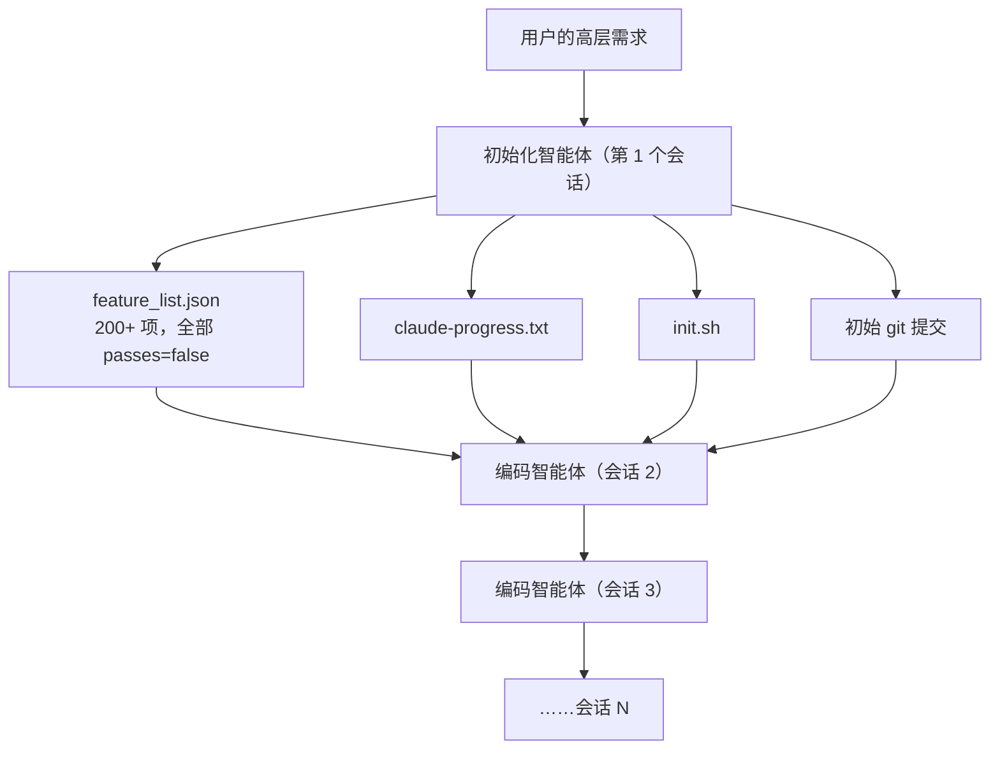
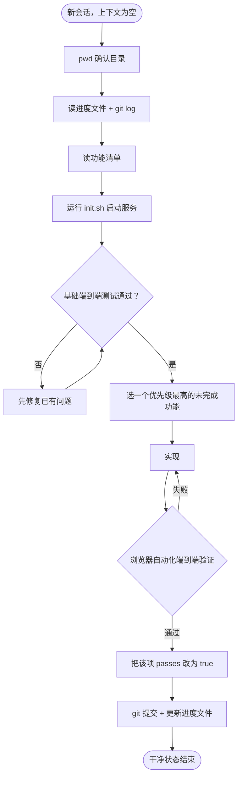
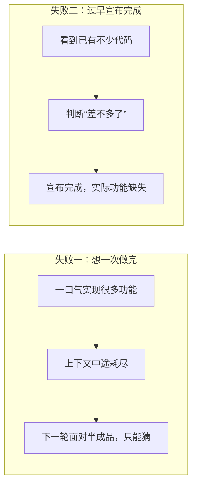

## 一句话总结

把长期项目想象成“轮班的工程师，每班都不记得上一班做了什么”：要靠结构化的交接产物（功能清单、进度笔记、git 历史、启动脚本）和“每班只做一件事、做完收拾干净”的纪律来接力。

## 为什么重要

- **把“上下文工程”中的结构化笔记落地成了一个具体的 harness 设计**，并提供了配套的快速上手代码。
- **点出两种非常典型的长任务失败模式**（想一次做完、过早宣布完成），在 Claude Code 日常使用中也很常见。
- **是第 18 篇《长时应用开发的 harness 设计》和第 19 篇《并行 Claude 写 C 编译器》的前导篇。**

## 核心概念（中英对照）

| 中文 | English | 简要解释（笔者概括） |
|---|---|---|
| 长时运行智能体 | long-running agent | 任务跨越数小时乃至数天、多个上下文窗口。 |
| Harness（运行框架） | agent harness | 包在模型外、驱动其循环工作的程序；本文基于 Claude Agent SDK。 |
| 压缩 | compaction | 总结历史以延续会话，但并不总能把清晰的指示传给下一轮。 |
| 初始化智能体 | initializer agent | 第一个会话使用的专门提示，负责搭建环境。 |
| 编码智能体 | coding agent | 之后每个会话使用的提示，负责增量推进并留下交接产物。 |
| 功能清单 | feature list (JSON) | 由初始化智能体根据需求扩展出的端到端功能列表，初始全部为“未通过”。 |
| 进度文件 | progress file (claude-progress.txt) | 记录各个会话做了什么的日志。 |
| 启动脚本 | init.sh | 启动开发服务器等，让后续会话不必摸索如何运行应用。 |
| 干净状态 | clean state | 可以合并到主分支的状态：没有大 bug、整齐、有文档。 |
| 增量推进 | incremental progress | 每个会话只做一个功能。 |
| 端到端测试 | end-to-end testing | 像真实用户一样通过浏览器自动化验证功能。 |

## 方法 / 步骤

### 1. 问题

- Claude Agent SDK 有压缩等上下文管理能力，理论上可以无限期地工作；但实践中，即使是 Opus 4.5，仅凭“做一个 claude.ai 的克隆”这样的高层提示循环运行，也做不出生产级的 Web 应用。
- **失败模式一：想一次做完**。做到一半上下文用尽，下一轮面对一个做了一半、没有记录的功能，只能猜，并花大量时间让基础功能重新跑起来（即使有压缩也会这样）。
- **失败模式二：过早宣布完成**。项目后期，新一轮看到已有不少进展，就认为任务完成了。

### 2. 解法：两类会话（同一套系统提示、工具和 harness，只有初始用户提示不同）

**初始化智能体（第一次运行）**
- 把用户需求扩展成完整的**功能清单 JSON**（claude.ai 克隆的例子中超过 200 个功能），每项包含类别、描述、验证步骤和 `passes: false`。
- 写进度文件 `claude-progress.txt`。
- 写 `init.sh`，用来启动开发服务器。
- 做一次初始 git 提交。

**编码智能体（之后每次）**
- 只能通过修改 `passes` 字段来编辑功能清单，并用措辞强硬的指令禁止删除或修改测试项。原文发现 **JSON 比 Markdown 更不容易被模型不当修改或覆盖**。
- **一次只做一个功能**——这是解决“想一次做完”的关键。
- 收尾时 **git 提交（附描述性信息）+ 更新进度文件**，让后续会话可以用 git 回退错误改动、恢复可用状态。

### 3. 测试：防止“没测就标完成”

- 不明确要求时，Claude 会改代码、跑单元测试或用 curl 测开发服务器，但意识不到功能在端到端层面并不可用。
- 明确要求使用**浏览器自动化工具**、像真实用户一样测试后（原文用 Puppeteer MCP 截图验证），表现大幅提升。
- 仍有局限：例如通过 Puppeteer MCP 看不到浏览器原生的 alert 弹窗，依赖这类弹窗的功能更容易出 bug。

### 4. 每个会话开头的“熟悉情况”流程

1. `pwd` 确认工作目录（只能编辑这个目录下的文件）。
2. 读 git 日志和进度文件，了解最近做了什么。
3. 读功能清单，选出优先级最高、尚未完成的功能。
4. 运行 `init.sh` 启动服务器，**先跑一遍基础端到端测试**（例如新建对话、发消息、收到回复），发现上一轮留下的问题就先修，而不是在坏掉的基础上继续加功能。
5. 然后才开始做新功能。

### 5. 四种失败模式与对策（原文表格的概括）

| 问题 | 初始化智能体 | 编码智能体 |
|---|---|---|
| 过早宣布整个项目完成 | 建立结构化的功能清单 JSON | 每次开头读清单，只选一个功能 |
| 留下 bug 或未记录的进度 | 初始化 git 仓库和进度文件 | 开头读进度与 git 日志并跑基础测试；结尾提交并更新进度 |
| 过早把功能标记为完成 | 建立功能清单 | 自我验证所有功能，仔细测试后才标记“通过” |
| 花时间摸索怎么运行应用 | 写 `init.sh` | 开头读 `init.sh` |

### 6. 尚待研究的问题

- 单个通用编码智能体是否就是最优，还是测试智能体、QA 智能体、代码清理智能体等专门化的多智能体架构会更好？
- 本文针对全栈 Web 开发优化，这些经验能否推广到科研、金融建模等其他长任务领域？

## 图解

### 图 1：两类会话的分工

### 图 2：编码智能体的单次会话流程

### 图 3：两种失败模式

## 关键原话

> "Imagine a software project staffed by engineers working in shifts, where each new engineer arrives with no memory of what happened on the previous shift."
> —— 想象一个由轮班工程师完成的软件项目，每个新来的工程师都不记得上一班发生了什么。

## 实践建议

- [ ] 长任务的第一步不是写代码，而是写一份可以机器检查的功能清单（JSON），每项带验证步骤。
- [ ] 禁止智能体删除或修改清单中的验证项，只允许修改状态字段。
- [ ] 在提示中强制“一次只做一个功能”。
- [ ] 每个会话结束都必须提交 git 并更新进度文件；开头必须先读它们。
- [ ] 提供端到端测试工具（如浏览器自动化），并要求像真实用户一样验证。
- [ ] 写好 `init.sh`，让任何新会话一条命令就能跑起应用。
- [ ] 每个会话开始先跑冒烟测试，坏了先修再做新功能。
- [ ] **笔者补充**：这些做法在日常用 Claude Code 做多次会话的项目时同样适用，可以把清单和进度文件放进仓库。

## 延伸阅读

**站内笔记**
- 第 2 篇：[上下文工程](./effective-context-engineering-for-ai-agents.md) — 结构化笔记、压缩。
- 第 18 篇：[长时应用开发的 harness 设计](./harness-design-long-running-apps.md) — 在本文基础上加入规划者和评估者。
- 第 19 篇：[用并行 Claude 团队写 C 编译器](./building-c-compiler.md)
- 第 20 篇：[Managed Agents](./managed-agents.md)
- 第 4 篇：[Claude Code 最佳实践](./claude-code-best-practices.md)

**原文引用的资源**
- 配套 quickstart 代码：<https://github.com/anthropics/claude-quickstarts/tree/main/autonomous-coding>
- Claude 4 提示指南（多上下文窗口工作流）：<https://docs.claude.com/en/docs/build-with-claude/prompt-engineering/claude-4-best-practices#multi-context-window-workflows>
- Claude Agent SDK：<https://platform.claude.com/docs/en/agent-sdk/overview>

---

*本笔记依据 2026-10-17 抓取的在线原文撰写。原文：Anthropic,《Effective harnesses for long-running agents》, <https://www.anthropic.com/engineering/effective-harnesses-for-long-running-agents>。*
