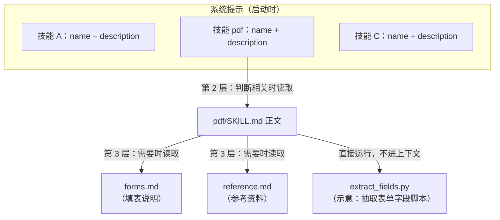
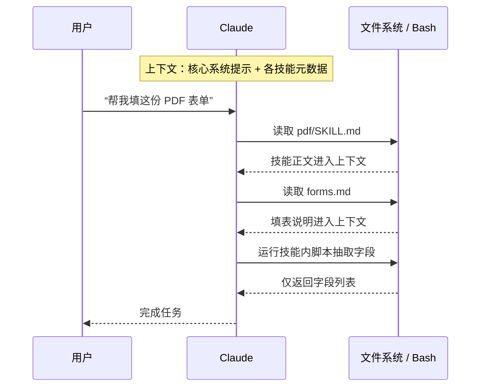

> 🔄 **原文后续更新（2025-12-18）**：Agent Skills 已作为开放标准发布，目标是跨平台可移植（见 <https://agentskills.io/>）。本文介绍的结构和原则不变，但它已经不只是 Claude 专属的格式。

## 一句话总结

与其为每个场景单独做一个定制智能体，不如把领域知识打包成一个个“技能文件夹”，让通用智能体在需要时自己发现并按需加载。

## 为什么重要

- **它是“渐进式披露”最直观的落地**，把《上下文工程》里的即时上下文思想变成了一个具体的文件格式。
- **格式极其简单**（一个文件夹 + 一个带 YAML 头的 Markdown），组织、开发者和普通用户都能写。
- **技能里能打包的上下文几乎没有上限**：智能体有文件系统和代码执行能力，并不需要一次性读完。
- **把“确定性代码”与“模型推理”结合起来**：适合用代码做的事情（如排序、抽取表单字段）交给脚本做。
- **新的供应链风险**：技能里有指令也有代码，安装来源需要审查。

## 核心概念（中英对照）

| 中文 | English | 简要解释（笔者概括） |
|---|---|---|
| 智能体技能 | Agent Skill | 包含指令、脚本、资源的文件夹，智能体可以动态发现和加载。 |
| SKILL.md | SKILL.md | 技能的核心文件，必须以包含 `name`、`description` 的 YAML 头开头。 |
| YAML 头信息 | YAML frontmatter | 技能元数据，启动时就被放进系统提示。 |
| 渐进式披露 | progressive disclosure | 第 1 层元数据 → 第 2 层 SKILL.md 正文 → 第 3 层及以上附属文件，按需逐层加载。 |
| 附属文件 | bundled / linked files | 在 SKILL.md 里按名称引用的其他文件，如 reference.md、forms.md。 |
| 程序性知识 | procedural knowledge | “怎么做某件事”的经验，技能就是把它打包。 |
| 确定性 | deterministic | 代码每次运行结果一致，适合需要可靠复现的操作。 |
| 开放标准 | open standard | 2025-12 更新后，技能格式作为跨平台标准发布。 |
| 数据外泄 | exfiltration | 恶意技能可能诱导智能体把数据发送出去。 |

## 方法 / 步骤

### 1. 技能的结构

- 最简单的技能 = 一个目录 + 其中的 `SKILL.md`。
- `SKILL.md` 开头必须是 YAML 头，包含必填的 `name` 和 `description`。
- 内容太多或只在特定场景用到的部分，拆成附属文件，在 `SKILL.md` 中按名称引用。
- 原文示例是支撑 Claude 文档编辑能力的 **PDF 技能**：核心说明放在 `SKILL.md`，填写表单的说明单独放在 `forms.md`，只有真要填表时才读。

### 2. 三层渐进式披露

| 层级 | 何时进入上下文 | 内容 |
|---|---|---|
| 第 1 层 | 启动时（所有已安装技能） | 名称 + 描述，仅足以判断“什么时候该用” |
| 第 2 层 | 模型判断与当前任务相关时 | SKILL.md 全文 |
| 第 3 层及以上 | 执行中确实需要时 | 附属文件、参考资料 |

原文把它比作一本好手册：先看目录，再看章节，最后才翻附录。

### 3. 技能与代码执行

- 技能可以带脚本，由模型自行决定是否当作工具运行。
- 理由：有些操作用 token 生成又贵又不可靠（例如排序），而且很多应用需要代码才能提供的确定性。
- PDF 技能里有一个现成的 Python 脚本，用来读取 PDF 并抽出所有表单字段；模型可以**直接运行它，而不必把脚本或 PDF 读进上下文**。

### 4. 开发与评估技能的四条建议

1. **从评测出发**：让智能体跑代表性任务，观察哪里吃力、缺什么上下文，再逐步补技能。
2. **为规模而组织**：SKILL.md 太长就拆；互斥或很少一起用的内容放在不同路径，省 token；代码既可以是工具也可以是文档，要写清楚是“直接运行”还是“读进来参考”。
3. **站在模型角度想**：观察真实使用中的意外路径或对某部分内容的过度依赖；尤其要打磨名称和描述——这是模型决定是否触发技能的依据。
4. **和模型一起迭代**：让模型把成功做法和常见错误沉淀进技能；走偏时让它自我反思原因。这样能发现模型真正需要什么，而不是事先去猜。

### 5. 安全

- 恶意技能可能引入漏洞，或指使智能体外泄数据、执行意外操作。
- 只从可信来源安装；来源不太可信时，使用前彻底审计：读完所有文件，重点看代码依赖、打包的脚本和图片等资源，以及要求连接外部不可信网络的指令或代码。

### 6. 支持范围与方向（原文发表时）

- 已在 Claude.ai、Claude Code、Claude Agent SDK、Claude Developer Platform 上支持。
- 计划：完善创建、编辑、发现、分享、使用的全生命周期；探索技能与 MCP 服务器互补（技能教“工作流程”，MCP 提供外部工具）；更远期希望智能体能自己创建、编辑、评估技能。

## 图解

### 图 1：技能的目录结构与三层披露

### 图 2：一次任务中上下文窗口的变化

### 图 3：技能的开发迭代循环

## 关键原话

> "Building a skill for an agent is like putting together an onboarding guide for a new hire."
> —— 给智能体写技能，就像给新员工准备入职手册。

> "the amount of context that can be bundled into a skill is effectively unbounded."
> —— 一个技能里能打包的上下文实际上没有上限。

## 实践建议

- [ ] 第一个技能从“智能体反复做错或反复问”的任务开始，而不是凭想象。
- [ ] `description` 写清“在什么情况下用”，而不只是“这是什么”——它决定触发率。
- [ ] SKILL.md 只放核心流程；只在某些分支才用的内容拆到单独文件，并在正文里写清什么时候去读。
- [ ] 稳定、确定性的操作写成脚本，并注明“直接运行”还是“读来参考”。
- [ ] 第三方技能安装前做代码审计，尤其是网络访问和依赖。
- [ ] **笔者补充**：给技能建一个小评测集（触发是否正确 + 任务是否完成），每次改描述都回归一次。

## 延伸阅读

**站内笔记**
- 第 2 篇：[上下文工程](./effective-context-engineering-for-ai-agents.md) — 渐进式披露的理论背景。
- 第 8 篇：[用代码执行调用 MCP](./code-execution-with-mcp.md) — 同样借助文件系统按需加载，并提到可把可复用代码保存为技能。
- 第 3 篇：[为智能体编写高效工具](./writing-tools-for-agents.md)

**原文引用的资源**
- Agent Skills 开放标准：<https://agentskills.io/>
- 产品发布：<https://www.anthropic.com/news/skills>
- 文档：<https://docs.claude.com/en/docs/agents-and-tools/agent-skills/overview>
- PDF 技能示例：<https://github.com/anthropics/skills/tree/main/document-skills/pdf>
- Skills cookbook：<https://github.com/anthropics/claude-cookbooks/tree/main/skills>

---

*本笔记依据 2026-10-17 抓取的在线原文撰写。原文：Anthropic,《Equipping agents for the real world with Agent Skills》, <https://www.anthropic.com/engineering/equipping-agents-for-the-real-world-with-agent-skills>。*
