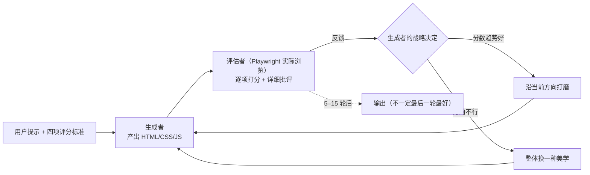
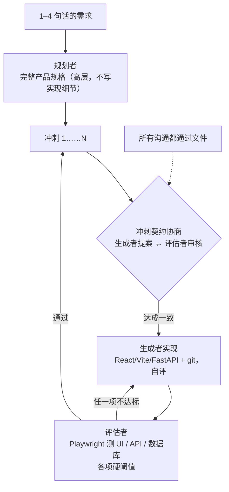
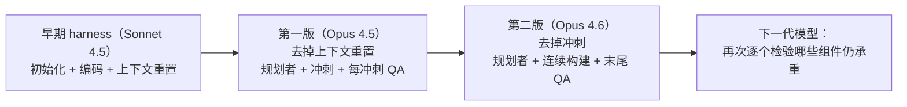
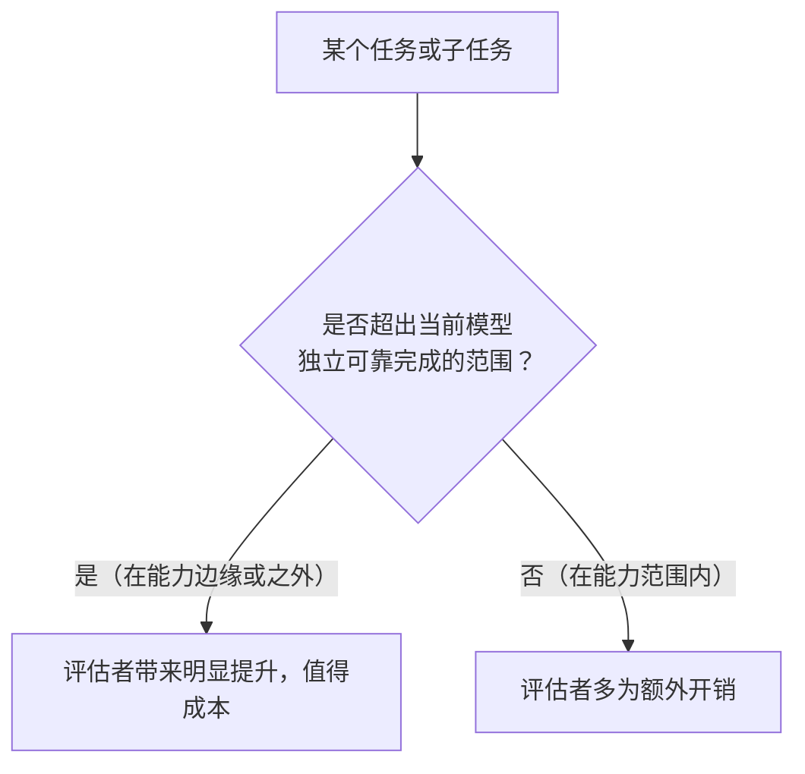

## 一句话总结

智能体给自己打分总是偏宽松，把评估者独立出来并调教得足够挑剔，再配上规划者扩展需求，就能让智能体自主做出更完整、更好用的应用；但 harness 的每个组件都是对“模型做不到什么”的假设，要随模型升级不断检验和删减。

## 为什么重要

- **是第 17 篇（初始化 + 编码智能体）的直接续篇**，补上了“自我评估不可靠”这个此前没有解决的问题。
- **展示了如何把主观质量变得可评分**：写成评分标准，用少样本示例校准评估者。
- **给出了真实的成本 / 耗时 / 效果对比**（单智能体 20 分钟 9 美元 vs 完整 harness 6 小时 200 美元）。
- **方法论价值**：逐个移除组件、观察影响，以及“评估者不是固定的是非题”这一判断，对任何维护 harness 的人都适用。

## 核心概念（中英对照）

| 中文 | English | 简要解释（笔者概括） |
|---|---|---|
| 生成对抗网络 | Generative Adversarial Network (GAN) | 生成器与判别器对抗训练；本文借用其“生成-评判”结构。 |
| 生成者 | generator | 负责实现前端或应用的智能体。 |
| 评估者 | evaluator / QA agent | 实际操作页面或应用、按标准打分并给出详细批评的智能体。 |
| 规划者 | planner | 把一两句话的需求扩展为完整产品规格的智能体。 |
| 上下文焦虑 | context anxiety | 模型自认为接近上下文上限时提前收尾的倾向。 |
| 上下文重置 | context reset | 清空上下文、启动新智能体，并通过结构化交接延续工作（不同于原地压缩）。 |
| 自我评估偏差 | self-evaluation leniency | 智能体评价自己的产出时倾向于自信地夸赞。 |
| 评分标准 | grading criteria | 设计质量、原创性、工艺、功能性等可以打分的维度。 |
| “AI 糊弄风” | AI slop | 原文用来指高度通用、一看就是 AI 生成的套路化设计。 |
| 冲刺 | sprint | 一次实现一个功能的工作块。 |
| 冲刺契约 | sprint contract | 每个冲刺开始前，生成者与评估者商定“怎样算完成”。 |
| 承重组件 | load-bearing component | 删掉后效果明显下降的 harness 组件。 |

## 方法 / 步骤

### 1. 朴素实现的两个问题

1. **长任务失去连贯性**：上下文越满越乱；有的模型还有“上下文焦虑”。上下文重置（清空 + 结构化交接）可以同时解决这两点，压缩则不能给出干净的起点。原文指出 Sonnet 4.5 的上下文焦虑严重到仅靠压缩不够，所以早期 harness 必须做重置——代价是编排复杂度、token 开销和延迟。
2. **自我评估**：智能体评价自己的作品时会自信地夸奖，即使人类一眼看出质量平庸；设计这类主观任务尤其明显，但可验证的任务中也会出现判断失误。把干活的和打分的分开是一个有力的杠杆：独立的评估者本身也是 LLM，仍然偏宽松，但**把一个独立评估者调教得挑剔，比让生成者批判自己容易得多**。

### 2. 前端设计实验：让主观质量可评分

- 不加干预时，Claude 倾向于安全、可预期、功能正常但视觉平淡的布局。
- 四个评分标准（同时写进生成者和评估者的提示）：

| 标准 | 关注点 | 权重 |
|---|---|---|
| 设计质量 | 色彩、字体、布局、图像等是否组合成统一的氛围和个性 | 高 |
| 原创性 | 是否有定制化的决策，而不是模板、库默认值、典型 AI 套路（原文举例：白卡片配紫色渐变） | 高 |
| 工艺 | 字体层级、间距一致性、色彩和谐、对比度等基本功 | 较低（模型默认就做得不错） |
| 功能性 | 用户能否理解界面、找到主要操作、不用猜就完成任务 | 较低 |

- 用带详细评分拆解的少样本示例**校准评估者**，使其与作者的偏好一致，并减少迭代过程中的评分漂移。
- 流程：基于 Claude Agent SDK；生成者产出 HTML/CSS/JS 前端 → 评估者通过 Playwright MCP 实际浏览、截图、研究页面，再逐项打分并写详细批评 → 反馈给生成者。每次生成迭代 5–15 轮，完整运行最长约 4 小时；每轮评估后生成者要做战略决定：分数趋势好就继续打磨，不好就整体转向另一种美学。
- 观察：
  - 评分随迭代上升后趋于平台期，仍有提升空间；
  - 标准的**措辞**会显著影响风格，例如写“最好的设计具有博物馆品质”会让设计趋同于某种视觉风格；
  - 并非线性变好，作者常常更喜欢中间某一轮；实现复杂度会随轮次上升；
  - 即使是第一轮，也明显优于不加提示的基线，说明标准本身就把模型推离了通用默认值；
  - 原文例子：为一家荷兰艺术博物馆做网站，第 9 轮是精致但符合预期的深色落地页，第 10 轮推翻重来，做成用 CSS 透视渲染的 3D 展厅，可以穿过门在展厅之间导航。

### 3. 扩展到全栈开发：三智能体架构（第一版，Opus 4.5）

- Opus 4.5 基本没有上下文焦虑，所以**去掉了上下文重置**，整个构建作为一个连续会话运行，靠 SDK 的自动压缩处理上下文增长。

| 智能体 | 职责 | 设计考虑 |
|---|---|---|
| 规划者 | 把 1–4 句话的提示扩展成完整产品规格 | 要求在范围上有野心；聚焦产品上下文和高层技术设计，**不写细粒度实现**（细节写错会层层传导）；寻找把 AI 功能融入产品的机会 |
| 生成者 | 按冲刺一次做一个功能（React + Vite + FastAPI + SQLite / PostgreSQL），每个冲刺结束先自评再交 QA，使用 git | 沿用“一次一个功能”的范围管理 |
| 评估者 | 用 Playwright MCP 像用户一样点击运行中的应用，测 UI、API、数据库状态；按产品深度、功能、视觉设计、代码质量打分；每项有硬阈值，任何一项不达标冲刺就失败，并给出详细反馈 | 早期 harness 的应用常常看起来很漂亮，实际用起来却有 bug |

- **冲刺契约**：每个冲刺开始前，生成者提出要做什么、如何验证成功，评估者审核，反复协商直到一致——用来弥合高层规格与可测试实现之间的鸿沟。
- **智能体之间通过文件通信**：一方写文件，另一方读后在原文件或新文件中回应。

**结果对比**（提示：做一个带关卡编辑器、精灵编辑器、实体行为和可玩测试模式的 2D 复古游戏制作器）：

| | 耗时 | 成本 | 效果（概括） |
|---|---|---|---|
| 单智能体 | 20 分钟 | 9 美元 | 初看符合预期，但布局浪费空间、流程僵硬，**核心的游戏运行是坏的**（实体定义与运行时之间的连接断了） |
| 完整 harness | 6 小时 | 200 美元 | 规划者扩展出 16 个功能、10 个冲刺（含动画、行为模板、音效、AI 辅助生成精灵和关卡、导出分享）；界面更精致，视觉风格统一；**游戏可以实际玩**，但物理和 AI 生成的关卡仍有瑕疵 |

- 评估者给出的问题非常具体，可以直接定位到代码行和路由顺序；原文提到第 3 个冲刺单是关卡编辑器就有 27 条契约标准。
- **调教评估者很费功夫**：开箱即用的 Claude 是很差的 QA——会发现问题，然后说服自己“问题不大”并放行；测试流于表面。方法是读评估者日志，找出它与作者判断不一致的地方，修改 QA 提示，反复多轮。即使如此，仍有小布局问题、不直观的交互和深层功能的 bug 没被发现。

### 4. 迭代 harness：逐个拆掉组件（第二版，Opus 4.6）

- 原则：**harness 中的每个组件都编码了一个“模型自己做不到什么”的假设**，这些假设可能本来就错，也可能随模型进步而过时。
- 第一次尝试大刀阔斧地简化，效果复现不了，而且分不清哪些组件真正承重；改为**一次只移除一个组件**并观察影响。
- Opus 4.6 发布后（原文引用其发布说明：规划更细致、能更久地持续执行智能体任务、在大代码库中更可靠、代码审查和调试能力更强、长上下文检索提升明显），这些正是 harness 原本要弥补的能力。
- **移除冲刺结构**；保留规划者（没有它，生成者会低估范围，直接开工，做出的应用功能更少）；评估者改为在整个运行结束时做一次。
- **评估者的价值取决于任务与模型能力边界的相对位置**：在 4.5 上，构建任务处在生成者能力边缘，评估者全程都能发现有意义的问题；在 4.6 上边界外移，许多任务生成者自己就能做好，评估者成了额外开销；但对仍处于能力边缘的部分，评估者依然有明显帮助。
- 还加强了提示，让生成者在应用中构建一个真正能通过工具驱动应用功能的智能体（相关知识较新，训练数据覆盖少，需要反复调教）。

**第二版结果**（提示：用 Web Audio API 在浏览器中做一个功能完整的数字音频工作站 DAW）：总计约 3 小时 50 分钟、124.70 美元；规划约 5 分钟，三轮构建分别约 2 小时 7 分钟、1 小时 2 分钟、11 分钟，三轮 QA 各约 7–10 分钟。生成者在没有冲刺拆分的情况下连贯运行了两个多小时。QA 仍抓到真实缺口：第一轮指出片段不能在时间线上拖动、没有乐器界面、没有可视化效果编辑器；第二轮指出录音只是占位、片段边缘拖拽调整和切分没实现、效果仍是数值滑块。最终应用离专业软件很远（Claude 也听不到声音，QA 对音乐品味的反馈有限），但具备编排视图、调音台、走带控制等核心部件，内置智能体能自主设置速度和调性、写旋律、做鼓轨、调混音、加混响，完成一个简短片段。

### 5. 结论

- 模型越强，有些脚手架会变得不重要；但模型越强，也越有空间设计能完成超出基线任务的 harness。
- 值得延续的做法：用你要构建的模型做实验，读它在真实问题上的轨迹并调优；复杂任务可以拆分并使用专门化智能体；**新模型发布时重新审视 harness**，删掉不再承重的部分，加入以前做不到的新部分。
- 作者的判断：有意思的 harness 组合空间不会随模型变强而缩小，而是**在移动**。

## 图解

### 图 1：生成者-评估者循环（前端设计实验）

### 图 2：三智能体全栈架构（第一版）

### 图 3：随模型升级简化 harness

### 图 4：评估者什么时候值得

## 关键原话

> "every component in a harness encodes an assumption about what the model can't do on its own"
> —— harness 中的每个组件，都编码了一个关于“模型自己做不到什么”的假设。

> "the space of interesting harness combinations doesn't shrink as models improve. Instead, it moves"
> —— 有意思的 harness 组合空间不会随着模型进步而缩小，而是会移动。

## 实践建议

- [ ] 不要让智能体给自己的作品打最终分；评估由独立的智能体完成，并专门调教它变得挑剔。
- [ ] 把主观要求写成评分标准，用带分项拆解的少样本示例校准评估者；对“模型本来就弱”的维度加大权重。
- [ ] 评估者要实际操作产物（浏览器自动化、调用 API、查数据库），而不是只看截图或代码。
- [ ] 规划者只写“做什么”和高层设计，不写细粒度实现。
- [ ] 生成者开始每块工作前，先与评估者商定可测试的“完成标准”。
- [ ] 定期读评估者日志，找出它与你判断不一致的地方，修改提示。
- [ ] 新模型发布后，一次只删一个 harness 组件，用同一套任务对比效果。
- [ ] 记录每次运行的耗时与成本，权衡评估者带来的提升。
- [ ] **笔者补充**：评分标准的措辞会直接塑造风格，改标准时同样要做 A/B 对比。

## 延伸阅读

**站内笔记**
- 第 17 篇：[长时运行智能体的有效 harness](./effective-harnesses-for-long-running-agents.md) — 本文的前作。
- 第 1 篇：[构建高效的智能体](./building-effective-agents.md) — 评估者-优化者模式与“简单优先”。
- 第 2 篇：[上下文工程](./effective-context-engineering-for-ai-agents.md)
- 第 20 篇：[Managed Agents](./managed-agents.md) — 同样讨论“harness 的假设会过时”。
- 第 11 篇：[揭秘智能体评测](./demystifying-evals-for-ai-agents.md)

**原文引用的资源**
- Claude Agent SDK：<https://platform.claude.com/docs/en/agent-sdk/overview>

---

*本笔记依据 2026-10-17 抓取的在线原文撰写。原文：Anthropic,《Harness design for long-running application development》, <https://www.anthropic.com/engineering/harness-design-long-running-apps>。*
