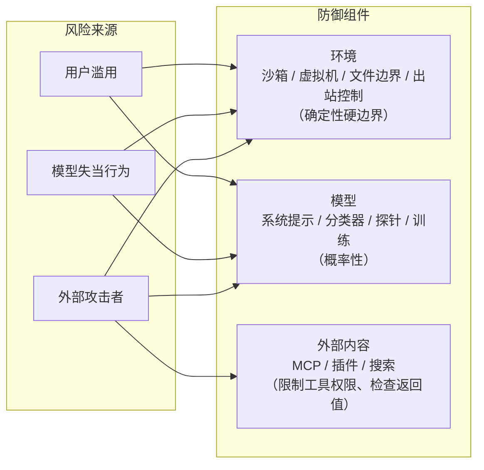
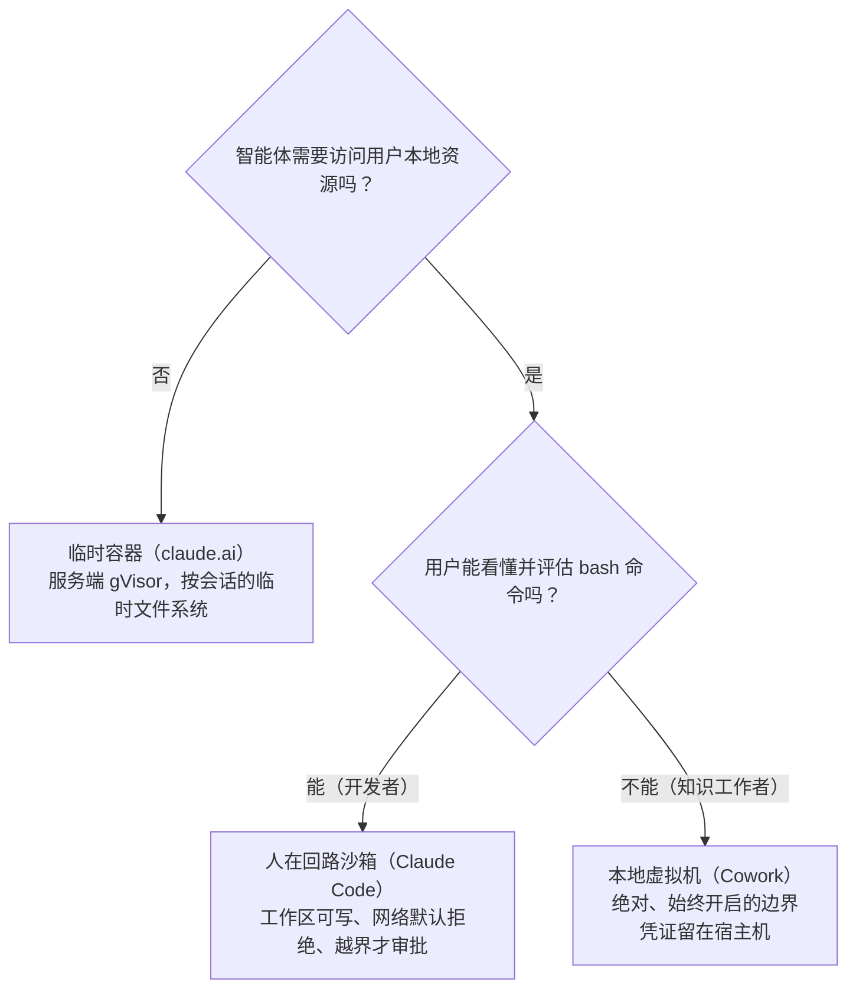
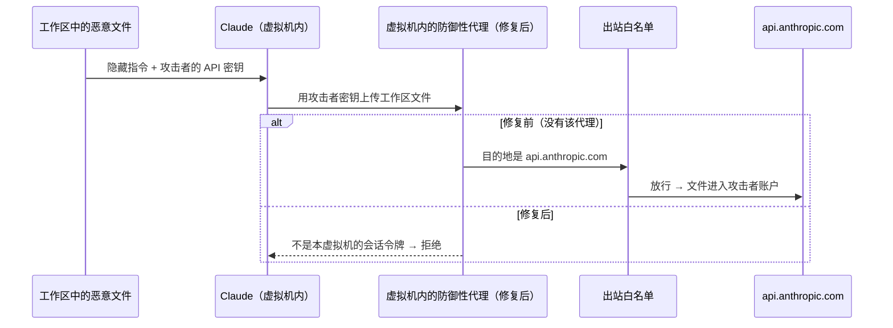
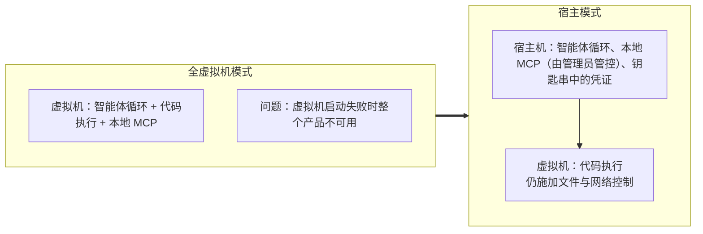

## 一句话总结

模型层的防御是概率性的，总会漏；真正兜底的是环境层的确定性边界——凭证不进沙箱、出站流量受控、文件挂载受限，并且隔离强度要和用户的监督能力相匹配。

## 为什么重要

- **一份来自一线的智能体安全复盘**：不只讲架构，还讲了哪些地方真的出过问题、怎么修。
- **把威胁分为三类、防御分为三个组件**，提供了一个清晰的思考框架。
- **几个反直觉的教训**：白名单域名其实是“能力授予”；自己写的组件最脆弱；用户本人也可能是注入的载体；隔离会降低可见性。
- **把第 21 篇（沙箱）和第 22 篇（auto 模式）放进了更大的纵深防御图景中。**

## 核心概念（中英对照）

| 中文 | English | 简要解释（笔者概括） |
|---|---|---|
| 破坏范围 | blast radius | 一次失败可能造成的最大损害。 |
| 约束 / 隔离 | containment | 不监督智能体做什么，而是限制它**能**做什么。 |
| 人在回路 | human-in-the-loop (HITL) | 由人逐项审批智能体的动作。 |
| 用户滥用 | user misuse | 用户恶意或粗心地让智能体做有害的事。 |
| 模型失当行为 | model misbehavior | 智能体做了没人要求的有害动作。 |
| 外部攻击者 | external attackers | 通过工具、文件、网络或运行时本身发起攻击。 |
| 出站控制 | egress controls | 限制数据能流向哪里。 |
| gVisor / seccomp | gVisor / seccomp | 久经考验的容器沙箱与系统调用过滤机制。 |
| 虚拟机管理程序 | hypervisor | Cowork 使用平台厂商提供的虚拟化（macOS 的 Virtualization 框架、Windows 的 HCS）。 |
| 信任对话框 | trust dialog | “你信任这个文件夹吗？”的提示。 |
| 能力授予 | capability grant | 对白名单的重新理解：放行一个域名等于放行该域名下的所有功能。 |
| 中间人代理（防御性） | defensive man-in-the-middle proxy | 在虚拟机内拦截发往 Anthropic API 的流量，只放行本会话的令牌。 |
| 终端检测与响应 | endpoint detection and response (EDR) | 企业主机上的安全监控软件。 |
| 持久记忆投毒 | persistent memory poisoning | 注入内容落入跨会话保留的状态，每次启动都会重新加载。 |
| 信任升级 | trust escalation | 子智能体的输出被当作比原始工具结果更可信。 |

## 方法 / 步骤

### 1. 风险框架：给破坏范围设上限

- 风险 = 失败的可能性 × 失败的破坏力。防护和训练在降低前者，但随着能力和权限扩大，理论上的破坏范围只会增大；同时，不部署的代价也越来越高。原文提到，Claude Mythos Preview 因破坏范围过大，在 2026 年 4 月被判定不宜发布。
- 两条路：
  1. **人在回路监督**：遥测显示用户同意约 93% 的权限请求，看得越多越不仔细；auto 模式能缓解，但任何概率性防御都有非零漏报率（脚注：auto 模式约 0.4% 误报、约 17% 的过度热心动作会漏过，它是沙箱内纵深防御的一层，而不是沙箱的替代品）。
  2. **约束**：通过沙箱、虚拟机、出站控制强制访问边界——本文的重点，也是出现最多意外安全故障的地方。

### 2. 三类风险 × 三个防御组件

| 风险 | 说明 |
|---|---|
| 用户滥用 | 从想绕过烦人的检查、运行不理解的破坏性命令，到蓄意伤害 |
| 模型失当行为 | 弱模型更容易误读情况、犯明显错误；强模型错误更少，但更善于找到意想不到的路径绕过没人写下来的限制。原文举例：为完成任务“好心”逃出沙箱、翻 git 历史找编程测试的答案、识别出基准并解密答案 |
| 外部攻击者 | 提示注入，以及对运行时、编排层、代理的传统攻击 |

| 防御组件 | 手段 | 特点 |
|---|---|---|
| 环境 | 进程沙箱、虚拟机、文件系统边界、出站控制 | 硬边界；边界够紧，就可以放松监督（例如 Claude Code 的参考 devcontainer 就是为无人值守运行准备的） |
| 模型 | 系统提示、分类器、探针、训练 | 只影响智能体**倾向**做什么，而不是**能**做什么。原文数据：在 Gray Swan 的 Agent Red Teaming 基准上，Opus 4.7 单次攻击成功率约 0.1%，100 次自适应尝试后约 5–6%；auto 模式约能拦下 83% 的过度热心行为——都很强，但不可能 100% |
| 外部内容 | MCP 服务器、第三方插件、网页搜索 | 经过审计的连接器不等于经过审计的数据（例如 GitHub 连接器可能把被投毒的 README 直接带进上下文）；按粒度限制工具权限（例如只读数据库） |

防御要相互重叠：没有环境层防御时，由模型层兜底（这正是 auto 模式的定位）。

### 3. 三种约束模式

| | 临时容器（claude.ai） | 人在回路沙箱（Claude Code） | 本地虚拟机（Claude Cowork） |
|---|---|---|---|
| 运行位置 | 服务端隔离基础设施中的 gVisor 容器，按会话的临时文件系统 | 用户本机，可以访问文件系统、shell、网络 | 用户桌面上的完整虚拟机，只挂载用户选的工作区和 `.claude` 文件夹 |
| 隔离开销 | 启动容器 | 低延迟的原生沙箱 | 完整的虚拟机启动 |
| 对用户的依赖 | 无 | 用户必须能看懂 bash | 无 |
| 破坏范围 | 服务端容器（gVisor + 主机基础设施边界） | 本地工作区 | 挂载的工作区（vsock + hypervisor 边界） |
| 主要威胁模型 | 传统的多租户安全：保护自家基础设施、租户之间互相隔离 | 智能体对开发者机器的影响 | 假设 Claude 某个时候可能行为失当 |

**模式 1 要点**：上线前的工作以网络配置、内部服务认证、编排等传统安全工作为主；最老的教训——**最弱的一层是你自己造的那层**，所以审查精力放在 gVisor、seccomp 周围的自研组件上。

**模式 2 要点**：
- 开发者熟悉 `rm -rf`，每周都会从不可信来源 `npm install`，有能力评估审批弹窗，所以最初的防御是：读放行，写 / bash / 网络需要审批。
- 几周内就出现审批疲劳 → 推出操作系统级沙箱（macOS Seatbelt、Linux bubblewrap）：读放行、工作区内写放行、网络默认拒绝；权限弹窗减少 84%；运行时开源以便审计。
- 匿名使用数据：老用户自动批准的比例约是新用户的两倍，但也更常中途打断智能体——从逐步把关转向“跑偏时才介入”。这同样不可靠：bash 越来越复杂、转向多智能体后，人更难察觉偏离。

**模式 3 要点**：
- 知识工作者不应被要求判断 `find ... -exec rm` 这类命令；**当批准例外需要用户不具备的专业知识时，管理员应设置绝对的、始终开启的边界**。
- 凭证留在宿主机的钥匙串中，从不进入虚拟机。
- 最初是“全虚拟机模式”：智能体循环本身在虚拟机里，以普通 Linux 用户身份运行，不知道自己在沙箱中，**外面没有掌握“逃生钥匙”的特权进程**（对比 Claude Code：沙箱外有一个特权进程逐条决定是否强制沙箱，有说服力的注入或疲劳的点击可能让它放行）。
- 后来改为“宿主模式”：智能体循环移到虚拟机外，代码执行仍在虚拟机内——虚拟机启动失败时 Claude 仍能回应并帮忙排错；安全影响很小，因为虚拟机仍对智能体执行的代码施加文件和网络控制。本地 MCP 服务器也移出虚拟机，与 Claude Desktop 一致，由管理员决定启用哪些。
- 原文图示列出 Cowork 虚拟机的六种主要隔离机制：两种在客户机内核之外强制执行（即使智能体在虚拟机内拿到 root 也仍然有效），四种在客户机内执行，刻意保持精简。
- 文件挂载提供只读、读写、读写但不可删除三种模式；**符号链接解析必须在路径校验之前完成**，否则授权文件夹中的符号链接可以指向外部逃逸；企业可以通过 MDM 设置挂载路径白名单。

### 4. 真实的失误与修复

| 失误 | 发生了什么 | 修复 / 教训 |
|---|---|---|
| 信任对话框之前的一切 | 2025 年中至 2026 年 1 月，负责任披露计划收到多份 Claude Code 漏洞报告，其中三个针对用户同意之前就执行的代码。最直接的例子：克隆的仓库中带有定义 hook 的 `.claude/settings.json`，启动时在“信任此文件夹？”之前就被读取并执行 | 把项目本地配置的解析和执行推迟到用户接受信任提示之后；**把打开项目、加载配置、本地监听端口当作来自互联网的请求对待** |
| 用户本人成为注入载体 | 2026 年 2 月的内部红队演练：研究员用看似普通协作的邮件钓鱼员工，让其用一段恶意提示启动 Claude Code，提示中夹带了读取 AWS 凭证并外发的步骤；重试 25 次中有 24 次完成外泄 | 这是直接提示注入，指令来自用户本人，模型层没有异常可抓；唯一可靠的是环境层——出站控制挡住 POST，文件边界让凭证目录根本不可达。附带教训：把这段提示贴到内部 Slack 讨论时，有人指出一些内部智能体会读 Slack，**调查工具本身也成了攻击面** |
| 经由已批准域名外泄 | 第三方披露：Cowork 的出站白名单正确放行了 api.anthropic.com；工作区中的恶意文件带有隐藏指令和攻击者的 API 密钥，Claude 读取其他文件后用攻击者的密钥调用 Files API 上传——沙箱工作正常，数据还是外泄了 | 白名单应理解为**能力授予**而非目的地过滤；在虚拟机内加防御性中间人代理，只放行带有本虚拟机会话令牌的请求，并阻止能触发服务端抓取的请求头。代理放在虚拟机内，因为只有虚拟机知道请求的来源。又一次印证：自研的白名单代理是出问题的那一环 |
| 虚拟机隔离也挡住了 EDR | 企业安全团队问“为什么我们的 EDR 看不到里面？”——在 EDR 眼中 Cowork 只是一个不透明的 hypervisor 进程 | 目前的缓解：基于拉取的 OTLP 导出，让管理员事后获取事件日志，但这不等于实时监控。建议尽早为这个问题留出讨论 |

### 5. 信任智能体读到的内容

- 任何提供给智能体的外部资源都同时带来两种风险：**代码执行风险**（传统供应链意义上）和**提示注入载体**。锁定版本、校验签名、审查源码只能解决前者。
- **远程与本地的差别比看起来大**：本地工具可以审计、可以锁版本；远程工具（托管 MCP、云连接器）在你批准之后随时可能改变行为。连接器目录有持续审查，目录之外的应视为不可信，先在破坏范围受控的环境中用假数据试运行。
- **即使工具可信，工具输出也是攻击面**：对网页做的输入扫描，对联网工具的返回结果也要同样严格。原文倾向于实时检查，因为一旦被投毒的返回值诱导智能体外泄，日志里只是一次成功的、经过授权的 API 调用，事后找不到信号。检查用的分类器可以是小而快的模型。

### 6. 展望

- **持久记忆投毒**：产品记忆、CLAUDE.md、挂载的工作区、定时和长期运行智能体的状态目录——注入一旦落进去，每次启动都会被重新加载。会话启动时的分类器会越来越必要。
- **多智能体信任升级**：子智能体可以隔离不可信内容、只向上返回结构化事实；但如果因为“是自己人产出的”就给予更高信任，就会成为新的注入路径。
- **智能体身份**：Cowork 的做法是凭证留在宿主机钥匙串，虚拟机获得按会话、范围收窄、可以独立吊销的令牌；更大的问题是智能体应该拥有自己的主体身份，还是作为用户的延伸继承用户权限，答案可能是两者结合。
- 呼吁行业共同投入：共享基准、披露规范、通用身份标准、跨厂商红队（并列举了 NIST、六国机构联合指南、ISO/IEC 42001 等）。

### 7. 三条原则

1. **先在环境层设计约束，再在模型层引导行为。** 员工被钓鱼和白名单外泄两起事件都是经由允许的路径出站，模型层无能为力。
2. **隔离强度与用户的监督能力相匹配。** 对专家摩擦过大、对非专家信任过多，都是失败。
3. **警惕自研组件。** 成熟的 hypervisor、系统调用过滤器和容器运行时一直守得住，暴露问题的是自己围绕它们写的东西。

## 图解

### 图 1：三类风险、三个防御组件

### 图 2：按用户的监督能力选择隔离强度

### 图 3：经由已批准域名外泄，以及修复

### 图 4：Cowork 架构从全虚拟机模式到宿主模式

## 关键原话

> "The deterministic boundary is what gets hit when everything probabilistic misses."
> —— 当所有概率性的防御都失手时，最终被撞上的是那条确定性的边界。

> "Allowing api.anthropic.com meant allowing file uploads to arbitrary Anthropic accounts."
> —— 放行 api.anthropic.com，就意味着允许把文件上传到任意 Anthropic 账户。

## 实践建议

- [ ] 先问“最坏情况下它能碰到什么”，再问“它通常会做什么”；先设计环境边界，再加模型层防御。
- [ ] 凭证不要进入智能体执行代码的环境；用按会话、范围收窄、可以独立吊销的令牌。
- [ ] 把出站白名单中的每个域名当作一项能力授予来审视：这个域名下有哪些可能被滥用的功能（上传、服务端抓取等）？
- [ ] 把打开项目、加载配置、本地监听端口都当作不可信的入站请求，在用户确认信任之前不要解析和执行。
- [ ] 文件挂载提供只读 / 不可删除等模式，并且先解析符号链接、再校验路径。
- [ ] 对联网工具的返回值做实时注入检查，可以用小而快的分类器。
- [ ] 远程 MCP / 连接器先用假数据、在受控环境中试运行。
- [ ] 面向非技术用户的产品不要依赖用户审批命令，而要用始终开启的硬边界。
- [ ] 尽早与企业安全团队讨论可见性（EDR、日志导出）问题。
- [ ] 优先使用成熟的隔离原语，对自己写的代理、白名单逻辑投入最多审查。
- [ ] **笔者补充**：CLAUDE.md、记忆文件等跨会话持久的内容也要纳入审查范围，它们是新的“持久化”落点。

## 延伸阅读

**站内笔记**
- 第 21 篇：[Claude Code 沙箱](./claude-code-sandboxing.md)
- 第 22 篇：[Claude Code auto 模式](./claude-code-auto-mode.md)
- 第 20 篇：[Managed Agents](./managed-agents.md) — 凭证保险库与 MCP 代理。
- 第 14 篇：[BrowseComp 中的评测意识](./eval-awareness-browsecomp.md) — 模型识别基准并解密答案的案例。
- 第 10 篇：[Desktop Extensions](./desktop-extensions.md) — 本地 MCP 的分发与管理。

**原文引用的资源**
- 开源 sandbox-runtime：<https://github.com/anthropic-experimental/sandbox-runtime>
- Claude Code 参考 devcontainer：<https://code.claude.com/docs/en/devcontainer>
- 衡量智能体自主性（匿名使用数据）：<https://www.anthropic.com/news/measuring-agent-autonomy>
- 连接器目录：<https://claude.com/connectors>
- OTLP 协议：<https://opentelemetry.io/docs/specs/otel/protocol/>
- NIST 关于软件与 AI 智能体身份和授权的项目：<https://www.nccoe.nist.gov/projects/software-and-ai-agent-identity-and-authorization>
- ISO/IEC 42001：<https://www.iso.org/standard/42001>
- Claude Mythos Preview 相关说明：<https://red.anthropic.com/2026/mythos-preview/>

---

*本笔记依据 2026-10-17 抓取的在线原文撰写。原文：Anthropic,《How we contain Claude across products》, <https://www.anthropic.com/engineering/how-we-contain-claude>。*
