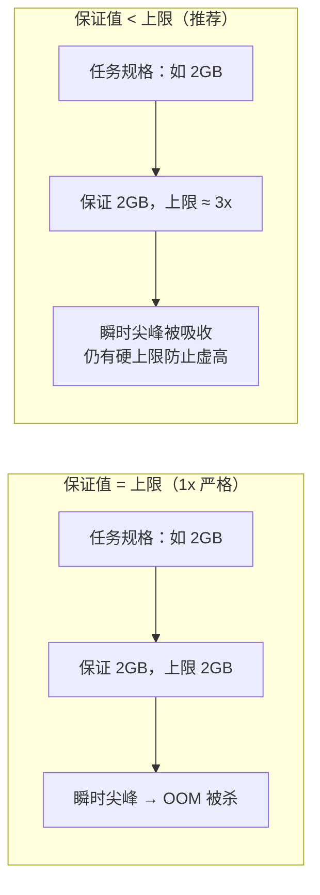
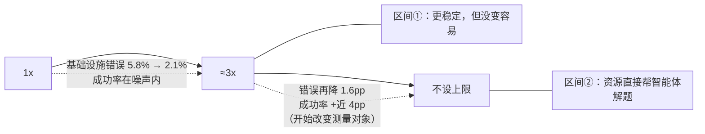
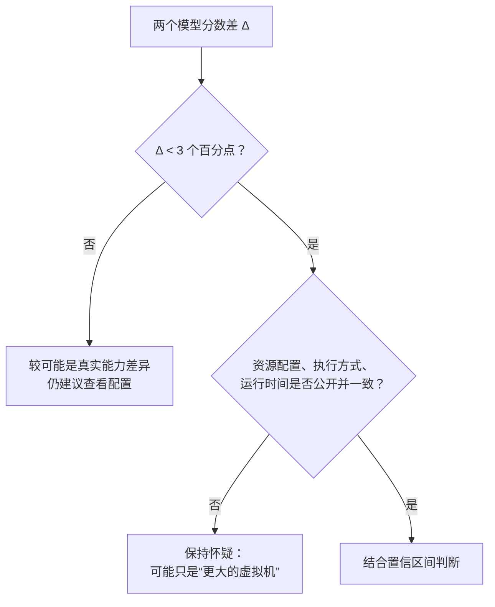

## 一句话总结

智能体编码评测本质上是端到端的系统测试，运行环境本身就是题目的一部分；资源给多少、怎么执行限制，足以造成超过排行榜名次差距的分数波动。

## 为什么重要

- **排行榜上前几名常常只差几个百分点**，而这篇证明光是基础设施配置就能制造更大的差距。
- **区分了“让评测更稳定”和“让评测变容易”**这两种效果，以及它们的分界点。
- **给出了可以直接采用的方法**：分别设置保证分配和硬上限，并根据经验校准两者之间的区间。
- 是[第 11 篇](./demystifying-evals-for-ai-agents.md)《揭秘智能体评测》中“稳定的 harness 与环境”这一步最具体的实证。

## 核心概念（中英对照）

| 中文 | English | 简要解释（笔者概括） |
|---|---|---|
| 静态基准 | static benchmark | 只对模型输出直接评分，运行环境不影响结果。 |
| 智能体编码评测 | agentic coding eval | 模型在完整环境里写代码、跑测试、装依赖、多轮迭代。 |
| 保证分配 | guaranteed allocation | 容器预先保留的资源。 |
| 硬上限 | hard limit / kill threshold | 超过就会被杀掉的资源阈值。 |
| 资源余量 | headroom | 上限相对于任务推荐规格的倍数。 |
| 内存溢出被杀 | OOM-kill | 瞬时内存峰值超过上限，容器被终止。 |
| 基础设施错误率 | infra error rate | 因 pod 错误等与模型能力无关的原因导致的失败比例。 |
| 混杂因素 | confounder | 影响结果、但不属于被测能力的变量。 |
| 二项置信区间 | binomial confidence interval | 仅由抽样带来的分数不确定范围。 |

## 方法 / 步骤

### 1. 问题是怎么发现的

- 团队在 Google Kubernetes Engine 集群上运行 Terminal-Bench 2.0，校准时发现分数和官方排行榜对不上，而且多达 6% 的任务因 pod 错误失败，大多和模型能力无关。
- 原因在于**限制的执行方式**：他们的实现把每个任务的资源规格既当下限又当硬上限（保证值 = 上限），瞬时波动没有任何余量，一次内存尖峰就会让本可成功的容器被杀。官方排行榜使用的沙箱服务商实现更宽松，允许暂时超额分配。

### 2. 实验设计

六种资源配置：从严格执行规格（1x，保证值 = 上限）一直到完全不设上限；同一个 Claude 模型、同一个 harness、同一套任务，其余全部不变。

### 3. 结果

| 区间 | 发生了什么 |
|---|---|
| 1x → 3x | 基础设施错误率从 5.8% 降到 2.1%（p < 0.001）；成功率变化在噪声范围内（p = 0.40）。1x 时崩溃的任务大多本来就会失败——智能体在探索中撞上资源墙被终止，但它原本就不在通往正确解的路上。 |
| 3x → 不设上限 | 基础设施错误再降 1.6 个百分点，而成功率提升近 4 个百分点。额外资源让智能体能采用只有在资源充足时才行得通的做法：拉取大型依赖、启动昂贵的子进程、运行吃内存的测试。 |
| 总计 | 不设上限比 1x 高 6 个百分点（p < 0.01）；不设上限时基础设施错误率为 0.5%。 |

原文的任务例子：一个贝叶斯网络拟合任务，有的模型第一步就安装完整的 Python 数据科学栈，在资源宽松时可行，资源紧张时安装阶段就内存不足，一行解题代码都没写；另一种更省资源的做法是只用标准库自己实现数学部分，有的模型默认就这么做。**资源配置决定了哪种默认策略恰好能成功。**

### 4. 对“测量”的含义

- 约 3x 以内：额外资源修的是可靠性问题（瞬时尖峰），评测更稳定但没有变简单——官方沙箱服务商实际上就在默默做这件事。
- 3x 以上：资源开始帮智能体解出原本解不出的题，**改变了评测在测什么**：限制紧时奖励精简高效的策略，限制松时奖励能充分利用资源的策略。两者都值得测，但不注明资源配置就合并成一个分数，会让差异和现实可推广性都难以解读。
- 复现情况：在不同的 Anthropic 模型上方向一致、幅度不同；其他厂商的模型趋势似乎相同，但没有严格测试。在 SWE-bench 上做了交叉实验（227 题、每题 10 次采样，RAM 最多到基线的 5 倍），分数同样随内存单调上升，但 5x 只比 1x 高 1.54 个百分点——任务对资源要求较低，效应较小，但资源分配并不中立。

### 5. 其他噪声来源

时间限制在某些配置下也有影响；理论上集群健康、硬件规格、并发度、出口带宽都可能影响分数。原文还提到一个**未量化的轶事观察**：通过率随一天中的时间波动，可能是 API 延迟随流量和故障变化。模型提供方可以用专用硬件隔离这些影响，外部评测者则不容易做到。公开的编码评测在不同时间、不同日期多次运行，有助于平均掉噪声。

### 6. 建议

1. 理想情况：每次评测都在完全相同的硬件条件下运行（包括评测脚手架和推理栈）。
2. 现实做法：每个任务**同时规定保证分配和硬上限两个参数**，而不是一个固定值。
3. 校准区间，使得下限和上限处的分数在噪声范围内一致。以 Terminal-Bench 2.0 为例，3x 上限把基础设施错误减少约三分之二，而分数提升仍在噪声内；具体倍数因基准而异，**必须报告**。
4. 把资源配置当成一等实验变量，像提示格式、采样温度一样记录和控制。
5. 基准维护者：除了公布推荐资源规格，还应规定执行方式。
6. 结果使用者：在配置被公开并对齐之前，对**小于 3 个百分点**的排行榜差距保持怀疑。原文指出，中等资源配置范围内的分数差略低于 2 个百分点，朴素的二项置信区间本身就有 1–2 个百分点，基础设施噪声是**叠加**在其上的；在资源配置的两个极端之间，差距可以达到 6 个百分点。

## 图解

### 图 1：两种资源执行方式

### 图 2：资源余量与两种效应

### 图 3：看到排行榜差距时如何判断

## 关键原话

> "A few-point lead might signal a real capability gap—or it might just be a bigger VM."
> —— 领先几个百分点，可能意味着真实的能力差距，也可能只是虚拟机更大。

## 实践建议

- [ ] 自建评测时，每个任务都写清 CPU / 内存的保证值和上限，并在报告中给出倍数。
- [ ] 单独统计“基础设施错误率”，不要把它混进模型失败里。
- [ ] 用两到三个资源档位跑一次校准实验，确认上下限之间分数在噪声内。
- [ ] 比较模型时，确保资源、时间限制、并发度一致，并尽量在不同时间多次运行。
- [ ] 读别人的排行榜时，小于 3 个百分点的差距先打问号。
- [ ] **笔者补充**：把评测运行环境的配置（镜像版本、资源、并发、区域）与分数一起存档，方便日后复现。

## 延伸阅读

**站内笔记**
- 第 11 篇：[揭秘智能体评测](./demystifying-evals-for-ai-agents.md)
- 第 12 篇：[SWE-bench Verified 与 Claude 3.5 Sonnet](./swe-bench-sonnet.md)
- 第 14 篇：[BrowseComp 中的评测察觉](./eval-awareness-browsecomp.md)

**相关资源**
- [Terminal-Bench](https://www.tbench.ai/)

---

*本笔记依据 2026-10-17 抓取的在线原文撰写。原文：Anthropic,[《Quantifying infrastructure noise in agentic coding evals》](https://www.anthropic.com/engineering/infrastructure-noise)。*
