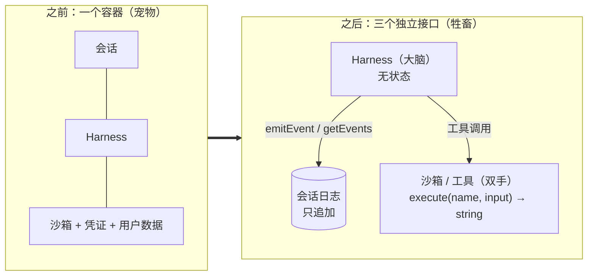
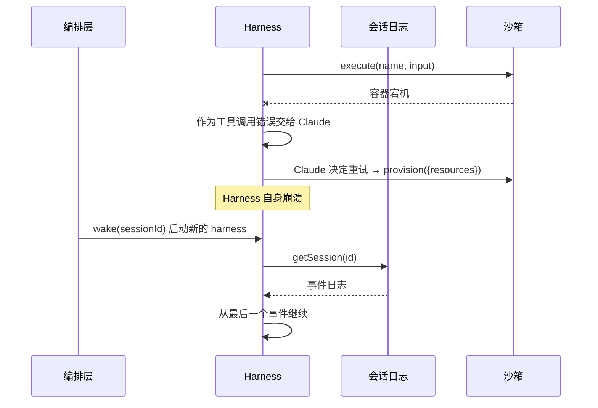
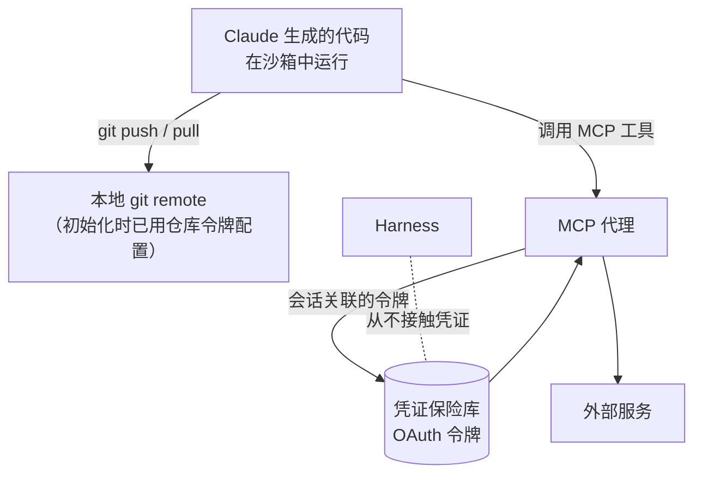

## 一句话总结

不要押注某一种 harness，而要对智能体周围的**接口**下定论：会话负责持久地保存状态，沙箱负责计算，harness 负责调用 Claude 并路由工具调用；三者各自可以失败、替换和扩展。

## 为什么重要

- **把第 17、18 篇的结论“harness 的假设会过时”上升为平台设计原则**（原文举例：为 Sonnet 4.5 加的上下文重置，到 Opus 4.5 就成了累赘）。
- **一个清晰的生产架构参考**：宠物 vs 牲畜、凭证隔离、无状态 harness、首 token 延迟优化。
- **重新定义了“上下文”**：会话日志不等于上下文窗口，从而避免压缩带来的不可逆丢失。

## 核心概念（中英对照）

| 中文 | English | 简要解释（笔者概括） |
|---|---|---|
| 托管智能体 | Managed Agents | Claude Platform 上代你运行长周期智能体的托管服务。 |
| 元 harness | meta-harness | 不限定具体 harness，只提供通用接口，可以容纳 Claude Code 或特定任务的 harness。 |
| 会话 | session | 只追加的日志，记录发生过的一切。 |
| Harness（大脑） | harness / "brain" | 调用 Claude、把工具调用路由到相应基础设施的循环。 |
| 沙箱（双手） | sandbox / "hands" | Claude 运行代码、编辑文件的执行环境；更广义地说是任何工具。 |
| 宠物 vs 牲畜 | pets vs. cattle | 宠物是需要精心照料、不能丢的个体；牲畜可以随时替换。 |
| 凭证保险库 | vault | 存放 OAuth 令牌等凭证，位于沙箱之外。 |
| MCP 代理 | MCP proxy | 凭会话关联的令牌，从保险库取凭证代为调用外部服务。 |
| 上下文修剪 | context trimming | 选择性地删除旧的工具结果或思考块等内容。 |
| 首 token 延迟 | time-to-first-token (TTFT) | 从接受任务到产生第一个响应 token 的等待时间。 |
| 虚拟私有云 | virtual private cloud (VPC) | 客户自己的私有网络环境。 |

## 方法 / 步骤

### 1. 设计思路：像操作系统一样虚拟化

- 老问题：如何为“尚未想到的程序”设计系统。操作系统把硬件虚拟化为进程、文件等抽象，抽象比硬件活得更久——同一个 `read()` 不关心底层是 1970 年代的磁盘还是现代 SSD。
- Managed Agents 同理，把智能体的组件虚拟化为三个接口：**会话、harness、沙箱**。原文的立场是：对接口的形状有明确主张，对接口背后运行什么不做假设。

### 2. 最初的问题：养了一只“宠物”

- 起初把会话、harness、沙箱都放在一个容器里：文件编辑就是直接的系统调用，也不用设计服务边界。
- 问题一：**容器成了宠物**。容器一挂会话就丢；容器无响应只能“护理”。唯一的观察窗口是 WebSocket 事件流，无法区分是 harness 的 bug、事件流丢包还是容器离线；工程师要进容器开 shell 排查，但容器里往往有用户数据，等于事实上无法调试。
- 问题二：harness 假设 Claude 操作的东西都和它在同一个容器里。客户想把 Claude 接到自己的 VPC 时，要么和 Anthropic 的网络打通，要么在自己的环境里运行 harness。

### 3. 解耦：大脑、双手、会话三分

| 组件 | 解耦后的接口（原文给出的形式） | 好处 |
|---|---|---|
| 沙箱 / 工具 | `execute(name, input) → string`；需要新容器时 `provision({resources})` | 容器变成牲畜：容器死了，harness 把它当作工具调用错误交给 Claude，Claude 决定是否重试 |
| Harness | `wake(sessionId)` 唤醒，`getSession(id)` 取回事件日志，从最后一个事件继续；运行中用 `emitEvent(id, event)` 持久记录 | Harness 也变成牲畜：崩溃时 harness 内没有需要幸存的状态 |
| 会话 | `getEvents()` 按位置切片读取事件流 | 持久、可回溯的上下文存储 |

### 4. 安全边界：凭证永远不进沙箱

- 耦合设计中，Claude 生成的不可信代码与凭证在同一容器里运行，提示注入只需说服 Claude 读取自己的环境；攻击者拿到令牌后就能启动新的不受限会话并委派任务。
- 把令牌权限收窄是显而易见的缓解手段，但这本身又编码了一个“Claude 用受限令牌做不了什么”的假设，而 Claude 越来越聪明。**结构性的解法是让令牌在运行生成代码的沙箱里根本不可达**。两种模式：
  1. **凭证与资源绑定**：Git 仓库在沙箱初始化时用该仓库的访问令牌克隆，并配置到本地 remote；沙箱内可以 push/pull，智能体却从不接触令牌。
  2. **凭证放在保险库**：自定义工具通过 MCP 接入，OAuth 令牌存在安全保险库；Claude 经由专门的代理调用 MCP 工具，代理凭会话关联的令牌去保险库取凭证并调用外部服务。**Harness 也从不知道任何凭证。**

### 5. 会话不是 Claude 的上下文窗口

- 处理超长任务的常见手段——压缩、记忆工具、上下文修剪——都涉及**不可逆**的取舍，很难知道未来哪一轮会需要哪些 token；被压缩掉的消息只有存下来才能找回。
- 已有研究把上下文作为窗口之外的对象（例如放在 REPL 中，让模型写代码去切片过滤）。Managed Agents 的会话提供同样的好处，但持久存储在会话日志中：大脑可以从上次读到的位置继续读、回退几个事件看某个时刻的来龙去脉，或者在某个动作之前重读上下文。
- 取出的事件在送入上下文窗口前，可以在 harness 中任意变换（例如为提高提示缓存命中率组织上下文，或做上下文工程）。
- **关注点分离**：会话只保证可恢复、可查询的持久存储；具体的上下文管理放在 harness 里，因为无法预测未来模型需要什么样的上下文工程。

### 6. 多大脑、多双手

- **多大脑**：harness 离开容器后，接入客户 VPC 不再需要网络打通。性能上，以前每个大脑都要等自己的容器准备好才能开始推理（克隆仓库、启动进程、拉取事件），即使根本用不到沙箱；现在容器只在大脑通过工具调用需要时才创建，推理可以在编排层取到待处理事件后立即开始。结果：**p50 TTFT 下降约 60%，p95 下降超过 90%**。扩展到多个大脑，只需启动多个无状态 harness。
- **多双手**：每只手都是一个 `execute(name, input) → string` 工具，可以是自定义工具、MCP 服务器或内置工具；harness 不关心沙箱是容器、手机还是宝可梦模拟器。让 Claude 在多个执行环境之间决定把工作发到哪里，是比在单个 shell 里操作更难的认知任务——早期模型做不到，所以一开始用单容器；模型变强后，单容器反而成了限制。由于手与大脑不耦合，**大脑之间还可以互相传递手**。

### 7. 结论：对接口有主张，对实现无假设

- 预期 Claude 需要操作状态（会话）和执行计算（沙箱），需要扩展到多个大脑和多只手，并且要在长周期内可靠、安全地运行；但不假设需要多少大脑和手、它们在哪里。

## 图解

### 图 1：耦合设计 vs 解耦设计

### 图 2：故障恢复

### 图 3：凭证不进沙箱

## 关键原话

> "We're opinionated about the shape of these interfaces, not about what runs behind them."
> —— 我们对这些接口的形状有明确主张，但对接口背后运行什么不做假设。

> "The structural fix was to make sure the tokens are never reachable from the sandbox where Claude's generated code runs."
> —— 结构性的修复，是确保令牌在运行 Claude 所生成代码的沙箱中永远不可达。

## 实践建议

- [ ] 智能体的执行环境设计成可随时丢弃重建的“牲畜”，状态放在外部持久日志中。
- [ ] Harness 保持无状态，崩溃后可以凭会话 ID 恢复。
- [ ] 不要把凭证放进运行模型生成代码的环境；用“初始化时绑定到资源”或“保险库 + 代理”的模式。
- [ ] 不要只依赖“缩小令牌权限”这种假设模型能力有限的缓解手段。
- [ ] 保留完整的会话事件日志，压缩、修剪等只作用于送入上下文窗口的视图。
- [ ] 按需创建沙箱，而不是每个会话都预先准备，以降低首 token 延迟。
- [ ] 把所有执行环境统一抽象成“名字 + 输入 → 字符串”的工具接口。
- [ ] **笔者补充**：自建智能体平台时，先区分哪些是长期稳定的接口、哪些是随模型变化的实现，再决定在哪里投入工程。

## 延伸阅读

**站内笔记**
- 第 1 篇：[构建高效的智能体](./building-effective-agents.md)
- 第 17 篇：[长时运行智能体的有效 harness](./effective-harnesses-for-long-running-agents.md)
- 第 18 篇：[长时应用开发的 harness 设计](./harness-design-long-running-apps.md) — 上下文焦虑与上下文重置。
- 第 2 篇：[上下文工程](./effective-context-engineering-for-ai-agents.md) — 压缩、记忆工具。
- 第 21 篇：[Claude Code 沙箱](./claude-code-sandboxing.md) — 另一种隔离思路。
- 第 23 篇：[我们如何约束 Claude](./how-we-contain-claude.md)

**原文引用的资源**
- Managed Agents 文档：<https://platform.claude.com/docs/en/managed-agents/overview>
- 《The Bitter Lesson》：<http://www.incompleteideas.net/IncIdeas/BitterLesson.html>
- 宠物与牲畜类比的历史：<https://cloudscaling.com/blog/cloud-computing/the-history-of-pets-vs-cattle/>
- 《The Art of Unix Programming》相关章节：<http://www.catb.org/esr/writings/taoup/html/ch03s01.html>
- 将上下文作为外部对象的相关研究：<https://arxiv.org/pdf/2512.24601>

---

*本笔记依据 2026-10-17 抓取的在线原文撰写。原文：Anthropic,《Scaling Managed Agents: Decoupling the brain from the hands》, <https://www.anthropic.com/engineering/managed-agents>。*
