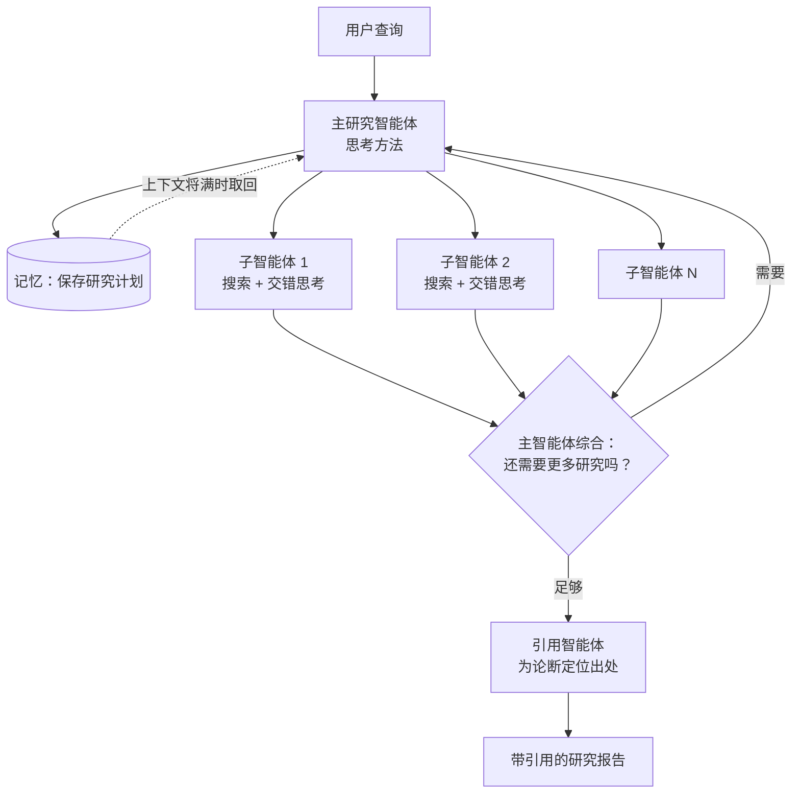
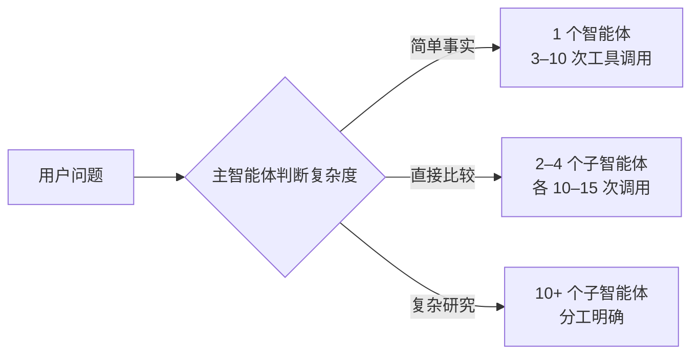
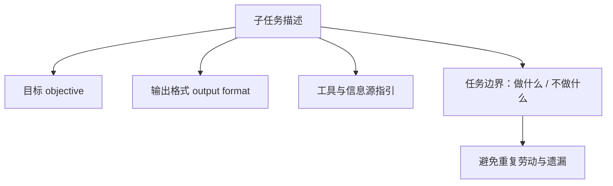
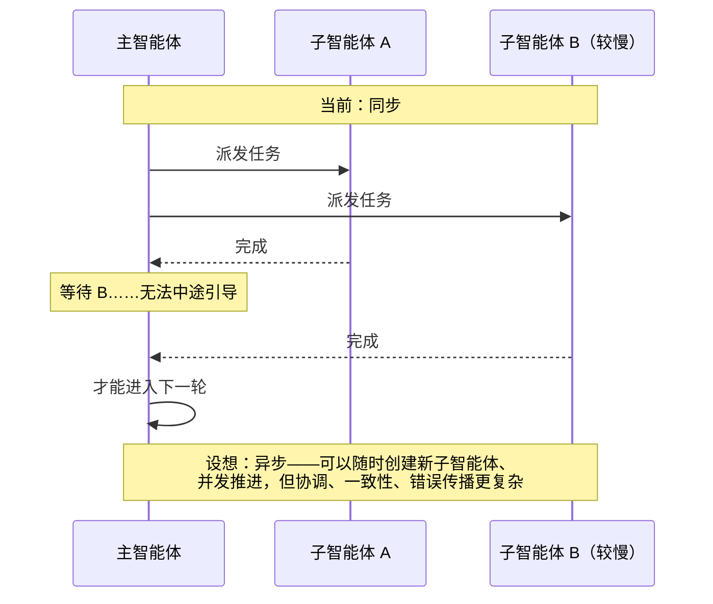

## 一句话总结

开放式研究任务步骤难以预知，又需要广泛并行探索，正适合“一个主智能体规划、多个子智能体并行搜索并压缩信息”的架构；但从原型到生产，最后一公里往往占了大半路程。

## 为什么重要

- **是“编排者-工作者”模式（[第 1 篇](./building-effective-agents.md)）在生产环境中的完整案例**，也是子智能体架构（[第 2 篇](./effective-context-engineering-for-ai-agents.md)）的实证来源。
- **给出了量化依据**：多智能体为什么有效（token 用量能解释大部分性能差异）、代价多大（约 15 倍于聊天的 token）、适合什么任务。
- **提示工程经验非常具体**：如何教主智能体分派任务、如何按复杂度分配投入、如何先宽后窄地搜索。
- **生产可靠性问题讲得透**：有状态、错误累积、非确定性调试、部署时不能打断正在运行的智能体。

## 核心概念（中英对照）

| 中文 | English | 简要解释（笔者概括） |
|---|---|---|
| 多智能体系统 | multi-agent system | 多个“在循环中自主使用工具的 LLM”协同工作。 |
| 主研究智能体 | lead agent / LeadResearcher | 分析问题、制定策略、创建并协调子智能体、汇总结果。 |
| 子智能体 | subagent | 拥有独立上下文窗口，并行探索某个方面，返回压缩后的发现。 |
| 引用智能体 | CitationAgent | 在最终报告中为论断找到具体出处位置。 |
| 压缩 | compression | 原文认为搜索的本质是从海量语料中提炼洞见。 |
| 关注点分离 | separation of concerns | 每个子智能体有独立的工具、提示和探索路径，减少路径依赖。 |
| 广度优先查询 | breadth-first query | 需要同时追踪多个独立方向的问题。 |
| 交错思考 | interleaved thinking | 在工具结果之间思考，评估质量、找出缺口、优化下一次查询。 |
| 以 LLM 为评委 | LLM-as-judge | 按细则给研究输出打分。 |
| 涌现行为 | emergent behavior | 没有专门编写，却在智能体交互中出现的行为。 |
| 彩虹部署 | rainbow deployment | 新旧版本同时运行，逐步迁移流量，避免打断运行中的智能体。 |
| 终态评估 | end-state evaluation | 评判最终状态是否正确，而不逐轮检查过程。 |
| 传话游戏 | game of telephone | 信息经多层转述而失真；可以让子智能体把产物直接写到文件系统来避免。 |

## 方法 / 步骤

### 1. 为什么用多智能体

- 研究是开放式、路径依赖的：要根据发现不断调整，无法硬编码，线性的一次性流程处理不了。
- 子智能体用各自的上下文并行探索，再把最重要的 token 压缩后交给主智能体。
- 原文数据：
  - 以 Claude Opus 4 为主智能体、Claude Sonnet 4 为子智能体的系统，在内部研究评测上比单智能体 Opus 4 高 **90.2%**；擅长广度优先的问题（例如找出某指数信息技术板块所有公司的董事会成员）。
  - 在 BrowseComp 上，三个因素解释了 95% 的性能差异，其中 **token 用量单独解释 80%**，另外两个是工具调用次数和模型选择；升级到更新的模型比单纯加倍 token 预算收益更大。
  - 代价：智能体的 token 用量约为聊天的 4 倍，多智能体约为 **15 倍**。
- 适合：价值高到能负担成本、可以高度并行、信息量超过单个上下文窗口、需要对接大量复杂工具的任务。
- 不适合：所有智能体需要共享同一上下文、智能体之间依赖很多的任务。原文举例，大多数编码任务可真正并行的部分比研究少，而且 LLM 智能体目前还不擅长实时协调和委派。

### 2. 架构

1. 用户提问 → 创建主研究智能体，先思考方法，并把**计划存入记忆**（上下文超过 20 万 token 会被截断，计划必须保住）。
2. 创建若干子智能体，各自承担具体研究任务；子智能体独立搜索，用交错思考评估工具结果，返回发现。
3. 主智能体综合结果，判断是否还需要更多研究（可以再创建子智能体或调整策略）。
4. 信息足够后退出循环，把全部发现交给**引用智能体**，为每条论断定位出处。
5. 返回带引用的最终结果。

与传统 RAG 的静态检索（取与查询最相似的若干块）不同，这里是多步、动态、会根据新发现调整的搜索。

### 3. 八条提示原则

| 原则 | 要点（概括） |
|---|---|
| 像智能体一样思考 | 在 Console 中用与生产相同的提示和工具做模拟，逐步观察，发现诸如结果已够仍继续搜、查询过长、选错工具等问题。 |
| 教主智能体如何委派 | 每个子任务都要写清目标、输出格式、工具与信息源指引、任务边界。原文例子：只写“研究半导体短缺”过于含糊，结果一个子智能体研究 2021 年汽车芯片危机，另两个重复研究 2025 年供应链。 |
| 按复杂度分配投入 | 在提示中写入规则：简单事实查找 1 个智能体、3–10 次工具调用；直接比较 2–4 个子智能体、各 10–15 次；复杂研究 10 个以上子智能体，分工明确。早期常见问题是简单查询也投入过多（例如为简单问题创建 50 个子智能体）。 |
| 工具设计与选择至关重要 | 用错工具常常注定失败（例如只存在于 Slack 的信息却去网上搜）；给出启发式：先查看所有可用工具、按用户意图匹配工具、广泛探索用网页搜索、优先使用专用工具。 |
| 让智能体改进自己 | Claude 4 模型是很好的提示工程师；原文构建了一个工具测试智能体，反复试用有缺陷的 MCP 工具后重写其描述，使后续智能体完成任务的时间减少 40%。 |
| 先宽后窄 | 智能体倾向于用过长、过细的查询；提示它先用简短宽泛的查询了解全貌，再逐步聚焦。 |
| 引导思考过程 | 主智能体用 extended thinking 规划：哪些工具合适、问题复杂度、需要几个子智能体、各自角色；子智能体在工具结果之后用交错思考。 |
| 并行工具调用 | 主智能体同时启动 3–5 个子智能体，子智能体同时使用 3 个以上工具；复杂查询的研究时间最多缩短 90%。 |

总体策略是**灌输好的启发式而非死板规则**：研究熟练的人类怎么做研究（拆解难题、评估来源质量、根据新信息调整、判断该深挖还是该铺开），并设置明确的护栏防止失控。

### 4. 评测方法

- 多智能体即使起点相同，路径也可能完全不同但都合理，所以要评**结果是否正确 + 过程是否合理**，而不是检查是否走了预设的步骤。
- **立即用小样本开始**：早期改动效果巨大（一次提示调整可能让成功率从 30% 提升到 80%），约 20 个代表真实用法的查询就足以看出差异。
- **LLM 评委**：按细则评分——事实准确性、引用准确性、完整性、来源质量、工具效率。原文发现，用单次调用、单个提示输出 0.0–1.0 分数和通过 / 不通过判定，比多个评委分别评各维度更一致、更接近人类判断。
- **人工评估补漏**：人工测试者发现早期智能体总是偏向经过 SEO 优化的内容农场，而不是排名较低但更权威的来源（如学术 PDF、个人博客），于是在提示中加入来源质量启发式。
- **涌现行为**：主智能体的小改动可能不可预测地改变子智能体的行为，所以最好的提示是“协作框架”：定义分工、解题方法和投入预算。

> 笔者注：关于 LLM 评委，本文发现“单个评委统一评分”更一致；而[第 11 篇](./demystifying-evals-for-ai-agents.md)《揭秘智能体评测》建议“按维度拆开、各用独立评委”。两篇针对的场景和时间不同，实践中可以两种都在自己的数据上试。

### 5. 生产可靠性与工程挑战

| 挑战 | 做法 |
|---|---|
| 有状态、错误累积 | 不能出错就从头重来（成本高、用户体验差）；做到从出错处恢复；告诉智能体某个工具失败了，让它自己调整，效果出奇地好；结合重试逻辑、定期检查点等确定性保护。 |
| 调试 | 非确定性让问题难以复现；加入完整的生产追踪；在**不监控具体对话内容**的前提下（保护隐私），监控决策模式和交互结构。 |
| 部署 | 智能体随时可能处在流程中间，不能一次性全部切换；用彩虹部署，新旧版本并行、逐步迁移流量。 |
| 同步执行瓶颈 | 目前主智能体等一批子智能体全部完成才继续，简化了协调，但主智能体无法中途引导、子智能体之间无法协调、一个慢的子智能体会拖住整体；异步执行能带来更多并行，但结果协调、状态一致、错误传播会更复杂。 |

### 6. 附录中的三条补充技巧

1. **会改变状态的智能体用终态评估**：评最终状态是否正确；复杂流程拆成若干检查点。
2. **长对话管理**：完成一个阶段就总结并存入外部记忆；接近上限时创建上下文干净的新子智能体，通过交接保持连续；需要时从记忆中取回研究计划。
3. **子智能体输出到文件系统**：子智能体把产物存到外部系统，只把轻量引用传给协调者，减少“传话游戏”的信息损失，也省去在对话历史中复制大段输出的 token。

## 图解

### 图 1：Research 系统的整体流程

### 图 2：按问题复杂度分配投入

### 图 3：给子智能体的任务描述应包含什么

图解：子任务描述至少要写清目标（objective）、输出格式（output format）、工具与信息源指引，以及做什么、不做什么的任务边界。

### 图 4：同步执行 vs 设想中的异步执行

## 关键原话

> "Multi-agent systems work mainly because they help spend enough tokens to solve the problem."
> —— 多智能体系统之所以有效，主要是因为它们帮助投入了足够多的 token 去解决问题。

> "the last mile often becomes most of the journey."
> —— 最后一公里常常成了大半段路程。

## 实践建议

- [ ] 先判断任务是否可以真正并行、价值是否足以覆盖约 15 倍的 token 成本；不满足就用单智能体。
- [ ] 主智能体的提示中写明委派模板（目标 / 格式 / 工具 / 边界）和按复杂度分配资源的规则。
- [ ] 让子智能体先宽后窄地搜索，并在提示中加入来源质量启发式。
- [ ] 让子智能体并行调用工具，主智能体并行启动子智能体。
- [ ] 用约 20 个真实查询立即开始评测，LLM 评委按细则打分，再辅以人工测试。
- [ ] 研究计划等关键状态存入外部记忆，大产物写入文件系统，只传引用。
- [ ] 生产环境：支持断点恢复、完整追踪（不读对话内容）、渐进式部署。
- [ ] **笔者补充**：为每个子智能体设置 token / 调用次数上限，并在追踪中按子智能体统计成本，便于发现“失控”的分支。

## 延伸阅读

**站内笔记**
- 第 1 篇：[构建高效的智能体](./building-effective-agents.md) — 编排者-工作者模式。
- 第 2 篇：[上下文工程](./effective-context-engineering-for-ai-agents.md) — 子智能体架构与记忆。
- 第 3 篇：[为智能体编写高效工具](./writing-tools-for-agents.md)
- 第 11 篇：[揭秘智能体评测](./demystifying-evals-for-ai-agents.md)
- 第 14 篇：[BrowseComp 中的评测察觉](./eval-awareness-browsecomp.md) — 多智能体配置会放大意外解法。

**原文引用的资源**
- [示例提示（Cookbook）](https://platform.claude.com/cookbook/patterns-agents-basic-workflows)
- [Extended thinking / 交错思考文档](https://docs.anthropic.com/en/docs/build-with-claude/extended-thinking)

---

*本笔记依据 2026-10-17 抓取的在线原文撰写。原文：Anthropic,[《How we built our multi-agent research system》](https://www.anthropic.com/engineering/multi-agent-research-system)。*
