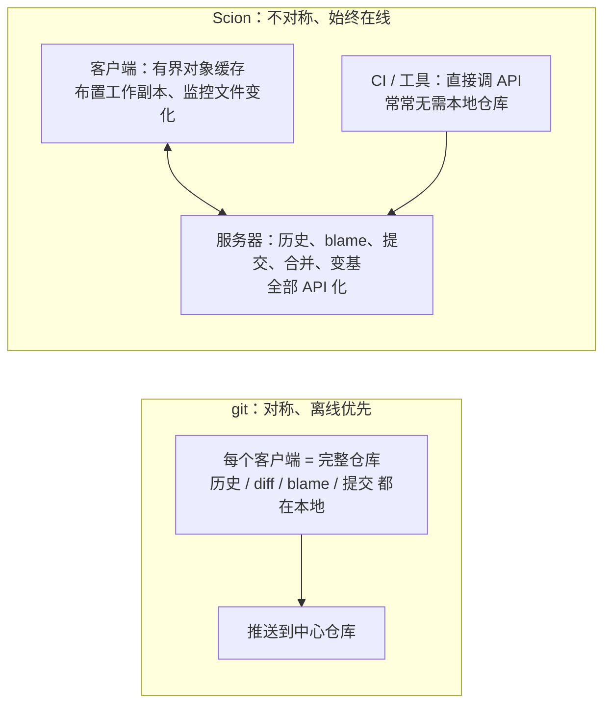
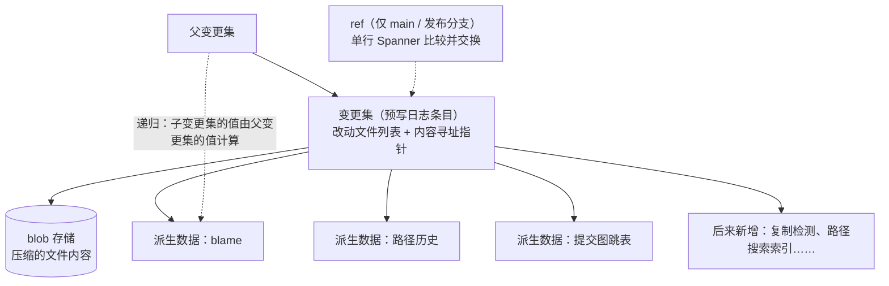
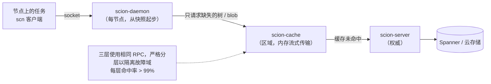
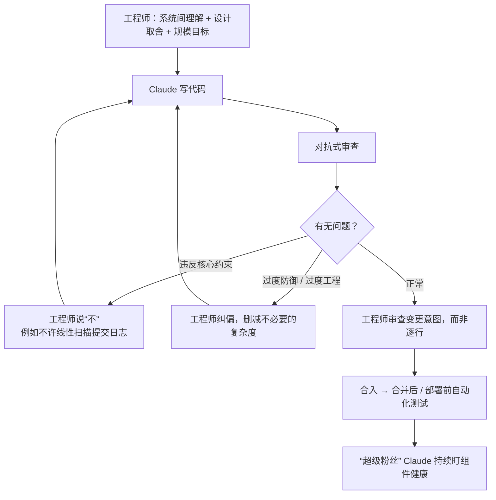

> 🔄 **更新提示**：原文页首注明“10 月 15 日更新”，补充了 Scion 所借鉴的先驱项目（Google 的 Piper、Meta 的 Sapling 及其服务端 Mononoke 的 Bonsai 数据模型）。本笔记依据更新后的版本撰写。

## 一句话总结

git 为离线、去中心化的人类协作而设计，而 Anthropic 的客户端几乎全是始终在线的智能体和任务；按这个事实重新设计——服务器做重活、客户端只拿需要的东西——就得到了能承受智能体规模代码量的 Scion。

## 为什么重要

- **展示了瓶颈如何从“写代码”转移到“基础设施”**：源代码控制、构建、CI 都是为人类规模设计的。
- **一组可迁移的设计原则**：内容寻址、派生数据、分层缓存、按需获取，可以借鉴到 git 服务端或开发流程的其他环节。
- **一手描述了工程师角色的变化**：工程师认为 Claude 写代码比自己强，但仍要提供系统层面的设计判断，并常常要对 Claude 说“不”。
- **作者明确说明 Scion 不适合作为通用的 git 替代品**，有助于读者正确理解适用范围。

## 核心概念（中英对照）

| 中文 | English | 简要解释（笔者概括） |
|---|---|---|
| 单体仓库 | monorepo | 所有代码放在一个仓库里。 |
| Scion | Scion | Anthropic 自研的版本控制系统。 |
| Antique | Antique | 同期构建的代码审查工具。 |
| 浅克隆 / 稀疏检出 / promisor remote | shallow clone / sparse checkout / promisor remote | git 处理仓库切片的工具。 |
| git 镜像 / 种子快照 | git mirrors / seeds | 常见的大仓库变通方法；Anthropic 高峰时运行了数百个内部镜像。 |
| 变更集 | changeset | Scion 的工作单元，是预写日志中的一个条目，记录相对第一个父提交改动的文件列表和内容指针。 |
| 预写日志 | write-ahead log | 变更集按顺序追加的日志。 |
| 内容寻址 | content-addressed | 数据以内容哈希定位，一旦存储就不再改变，可以随意缓存。 |
| 派生数据 | derived data | 由变更集递归计算出的结构，例如 blame、路径历史、提交图的跳表。 |
| 引用 | refs | 指向提交的指针（分支、标签）；Scion 不鼓励使用，除了 main 和发布分支。 |
| 比较并交换 | compare-and-swap | 移动 ref 只是对单个 Spanner 行的原子操作。 |
| 虚拟化检出 | virtualized checkout | 文件在被读取时才物化到磁盘。 |
| 分层缓存 | tiered caches | scion-daemon（节点）→ scion-cache（区域）→ scion-server（权威）。 |
| 对抗式审查 | adversarial review | 让模型从对立角度挑毛病的审查方式。 |
| “超级粉丝” | superfans | 在 Slack 频道中专注监控单个组件健康状况的 Claude。 |
| 合并队列 | merge queue | 传统上保证合并前测试通过的串行化机制。 |

## 方法 / 步骤

### 1. 背景：规模爆炸

- 每天合并的变更：2026 年 5 月平均约 2,500 个，9 月超过 30,000 个；原文认为合并代码的潜在需求几乎无限，每移除一个瓶颈，代码量就会进一步上升。
- 5 个月内：构建 Scion 并把 monorepo 完全从 git 迁移过去；同时构建了代码审查工具 Antique、代码搜索、源代码控制的权限系统、管理和合入大量已审查代码的新方法等。
- 作者承认这种工作负载很不寻常，但预计用 AI 编码工具的其他组织不久也会遇到同样的压力点。

### 2. 为什么 git 不再合适

| 数据点 | 规模 |
|---|---|
| main 分支历史 | 接近 100 GB |
| 压缩后的工作副本 | 超过 25 GB |
| 每天仅 CI 的检出 | 约 2,500 万次（不含开发环境、智能体沙箱、研究任务） |
| 如果朴素地获取 | 每天超过 600 PB 的 git 流量 |

- 已经用尽了所有常规手段：浅克隆、稀疏检出、promisor remote、内部镜像、存在 blob 存储中的种子快照。这些争取了时间，但合并率上升后越来越难运维：种子在刷新间隔中离 main 越来越远，在部分克隆上保持 diff、blame 这类依赖历史的操作正常运转也越来越费力。
- 关键观察：和大多数公司一样，实际上是把 git 当成**有唯一权威副本的中心化系统**来用，而几乎所有客户端都是天然在线的智能体和任务——git 为分布式离线工作而设的特性反而阻碍了扩展。

### 3. 智能体规模源代码控制的六条原则

| 原则 | git 的假设 | Scion 的做法 |
|---|---|---|
| 客户端始终在线 | 客户端离线工作，需要完整副本 | 围绕始终可达的服务器设计，客户端需要时才获取数据 |
| 客户端与服务器不对称 | 每个客户端都能当完整服务器 | 服务器负责历史、blame、创建提交、合并、变基；客户端只维护有界的本地对象缓存、布置工作副本、监控文件变化 |
| 全面的源代码控制服务 | 要回答仓库问题就要有本地副本或依赖厂商 API | 客户端用到的所有查询都通过 API 暴露，很多任务根本不需要本地仓库；自动二分定位和自动回滚流水线依赖这种廉价的程序化访问 |
| 一切可以水平扩展 | 镜像受磁盘和内存限制 | 数据分布式存储，任何地方（包括服务器）都没有完整物化的仓库；没有 packfile，无需仓库维护 |
| 提交廉价、增量、无锁 | 本地提交再推送 | 提交、变基、合并都在服务器上发生，没什么可推送；开销与改动大小成正比，而不是与仓库大小成正比；不鼓励 ref，因为全局一致的状态是迟早会到来的扩展问题 |
| 工作副本可选、天然稀疏 | 默认完整检出 | 能不检出就不检出（例如直接向服务器要 diff），很多写操作也可以纯 API 完成；需要文件时，用稀疏或虚拟化检出，只为实际读取的部分付费 |

- 原文说明这些设计借鉴了 Google Piper 和 Meta Sapling 的经验（脚注特别指出 Sapling 的服务端 Mononoke 开创了 Scion 使用的许多技术，尤其是 Bonsai 数据模型）。

### 4. Scion 的工作方式

**数据结构**
- 变更集与 git 提交的区别：git 提交指向一棵树；变更集存储**相对第一个父提交改动的文件列表**以及指向 blob 存储中压缩内容的内容寻址指针。变更集在服务端创建，立即全局可用。（脚注：相对合并的第一个父提交存储是一种风格选择，因为在 monorepo 主干开发中，人们只关心主线的历史和 blame。）
- 吞吐量高的原因：没有 packfile、没有锁或跨服务器协调、不需要移动 ref；移动 ref 是对单个 Spanner 行的比较并交换，与创建变更集分开进行。
- **派生数据**：变更集本身回答不了“这一行最后谁改的”，于是由变更集构建 blame、路径历史、提交图跳表等结构，统一通过一个通用机制计算——每种派生数据都递归定义（某个变更集的值由其父提交的值算出）。三个好处：容易新增类型（后来陆续加入了复制检测、按路径搜索文件等索引）；每种类型可以选择立即计算或延迟计算；客户端看不到内部结构，优化时无需改客户端。

**扩展方式**
- 一小组 Scion 服务器提供客户端需要的所有 API（取变更集、算 diff、找合并基、取 blob）。由于数据内容寻址、存储后不变，任何服务器都可以缓存而无需相互确认——服务器本质上是能现场计算派生数据并写回 Spanner 的大缓存。
- 迁移初期，Scion 只回答“元数据”查询（祖先关系、blame 等）；获取文件内容和物化工作副本的数据量大得多，单独设计。
- **获取协议与 git 不同**：协商时客户端不告诉服务器自己已有什么，而是只请求想要的树和 blob——从根树开始，检查本地缺哪些树并递归请求，再对 blob 做同样的事。每个请求都针对一个永不改变的对象，任何缓存都能回答；没有单个数 GB 的 packfile 响应，因此高效且可以断点续传；稀疏甚至虚拟化检出无需特殊支持，因为客户端根本不请求不需要的树。
- **分层缓存**：节点上的 `scn` 客户端通过 socket 与该节点的 scion-daemon 通信（同节点的任务复用大部分对象）；daemon 从定期刷新的快照起步，只与所在区域的 scion-cache 通信；cache 直接从内存以 daemon 能直接使用的磁盘格式流式传输对象，无需计算差集或做增量压缩；缺失时向权威的 scion-server 请求，后者按需读取 Spanner 或云存储。三层响应相同的 RPC，客户端无需了解缓存拓扑；但严格执行分层，以隔离故障域，避免区域缓存故障压垮上游服务器。

**效果**
- 每一层缓存命中率超过 99%，不需要长期状态，容易扩容。
- CPU 和内存占用比之前的 git 镜像基础设施**小 200 倍**。
- CI 和研究任务的检出快两个数量级（从几分钟到几秒）；仅 CI 就节省了 25% 的 CPU 容量。
- 客户端和缓存都无需仓库维护。

### 5. 构建 Scion 的经验

- **Claude 的作用**：项目开始时正值 Claude Mythos Preview 和 Claude Tag 在内部可用，两者既放大了对 Scion 的需求，也加快了构建速度。例子：git 到 Scion 的数据导入流水线第一版原型基本是手写的，交给 Mythos Preview 的早期内部快照整体重写后，在没有额外指令的情况下，内存占用降为 1/20、速度提升 4 倍，并保留了关于导入顺序和数据结构的所有隐含不变量。
- **小团队快速开发会更常见**：7 个人构建了 Scion 和 Antique 以及另外半打相关系统，5 个月完成迁移，期间每日合并量增长了 10 倍。
- **工程师的价值不减，但工作在变**：
  - 参与的工程师都认为 Claude 写代码比自己强，但系统间组件的理解和设计层面的取舍仍由工程师提供。
  - 工程师经常要**对 Claude 说“不”**：智能体有时会为了迎合一个本不该被允许的模式而违反核心约束（迁移中尤其常见，例如有多个系统试图线性扫描提交日志来查找某个变更何时合入 main，而不是去问代码审查工具）。
  - 对抗式审查非常有效，但也可能短视：一次审查对另一个内部服务过度防御，导致 Claude 加入过多校验和复杂度，需要有经验的工程师纠正这种过度工程。
  - 团队仍审查每一个变更请求，但审查的是**变更意图**，而不是逐行阅读代码。
- **优化与质量大幅提升**：Scion 是作者参与过的测试和防护最完善的代码库之一——为遇到过的每种重要基础设施与源代码控制交互构建了封闭仿真，还有模糊测试和复杂的限流。Claude 还随手找到重要优化，例如一个没用上索引的祖先查询的算法优化。
- **为 monorepo 安全打基础**：支持仓库级访问控制，也能对单个目录设权限，在保护最敏感代码的同时保留 monorepo 的好处；代码审查工具可以对审批表达复杂的语义约束（例如区分只改注释与敏感的逻辑改动），让人类审查者聚焦最重要的变更。
- **新的运维水平**：在 Slack 频道中让 Claude 专注盯住单个组件的健康，称为“超级粉丝”（scion-daemon、scion-cache、Antique 合并队列等各有一个），它们能访问遥测和日志，能发现传统告警发现不了的细微和新型问题；传统告警仍然保留。
- **重新审视先验**：在智能体规模下，传统合并队列意义不大——测试运行期间可能有成百上千个变更合入，CI 又意味着什么？无法有效复制全局合并队列的行业标准，于是转而投资合并后、部署前的自动化测试；并发变更可能冲突，但 Claude 修复冲突通常比人类发现冲突还快。

### 6. 适用范围与对生态的贡献

- **Scion 不是 git 的通用替代品**：只对拥有数万名工程师或大群智能体大量写代码的超大 monorepo 有意义；而且 Anthropic 内部能花的 token 远超其他企业的现实意愿。
- 难以对外提供：与 git 差异很大，需要迁移整个开发生命周期，并依赖定制的代码审查、代码搜索和 CI。
- 预计 6–12 个月内这类问题会更普遍，所以选择分享思路，让大家能把 Scion 最成功的部分用到 git 上而不必放弃 git 的整体模型：git 服务端不必与客户端工作方式相同；git 平台可以提供类似 Scion 的全面服务端 RPC（甚至在各托管平台之间标准化）；协商协议可以改变；稀疏、浅克隆等特性可以更好地组合。
- 致谢 git 社区近二十年的扩展工作，希望与 GitHub、GitLab 和开源社区合作。

## 图解

### 图 1：git 与 Scion 的职责分配

### 图 2：变更集与派生数据

### 图 3：分层检出架构

### 图 4：工程师在智能体规模开发中的角色

## 关键原话

> "Very often, we found that the role of the engineers was to tell Claude “no.”"
> —— 我们常常发现，工程师的职责就是对 Claude 说“不”。

## 实践建议

- [ ] 如果团队的 AI 生成代码量快速增长，监控合并率、检出次数和 CI 负载，提前识别下一个基础设施瓶颈。
- [ ] 让 CI 和工具尽量通过 API 回答仓库问题，而不是每次克隆完整仓库。
- [ ] 在 git 体系内，充分组合稀疏检出、浅克隆、部分克隆和节点级共享对象缓存。
- [ ] 内容寻址、不可变的数据最容易分层缓存；为缓存层设定严格的上下游关系以隔离故障。
- [ ] 审查 AI 生成的代码时，把精力放在意图和系统约束上；警惕对抗式审查引发的过度工程。
- [ ] 用 AI 写大量测试、仿真和模糊测试，把节省下来的写代码时间投入质量保障。
- [ ] 为关键组件设置专注的 AI 监控，作为传统告警的补充，而不是替代。
- [ ] **笔者补充**：原文明确说 Scion 只适合超大 monorepo，普通团队不应照搬，而应借鉴“服务端做重活、按需获取”的思路。

## 延伸阅读

**站内笔记**
- 第 19 篇：[用并行 Claude 团队写 C 编译器](./building-c-compiler.md) — 多智能体共享 git 仓库时的合并冲突。
- 第 20 篇：[Managed Agents](./managed-agents.md) — 同样从“为未来规模设计接口”出发。
- 第 24 篇：[近期三个问题的事后复盘](./a-postmortem-of-three-recent-issues.md)
- 第 25 篇：[4 月 23 日事后复盘](./april-23-postmortem.md)
- 第 23 篇：[我们如何约束 Claude](./how-we-contain-claude.md)

**原文引用的资源**
- Google Piper（维基百科）：<https://en.wikipedia.org/wiki/Piper_(source_control_system)>
- Meta Sapling：<https://sapling-scm.com/>
- Mononoke README：<https://github.com/facebook/sapling/blob/main/eden/mononoke/README.md>
- Claude Mythos：<https://www.anthropic.com/claude/mythos>
- Claude Tag 介绍：<https://www.anthropic.com/news/introducing-claude-tag>

---

*本笔记依据 2026-10-17 抓取的在线原文撰写。原文：Anthropic,《Redesigning source control at Anthropic》, <https://www.anthropic.com/engineering/redesigning-source-control>。*
