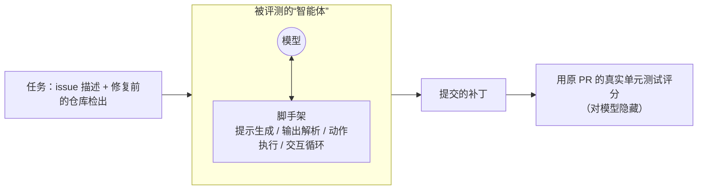
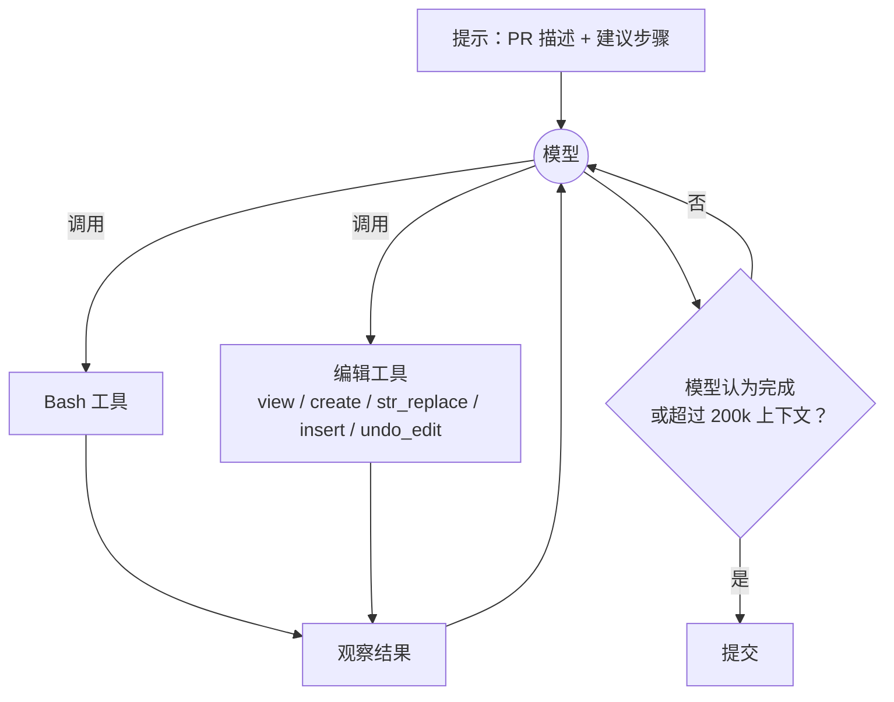

> ℹ️ 本文所说的“当前最好成绩”指 2025 年初发表时的情况。另外，其他文章引用本文时有时用 `/research/swe-bench-sonnet` 这个地址，指向同一篇文章。

## 一句话总结

在真实代码任务上，一个“极简脚手架 + 精心设计的两个工具”就足以让模型发挥出当时最好的水平；而评测分数衡量的其实是整个智能体，而不只是模型本身。

## 为什么重要

- **一个具体的、完全公开的编码智能体设计**：提示词和工具 schema 都在原文中公开，可以直接对照学习。
- **印证了《Building effective agents》中的观点**：智能体就是在循环里使用工具；花在工具上的功夫比花在提示上的更值。
- **介绍了 SWE-bench 的评测机制和坑**：隐藏测试、环境问题、成本，都是后续评测类文章反复讨论的主题。

## 核心概念（中英对照）

| 中文 | English | 简要解释（笔者概括） |
|---|---|---|
| SWE-bench | SWE-bench | 让模型解决热门开源 Python 仓库真实 GitHub issue 的基准。 |
| SWE-bench Verified | SWE-bench Verified | 经人工审核、确认可以解决的 500 题子集。 |
| 脚手架 | scaffold / scaffolding | 包在模型外面的软件：生成提示、解析输出、执行动作、管理交互循环。 |
| 智能体 | agent | 在本文中指“模型 + 脚手架”的组合。 |
| Bash 工具 | Bash Tool | 执行 shell 命令的工具。 |
| 编辑工具 | Edit Tool (str_replace_editor) | 查看、创建、编辑文件的工具，核心是字符串替换。 |
| 字符串替换 | string replacement (old_str → new_str) | 只有在 old_str 恰好唯一匹配时才执行替换。 |
| 防错 | error-proofing | 改造工具，让模型更难用错（如强制绝对路径）。 |
| 隐藏测试 | hidden tests | 模型看不到用于评分的单元测试。 |
| 饱和 | saturated | 基准分数接近满分、失去区分度。 |

## 方法 / 步骤

### 1. SWE-bench 怎么评

- 每道题给模型一个配好的 Python 环境，以及 issue 被解决之前那一刻的仓库检出；模型需要理解、修改、测试代码后提交方案。
- 用关闭该 issue 的那个 PR 里的真实单元测试来评分，看模型能否实现和原作者相同的功能。
- 原文列出它受欢迎的原因：任务来自真实项目，而不是竞赛题或面试题；当时尚未饱和（没有模型超过 50%）；衡量的是整个智能体，开源社区和创业公司已经证明，优化脚手架能在同一个模型上大幅提分。
- 原始数据集里有些题缺少 issue 之外的必要信息，无法解决，所以使用经过人工审核的 Verified 子集。

### 2. 智能体设计：极简脚手架

- 设计理念：**尽量把控制权交给模型，脚手架保持最小**。
- 组成：一个提示 + Bash 工具 + 编辑工具；一直采样，直到模型自己认为完成，或者超过 200k 上下文。
- 提示只给出“建议步骤”，不强制状态转移（笔者概括）：先熟悉仓库结构 → 写一个脚本复现错误并运行 → 修改源码 → 重新运行脚本确认修复 → 考虑边界情况。提示里还说明测试文件已经改好，只需对非测试文件做最小改动，并鼓励充分思考。原文提到，如果对 token 不敏感，明确鼓励模型输出长回复会有帮助。

### 3. 工具设计：功夫在描述上

| 工具 | schema | 描述里写了什么（概括） |
|---|---|---|
| Bash | 只有一个参数 `command` | 不需要 XML 转义；没有网络；可以通过 apt/pip 镜像装包；状态跨调用保留；怎样查看文件的指定行；避免产生巨量输出；长时间运行的命令放到后台 |
| 编辑工具 | 命令枚举：view / create / str_replace / insert / undo_edit；`path` 等参数 | view 对文件和目录的不同行为；create 不能覆盖已有文件；长输出会被截断并标记；old_str 必须精确匹配并且唯一，否则不替换 |

- 团队在多种智能体任务上测试，找出模型可能误解规格的地方，然后修改描述来预防。原文认为应该像设计人机界面一样，为模型设计工具接口。
- **防错**：模型离开根目录后常把相对路径弄错，于是规定工具必须使用绝对路径。
- 试过多种编辑方式，**字符串替换最可靠**；匹配数不为 1 时给出相应错误信息，让模型重试。

### 4. 结果（同一套脚手架）

| 模型 | SWE-bench Verified |
|---|---|
| Claude 3.5 Sonnet（升级版） | 49% |
| 此前最好成绩 | 45% |
| Claude 3.5 Sonnet（旧版） | 33% |
| Claude 3 Opus | 22% |

原文以 SWE-Agent 框架作为智能体代码的基础，演示了一个 scikit-learn 的真实案例：模型看目录 → 写复现脚本 → 运行复现报错 → 修改构造函数把参数传给父类 → 重跑验证，共 12 步完成。有的任务要 100 多轮，有的直到上下文用完。和旧模型相比，升级版更常自我纠正，也会尝试多种方案，而不是反复犯同样的错误。

### 5. 运行这类评测的四个难点

1. **耗时长、token 成本高**：很多成功案例要几百轮、超过 10 万 token。
2. **评分本身可能出错**：失败案例里有些是环境配置问题，或补丁被重复应用，必须修好这些系统问题才能得到准确分数。
3. **隐藏测试**：模型看不到评分测试，常常“以为”自己成功了；有些失败是因为在错误的抽象层次修复（打补丁而不是深层重构），有些则是问题解决了但和原测试对不上。
4. **多模态缺失**：脚手架没有给模型查看文件系统里图片或 URL 的手段，调试某些任务（尤其是 Matplotlib）很难，还容易产生幻觉。

## 图解

### 图 1：SWE-bench 评测的是整个智能体

### 图 2：极简脚手架的运行循环

### 图 3：模型解题的典型路径（以原文 sklearn 案例为例）

## 关键原话

> "We believe that much more attention should go into designing tool interfaces for models, in the same way that a large amount of attention goes into designing tool interfaces for humans."
> —— 我们认为，应该像在人类工具界面设计上投入大量精力那样，在为模型设计工具接口上投入更多精力。

## 实践建议

- [ ] 做编码智能体时，先试“提示 + Bash + 编辑工具”这样的极简组合作为基线，再考虑加复杂度。
- [ ] 把环境约束（有没有网络、怎么装包、怎么看大文件、长任务放后台）写进工具描述，而不是只写进系统提示。
- [ ] 编辑工具优先用唯一匹配的字符串替换；匹配失败时返回清晰的错误信息。
- [ ] 所有路径参数要求绝对路径。
- [ ] 自己跑评测时，先人工检查一批失败案例，排除环境或评分问题，再下结论。
- [ ] 预算要按“几百轮、十万级 token”来估算。
- [ ] **笔者补充**：如果任务涉及图表或 UI，给智能体一个“看图”的工具往往是最便宜的提升。

## 延伸阅读

**站内笔记**
- 第 1 篇：[构建高效的智能体](./building-effective-agents.md) — 附录里的工具设计经验即来自这次实践。
- 第 3 篇：[为智能体编写高效工具](./writing-tools-for-agents.md)
- 第 11 篇：[揭秘智能体评测](./demystifying-evals-for-ai-agents.md)
- 第 13 篇：[智能体编码评测中的基础设施噪声](./infrastructure-noise.md)

**原文引用的资源**
- SWE-bench 官网：<https://www.swebench.com/>

---

*本笔记依据 2026-10-17 抓取的在线原文撰写。原文：Anthropic,《Raising the bar on SWE-bench Verified with Claude 3.5 Sonnet》, <https://www.anthropic.com/engineering/swe-bench-sonnet>。*
