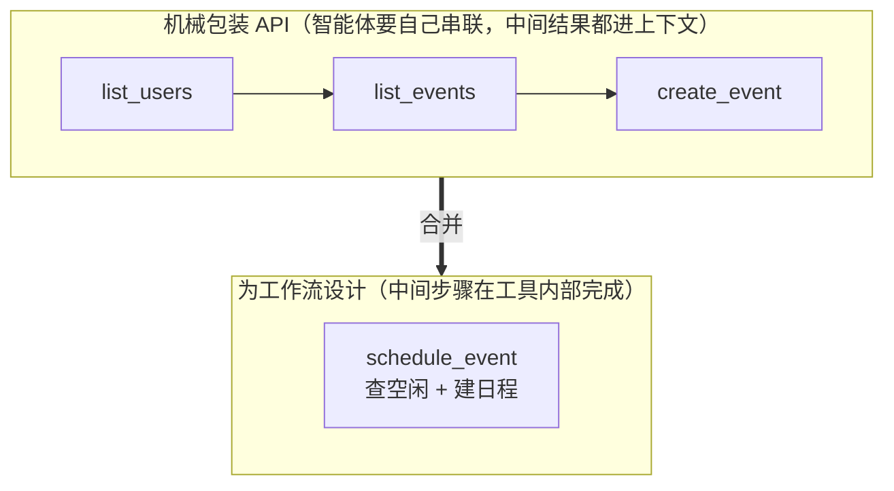
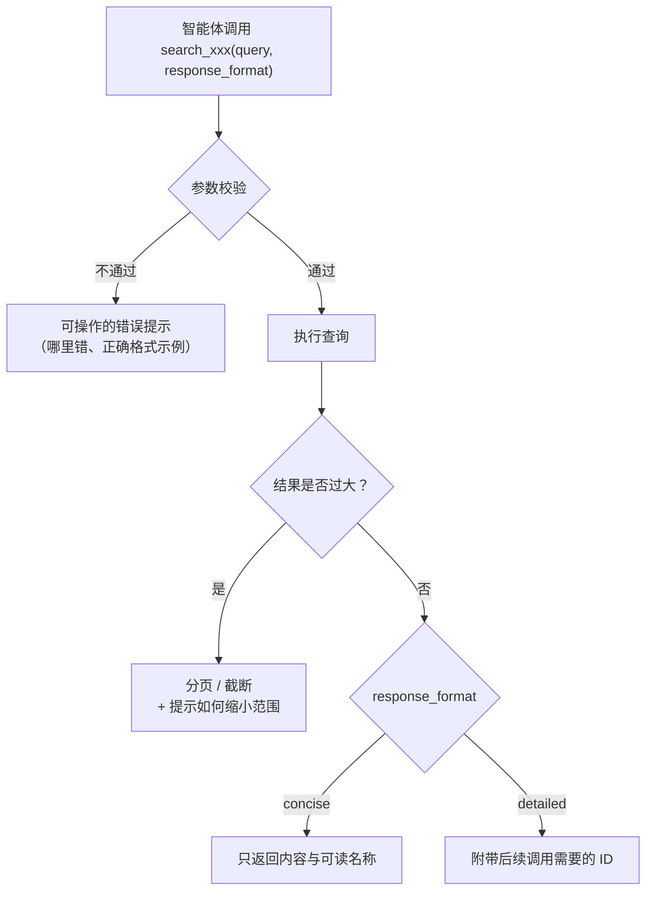

## 一句话总结

别把 API 端点原样包成工具丢给智能体：要按智能体的“感知方式”来设计工具，并用一套“原型 → 评测 → 让智能体自己帮你改”的循环持续优化。

## 为什么重要

- **系统展开了[《Building effective agents》](./building-effective-agents.md)附录里的“智能体-计算机接口（ACI）”**，从理念变成了可执行的流程。
- **给出了评测驱动的工具开发闭环**，而且让 Claude Code 参与分析评测记录、批量重构工具。原文说文中大部分建议本身就是这样得出的。
- **原则都很具体**（工具合并、命名空间、`response_format`、截断与错误提示），可以直接拿来审查自家 MCP 服务器。

## 核心概念（中英对照）

| 中文 | English | 简要解释（笔者概括） |
|---|---|---|
| 工具 | tool | 一种新型软件：确定性系统与非确定性智能体之间的契约。 |
| 非确定性 | non-deterministic | 同样输入，智能体可能选择不同路径（调用工具、凭常识回答、先反问）。 |
| 好用性 / 人体工学 | ergonomic | 对智能体而言是否顺手；原文发现对智能体顺手的工具对人也直观。 |
| 可供性 | affordance | 使用者感知到“能用它做什么”；智能体与传统程序不同。 |
| 评测任务 | evaluation task | 基于真实场景、通常需要多次工具调用的提示，配可验证的结果。 |
| 验证器 | verifier | 判定回答是否正确，可以是字符串比对，也可以让 Claude 评判。 |
| 留出测试集 | held-out test set | 不参与优化的测试集，防止对评测过拟合。 |
| 交错思考 | interleaved thinking | 工具调用之间的思考，便于了解模型为何调用或不调用某工具。 |
| 命名空间 | namespacing | 用统一前缀（按服务、按资源）给工具分组，划清边界。 |
| 响应格式参数 | response_format | 让智能体选择返回“简洁”还是“详细”内容的枚举参数。 |
| 分页 / 范围选择 / 过滤 / 截断 | pagination / range selection / filtering / truncation | 控制工具返回量的手段。 |
| 工具注解 | tool annotations | MCP 中标注工具是否需要开放网络访问、是否有破坏性操作。 |

## 方法 / 步骤

### 1. 先理解：工具为什么要“为智能体设计”

传统函数如 `getWeather("NYC")` 每次行为一致；但用户问“今天要不要带伞”，智能体可能调天气工具、直接凭常识答、或先问在哪个城市，也可能误用工具。所以写工具不能照着“给其他开发者写 API”的习惯来。

### 2. 开发循环

**① 做原型**
- 用 Claude Code 写工具时，把依赖的库 / API / SDK 文档（如官方站点的 `llms.txt`）喂给它。
- 包成本地 MCP 服务器或桌面扩展，在 Claude Code（`claude mcp add ...`）或 Claude Desktop 里试用；也可以直接在 API 调用中传入工具做程序化测试。
- 自己先用，收集用户反馈。

**② 生成评测任务**
- 让 Claude Code 探索工具，生成几十个提示-答案对；任务基于真实数据源和服务，避免过于简单的“沙盒”。好任务可能需要数十次工具调用。
- 强任务 vs 弱任务（笔者按原文思路概括）：强任务像真实请求，需要综合多步信息（例如“和某人约下周会议、附上上次会议纪要、订会议室”）；弱任务只是直接给出参数让工具执行一步（例如“查日志里某个字段等于某值”）。
- 每个提示配一个可验证的结果；验证器不要太严，别因为格式、标点或合理的同义表述就判错。
- 可以注明“预期调用哪些工具”，但不要过度规定策略，正确路径往往不止一条。

**③ 运行评测**
- 直接调用 LLM API，每个任务一个简单的 while 循环（模型调用与工具调用交替）。
- 让评测智能体除结构化答案外，**在调用工具和作答之前先输出推理和反馈**，可能触发思维链、提升效果；用 Claude 时也可以直接开交错思考。
- 除准确率外还要收集：单次工具调用与任务的总耗时、工具调用次数、token 总消耗、工具错误数。

**④ 分析结果**
- 让智能体帮你发现问题（描述矛盾、实现低效、schema 混乱），但要注意它**没说出来的**可能更重要。
- 读推理和反馈，也要读原始记录（包括工具调用和返回）。
- 看指标：冗余调用多 → 调整分页或 token 上限参数；参数错误多 → 描述或示例要更清楚。原文例子：上线网页搜索工具时发现 Claude 总在查询里无谓地加上年份“2025”，影响结果，后来通过改进工具描述解决。

**⑤ 让智能体来改**
- 把评测记录拼起来交给 Claude Code，让它分析并一次性重构多个工具，保证实现和描述前后一致。
- 用留出测试集防过拟合；原文称这样还能在“专家手写”或 Claude 生成的工具基础上进一步提升。

### 3. 五条写工具的原则

| 原则 | 要点（概括） | 原文式例子 |
|---|---|---|
| 选对要做的工具 | 工具不是越多越好；不要机械包装 API 端点。智能体上下文有限，“返回全部再逐条读”很浪费。先围绕高影响工作流做少量精心设计的工具，可以在内部合并多步操作。 | 用 `search_contacts` 代替 `list_contacts`；用 `schedule_event` 合并查空闲与建日程；用 `search_logs` 代替 `read_logs`；用 `get_customer_context` 一次汇总客户信息 |
| 命名空间 | 智能体可能同时接入几十个 MCP 服务器、上百个工具；按服务、按资源加前缀能减少混淆。前缀式和后缀式的效果有差别，且因模型而异，要用评测来选。 | `asana_search`、`jira_search`、`asana_projects_search` |
| 返回有意义的上下文 | 只返回高信号信息；避免 uuid、mime_type 之类底层标识，优先 name、file_type 等。把随机 ID 解析成有语义的名字（甚至 0 起编号）能减少幻觉、提升检索精度。需要时提供 `response_format`（concise / detailed）。返回结构（XML / JSON / Markdown）也会影响效果，没有统一答案。 | 原文 Slack 示例中，“简洁”返回约为“详细”的三分之一 token |
| 优化 token 效率 | 可能返回大量内容的工具要有分页、范围、过滤、截断，并设合理默认值；Claude Code 默认把工具返回限制在 25,000 token。截断时提示更省 token 的做法；错误返回要写清可操作的修改建议，而不是只给错误码或堆栈。 | 截断提示里建议“多次小范围搜索”而非一次大搜索 |
| 把描述当提示来写 | 像给新同事解释一样，把隐含知识（查询格式、术语、资源关系）写明；输入输出描述清楚并用严格数据模型约束；参数名不要有歧义（`user_id` 优于 `user`）。小改描述可能带来大提升：原文提到 Claude 3.5 Sonnet 在 SWE-bench Verified 上的成绩就得益于对工具描述的精确打磨。 | — |

## 图解

### 图 1：评测驱动的工具开发闭环

### 图 2：从“包装 API”到“为智能体设计”的工具合并

图解：机械包装 API 时，智能体要自己依次调用 `list_users`、`list_events`、`create_event`；按工作流设计时合成一个 `schedule_event`。

### 图 3：一次工具调用的“高信号返回”设计

图解：调用先过参数校验，不通过就返回可操作的错误提示；结果过大就分页或截断并提示如何缩小范围；`response_format` 决定只返回内容还是附带后续调用需要的 ID。

## 关键原话

> "Tools are a new kind of software which reflects a contract between deterministic systems and non-deterministic agents."
> —— 工具是一种新型软件，体现的是确定性系统与非确定性智能体之间的契约。

> "More tools don’t always lead to better outcomes."
> —— 工具多不一定效果好。

## 实践建议

- [ ] 盘点现有工具：哪些只是对 API 端点的一比一包装？能否按工作流合并？
- [ ] 每个工具都能用一句话说清用途，并与其他工具区分开；接入多个服务时统一命名空间。
- [ ] 返回字段逐个审查：去掉智能体用不上的底层 ID；必须保留 ID 时提供 `response_format`。
- [ ] 所有“可能很大”的返回都设分页 / 截断，并在截断说明里告诉智能体下一步怎么做。
- [ ] 把错误信息改写成“告诉智能体怎么改”的提示。
- [ ] 建 20 个以上真实多步任务作评测，跟踪准确率、调用次数、token、错误数；保留一份留出测试集。
- [ ] MCP 服务器使用 tool annotations 标注破坏性操作和开放网络访问。
- [ ] **笔者补充**：改工具描述也要像改代码一样走评审，并在评测上做 A/B 对比。

## 延伸阅读

**站内笔记**
- 第 1 篇：[构建高效的智能体](./building-effective-agents.md) — ACI 概念的出处。
- 第 8 篇：[用代码执行调用 MCP](./code-execution-with-mcp.md)、第 9 篇：[Advanced tool use](./advanced-tool-use.md) — 工具数量巨大时的进一步方案。
- 第 10 篇：[Desktop Extensions](./desktop-extensions.md) — 文中提到的本地测试与分发方式。
- 第 11 篇：[揭秘智能体评测](./demystifying-evals-for-ai-agents.md)

**原文引用的资源**
- [工具评测 cookbook](https://platform.claude.com/cookbook/tool-evaluation-tool-evaluation)
- [工具定义最佳实践](https://docs.anthropic.com/en/docs/agents-and-tools/tool-use/implement-tool-use#best-practices-for-tool-definitions)
- [MCP tool annotations 规范](https://modelcontextprotocol.io/specification/2025-06-18/server/tools)
- [交错思考文档](https://docs.anthropic.com/en/docs/build-with-claude/extended-thinking#interleaved-thinking)

---

*本笔记依据 2026-10-17 抓取的在线原文撰写。原文：Anthropic,[《Writing effective tools for agents — with agents》](https://www.anthropic.com/engineering/writing-tools-for-agents)。*
