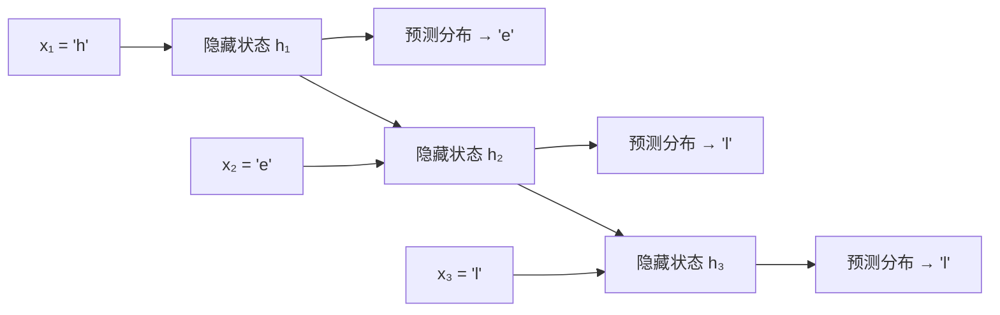
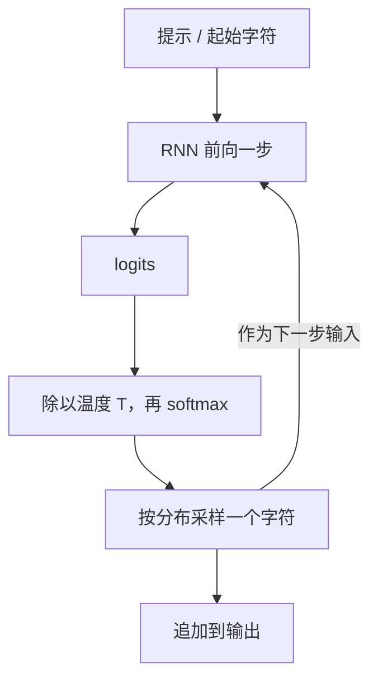

## 一句话总结

只要把“根据前文预测下一个字符”这件事反复训练，一个很小的循环神经网络（RNN）就能自己学会拼写、标点、括号配对、代码缩进这类结构；生成时再一个字符一个字符地采样，就得到了能“写作”的模型。

## 解决什么问题

普通的前馈网络只能处理固定大小的输入和输出（一张图进、一个类别出），而文本、语音、视频天然是**长度不定的序列**。作者想说明：给网络加上一个随时间传递的隐藏状态，它就能处理任意长度的序列，而且效果好得出乎意料。

文章本身不是论文，没有新算法；它的价值在于用大量可复现的小实验，把“序列建模”和“语言模型”这两件事讲成了直觉。

## 核心思想

- **同一个变换，反复使用**：RNN 每一步接收当前输入和上一步的隐藏状态，算出新的隐藏状态和输出。因为这个变换是共享的，所以序列多长都能用。
- **五种输入输出形态**：一对一（普通网络）、一对多（看图写话）、多对一（情感分类）、多对多且不对齐（翻译）、多对多且逐步对齐（逐帧标注视频）。文章用这张图说明序列模型能覆盖的任务类型。
- **字符级语言模型**：把每个字符编码成 one-hot 向量，训练目标是让下一个字符的概率尽量高。以训练串 “hello” 为例，它其实提供了 4 个监督信号：看到 h 要预测 e，看到 he 要预测 l，依此类推。
- **生成就是循环采样**：从模型给出的分布里抽一个字符，把它当作下一步的输入，再抽下一个……今天大模型逐 token 生成，骨架完全一样。

## 关键公式或机制

### 1. 单步更新

文中给出的“原版 RNN”只有三个权重矩阵（笔者按文意改写成公式）：

- 隐藏状态：`h_t = tanh(W_hh · h_{t-1} + W_xh · x_t)`
- 输出：`y_t = W_hy · h_t`，再经过 softmax 得到下一个字符的概率分布

训练时对每一步的输出都用交叉熵损失（也就是 softmax 分类器），用小批量随机梯度下降配合 RMSProp 或 Adam 更新。作者还提到可以把多个 RNN 叠起来（上一层的输出是下一层的输入），以及实践中大家更常用的是 LSTM（见 [Day 2 笔记](./p-02-understanding-lstm.md)）。

### 2. 温度（temperature）

采样前先把 logits 除以温度再做 softmax：

- 温度低于 1（例如 0.5）：分布更尖，输出更“自信”，也更保守、更爱重复。
- 温度高于 1：分布更平，输出更多样，但错误也更多。
- 温度趋近 0：几乎总选概率最高的字符，作者观察到这时容易陷入重复循环。

这正是今天调用大模型 API 时 `temperature` 参数的含义。

### 3. 实验一览（数字均为原文所写）

| 数据 | 规模 | 模型 | 观察 |
|---|---|---|---|
| Paul Graham 文集 | 约 1MB | 2 层 LSTM，每层 512 单元，约 350 万参数 | 能拼出英文单词和“创业腔”句子 |
| 莎士比亚全集 | 4.4MB | 3 层，每层 512 单元 | 学会剧本格式、人名与台词交替 |
| 维基百科（Hutter Prize 数据） | 100MB，前 96MB 训练 | LSTM | 能生成 markdown、链接、XML 并正确闭合标签 |
| 代数几何教材（LaTeX） | 16MB | 多层 LSTM | 生成“几乎能编译”的 LaTeX，但会忘记闭合 `\begin{enumerate}` 这类环境 |
| Linux 源码 | 474MB C 代码 | 3 层 LSTM，约 1000 万参数 | 括号配对、缩进、注释风格都像，但常用未定义的变量 |
| 8000 个英文名 | 小 | — | 生成大量“没见过但像名字”的新名字 |

### 4. 往里看：训练过程和神经元

- **样本随训练演化**：在《战争与和平》上，模型先学会空格和单词长度，再学会常用短词，然后是长词，跨越多个词的主题和长依赖最晚出现。
- **可解释的神经元**：作者把隐藏单元的激活可视化，找到了一些“含义明确”的单元，比如在引号内亮起、在 URL 里亮起、在 `[[ ]]` 链接里亮起的单元；但他也强调，大多数单元看不出含义。

## 图解

图解：同一组权重在每一步复用，隐藏状态把“到目前为止看到了什么”传给下一步；每一步都输出一个下一个字符的预测分布，训练时和真实的下一个字符算交叉熵。

图解：生成是一个循环，每一步把 logits 除以温度、做 softmax、按分布采样，再把采到的字符喂回模型；温度只改变分布的“尖锐程度”，不改变模型本身。

## 关键原话

> "If training vanilla neural nets is optimization over functions, training recurrent nets is optimization over programs."

（意思是：训练循环网络，某种程度上是在搜索一段“程序”。作者紧接着也提醒不要过度解读 RNN 图灵完备之类的说法。）

## 和 Anthropic 笔记的对应

| Anthropic 笔记 | 对得上的地方 |
|---|---|
| [近期三个问题的事后复盘](../notes/a-postmortem-of-three-recent-issues.md) | 复盘里有“温度为 0 时 TPU 实现偶尔丢掉概率最高的 token”、近似 top-k 返回错误结果等问题。读完本篇再看就明白：生成就是“算分布 → 采样”的循环，分布或采样任何一环出错，输出就会冒出不该出现的字符。 |
| [面向 AI 智能体的上下文工程](../notes/effective-context-engineering-for-ai-agents.md) | 本篇的隐藏状态是一个固定大小的向量，要把全部历史压进去；上下文工程讨论的是 Transformer 的上下文窗口有限、越长越“摊薄”。两者都是“有限的记忆装不下所有历史”，只是形式不同（类比，不是同一机制）。 |
| [Claude Code 最佳实践](../notes/claude-code-best-practices.md) | 原理支线 P1 挂在这篇之后。实际用模型时你调的温度、看到的逐字流式输出，在本篇都能找到最朴素的版本。 |

## 读的时候要注意

- **这是 2015 年的博文**：今天的主流是 Transformer，不是 RNN；分词也从字符变成了子词 token。读它是为了建立直觉，不是学当前做法。
- **样本是挑过的**：作者展示的多是有趣的片段，模型的平均水平并不总这么好；他自己也提到生成的 C 代码多半编译不过、变量名对不上，LaTeX 样本也要人工修几处才能编译。
- **“神经元有含义”只适用于少数单元**：作者明确说大多数单元无法解释，不要把可视化结论推广。
- **温度在不同实现里的细节可能不同**：本篇讲的是 softmax 前除以温度这一最常见的定义；具体 API 的温度范围和行为以各家文档为准。
- 文末的回应列表里提到 Yoav Goldberg 用 n-gram 计数基线做了对照。想严肃比较模型能力，要看困惑度等指标和基线，而不是只看样本。

## 30u30 对应单元

- 30u30 的 [Day 1 单元](https://github.com/Ojhaharsh/30u30/tree/main/papers/01_Unreasonable_Effectiveness)（讲解、实现和练习；仓库采用 CC BY-NC-ND 4.0，本笔记没有使用其内容）。
- 路线位置：[30u30 导读](../resources/r-30u30.md) 的原理支线 P1。

## 延伸阅读

- [char-rnn 代码仓库](https://github.com/karpathy/char-rnn)：文中实验所用的 Torch 实现。
- [Day 2：理解 LSTM 网络](./p-02-understanding-lstm.md)：本文提到“实践中大家都用 LSTM”，下一篇讲它为什么更好。
- [Attention and Augmented Recurrent Neural Networks（Distill）](https://distill.pub/2016/augmented-rnns/)：本文结尾提到的注意力、外部记忆方向的后续综述。

---

*本笔记依据 2026-10-18 抓取的在线原文撰写，仅为导读与总结。原文：Andrej Karpathy,[《The Unreasonable Effectiveness of Recurrent Neural Networks》](https://karpathy.github.io/2015/05/21/rnn-effectiveness/), 2015-05-21。*
