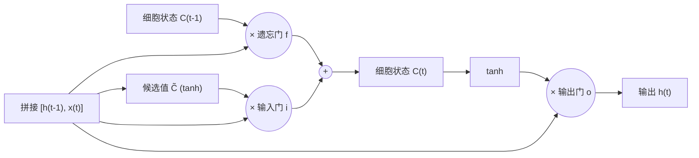

## 一句话总结

LSTM 的关键不是“更复杂”，而是给网络开了一条信息可以几乎原样流过的通道（细胞状态），再用三个可学习的“门”去控制往这条通道里删什么、加什么、读出什么。

## 解决什么问题

[Day 1](./p-01-rnn-effectiveness.md) 里的普通 RNN 有个根本问题：**长期依赖**（long-term dependencies）。

- 预测“the clouds are in the ___”只需要看最近几个词，普通 RNN 能做到。
- 预测“I grew up in France … I speak fluent ___”需要回到很远之前的“France”，间隔越大，普通 RNN 越学不会。

作者指出，理论上 RNN 有能力处理这种依赖（人可以手工给出参数），但实践中靠训练学不出来；更深的原因由 Hochreiter（1991）和 Bengio 等（1994）分析过，这篇博文只引用、不展开。LSTM（Hochreiter & Schmidhuber, 1997）就是为此设计的：记住长时间的信息是它的“默认行为”。

## 核心思想

- **细胞状态（cell state）是一条传送带**：贯穿整条链，只经过少量逐元素的线性操作（乘一个门、加一点新内容），信息很容易原样流过去。
- **门（gate）= sigmoid 层 + 逐元素乘法**：sigmoid 输出 0 到 1 之间的数，0 表示“一点都不放行”，1 表示“全部放行”。
- **三个门各管一件事**：
  1. **遗忘门**：看上一步输出和当前输入，决定细胞状态里每一维保留多少。
  2. **输入门 + 候选值**：输入门决定更新哪些维度，tanh 层给出候选的新内容，两者相乘后加进细胞状态。
  3. **输出门**：决定把细胞状态的哪些部分（经 tanh 压到 -1 到 1 之后）作为这一步的输出。
- 作者用语言模型举例：细胞状态里可能存着“当前主语的性别”，遇到新主语时遗忘门把旧的清掉、输入门把新的写进去；输出时可能只需要“主语是单数还是复数”，好让后面的动词变位正确。

## 关键公式或机制

### 1. 一步 LSTM 的四个式子

记上一步输出为 `h_{t-1}`、当前输入为 `x_t`，`[h_{t-1}, x_t]` 表示拼接，σ 是 sigmoid，`*` 是逐元素乘法：

- 遗忘门：`f_t = σ(W_f · [h_{t-1}, x_t] + b_f)`
- 输入门：`i_t = σ(W_i · [h_{t-1}, x_t] + b_i)`；候选值：`C̃_t = tanh(W_C · [h_{t-1}, x_t] + b_C)`
- 更新细胞状态：`C_t = f_t * C_{t-1} + i_t * C̃_t`
- 输出门与输出：`o_t = σ(W_o · [h_{t-1}, x_t] + b_o)`，`h_t = o_t * tanh(C_t)`

最关键的是第三行：新状态 = 旧状态按比例保留 + 新内容按比例加入。**加法**让信息（以及训练时的梯度）有一条不必反复穿过非线性变换的路径。这一点是笔者的补充解释，博文本身没有推导梯度。

### 2. 常见变体（博文列举）

| 变体 | 改了什么 |
|---|---|
| 窥视孔连接（peephole，Gers & Schmidhuber 2000） | 让门也能看到细胞状态 |
| 耦合遗忘门与输入门 | 只在要写入新内容时才遗忘，忘多少就写多少 |
| GRU（Cho 等 2014） | 合并遗忘门和输入门为“更新门”，并合并细胞状态与隐藏状态，结构更简单 |

作者引用了两项比较研究：Greff 等（2015）发现主流变体效果差不多；Jozefowicz 等（2015）测试了一万多种 RNN 结构，找到一些在特定任务上胜过 LSTM 的。

### 3. 结尾的“下一步”

博文最后说，研究者普遍认为下一步是**注意力**（attention）：让 RNN 的每一步都能从更大的信息集合里挑出要看的部分，例如给图片写说明时每个词只看图的一部分。这正是 [Day 15 Bahdanau 注意力](./p-15-bahdanau-attention.md) 和 [Day 13 Transformer](./p-13-attention-is-all-you-need.md) 要讲的。

## 图解

图解：上面一条是细胞状态的“传送带”，只经过“乘遗忘门、加新内容”两步；三个门和候选值都由上一步输出与当前输入的拼接算出来；最终输出是经过 tanh 的细胞状态再乘输出门。

## 关键原话

> "Remembering information for long periods of time is practically their default behavior, not something they struggle to learn!"

## 和 Anthropic 笔记的对应

| Anthropic 笔记 | 对得上的地方 |
|---|---|
| [面向 AI 智能体的上下文工程](../notes/effective-context-engineering-for-ai-agents.md) | LSTM 的遗忘门和输入门是在**网络内部**学“该留什么、该丢什么”；上下文工程讲的压缩、清理旧工具结果、结构化笔记，是在**系统层面**手工做同样的取舍。机制完全不同，但问题相同：容量有限，必须有选择地保留。 |
| [长时运行智能体的有效 harness](../notes/effective-harnesses-for-long-running-agents.md) | harness 用进度文件和 git 提交把信息带过一个个会话，相当于给智能体一条“细胞状态”；但它是外部文件，不是可学习的门。这只是帮助记忆的类比。 |
| [近期三个问题的事后复盘](../notes/a-postmortem-of-three-recent-issues.md) | 和 Day 1 一起读：LSTM 仍然是“预测下一个 token、再采样”的语言模型，只是记忆机制更好。 |

## 读的时候要注意

- **博文没有讲梯度消失的推导**：它只说普通 RNN 学不会长依赖，并引用 Hochreiter（1991）和 Bengio 等（1994）。“加法路径缓解梯度消失”是常见的解释，属于笔者补充；想看严格分析要去读原始论文（待核实：本笔记未逐篇核对这两篇的具体结论）。
- **“LSTM 没有长依赖问题”是简化说法**：LSTM 大幅缓解了问题，但实际能记住的距离仍然有限，这也是后来注意力和 Transformer 出现的原因之一。
- **公式写法有很多版本**：作者自己说几乎每篇论文的 LSTM 都略有不同；读代码时对照具体实现，不要死记某一版。
- **时间背景**：博文写于 2015 年，当时“几乎所有令人兴奋的 RNN 成果都来自 LSTM”。今天语言模型的主流已是 Transformer，LSTM 更多出现在小模型、流式和资源受限场景（这一现状判断为笔者概括）。

## 30u30 对应单元

- 30u30 的 [Day 2 单元](https://github.com/Ojhaharsh/30u30/tree/main/papers/02_Understanding_LSTM)（仓库采用 CC BY-NC-ND 4.0，本笔记没有使用其内容）。
- 路线位置：[30u30 导读](../resources/r-30u30.md) 的原理支线 P1。

## 延伸阅读

- [Day 1：循环神经网络为什么“好用得不讲道理”](./p-01-rnn-effectiveness.md)
- [Attention and Augmented Recurrent Neural Networks（Distill）](https://distill.pub/2016/augmented-rnns/)：同一作者参与的后续文章，展开讲注意力和外部记忆。
- [Day 17：神经图灵机](./p-17-neural-turing-machines.md)：它的“擦除 + 写入”明确借鉴了 LSTM 的遗忘门和输入门。

---

*本笔记依据 2026-10-18 抓取的在线原文撰写，仅为导读与总结。原文：Christopher Olah,[《Understanding LSTM Networks》](https://colah.github.io/posts/2015-08-Understanding-LSTMs/), 2015-08-27。*
