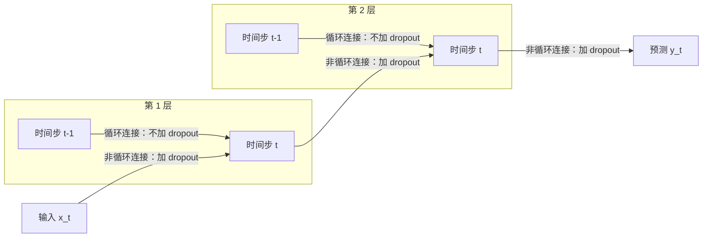

## 一句话总结

dropout 能用在 LSTM 上，关键是**只丢“纵向”的连接（从下一层到上一层），不丢“横向”的连接（从上一个时间步到下一个时间步）**。

## 解决什么问题

[Day 12](./p-12-dropout.md) 的 dropout 在前馈网络里是最有效的正则化方法之一，但论文开头指出，它直接用在 RNN 上效果不好。后果是：实际应用里的 RNN 往往只能做得很小，因为大模型容易过拟合。

论文引述了此前的解释：循环会放大噪声，干扰学习。作者的回答是：问题不在 dropout 本身，而在**加在哪些连接上**。

## 核心思想

- 多层 LSTM 里，每个单元有两路输入：来自**下一层同一时间步**的输出（非循环连接），和来自**同一层上一时间步**的状态（循环连接）。
- 只在非循环连接上做 dropout，循环连接保持原样。
- 论文的解释：一条信息从时间步 t−2 传到 t+2 的预测，经过 dropout 的次数恰好是 **L+1 次**（L 为层数），与它跨越多少个时间步无关。于是 LSTM 仍能把信息存很久，同时获得 dropout 的正则化效果。
- 作者也说明，Pham 等人此前独立提出了同样的方法并用于手写识别，本文是“重新发现”并在更多任务上验证。

## 关键公式或机制

### 1. LSTM 回顾

本文用的 LSTM 结构和 [Day 2](./p-02-understanding-lstm.md) 相同：输入门 i、遗忘门 f、输出门 o 和候选值 g 由“下一层输出 + 本层上一步状态”算出，然后 `c = f ⊙ c_prev + i ⊙ g`，`h = o ⊙ tanh(c)`。

### 2. 唯一的改动

把输入里来自下一层的那部分 `h^{l-1}_t` 换成 `D(h^{l-1}_t)`，D 是随机把一部分分量置零的 dropout 算子；来自上一步的 `h^l_{t-1}` 不动。整篇论文的方法就是这一处改动。

### 3. 实验结果（论文所写）

**Penn Treebank 词级语言建模（困惑度，越低越好）：**

| 模型 | 每层单元数 | 非循环连接 dropout | 测试集困惑度 |
|---|---|---|---|
| 不加正则化的最佳 LSTM | 200 | 无 | 114.5 |
| 中等正则化 LSTM | 650 | 50% | 82.7 |
| 大型正则化 LSTM | 1500 | 65% | 78.4 |
| 38 个大型正则化 LSTM 平均 | 1500 | 65% | 68.7 |

不加正则化时，作者只能用 200 单元的小网络，因为更大的网络会过拟合；加了 dropout 后可以把网络做大很多。

**其他任务：**

- 冰岛语语音识别（内部数据集，9.3 万条语音）：帧准确率验证集从 68.9% 升到 70.5%，训练集反而从 71.6% 降到 69.4%，这是 dropout 的典型现象。
- WMT'14 英法翻译：BLEU 从 25.9 升到 29.03，最优 dropout 概率为 0.2，但仍不如基于短语的 LIUM 系统（33.30）。
- 图像描述生成：dropout 有帮助，但 10 个不加正则化的模型做集成也能达到同样效果。作者据此总结：在这里 dropout 的主要作用是让单个模型接近集成的效果。

## 图解

图解：同一层内跨时间步的循环连接保持不变；从输入到第 1 层、从第 1 层到第 2 层、再到预测输出的非循环连接上做 dropout。

## 关键原话

> "The main idea is to apply the dropout operator only to the non-recurrent connections"

## 和 Anthropic 笔记的对应

这是一篇训练技巧论文，Anthropic 工程博客的笔记没有直接讨论它。下面是类比：

| Anthropic 笔记 | 对得上的地方 |
|---|---|
| [长时运行智能体的有效 harness](../notes/effective-harnesses-for-long-running-agents.md) | 本文的要点是“干扰可以加，但不能加在负责长期记忆的那条通路上”。长任务 harness 里，进度文件、功能清单和 git 历史就是跨会话的“记忆通路”，那篇强调要保护它们不被随意修改。只是类比。 |
| [揭秘 AI 智能体评测](../notes/demystifying-evals-for-ai-agents.md) | 本文语音实验里训练集指标下降、验证集上升，说明“看哪组数据”决定结论。评测笔记同样强调把训练外的、有代表性的任务集当作衡量标准。 |

## 读的时候要注意

- **方法极简，论文也很短**：8 页，核心就是一个公式改动，读的重点是“为什么不加在循环连接上”的解释。
- **“不能在循环连接上用 dropout”不是定论**：后来有研究提出在每个时间步使用同一个 dropout 掩码的变分 dropout，可以用于循环连接（待核实：本笔记未打开相关论文）。
- **语音实验用的是内部数据集**：无法复现，且只报告了帧准确率，没有报告词错误率，论文对此做了说明。
- **翻译结果没有超过传统系统**：论文只声称 dropout 改善了 LSTM，没有声称达到最好水平。

## 30u30 对应单元

- 30u30 的 [Day 3 单元](https://github.com/Ojhaharsh/30u30/tree/main/papers/03_RNN_Regularization)（仓库采用 CC BY-NC-ND 4.0，本笔记没有使用其内容）。
- 路线位置：[30u30 导读](../resources/r-30u30.md) 的补完段，建议在 P1（Day 1–2）之后读。

## 延伸阅读

- [Day 2：理解 LSTM](./p-02-understanding-lstm.md)：本文修改的对象。
- [Day 12：Dropout](./p-12-dropout.md)：dropout 本身的原始论文。
- [Day 1：循环神经网络为什么“好用得不讲道理”](./p-01-rnn-effectiveness.md)：同一时期的字符级语言模型。

---

*本笔记依据 2026-10-18 抓取的在线原文撰写，仅为导读与总结。原文：Wojciech Zaremba, Ilya Sutskever, Oriol Vinyals,[《Recurrent Neural Network Regularization》](https://arxiv.org/abs/1409.2329), arXiv 2014。*
