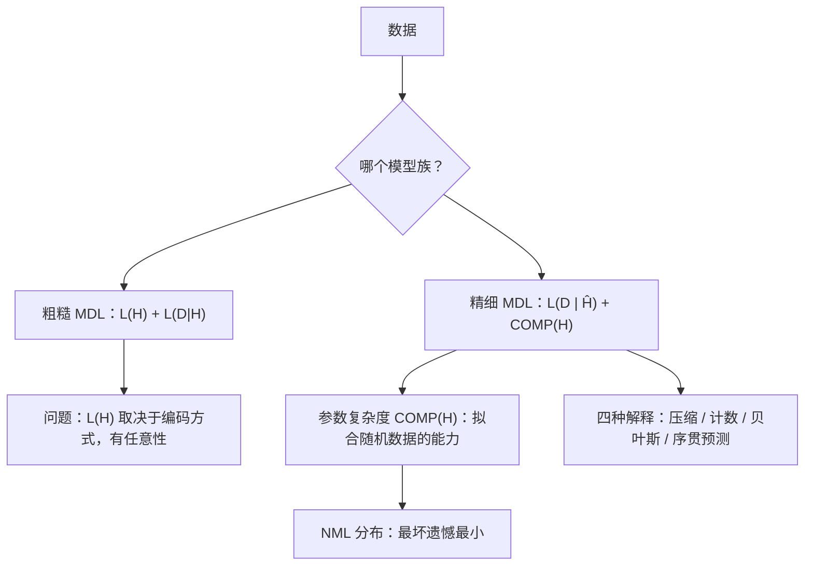

## 一句话总结

在若干个能解释数据的模型里，选那个让“描述模型 + 借助模型描述数据”总长度最短的；精细版本进一步把“模型有多复杂”定义成它能拟合多少种随机数据。

## 解决什么问题

**模型选择**：数据有限，几个模型都能解释它，该信哪个？例如拿一次多项式还是十次多项式去拟合一组点。越复杂的模型训练误差越小，但越容易过拟合。

教程开头列出 MDL 想同时做到的几件事：体现奥卡姆剃刀、自动防止过拟合、和贝叶斯方法相通但避开它的一些解释难题、**不需要假设存在“真实模型”**，以及可以解释为“对未见数据的预测”。

[Day 4](./p-04-keeping-nn-simple-mdl.md) 已经把 MDL 用在神经网络权重上，这篇是它背后原理的系统介绍。

## 核心思想

### 规律 = 可压缩

教程用三条各 10000 位的二进制序列开场：

1. `0001` 重复 2500 次：极有规律，可以压缩到 O(log n) 位。
2. 公平硬币抛出来的：几乎肯定无法压缩。
3. 0 大约是 1 的四倍：有统计规律，能压缩到 αn 位（0 < α < 1）。

“学习”就是“发现规律”，于是**压缩得越多，学到的越多**。

### 为什么不直接用 Kolmogorov 复杂性

最理想的版本是找“能输出数据的最短程序”（[Day 26](./p-26-kolmogorov-complexity.md) 的 Kolmogorov 复杂性）。教程指出两个障碍：它**不可计算**；样本小时，结果还会依赖所选编程语言的语法细节。所以实用的 MDL 把“所有程序”缩小为“某一族概率模型”。

### 粗糙 MDL 与精细 MDL

- **粗糙 MDL（两段式编码）**：选使 `L(H) + L(D|H)` 最小的假设 H。其中 `L(D|H) = −log P(D|H)` 没有争议；问题在 `L(H)`，“描述一个假设要多少位”取决于你选的编码，带有任意性。
- **精细 MDL**：不再单独编码假设，而是对整个模型族用一种“通用编码”一次性编码数据。数据在模型族下的“随机复杂度”可以拆成两项：

`随机复杂度 = L(D | Ĥ) + COMP(H)`

`Ĥ` 是模型族里最大化似然的那个分布，`COMP(H)` 是**参数复杂度**，衡量这个模型族“拟合随机数据的能力”。它和自由参数个数有关，但也取决于模型的几何结构。

## 关键公式或机制

### 1. 码长与概率可以互换

第二章先讲信息论基础：前缀码、Kraft 不等式。核心结论是码长和概率一一对应，`码长 = −log 概率`，所以“最短描述”和“最大概率”是同一枚硬币的两面。

### 2. 遗憾与 NML

衡量一个通用编码 P̄ 的好坏，用**遗憾**：用 P̄ 编码数据比“事后看最合适的那个模型”多花的位数。取所有可能数据上的最坏情况，让最坏遗憾最小的分布就是**归一化最大似然（NML）**分布，它对应的最坏遗憾正是 `COMP(H)`。

### 3. 同样两个参数，复杂度却不同

教程引用心理物理学的例子：Stevens 模型 `y = a·x^b + Z` 和 Fechner 模型 `y = a·ln(x + b) + Z` 都有两个参数。有研究从 Fechner 模型生成许多大小为 4 的样本，结果 67% 的情况下 Stevens 模型拟合得更好。精细 MDL 给 Stevens 模型的复杂度大得多，拟合程度相当时会选 Fechner。只数参数个数（如 BIC 一类方法）看不出这一点。

### 4. 四种解释

精细 MDL 的选择可以分别解释为：压缩（码长最短）、计数（模型里“可区分的假设”有多少）、贝叶斯（与某种先验下的边际似然相近）、序贯预测（逐个预测下一个数据点时累计损失最小）。

## 图解

图解：粗糙 MDL 把总长度拆成假设码长和数据码长，但假设码长依赖编码方式；精细 MDL 改用最大似然项加参数复杂度，参数复杂度等于 NML 分布的最坏遗憾，并且可以从四个角度解释。

## 关键原话

> "the more we are able to compress the data, the more we have learned about the data."

## 和 Anthropic 笔记的对应

这是一份统计学习理论教程，Anthropic 工程博客的笔记没有直接讨论它。下面是类比：

| Anthropic 笔记 | 对得上的地方 |
|---|---|
| [面向 AI 智能体的上下文工程](../notes/effective-context-engineering-for-ai-agents.md) | 那篇追求“能完整描述期望行为的最小信息集”，并强调最小不等于短。MDL 的总成本里同时有“描述模型”和“描述剩余误差”两项，同样不是越短越好。 |
| [构建高效的智能体](../notes/building-effective-agents.md) | “从最简单的方案开始，复杂度带来可测量收益才加”是工程版的奥卡姆剃刀；MDL 给“复杂度值不值”提供了一种可以计算的标准。只是类比。 |

## 读的时候要注意

- **先读第一章**：约 20 页，完全不用公式，读完就能掌握主要思想；第二章需要概率论和信息论基础。
- **“奥卡姆剃刀”不是说世界简单**：教程专门回应了“简单模型如何描述复杂世界”的质疑，而且指出数据越多，MDL 选出的模型可以越复杂。
- **作者自己列出的问题**：样本不够大时用渐近公式会出错；NML 对某些模型无定义，只能人为截断参数范围；当候选模型都不是“真实模型”时，MDL 有时也会失效——作者也承认这有点讽刺，因为 MDL 本来就不依赖这个假设。
- **这是 2004 年的教程**：MDL 后来的发展本笔记未跟进（待核实）。

## 30u30 对应单元

- 30u30 的 [Day 5 单元](https://github.com/Ojhaharsh/30u30/tree/main/papers/05_MDL_Principle)（仓库采用 CC BY-NC-ND 4.0，本笔记没有使用其内容）。
- 路线位置：[30u30 导读](../resources/r-30u30.md) 的 P6 理论段（压缩、复杂性、通用智能）。

## 延伸阅读

- [Day 4：用最短描述长度让神经网络保持简单](./p-04-keeping-nn-simple-mdl.md)：MDL 在神经网络上的早期应用。
- [Day 26：Kolmogorov 复杂性](./p-26-kolmogorov-complexity.md)：理想化 MDL 的基础。
- [Day 27：机器超级智能](./p-27-machine-super-intelligence.md)：把“压缩 / 简单性”用于定义通用智能。

---

*本笔记依据 2026-10-18 抓取的在线原文撰写，仅为导读与总结。原文：Peter Grünwald,[《A Tutorial Introduction to the Minimum Description Length Principle》](https://arxiv.org/abs/math/0406077), arXiv 2004。*
