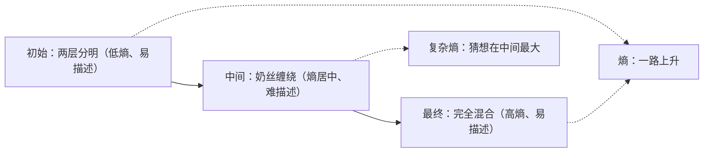

## 一句话总结

“复杂”和“随机”不是一回事：完全有序和完全混合的状态都容易描述，只有中间态难以描述；要把这个直觉变成数学，关键是给描述过程加上**计算资源限制**。

## 解决什么问题

在一次关于“时间”的会议上，物理学家 Sean Carroll 提出一个问题：咖啡里刚倒进奶时，两层分明；完全搅匀后，是均匀的浅褐色；中间那个奶丝缠绕的阶段看起来最“复杂”。宇宙也一样：大爆炸后不久是一锅低熵的粒子汤，极远的未来是一锅高熵的粒子汤，只有中间这段时间有星系和大脑。

熵单调增加（热力学第二定律），**那么“复杂度”为什么先升后降？**能不能有一条“复杂动力学定律”来解释？

Aaronson 认为这个问题有两步：先给“复杂度”一个说得过去的形式化定义；再证明它在自然的模型系统里，开始和结束时接近零、中间时刻很大。

## 核心思想

### 1. 用 Kolmogorov 复杂性定义熵会遇到麻烦

一个字符串的 Kolmogorov 复杂性，是能输出它的最短程序的长度（见 [Day 26](./p-26-kolmogorov-complexity.md)）。但对**确定性**系统，第 t 步的状态总能用“初始状态 + 规则 + 步数 t”描述，后者只要 log(t) 位，所以这样定义的“熵”最多按对数增长，远比直觉慢。

两种补救：改用**随机**系统；或者改用**资源受限**的 Kolmogorov 复杂性（只允许在短时间内运行完的程序）。

### 2. “精致度”：区分随机和有结构

Kolmogorov 本人就注意到：完全随机的字符串复杂性最高，却最“无聊”，一句“它是随机的”就说完了。由此有了**精致度**（sophistication）：找一个集合 S，使 x 是 S 中“典型的、随机的”一员，描述 S 所需的最短程序长度就是 x 的精致度。

- 简单字符串：S 取只含它自己的集合，精致度小。
- 随机字符串：S 取所有 n 位串的集合，精致度也小。
- 只有“既不简单也不随机”的串精致度才大。

### 3. 但精致度同样升不上去

对确定性系统，理由同上；对随机系统，也可以用“初始状态 + 随机规则 + t”描述第 t 步所有可能状态的集合，而实际状态几乎总是其中的典型成员。所以精致度几乎不会超过 log(t) 加一个常数。

### 4. 加上计算资源限制：“复杂熵”

Aaronson 的提议：在**两处**都要求计算高效——生成样本的程序要快（例如在 n log n 时间内），从样本还原 x 的程序也要快。他称之为“复杂熵”（complextropy），并猜想它满足“复杂动力学第一定律”：初始小、中间大、混合完成后又变小。

## 关键公式或机制

- Kolmogorov 复杂性 `K(x)`：输出 x 的最短程序长度。
- 精致度：在所有满足 `x ∈ S` 且 `K(x | S) ≥ log₂|S| − c` 的集合 S 里，`K(S)` 的最小值。第二个条件的意思是：x 在 S 里没有额外可利用的规律，S 已经提炼出了 x 的全部“非随机”信息。
- 复杂熵：同样的思路，但描述 S 的程序和还原 x 的程序都必须在给定的时间界（例如 n log n）内运行完。作者强调两处限制缺一不可：没有前者，结果仍不超过 log(t) + c；没有后者，复杂熵可能会一直增加而不回落。

## 图解

图解：咖啡从两层分明到奶丝缠绕再到完全混合，熵一路上升；Aaronson 猜想带资源限制的复杂熵在开始和结束时都小，只在中间阶段大。

## 关键原话

> "it’s not a hopelessly open-ended question that one tosses out just to show how wide-ranging one’s thoughts are, but a relatively-bounded question about which actual theorems could be proved"

## 和 Anthropic 笔记的对应

这是一篇理论计算机科学博文，Anthropic 工程博客的笔记没有直接讨论它。下面是类比：

| Anthropic 笔记 | 对得上的地方 |
|---|---|
| [揭秘 AI 智能体评测](../notes/demystifying-evals-for-ai-agents.md) | Aaronson 建议用可计算的压缩文件大小代替不可计算的 Kolmogorov 复杂性。评测里也经常用可计算的代理指标替代真正想测的东西，那篇强调要校准代理和真实目标之间的关系。 |
| [面向 AI 智能体的上下文工程](../notes/effective-context-engineering-for-ai-agents.md) | “随机的东西一句话就能概括”对应上下文工程的一个直觉：信息量大不等于有用，真正值得放进窗口的是有结构的、高信号的部分。只是类比。 |

## 读的时候要注意

- **这是一篇博文和一个猜想**：作者明确说不知道如何证明，属于提出问题，不是给出结论。
- **定义里有很多可调的选择**：时间界选 n log n 只是举例，作者说也可以换成其他资源限制。
- **“复杂熵”难以计算**：作者自己指出它几乎肯定无法计算甚至近似，建议用 gzip 等压缩程序的输出大小做粗略替代。
- **评论区有大量讨论**：本笔记只依据正文，没有整理评论（待核实：评论中是否有人指出更早的类似想法）。
- **后续**：文末提到 MIT 本科生 Lauren Ouellette 开始做实验，这项工作后来成为 [Day 7](./p-07-coffee-automaton.md) 的论文。

## 30u30 对应单元

- 30u30 的 [Day 6 单元](https://github.com/Ojhaharsh/30u30/tree/main/papers/06_Complexodynamics)（仓库采用 CC BY-NC-ND 4.0，本笔记没有使用其内容）。
- 路线位置：[30u30 导读](../resources/r-30u30.md) 的 P6 理论段（压缩、复杂性、通用智能）。

## 延伸阅读

- [Day 7：咖啡自动机](./p-07-coffee-automaton.md)：这篇博文的实验版本。
- [Day 26：Kolmogorov 复杂性](./p-26-kolmogorov-complexity.md)：精致度等概念的理论背景。
- [Day 5：最小描述长度原理入门](./p-05-mdl-tutorial.md)：同样是“两段式描述”的思路。

---

*本笔记依据 2026-10-18 抓取的在线原文撰写，仅为导读与总结。原文：Scott Aaronson,[《The First Law of Complexodynamics》](https://scottaaronson.blog/?p=762), Shtetl-Optimized, 2011-09-23。*
