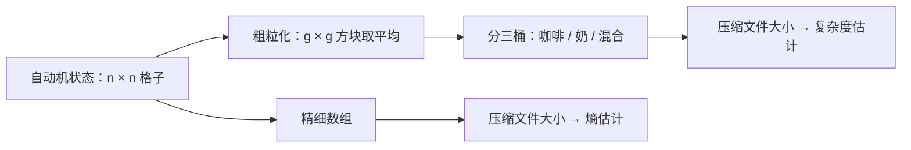

## 一句话总结

把“看起来有多复杂”定义成“模糊化之后还要多少比特才能描述”：用压缩程序估计这个量，在一个模拟咖啡混合的自动机里，它确实先升后降。

## 解决什么问题

[Day 6](./p-06-first-law-complexodynamics.md) 的博文提出了一个猜想：封闭系统的熵单调增加，而“复杂度”先升后降。博文给的定义（带资源限制的复杂熵）几乎无法计算。这篇论文要做的是：

1. 选一个简单、可模拟的模型系统；
2. 选一个**可以实际计算**的复杂度度量；
3. 跑实验，看它是否呈现先升后降，并尽量做些理论分析。

论文称，据作者所知，这是对这一现象的第一次定量探索。

## 核心思想

### 先区分熵和复杂度

论文回顾了几种熵（Boltzmann 熵、Gibbs 熵、Shannon 熵、Kolmogorov 复杂性），指出它们都在“随机”的对象上取最大值；而复杂度应当对“简单”和“随机”的对象都低，只对“既不简单也不随机”的对象高。

论文列出四种区别于熵的复杂度概念：**表观复杂度**、**精致度**、**逻辑深度**、**光锥复杂度**，并说明它们彼此相关。

### 表观复杂度

最贴近直觉的一种：先对状态做**平滑或粗粒化**（相当于眯着眼看），再计算结果的 Kolmogorov 复杂性。实际中用压缩程序（如 gzip、bzip）压缩后的文件大小来估计 Kolmogorov 复杂性；论文回应了对这种做法的质疑，说在他们的实验里估计结果是稳定的。

## 关键公式或机制

### 1. 两种咖啡自动机

在一个 n × n 的格子上，上半部分是奶、下半部分是咖啡：

- **相互作用模型**：每格最多一个粒子；每一步随机选一对上下或左右相邻、类型不同的粒子交换位置。粒子不能重叠，运动彼此牵制。
- **非相互作用模型**：一个格子可以有任意多个奶粒子，每个奶粒子每步独立地随机走向四个邻格之一。

### 2. 粗粒化度量

- 把每个格子替换为以它为中心、边长为 g 的方块内的平均值（g 称为粒度，靠实验选定）。
- 把平均值分到三个桶：基本是咖啡、基本是奶、混合。
- **复杂度估计** = 粗粒化、分桶后数组的压缩文件大小；**熵估计** = 原始精细数组的压缩文件大小。

实现时遇到“边界像素伪影”等技术问题，论文第 6 节给出了调整后的粗粒化方法。

### 3. 实验结果（论文所写）

- 两种模型的熵估计都持续上升，符合第二定律。
- 用原始粗粒化方法，两种模型的复杂度都先升后降。
- 改用调整后的方法后，相互作用模型仍是类似的先升后降曲线，而非相互作用模型的复杂度曲线被压平到较低水平。
- 相互作用模型中，复杂度峰值大致随格子边长 **线性** 增长；到达峰值的时间大致随边长 **平方** 增长，即与粒子数成正比。作者认为这符合预期：初始状态沿竖直轴对称，复杂结构大致只沿一个方向发展。

### 4. 理论部分

附录证明：在非相互作用模型中，期望每格粒子数不超过 1，粗粒化后的方块在大多数时刻都接近期望值，所以表观复杂度**不会变大**。而对于相互作用模型，作者只能给出数值证据，**证明复杂度确实在中间变大，需要一个下界，这留作开放问题**。

### 5. 其他尝试

论文也试过一种直接估计 Kolmogorov 复杂性和精致度的两段式编码算法（OSCR），但他们的实现压缩自动机数据的效果不好。结论部分认为它理论上更有前景，因为它不依赖人为选择的粗粒化方式。

## 图解

图解：同一个自动机状态分两路处理：精细数组直接压缩，得到熵估计；先粗粒化成方块平均、再分成三桶后压缩，得到表观复杂度的估计。

## 关键原话

> "a complexity measure should be low both for “simple” objects and for “random” objects, and large only for “interesting” objects that are neither simple nor random."

## 和 Anthropic 笔记的对应

这是一篇物理与理论计算机科学交叉的论文，Anthropic 工程博客的笔记没有直接讨论它。下面是类比：

| Anthropic 笔记 | 对得上的地方 |
|---|---|
| [量化智能体编码评测中的基础设施噪声](../notes/infrastructure-noise.md) | 本文的复杂度曲线随粗粒化方式不同而改变（非相互作用模型的曲线在调整后被压平）。那篇也发现，只改容器资源配置就能改变评测结果。两者都说明：测量方法本身的选择会改变你看到的结论。 |
| [揭秘 AI 智能体评测](../notes/demystifying-evals-for-ai-agents.md) | 本文用压缩文件大小作为不可计算量的代理，并检查代理是否稳定；评测里用代码或模型评分器作为“任务是否完成”的代理，同样需要校准。只是类比。 |

## 读的时候要注意

- **作者自己承认的局限**：表观复杂度依赖粗粒化方式，而这种方式来自人的直觉；结论部分明确把这列为缺点。
- **相互作用模型没有理论证明**：“先升后降”只有数值证据。
- **压缩程序只是近似**：gzip 等程序的压缩率并不等于 Kolmogorov 复杂性，论文也记录了对此的质疑和回应。
- **与 Day 6 的关系**：表观复杂度可以看作资源极度受限的精致度，论文对此有说明，但这和博文里的“复杂熵”并不完全相同。
- **代码**：论文给出了作者主页上的代码下载地址，本笔记未下载运行（待核实：该链接现在是否仍然有效）。

## 30u30 对应单元

- 30u30 的 [Day 7 单元](https://github.com/Ojhaharsh/30u30/tree/main/papers/07_coffee_automaton)（仓库采用 CC BY-NC-ND 4.0，本笔记没有使用其内容）。
- 路线位置：[30u30 导读](../resources/r-30u30.md) 的 P6 理论段（压缩、复杂性、通用智能）。

## 延伸阅读

- [Day 6：复杂动力学第一定律](./p-06-first-law-complexodynamics.md)：本文要验证的猜想。
- [Day 26：Kolmogorov 复杂性](./p-26-kolmogorov-complexity.md)：本文度量的理论基础。
- [Day 5：最小描述长度原理入门](./p-05-mdl-tutorial.md)：OSCR 两段式编码背后的思路。

---

*本笔记依据 2026-10-18 抓取的在线原文撰写，仅为导读与总结。原文：Scott Aaronson, Sean M. Carroll, Lauren Ouellette,[《Quantifying the Rise and Fall of Complexity in Closed Systems: The Coffee Automaton》](https://arxiv.org/abs/1405.6903), arXiv 2014。*
