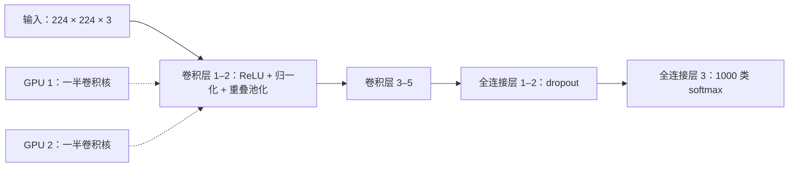

## 一句话总结

当数据足够大（120 万张标注图片）、算力足够强（GPU）时，一个足够深的、纯监督训练的卷积网络，可以远远超过当时手工特征加分类器的方法。

## 解决什么问题

2012 年以前，物体识别的标注数据集大多只有几万张图片。论文指出，真实场景中的物体变化极大，需要大得多的训练集；ImageNet 这样有上千万张标注图片的数据集刚刚出现。

要从几百万张图片里学几千类物体，需要**容量很大**的模型，同时它又得带有足够的先验知识（比如图像的局部相关性和平移不变性）来弥补数据的不足。卷积神经网络正好满足这两点，问题是：在高分辨率图片上大规模训练它，**算得动吗？会不会严重过拟合？**

## 核心思想

- **网络结构**：5 个卷积层（部分后接最大池化）+ 3 个全连接层 + 1000 类 softmax，约 6000 万参数、65 万个神经元。
- **作者强调深度很重要**：去掉任何一个卷积层效果都会变差；去掉中间某层，top-1 准确率大约下降 2%，而每个卷积层的参数都不超过全模型的 1%。
- **规模受限于硬件**：单块 GTX 580 只有 3GB 显存，作者把网络拆到两块 GPU 上，训练约 90 轮，耗时五到六天。论文还写道，实验表明只要等到更快的 GPU 和更大的数据集，结果就能进一步提升。

## 关键公式或机制

论文按作者认为的重要程度介绍了几项设计（数字均为论文所写）：

### 1. ReLU 非线性

用 `f(x) = max(0, x)` 代替 tanh。在 CIFAR-10 上，一个 4 层卷积网络用 ReLU 达到 25% 训练错误率的速度比 tanh 快六倍。论文说，用传统的饱和型神经元，根本无法在这么大的网络上做这些实验。

### 2. 两块 GPU 并行

每块 GPU 放一半卷积核，只在部分层之间通信。和单 GPU、卷积核减半的网络相比，top-1 和 top-5 错误率分别降低 1.7% 和 1.2%。

### 3. 局部响应归一化与重叠池化

- 局部响应归一化：让相邻通道之间互相抑制，top-1 / top-5 错误率分别降低 1.4% / 1.2%。
- 重叠池化：池化窗口 3、步长 2（窗口有重叠），比不重叠时 top-1 / top-5 降低 0.4% / 0.3%。

### 4. 对抗过拟合

论文说明，1000 类意味着每个样本只对映射施加约 10 比特的约束，不足以约束 6000 万个参数。两种主要手段：

- **数据增强**：从 256×256 图片中随机裁出 224×224 的块并做水平翻转，训练集扩大 2048 倍（但样本高度相关）；测试时取四角、中心加翻转共 10 块取平均。另外对 RGB 做主成分扰动，模拟光照变化，top-1 错误率降低 1% 以上。
- **dropout**：在前两个全连接层以 0.5 的概率随机关闭神经元（见 [Day 12](./p-12-dropout.md)）。不用 dropout 会严重过拟合；用了以后收敛所需的迭代次数大约翻倍。

### 5. 训练细节

随机梯度下降，批大小 128，动量 0.9，权重衰减 0.0005（论文发现这点权重衰减对降低**训练**误差也很重要），学习率从 0.01 开始，验证误差不再下降时除以 10，共降了三次。

### 6. 结果

| 数据 | 方法 | top-1 | top-5 |
|---|---|---|---|
| ILSVRC-2010 测试集 | 此前最好（稀疏编码） | 47.1% | 28.2% |
| ILSVRC-2010 测试集 | 本文 CNN | 37.5% | 17.0% |
| ILSVRC-2012 测试集 | 第二名 | — | 26.2% |
| ILSVRC-2012 测试集 | 本文 7 个 CNN 集成 | — | 15.3% |

ILSVRC-2012 的 15.3% 来自 7 个网络的集成，其中两个先在完整的 ImageNet 2011 秋季版（1500 万张图、2.2 万类）上预训练再微调。单个网络在验证集上的 top-5 是 18.2%。

## 图解

图解：输入的 224×224 图片依次经过 5 个卷积层（前两层后接局部响应归一化和重叠池化）、2 个带 dropout 的全连接层和 1000 类 softmax；卷积核平均分到两块 GPU 上，只在部分层之间通信。

## 关键原话

> "All of our experiments suggest that our results can be improved simply by waiting for faster GPUs and bigger datasets to become available."

## 和 Anthropic 笔记的对应

| Anthropic 笔记 | 对得上的地方 |
|---|---|
| [为长时间运行的应用开发设计 harness](../notes/harness-design-long-running-apps.md) | AlexNet 的网络规模被显存限制，作者用“拆到两块 GPU”这个工程变通绕过去，并预言硬件变强后结果还会更好。那篇说 harness 的每个组件都编码了“模型做不到什么”的假设，模型变强后要重新检验。两者都是：今天的工程变通，是对当前能力边界的回应。只是类比。 |
| [揭秘 AI 智能体评测](../notes/demystifying-evals-for-ai-agents.md) | 论文说明 ILSVRC-2012 测试集标签不公开，所以文中混用验证集和测试集错误率，并给出两者差距不超过 0.1% 的经验。评测笔记同样要求说清楚“分数是在哪组数据上、怎么测出来的”。 |

## 读的时候要注意

- **摘要页和 PDF 数字不一致**：NeurIPS 论文集摘要页写的是 130 万张训练图、top-1 / top-5 错误率 39.7% / 18.9%、50 万个神经元、“两个全局连接层”；PDF 正文写的是 120 万张、37.5% / 17.0%、65 万个神经元、三个全连接层。本笔记以 PDF 为准，差异原因未核实（待核实，可能是摘要页保留了早期版本）。
- **很多设计后来被替代**：局部响应归一化、跨 GPU 拆分卷积核在后来的网络里很少使用（待核实：本笔记未逐一核对后续文献），读的重点是“规模 + 数据 + GPU + 正则化”这一组合。
- **集成与预训练**：竞赛成绩 15.3% 用了 7 个网络的集成和额外数据的预训练，比较单模型时要用 18.2% 这一类数字。
- **深度的证据有限**：“去掉一层就变差”是消融观察，没有系统地加深网络；更深网络的训练问题要到 [Day 9 ResNet](./p-09-resnet.md) 才解决。

## 30u30 对应单元

- 30u30 的 [Day 8 单元](https://github.com/Ojhaharsh/30u30/tree/main/papers/08_alexnet)（仓库采用 CC BY-NC-ND 4.0，本笔记没有使用其内容）。
- 路线位置：[30u30 导读](../resources/r-30u30.md) 的补完段，单元 2 视觉（Day 8 → 9 → 10 → 11 → 12）。

## 延伸阅读

- [Day 12：Dropout](./p-12-dropout.md)：本文用到的正则化方法。
- [Day 9：ResNet](./p-09-resnet.md)：如何把网络做到上百层。
- [Day 28：CS231n 卷积网络](./p-28-cs231n-cnn.md)：卷积网络的系统入门。
- [论文 PDF（NeurIPS 论文集）](https://papers.nips.cc/paper_files/paper/2012/file/c399862d3b9d6b76c8436e924a68c45b-Paper.pdf)

---

*本笔记依据 2026-10-18 抓取的在线原文撰写，仅为导读与总结。原文：Alex Krizhevsky, Ilya Sutskever, Geoffrey E. Hinton,[《ImageNet Classification with Deep Convolutional Neural Networks》](https://papers.nips.cc/paper/2012/hash/c399862d3b9d6b76c8436e924a68c45b-Abstract.html), NIPS 2012。*
