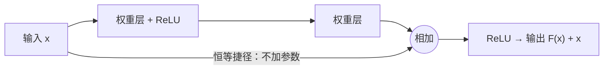

## 一句话总结

与其让一组层直接学目标映射 H(x)，不如让它学 `F(x) = H(x) − x`，再把 x 原样加回来；如果最好的做法是“什么都不改”，网络只需把 F 学成零。

## 解决什么问题

[AlexNet](./p-08-alexnet.md) 之后，大家发现网络越深越好，但再往深走遇到了新问题。论文把它称为**退化**：

- 深度增加后，准确率先饱和，然后迅速下降。
- 这**不是过拟合**：更深的网络连**训练误差**都更高（论文图 1：CIFAR-10 上 56 层普通网络的训练误差和测试误差都高于 20 层）。
- 也不太可能是梯度消失：这些网络都用了批归一化，作者还检查了反向传播的梯度大小正常。论文猜想深层普通网络的收敛速度可能极慢。

论文用一个构造论证说明这不应该发生：把浅层网络复制过来，再在上面加几层恒等映射，得到的深层网络训练误差至少不会更高。既然这样的解存在，说明问题出在**现有优化器找不到它**。

## 核心思想

- 设一组层希望拟合的映射为 H(x)，改为让它拟合残差 `F(x) := H(x) − x`，输出变成 `F(x) + x`。
- “+ x”由**捷径连接**实现：把输入跳过这组层直接加到输出上。维度相同时用**恒等捷径**，不增加参数和计算量。
- 作者的假设是：优化残差比优化原始映射更容易。极端情况下，如果恒等映射就是最优的，把 F 推到零比用一叠非线性层去逼近恒等映射容易得多。论文的脚注也说明，这一假设本身仍是开放问题。

## 关键公式或机制

### 1. 残差块

`y = F(x, {W_i}) + x`

例如两层的残差块中 `F = W2 · σ(W1 · x)`，σ 为 ReLU。维度变化时，用一个线性投影 `W_s · x` 代替 x。

### 2. 三种捷径方案（ImageNet 34 层）

- A：维度增加时用补零，所有捷径都无参数；
- B：只在维度增加时用投影；
- C：所有捷径都用投影。

top-1 错误率分别为 25.03%、24.52%、24.19%。差别很小，作者据此认为投影捷径不是解决退化问题的关键，为了节省计算，更深的网络不用方案 C。

### 3. 瓶颈块

为了把网络做到 50、101、152 层，作者用“1×1 降维 → 3×3 卷积 → 1×1 升维”的三层瓶颈块代替两层块。152 层网络的计算量为 113 亿次乘加，仍低于 VGG-16/19（153 亿 / 196 亿次）。

### 4. 主要结果（论文所写）

**普通网络 vs 残差网络（ImageNet 验证集 top-1 错误率，10 裁剪测试）：**

| 层数 | 普通网络 | 残差网络 |
|---|---|---|
| 18 | 27.94% | 27.88% |
| 34 | 28.54% | 25.03% |

普通网络 34 层比 18 层差，残差网络则反过来，34 层比 18 层好 2.8 个百分点。

**更深的网络：** ResNet-50 / 101 / 152 的 top-5 错误率分别为 6.71% / 6.05% / 5.71%（验证集，10 裁剪）。多个残差网络集成后在 ImageNet 测试集上的 top-5 错误率为 3.57%，获得 ILSVRC 2015 分类第一。

**CIFAR-10：** 110 层残差网络测试错误率 6.43%；1202 层网络训练误差同样很低，但测试错误率升到 7.93%，作者认为是这个 1940 万参数的网络对小数据集来说太大、过拟合了。

**迁移到检测：** 论文称仅因为表示更深，在 COCO 目标检测上取得了 28% 的相对提升，并在 ILSVRC 和 COCO 2015 的检测、定位、分割任务上也拿了第一。

## 图解

图解：输入 x 一路经过两层权重层得到残差 F(x)，另一路通过恒等捷径直接跳过，两路相加后再经过 ReLU，输出 F(x) + x。

## 关键原话

> "We hypothesize that it is easier to optimize the residual mapping than to optimize the original, unreferenced mapping."

## 和 Anthropic 笔记的对应

这是一篇视觉模型结构论文，Anthropic 工程博客的笔记没有直接讨论它。下面是类比：

| Anthropic 笔记 | 对得上的地方 |
|---|---|
| [长时运行智能体的有效 harness](../notes/effective-harnesses-for-long-running-agents.md) | 那篇要求编码智能体每次只做一个功能、在可工作的状态上增量推进，并保持干净的提交。残差块也是“在已有输出上只学增量，默认保持原样”。只是类比。 |
| [揭秘 AI 智能体评测](../notes/demystifying-evals-for-ai-agents.md) | 本文的关键一步是区分“训练误差高”（优化失败）和“测试误差高”（过拟合），两者的对策完全不同。评测笔记同样强调先读失败的轨迹、弄清失败属于哪一类，再决定改什么。 |

## 读的时候要注意

- **为什么残差更好优化，论文没有给出理论证明**：它是一个假设加大量实验证据。
- **更深不总是更好**：CIFAR-10 上 1202 层比 110 层差，论文自己报告了这一点。
- **捷径方案和后续改进**：本文的激活函数放在相加之后，同一组作者在 [Day 10](./p-10-identity-mappings-resnet.md) 里分析了这样做的问题并提出改进。
- **竞赛成绩是集成结果**：3.57% 来自多个模型的集成，单模型数字要看表 4（待核实：本笔记未摘录单模型测试集数字）。
- **深度学习在语言模型里的对应**：残差连接也是 [Transformer](./p-13-attention-is-all-you-need.md) 每个子层的标准部件。

## 30u30 对应单元

- 30u30 的 [Day 9 单元](https://github.com/Ojhaharsh/30u30/tree/main/papers/09_resnet)（仓库采用 CC BY-NC-ND 4.0，本笔记没有使用其内容）。
- 路线位置：[30u30 导读](../resources/r-30u30.md) 的补完段，单元 2 视觉（Day 8 → 9 → 10 → 11 → 12）。

## 延伸阅读

- [Day 10：深度残差网络中的恒等映射](./p-10-identity-mappings-resnet.md)：ResNet 的改进版。
- [Day 8：AlexNet](./p-08-alexnet.md)：深层卷积网络的起点。
- [CVPR 2016 版本（CVF 开放获取）](https://openaccess.thecvf.com/content_cvpr_2016/html/He_Deep_Residual_Learning_CVPR_2016_paper.html)

---

*本笔记依据 2026-10-18 抓取的在线原文撰写，仅为导读与总结。原文：Kaiming He, Xiangyu Zhang, Shaoqing Ren, Jian Sun,[《Deep Residual Learning for Image Recognition》](https://arxiv.org/abs/1512.03385), CVPR 2016。*
