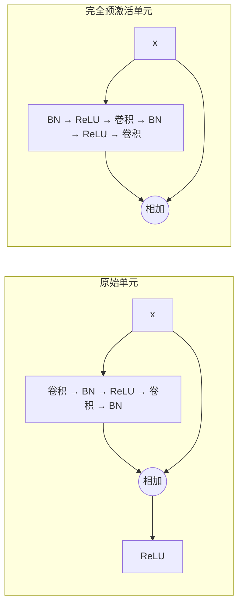

## 一句话总结

残差网络之所以好训练，是因为存在一条“干净”的信息通路；捷径上加任何东西、相加后再做非线性，都会弄脏这条通路，而把激活挪到权重层之前就能让它保持干净。

## 解决什么问题

[Day 9 的 ResNet](./p-09-resnet.md) 把网络做到了 152 层，但还留下两个问题：

- 原始残差单元在相加之后还要过一次 ReLU，这一步对信息传播有什么影响？
- 在 CIFAR-10 上，1202 层的网络反而比 110 层差。再往深走，问题出在哪里？

本文从公式出发分析信息在残差网络里怎么传播，再用大量消融实验验证。

## 核心思想

### 1. 一般形式

一个残差单元可以写成：

- `y_l = h(x_l) + F(x_l, W_l)`
- `x_{l+1} = f(y_l)`

原始 ResNet 中 h 是恒等映射，f 是 ReLU。

### 2. 如果 h 和 f 都是恒等映射

递推下去，任意深层 L 和浅层 l 之间满足：

`x_L = x_l + Σ_{i=l}^{L−1} F(x_i, W_i)`

论文指出两点好处：

- **前向**：任何深层的特征都是浅层特征加上一串残差之和，而普通网络是一串矩阵连乘。
- **反向**：对损失 E 求导得 `∂E/∂x_l = ∂E/∂x_L · (1 + ∂/∂x_l Σ F)`。括号里的“1”意味着深层的梯度可以**不经过任何权重层**直接传到浅层；而且在一个小批次里，后一项一般不会恰好处处等于 −1，所以梯度不太会消失。

### 3. 捷径上不能乱加东西

如果把捷径换成 `λ_i · x_i`，反向传播里那个“1”就变成所有 λ 的连乘。网络很深时，λ 都大于 1 会指数级爆炸，都小于 1 会指数级消失，梯度只能被迫绕道权重层。

## 关键公式或机制

### 1. 捷径消融（CIFAR-10，110 层，论文表 1）

| 捷径形式 | 测试错误率 |
|---|---|
| 原始恒等捷径 | 6.61% |
| 常数缩放 0.5 | 训练失败（错误率超过 20%） |
| 互斥门控（类似 Highway） | 8.70% 起，依初始化而定 |
| 仅捷径门控，偏置初始化为 −6（接近恒等） | 6.91% |
| 1×1 卷积捷径 | 12.22% |
| dropout 捷径 | 训练失败 |

结论：越接近恒等映射越好。1×1 卷积捷径表达能力更强，结果却差得多，说明问题在**优化难度**而不是表达能力。

### 2. 预激活残差单元

原始单元：卷积 → BN → ReLU → 卷积 → BN → 相加 → ReLU。
**完全预激活**单元：BN → ReLU → 卷积 → BN → ReLU → 卷积 → 相加，相加之后什么都不做。

论文解释了“预激活”的由来：对普通网络来说激活放在前面还是后面没有区别，但有了相加这个分叉点，激活放在哪一侧就有影响。

### 3. 结果（论文所写）

| 网络 | 数据集 | 原始单元 | 预激活单元 |
|---|---|---|---|
| ResNet-164 | CIFAR-10 | 5.93% | 5.46% |
| ResNet-1001 | CIFAR-10 | 7.61% | 4.92% |
| ResNet-1001 | CIFAR-100 | 27.82% | 22.71% |

用小批量 64 训练的 ResNet-1001 在 CIFAR-10 上达到 4.62%。论文还观察到预激活带来两种好处：深网络**更容易优化**（1001 层时尤其明显），以及**过拟合减轻**（训练损失略高但测试误差更低，作者推测与 BN 的正则化作用有关）。

ImageNet 上，原始结构的 200 层网络开始过拟合；预激活的 200 层网络单裁剪 top-1 / top-5 验证错误率为 20.7% / 5.3%，原始结构为 21.8% / 6.0%（表 5，测试裁剪 320×320）。

## 图解

图解：原始单元在相加之后还要经过一次 ReLU，信息通路并不完全干净；完全预激活单元把 BN 和 ReLU 都挪到卷积之前，相加之后不再做任何操作，捷径成为纯粹的恒等映射。

## 关键原话

> "These experiments suggest that keeping a “clean” information path ... is helpful for easing optimization."

## 和 Anthropic 笔记的对应

这是一篇模型结构论文，Anthropic 工程博客的笔记没有直接讨论它。下面是类比：

| Anthropic 笔记 | 对得上的地方 |
|---|---|
| [规模化 Managed Agents：把大脑和双手解耦](../notes/managed-agents.md) | 那篇把会话日志设计成只追加、不被改写的事件流，各组件通过稳定接口读写。本文强调捷径要保持“干净”、不在上面叠加额外变换。两者都在保护一条不被中间环节改写的通路。只是类比。 |
| [近期三个问题的事后复盘](../notes/a-postmortem-of-three-recent-issues.md) | 那篇里，看似无害的底层改动在特定条件下让模型输出出错。本文的消融也显示，捷径上一个看似合理的小改动（缩放 0.5、加 dropout）就能让 110 层网络训练失败。 |

## 读的时候要注意

- **分析基于简化**：公式推导假定 f 是恒等映射，并忽略了 BN 等细节；论文用实验而不是证明来支撑结论。
- **“1001 层”主要在 CIFAR 上**：ImageNet 上最深只到 200 层，作者提到资源有限，部分实验中途停止。
- **数字的条件**：CIFAR 结果是 5 次运行的中位数；ImageNet 的比较依赖测试裁剪方式，论文专门解释了原 ResNet 的测试方式有偏差。
- **影响**：预激活顺序后来在很多网络里被采用；[Day 14](./p-14-annotated-transformer.md) 提到的 Transformer pre-norm 写法与它思路相近（待核实：本笔记未核对二者的直接引用关系）。

## 30u30 对应单元

- 30u30 的 [Day 10 单元](https://github.com/Ojhaharsh/30u30/tree/main/papers/10_resnet_v2)（仓库采用 CC BY-NC-ND 4.0，本笔记没有使用其内容）。
- 路线位置：[30u30 导读](../resources/r-30u30.md) 的补完段，单元 2 视觉（Day 8 → 9 → 10 → 11 → 12）。

## 延伸阅读

- [Day 9：ResNet](./p-09-resnet.md)：本文的前作。
- [论文代码（作者 GitHub）](https://github.com/KaimingHe/resnet-1k-layers)

---

*本笔记依据 2026-10-18 抓取的在线原文撰写，仅为导读与总结。原文：Kaiming He, Xiangyu Zhang, Shaoqing Ren, Jian Sun,[《Identity Mappings in Deep Residual Networks》](https://arxiv.org/abs/1603.05027), ECCV 2016。*
