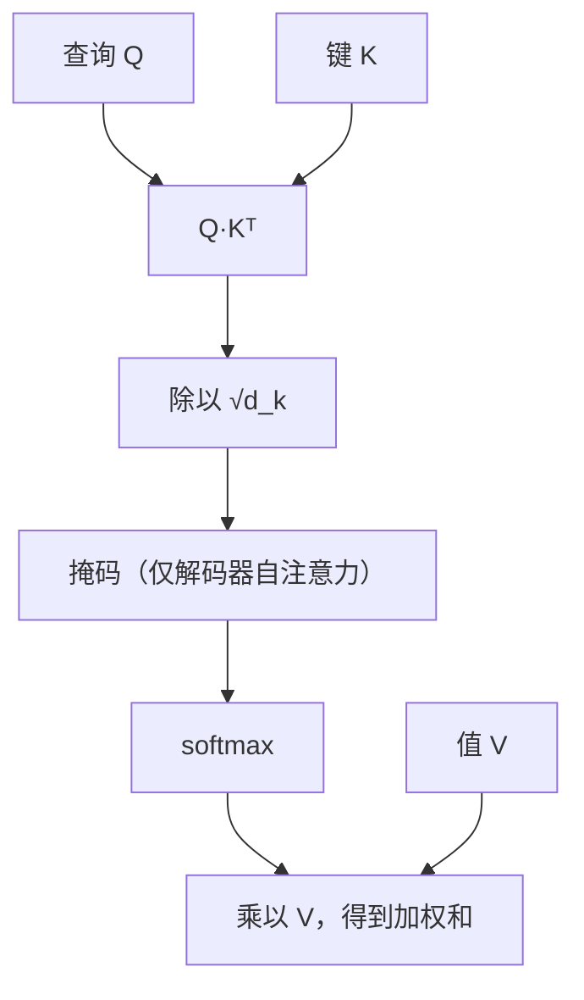
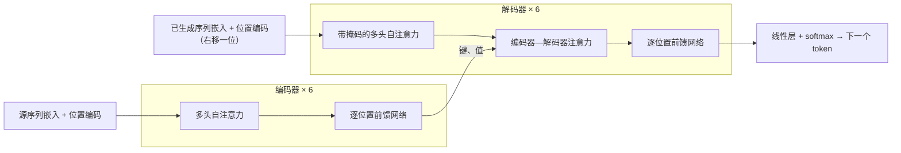

## 一句话总结

序列建模不一定要一步一步循环：让每个位置直接对所有位置做注意力，再叠几层，就能比 RNN 训练得更快、翻译得更好；这套结构后来成了几乎所有大语言模型的骨架。

## 解决什么问题

2017 年最好的翻译模型是带注意力的 RNN 或 CNN 编码器—解码器（[Day 15](./p-15-bahdanau-attention.md) 就是一例）。RNN 有两个硬伤：

1. **不能并行**：第 t 步必须等第 t-1 步算完，序列越长越慢，长序列还受显存限制。
2. **长距离依赖路径长**：两个相隔 n 个位置的词，信号要经过 O(n) 步才能互相影响，越远越难学。

作者的问题是：能不能**完全不用循环和卷积**，只靠注意力？

## 核心思想

- **自注意力（self-attention）**：一个序列里的每个位置，都对同一序列的所有位置算注意力，用加权和更新自己的表示。任意两个位置之间只隔一步。
- **查询、键、值（Q / K / V）**：注意力被统一描述为“用一个查询去匹配一组键，按匹配程度对相应的值加权求和”。Day 15 里解码器状态相当于查询，源句注释同时充当键和值。
- **多头注意力（multi-head attention）**：把 Q、K、V 分别投影成 h 份较低维的版本，各自做注意力再拼接。论文的解释是单头会把不同子空间的信息“平均掉”，多头可以同时关注不同位置、不同方面。
- **位置编码（positional encoding）**：注意力本身不关心顺序，所以在输入嵌入上加一个表示位置的向量。
- **编码器—解码器结构**：编码器 6 层，每层是“多头自注意力 + 逐位置前馈网络”；解码器 6 层，多一个对编码器输出的注意力子层，并且自注意力加了**掩码**，保证预测第 i 个位置时只能看到之前的位置。

## 关键公式或机制

### 1. 缩放点积注意力（scaled dot-product attention）

`Attention(Q, K, V) = softmax(Q·Kᵀ / √d_k) · V`

为什么要除以 √d_k：论文的脚注给了理由——如果 q、k 的各分量是均值 0、方差 1 的独立随机变量，它们的点积方差就是 d_k；维度大时点积数值很大，softmax 会被推到梯度极小的区域。缩放把方差拉回 1 左右。

论文也解释了为什么选点积而不是 Day 15 的加性打分：两者理论复杂度相近，但点积可以用高度优化的矩阵乘法实现，实际快得多、省内存；不缩放时，维度大了加性打分反而更好，这正是要缩放的原因。

### 2. 多头

`MultiHead(Q, K, V) = Concat(head_1, …, head_h) · W^O`，其中 `head_i = Attention(Q·W_i^Q, K·W_i^K, V·W_i^V)`

基础模型用 h = 8 个头，每个头的维度 d_k = d_v = d_model / h = 64，所以总计算量和单头全维度差不多。

### 3. 注意力的三种用法

| 位置 | 查询来自 | 键、值来自 | 作用 |
|---|---|---|---|
| 编码器自注意力 | 编码器上一层 | 编码器上一层 | 源句内部互相看 |
| 解码器自注意力（带掩码） | 解码器上一层 | 解码器上一层（只到当前位置） | 已生成部分互相看，保持自回归 |
| 编码器—解码器注意力 | 解码器上一层 | 编码器输出 | 生成时去看源句（对应 Day 15 的做法） |

掩码的实现方式是在 softmax 之前把不允许的位置设为 −∞。

### 4. 其余部件

- **残差 + 层归一化**：每个子层的输出是 `LayerNorm(x + Sublayer(x))`（归一化在残差之后，也就是常说的 post-norm）。
- **逐位置前馈网络**：`FFN(x) = max(0, x·W1 + b1)·W2 + b2`，d_model = 512，中间层 d_ff = 2048；对每个位置单独、相同地作用。
- **正弦位置编码**：`PE(pos, 2i) = sin(pos / 10000^(2i/d_model))`，`PE(pos, 2i+1) = cos(pos / 10000^(2i/d_model))`。作者的设想是任意固定偏移 k 下，`PE(pos+k)` 可以表示成 `PE(pos)` 的线性函数，方便学习相对位置；他们也试了可学习的位置嵌入，结果几乎一样。
- **嵌入共享**：两个嵌入层和输出前的线性层共享权重，嵌入乘以 √d_model。

### 5. 为什么是自注意力（论文表 1，n 为序列长度，d 为表示维度）

| 层类型 | 每层计算量 | 顺序操作数 | 最长路径 |
|---|---|---|---|
| 自注意力 | O(n²·d) | O(1) | O(1) |
| 循环层 | O(n·d²) | O(n) | O(n) |
| 卷积层（核宽 k） | O(k·n·d²) | O(1) | O(log_k n) |

论文据此说：当 n 小于 d（当时句子级翻译多是这种情况）时，自注意力每层比循环层还便宜；序列很长时，可以把注意力限制在一个邻域内，代价是路径变长。

### 6. 训练与结果（论文所写）

- 8 块 NVIDIA P100；基础模型训练 10 万步，约 12 小时；大模型 30 万步，约 3.5 天。
- Adam（β1 = 0.9，β2 = 0.98），学习率先线性预热 4000 步，再按步数的平方根倒数衰减。
- 正则化：残差 dropout 0.1（基础模型），标签平滑 0.1（作者说这会损害困惑度，但提高准确率和 BLEU）。
- WMT 2014 英译德 BLEU 28.4，英译法 BLEU 41.8（大模型），训练成本只是当时最好模型的一小部分。
- 还在英语成分句法分析上测试了泛化能力。

## 图解

图解：缩放点积注意力先用查询和所有键做点积，除以 √d_k 防止 softmax 饱和，解码器自注意力再加掩码屏蔽未来位置，softmax 后用权重对值做加权和。

图解：编码器每层是多头自注意力加逐位置前馈网络；解码器每层多一个编码器—解码器注意力，从编码器输出取键和值；每个子层外都有残差连接和层归一化（图中省略）。

## 关键原话

> "We suspect that for large values of d_k, the dot products grow large in magnitude, pushing the softmax function into regions where it has extremely small gradients."

## 和 Anthropic 笔记的对应

| Anthropic 笔记 | 对得上的地方 |
|---|---|
| [面向 AI 智能体的上下文工程](../notes/effective-context-engineering-for-ai-agents.md) | 那篇说“n 个 token 有 n² 对关系、上下文越长注意力越摊薄”，来源就是本文表 1 里自注意力 O(n²·d) 的计算方式和 softmax 加权和。读完本篇，“上下文是有限资源”就有了具体含义。 |
| [上下文检索：给每个文本块补上“它来自哪里”](../notes/contextual-retrieval.md) | 检索用的嵌入模型和 Claude 本身都是 Transformer；“把相关内容放进上下文”之所以有用，是因为自注意力能让每个位置直接看到它。 |
| [Claude 的“think”工具](../notes/claude-think-tool.md) | 解码器的掩码保证模型只能根据已生成的内容预测下一个 token。思考类工具和扩展思考之所以有效，可以理解为先把中间推理写进上下文，后面的 token 才能注意到它（笔者的理解，原文未作此论证）。 |

## 读的时候要注意

- **这是翻译模型，不是今天的聊天模型**：论文是编码器—解码器结构；GPT 一类模型只用解码器部分，Claude 的具体结构 Anthropic 没有公开（待核实：本笔记不对 Claude 架构做任何断言）。
- **post-norm 与 pre-norm**：论文写的是 `LayerNorm(x + Sublayer(x))`；很多后来的实现（包括 [Day 14](./p-14-annotated-transformer.md) 的 Annotated Transformer）把归一化放到子层之前。读代码时别以为是自己看错了。
- **“n 小于 d 时更便宜”有前提**：这是 2017 年句子级翻译的情况。今天上下文动辄几十万 token，n 远大于 d，平方项成为主要成本，这正是长上下文昂贵的原因。
- **多头的解释是直觉**：论文说多头能关注不同子空间，并在附录展示了一些注意力图，但“每个头学到了什么”没有系统结论。
- **BLEU 和训练成本只适用于当时的设置**（WMT 2014、P100 GPU），不要拿来和今天的模型直接比。

## 30u30 对应单元

- 30u30 的 [Day 13 单元](https://github.com/Ojhaharsh/30u30/tree/main/papers/13_attention)（仓库采用 CC BY-NC-ND 4.0，本笔记没有使用其内容）。
- 路线位置：[30u30 导读](../resources/r-30u30.md) 的原理支线 P2（Day 15 → 13 → 14）。

## 延伸阅读

- [Day 15：Bahdanau 注意力](./p-15-bahdanau-attention.md)：本文“编码器—解码器注意力”的前身，也是加性打分的出处。
- [Day 14：The Annotated Transformer](./p-14-annotated-transformer.md)：把本文逐段变成可运行代码。
- [Day 25：神经语言模型的规模定律](./p-25-scaling-laws.md)：在 Transformer 上研究“变大会怎样”。

---

*本笔记依据 2026-10-18 抓取的在线原文撰写，仅为导读与总结。原文：Ashish Vaswani 等,[《Attention Is All You Need》](https://arxiv.org/abs/1706.03762), NIPS 2017。*
