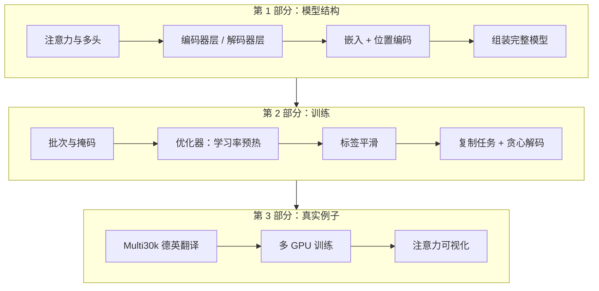

## 一句话总结

这不是一篇新论文，而是一份“可以执行的阅读笔记”：正文几乎全部摘自 Transformer 论文，作者把它重新排序、删去部分章节，并在每段后面给出对应的 PyTorch 实现和简短评注。

## 解决什么问题

[Day 13](./p-13-attention-is-all-you-need.md) 的论文写得很紧凑，很多细节一笔带过：掩码怎么构造、多头怎么拆维度、损失怎么按 token 数归一化、学习率曲线长什么样。只读论文，很容易“每句都懂、合起来写不出来”。

The Annotated Transformer 的做法是把论文当成提纲，**每个公式后面紧跟一段能跑的代码**，整篇文档本身就是一个 notebook。作者在开头说明：评注用引用块标出，正文都来自论文。

## 核心思想

全文分三部分（标题按原文的章节结构概括）：

1. **模型结构**：编码器—解码器的总框架、编码器层与解码器层、注意力与多头注意力、逐位置前馈网络、嵌入与 softmax、位置编码，最后组装成完整模型，并用一个未训练的模型演示前向推理。
2. **模型训练**：批次与掩码、训练循环、数据与分批、硬件与训练时长、优化器与学习率预热、正则化与标签平滑；然后是“第一个例子”——让模型学会把一串随机数字原样复制出来，配合损失计算和贪心解码。
3. **真实例子**：在 Multi30k 德英翻译数据上训练（作者说明它比论文用的 WMT 小得多，只是为了演示完整流程），包含数据加载、迭代器、多 GPU 训练；之后简要说明 BPE、束搜索、模型平均这些论文提到但这里没有完整实现的部分，最后是注意力可视化。

## 关键公式或机制

这一篇的“公式”就是 Day 13 的公式，值得注意的是**落到代码时才暴露出来的细节**（以下为笔者概括，不是代码摘录）：

### 1. 掩码有两种

- **源序列掩码**：把填充（padding）位置屏蔽掉，防止注意力分给无意义的补齐 token。
- **目标序列掩码**：在填充掩码之外再叠一个上三角掩码，让第 i 个位置看不到 i 之后的位置。代码里它是一个下三角为真的方阵，和论文“把非法位置设为 −∞”是同一件事的两种写法。

### 2. 多头的实现方式

不是真的建 8 个小注意力模块，而是先用一个大的线性层投影，再把最后一维拆成“头数 × 每头维度”，转置后批量计算，算完再拼回去。这就是论文说“多头总计算量和单头差不多”的具体原因。

### 3. 归一化的位置和论文不同

文中实现的残差子层先做层归一化、再进子层、再加回残差，作者注明这是“为了代码简洁”。论文写的是先加残差再归一化（post-norm）。两种写法训练表现有差异，读代码和读论文时要分清。

### 4. 学习率预热

按论文的公式实现：前 warmup 步线性上升，之后按步数的平方根倒数下降。文中画了几条不同模型维度、不同预热步数的曲线，能直观看到预热步数越大，峰值越晚、越低。

### 5. 标签平滑

不把目标设成“正确词概率 1、其余 0”，而是给正确词留大部分概率，其余平摊到词表里，用 KL 散度作为损失。作者引用论文的说法：这会让困惑度变差，但准确率和 BLEU 变好。

### 6. 解码

示例只实现了**贪心解码**：编码一次源句，然后循环“解码 → 取概率最大的词 → 追加 → 再解码”。束搜索被明确略过，指向其他实现。

## 图解

图解：先把模型各部件写出来并组装，再搭训练流程（掩码、学习率预热、标签平滑），用复制任务验证模型能学会，最后在 Multi30k 德英翻译上训练并可视化注意力。

## 关键原话

> "It reorders and deletes some sections from the original paper and adds comments throughout."

## 和 Anthropic 笔记的对应

| Anthropic 笔记 | 对得上的地方 |
|---|---|
| [面向 AI 智能体的上下文工程](../notes/effective-context-engineering-for-ai-agents.md) | 亲手构造一次注意力矩阵（序列长度 × 序列长度），就能理解“上下文越长，成对关系越多”不是比喻，而是张量形状。 |
| [近期三个问题的事后复盘](../notes/a-postmortem-of-three-recent-issues.md) | 本文的贪心解码就是“每步取概率最大的 token”。复盘里讨论的温度、top-k 采样，是在这个循环上把“取最大值”换成“按分布抽样”。读完再回看复盘，会更清楚 bug 出在哪一层。 |
| [Claude Code 最佳实践](../notes/claude-code-best-practices.md) | 那篇强调给模型一个能自己运行的检查手段。本文的复制任务就是同样的思路：先用一个答案已知的小任务确认模型和训练流程是对的，再上真实数据。 |

## 读的时候要注意

- **它是教学实现，不是论文复现**：文中“结果”一节引用的是论文在 WMT 上的数字，不是这份代码在 Multi30k 上的成绩。Multi30k 上实际能达到多少，本笔记未核实（待核实）。
- **pre-norm 与论文不一致**：见上文第 3 点。这是作者有意的简化。
- **依赖版本较旧**：页面开头固定了较早版本的 torchtext 和 spaCy 等依赖；在新环境里直接运行可能需要调整（待核实：本笔记没有实际运行代码）。
- **两个版本**：2018 年原版和 2022 年更新版内容相近、代码风格不同，网上的二手资料可能混用两版，对照时以你打开的那一版为准。
- **版权**：文档正文大量摘自论文，评注和代码属于作者；本笔记只概括结构和要点，没有摘抄代码。

## 30u30 对应单元

- 30u30 的 [Day 14 单元](https://github.com/Ojhaharsh/30u30/tree/main/papers/14_annotated_transformer)（仓库采用 CC BY-NC-ND 4.0，本笔记没有使用其内容）。
- 路线位置：[30u30 导读](../resources/r-30u30.md) 的原理支线 P2（Day 15 → 13 → 14）。

## 延伸阅读

- [Day 13：Attention Is All You Need](./p-13-attention-is-all-you-need.md)：建议先读论文再读本篇。
- [The Annotated Transformer 代码仓库](https://github.com/harvardnlp/annotated-transformer)
- [2018 年原版](https://nlp.seas.harvard.edu/2018/04/03/attention.html)

---

*本笔记依据 2026-10-18 抓取的在线原文撰写，仅为导读与总结。原文：Austin Huang 等（原版作者 Sasha Rush）,[《The Annotated Transformer》](https://nlp.seas.harvard.edu/annotated-transformer/), v2022。*
