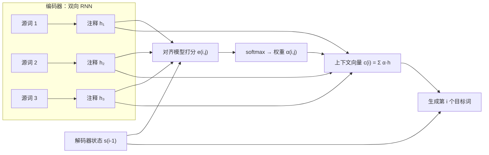

## 一句话总结

不要把整句源语言硬塞进一个向量；让解码器在生成每个目标词时，自己去源句里“软搜索”相关的位置，按相关程度加权取信息。

## 解决什么问题

2014 年的神经机器翻译主要是**编码器—解码器**结构：一个 RNN 读完源句，把它压成一个固定长度向量；另一个 RNN 从这个向量生成译文。作者的判断是：**固定长度向量是瓶颈**。句子越长，越难把所有信息塞进去，翻译质量随句长明显下降。

论文要做的是：在不改变“端到端训练一个神经网络”这个前提下，去掉这个瓶颈。

## 核心思想

- **编码器保留每个位置的表示**：用双向 RNN（BiRNN）读源句，把每个词位置的前向、后向隐藏状态拼起来，得到一串“注释向量”（annotation）`h_j`。每个 `h_j` 侧重它附近的词，同时带有整句的信息。
- **解码器每一步都重新“看”源句**：生成第 i 个目标词前，用上一步的解码器状态 `s_{i-1}` 去给每个 `h_j` 打分，分数经 softmax 变成权重 `α_ij`，再对所有 `h_j` 加权求和，得到这一步专属的上下文向量 `c_i`。
- **对齐是软的、可微的**：传统统计翻译把对齐当作隐变量；这里对齐模型就是网络的一部分，梯度能穿过它，和翻译模型一起训练。作者把 `c_i` 解释为“在所有可能对齐上取期望的注释”。
- 论文把这个部件叫作对齐模型（alignment model）或“软搜索”，并说明它相当于在解码器里实现了一种**注意力机制**：解码器自己决定要关注源句的哪些部分，编码器也就不必把整句信息都压进一个向量。

## 关键公式或机制

### 1. 三个式子

- 打分（对齐模型）：`e_ij = a(s_{i-1}, h_j)`，论文附录给出的具体形式是一个单隐层前馈网络：`a(s_{i-1}, h_j) = v_aᵀ · tanh(W_a s_{i-1} + U_a h_j)`
- 归一化：`α_ij = exp(e_ij) / Σ_k exp(e_ik)`
- 上下文向量：`c_i = Σ_j α_ij · h_j`

解码器再用 `s_{i-1}`、上一个输出词和 `c_i` 计算新状态与下一个词的分布。论文附录提到，对齐模型对一对长度为 Tx、Ty 的句子要计算 Tx × Ty 次，所以特意选了单隐层这种便宜的形式，而且 `U_a h_j` 与 i 无关，可以预先算好。“每个输出位置都要和每个输入位置打一次分”这个成本结构，在 Transformer 里变成了上下文长度的平方。这种“前馈网络打分”的形式后来常被称为**加性注意力**，Transformer 论文正是拿它和点积注意力对比。

### 2. 实验设置（论文所写）

- 任务：WMT ’14 英译法。每种语言只保留最常见的 30,000 个词，其余替换为 `[UNK]`。
- 对比：RNNencdec（传统编码器—解码器）与 RNNsearch（本文模型），各自在最长 30 词和最长 50 词的句子上训练（后缀 -30、-50）。隐藏单元数为 1000。

### 3. 结果（论文表 1，测试集 BLEU）

| 模型 | 全部句子 | 无未知词的句子 |
|---|---|---|
| RNNencdec-30 | 13.93 | 24.19 |
| RNNsearch-30 | 21.50 | 31.44 |
| RNNencdec-50 | 17.82 | 26.71 |
| RNNsearch-50 | 26.75 | 34.16 |
| RNNsearch-50（训练更久） | 28.45 | 36.15 |
| Moses（短语统计翻译） | 33.30 | 35.63 |

- 在所有设置下 RNNsearch 都优于 RNNencdec，而且句子变长时下降得少。
- 只看不含未知词的句子时，训练更久的 RNNsearch-50 与 Moses 相当（36.15 对 35.63）；作者特别指出 Moses 还额外用了一个 4.18 亿词的单语语料。
- 看全部句子时，本文模型仍低于 Moses（28.45 对 33.30），主要受未知词拖累。

### 4. 对齐可视化

把 `α_ij` 画成矩阵（行是目标词、列是源词），大多数权重落在对角线附近，说明英法语序大体一致；在形容词与名词需要调换顺序的地方，权重能正确地“拐弯”。这让模型的行为第一次变得可以直观检查。

## 图解

图解：双向 RNN 编码器为每个源词位置保留一个注释向量；解码器每一步用当前状态给所有注释打分，softmax 得到权重，加权求和成这一步的上下文向量，再和解码器状态一起生成下一个目标词。

## 关键原话

> "we conjecture that the use of a fixed-length vector is a bottleneck in improving the performance of this basic encoder–decoder architecture"

## 和 Anthropic 笔记的对应

| Anthropic 笔记 | 对得上的地方 |
|---|---|
| [面向 AI 智能体的上下文工程](../notes/effective-context-engineering-for-ai-agents.md) | 本文的出发点是“把所有信息压进一个固定大小的东西会丢信息”，解法是让模型按需去看原始材料。上下文工程讲即时检索、只把需要的片段放进上下文，是在系统层面做同样的选择（类比）。 |
| [上下文检索：给每个文本块补上“它来自哪里”](../notes/contextual-retrieval.md) | 注意力可以看成“对所有位置打分、取加权和”的软查找；RAG 是“对所有文本块打分、取前 k 个”的硬查找。两者都依赖一个好用的打分函数，只是一个可微、一个不可微。 |
| [近期三个问题的事后复盘](../notes/a-postmortem-of-three-recent-issues.md) | 其中一个问题与上下文窗口路由有关。读完本文和 Transformer 后再看，会更清楚“上下文”对模型来说具体是什么。 |

## 读的时候要注意

- **这里的注意力挂在 RNN 上**：编码器、解码器都还是 RNN，注意力只是连接两者的部件。[Day 13 Transformer](./p-13-attention-is-all-you-need.md) 才把 RNN 整个拿掉。
- **加性打分 vs 点积打分**：本文用前馈网络打分；Transformer 用缩放点积。两者思想相同，计算方式不同，读 Day 13 时注意对比。
- **BLEU 数字要放在当时的设定里看**：3 万词表、未知词替换、只用平行语料。和 Moses“打平”只在无未知词的子集上成立，不要笼统说“超过了统计翻译”。
- **对齐图不等于解释**：注意力权重直观好看，但“权重高 = 模型因此做出决定”并不是本文证明过的结论（笔者提醒）。
- **名称问题**：文中的“对齐模型”就是今天说的注意力打分函数；不同论文对 query/key/value 的叫法在 Day 13 才统一。

## 30u30 对应单元

- 30u30 的 [Day 15 单元](https://github.com/Ojhaharsh/30u30/tree/main/papers/15_bahdanau_attention)（仓库采用 CC BY-NC-ND 4.0，本笔记没有使用其内容）。
- 路线位置：[30u30 导读](../resources/r-30u30.md) 的原理支线 P2，建议顺序为 Day 15 → 13 → 14；从这里开始需要 PyTorch 基础才能跑仓库代码。

## 延伸阅读

- [Day 2：理解 LSTM](./p-02-understanding-lstm.md)：本文编码器、解码器用到的门控 RNN。
- [Day 13：Attention Is All You Need](./p-13-attention-is-all-you-need.md)
- [Day 18：指针网络](./p-18-pointer-networks.md)：把同样的注意力分布直接当作“指向输入的指针”。

---

*本笔记依据 2026-10-18 抓取的在线原文撰写，仅为导读与总结。原文：Dzmitry Bahdanau, Kyunghyun Cho, Yoshua Bengio,[《Neural Machine Translation by Jointly Learning to Align and Translate》](https://arxiv.org/abs/1409.0473), ICLR 2015。*
