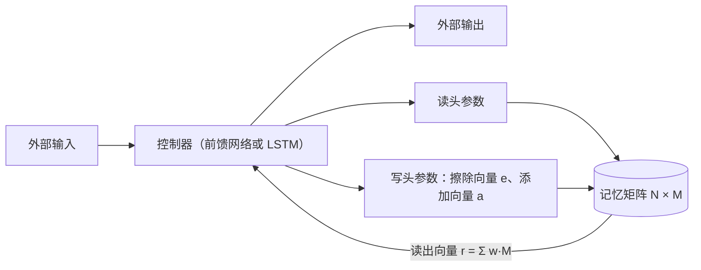
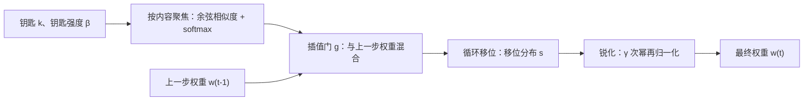

## 一句话总结

把“计算”和“存储”分开：控制器网络负责算，外部记忆矩阵负责存，两者之间用可微的注意力式寻址连接，于是整台“机器”可以直接从输入输出样例里学会简单算法。

## 解决什么问题

RNN 的记忆就是它的隐藏状态，容量和计算绑在一起：想多记一些，就得把状态向量变大，每一步的计算量也跟着涨。[Day 1](./p-01-rnn-effectiveness.md) 的作者在文末也提到过这个问题，并把本文当作这个方向的第一个有说服力的例子。

本文的问题是：能否像冯·诺依曼计算机那样，给网络一块**独立的、可寻址的外部记忆**，同时保持整个系统**端到端可微**，从而还能用梯度下降训练？

## 核心思想

- **两部分**：一个神经网络控制器（前馈网络或 LSTM），和一块 N 行 M 列的记忆矩阵（N 个位置，每个位置一个 M 维向量）。
- **“头”**：借用图灵机的说法，控制器输出的、用来参数化读写操作的那部分叫读头和写头。
- **模糊读写**：真正的计算机一次只读写一个地址；这里每次读写都对所有位置按一个归一化权重 `w_t` 进行，权重集中时就近似读写单个位置。正是这种“模糊”让一切都可微。
- **两种寻址方式并用**：
  - **按内容寻址**：给一个“钥匙”向量，找内容相似的位置，像查字典。
  - **按位置寻址**：在上一步位置的基础上前后移动，像遍历数组。作者说按内容寻址在理论上更一般，但实验中把按位置寻址作为基本操作，对某些泛化是必需的。

## 关键公式或机制

### 1. 读

读头给出 N 个位置上的权重 `w_t(i)`（非负、总和为 1），读出的向量是各行的加权和：

`r_t = Σ_i w_t(i) · M_t(i)`

### 2. 写 = 擦除 + 添加

写头给出权重 `w_t`、擦除向量 `e_t`（每个分量在 0 到 1 之间）和添加向量 `a_t`：

- 擦除：`M̃_t(i) = M_{t-1}(i) · [1 − w_t(i) · e_t]`
- 添加：`M_t(i) = M̃_t(i) + w_t(i) · a_t`

论文说明这个“先擦后加”的设计借鉴了 [LSTM](./p-02-understanding-lstm.md) 的遗忘门和输入门。只有当某位置的权重和擦除分量都接近 1 时，该处内容才会被清零。

### 3. 寻址的四步流水线

1. **按内容聚焦**：用余弦相似度比较钥匙 `k_t` 和每一行，乘以“钥匙强度” `β_t` 后做 softmax，得到内容权重。`β_t` 越大，焦点越集中。
2. **插值**：用一个 0 到 1 之间的门 `g_t`，在“这一步的内容权重”和“上一步的最终权重”之间混合：`w_g = g_t · w_c + (1 − g_t) · w_{t-1}`。门为 0 就完全沿用上一步的位置。
3. **循环移位**：输出一个移位分布 `s_t`（例如对 −1、0、+1 三种移动的概率），对权重做循环卷积，实现“往前或往后挪一格”。
4. **锐化**：移位会让权重变模糊，所以再用一个 `γ_t ≥ 1` 做幂次锐化并重新归一化。

论文总结了这套机制的三种用法：只按内容找；按内容找到一块再在附近移动；完全不看内容、每步固定前进（遍历）。

### 4. 实验任务（论文所写）

对比三种模型：前馈控制器 NTM、LSTM 控制器 NTM、普通 LSTM。

| 任务 | 考什么 | 论文观察 |
|---|---|---|
| 复制 | 记住一串随机 8 位向量（训练长度 1–20）再原样输出 | NTM 学得快得多、损失更低；超过训练长度后 NTM 仍能复制，LSTM 在长度 20 之后迅速变差 |
| 重复复制 | 把序列重复输出指定次数并给出结束标记 | 测试能否学会简单的嵌套循环 |
| 联想回忆 | 给出一串条目，再给其中一项，要求输出下一项 | NTM 约 3 万个回合损失接近 0，LSTM 一百万回合后仍未到 0；前馈控制器 NTM 在 12 个条目（训练最大值的两倍）内几乎完美 |
| 动态 N-gram | 快速适应新的转移概率 | NTM 的预测在多数位置接近最优估计器 |
| 优先级排序 | 按给定优先级输出排序后的向量 | 测试能否学会排序 |

在复制任务上，作者分析读写权重后，把 NTM 学到的做法总结成一段伪代码：把头移到起点；逐个写入并前移一格；遇到分隔符后回到起点；逐个读出并前移一格。也就是说，它学会了“建数组、遍历数组”。作者还注明，复制长度的上限来自记忆只有 128 个位置，超过后循环移位绕回来覆盖了旧内容。

## 图解

图解：控制器和外界交换输入输出，同时通过读头、写头操作记忆矩阵；写入分擦除和添加两步，读出的向量是按权重对所有行的加权和，在下一步反馈给控制器。

图解：每个头按四步生成权重——按内容聚焦、和上一步权重插值、循环移位、锐化；四步都可微，所以寻址方式本身也能被训练出来。

## 关键原话

> "We achieved this by defining ‘blurry’ read and write operations that interact to a greater or lesser degree with all the elements in memory"

## 和 Anthropic 笔记的对应

| Anthropic 笔记 | 对得上的地方 |
|---|---|
| [长时运行智能体的有效 harness](../notes/effective-harnesses-for-long-running-agents.md) | NTM 在网络**内部**学会读写外部记忆；harness 在系统**外部**用功能清单、进度文件和 git 提交充当记忆，让每个新会话都能接着干。两者都是“计算单元之外再放一块持久存储”，但 harness 的读写规则是人写的，NTM 的是学出来的。只是类比。 |
| [面向 AI 智能体的上下文工程](../notes/effective-context-engineering-for-ai-agents.md) | 那篇的“结构化笔记：写到窗口外，按需读回”和本文“控制器容量有限、把数据放进外部记忆再按需读”是同一种分工思路。 |
| [规模化 Managed Agents：把大脑和双手解耦](../notes/managed-agents.md) | Managed Agents 把会话日志放在上下文窗口之外、按位置切片读取，可以对照本文的“按位置寻址”；把 harness 设计成无状态，也类似本文让控制器只负责计算。属于设计思路上的呼应。 |

## 读的时候要注意

- **任务都是小型算法玩具**：随机二进制向量、长度几十以内。论文证明的是“可微外部记忆能学会简单算法并有一定泛化”，不是“能解决实际问题”。
- **训练不稳定的问题论文没怎么谈**：后来不少复现报告称 NTM 训练困难、对超参数敏感（待核实：本笔记未逐一核对这些复现）。
- **模糊读写的代价**：每次读写都要遍历全部 N 个位置，记忆越大越慢；这和 Transformer 注意力的平方成本是类似的问题。
- **和智能体“记忆”只是类比**：今天智能体的记忆大多是文件、数据库和检索，不是可微的；不要把本文的结论直接迁移到 harness 设计上。
- **后续工作**：同一团队后来提出了可微神经计算机（DNC），改进了记忆分配和时间顺序链接（待核实：本笔记未打开该论文，仅作方向提示）。

## 30u30 对应单元

- 30u30 的 [Day 17 单元](https://github.com/Ojhaharsh/30u30/tree/main/papers/17_neural_turing_machines)（仓库采用 CC BY-NC-ND 4.0，本笔记没有使用其内容）。
- 路线位置：[30u30 导读](../resources/r-30u30.md) 的原理支线 P3（外部记忆与指针，Day 17、18）。

## 延伸阅读

- [Day 2：理解 LSTM](./p-02-understanding-lstm.md)：擦除 + 添加的灵感来源。
- [Day 15：Bahdanau 注意力](./p-15-bahdanau-attention.md)：按内容聚焦与“软注意力”的关系。
- [Attention and Augmented Recurrent Neural Networks（Distill）](https://distill.pub/2016/augmented-rnns/)：把 NTM、注意力、自适应计算放在一起讲的综述。

---

*本笔记依据 2026-10-18 抓取的在线原文撰写，仅为导读与总结。原文：Alex Graves, Greg Wayne, Ivo Danihelka,[《Neural Turing Machines》](https://arxiv.org/abs/1410.5401), 2014。*
