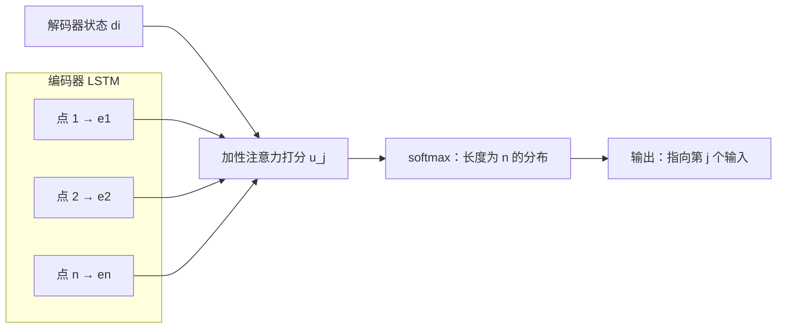

## 一句话总结

不再用注意力“混合”出一个上下文向量去预测词表里的词，而是**把注意力分布本身当作输出**：哪个输入位置得分最高，就输出哪个位置。

## 解决什么问题

序列到序列模型（编码器读入、解码器逐个输出）有一个隐含前提：输出词表是固定的。翻译时这没问题，但很多组合问题的答案是“输入里的哪几个元素、按什么顺序”：

- **凸包**：给一堆平面上的点，输出外围那几个点的编号序列。
- **Delaunay 三角剖分**：输出一组三角形，每个三角形由三个点的编号组成。
- **旅行商问题（TSP）**：输出访问所有城市的一个顺序。

这里“可选的输出”数量等于输入点数 n。n 变了，输出的类别数就变了，固定词表的模型必须针对每个 n 单独训练一个。论文摘要就指出，这类问题用当时的序列到序列模型和[神经图灵机](./p-17-neural-turing-machines.md)都不能直接解决。

## 核心思想

- 编码器（LSTM）逐个读入输入点，得到每个位置的编码 `e_j`。
- 解码器（LSTM）每一步有一个状态 `d_i`。
- 用加性注意力给每个输入位置打分，**对分数做 softmax，得到的分布就是这一步的输出分布**——输出“选第 j 个输入”。
- 因为分布的长度永远等于输入长度，同一个模型可以处理不同的 n。

和 [Bahdanau 注意力](./p-15-bahdanau-attention.md) 的区别只在最后一步：Bahdanau 用权重对编码做加权求和，再拿这个上下文向量去预测词；指针网络跳过加权求和，直接用权重“指”。

## 关键公式或机制

### 1. 打分与“指”

对解码第 i 步、输入第 j 个位置（j 从 1 到 n）：

- 打分：`u_j^i = vᵀ · tanh(W1 · e_j + W2 · d_i)`
- 输出分布：`p(C_i | C_1, …, C_{i-1}, P) = softmax(u^i)`

`v`、`W1`、`W2` 是可学习参数。打分形式就是加性注意力，没有任何新的复杂部件。

### 2. 实验设置（论文所写）

- 没有做大范围的结构和超参数搜索，所有问题用几乎相同的模型：单层 LSTM，256 或 512 个隐藏单元，随机梯度下降，学习率 1.0，批大小 128，梯度裁剪 2.0，生成 100 万对训练样本。作者认为“同一套超参数通吃”更能说明问题。
- TSP 的训练标签：n ≤ 20 用 Held-Karp 精确算法求最优解；更大的 n 用三种近似算法生成（A1、A2 为 O(n²)，A3 为 O(n³) 的 Christofides 算法，有 1.5 倍近似保证）。

### 3. 主要结果

**凸包（准确率 = 整个输出序列完全正确）：**

| 模型 | 训练 n | 测试 n | 准确率 |
|---|---|---|---|
| LSTM 序列到序列 | 50 | 50 | 1.9% |
| LSTM + 注意力 | 50 | 50 | 38.9% |
| 指针网络 | 50 | 50 | 72.6% |
| 指针网络 | 5–50 | 100 | 50.3% |
| 指针网络 | 5–50 | 500 | 1.3%（面积覆盖 99.2%） |

基线模型只能在训练用的 n 上测试；指针网络在 5–50 上训练后可以直接测 100、200、500。n 越大，完全正确的比例下降很快，但面积覆盖仍很高。

**Delaunay 三角剖分：** n=5 时准确率 80.7%、三角形覆盖 93.0%；n=10 时 22.6% / 81.3%；n=50 时没有一个完全正确，三角形覆盖 52.8%。

**TSP（数字是平均路径长度，越短越好）：**

- 用 A1 的近似解训练、在 n=50 上测试，指针网络得到 6.42，略好于 A1 本身的 6.46。
- 在 5–20 上训练，测到 25 时和近似算法差距很小（4.30，A3 为 4.24），到 40 和 50 时明显变差（n=50 为 7.66，A3 为 5.79）。
- TSP 解码时的束搜索被限制为只考虑合法路线；论文说明否则模型会重复城市或漏掉城市，n > 20 时至少有 10% 的实例得不到任何合法路线。

## 图解

图解：编码器把每个输入点编码成 e1 到 en，解码器状态和每个编码做加性注意力打分，softmax 后得到长度为 n 的分布，直接把它当作输出——指向某个输入位置，不再加权求和成上下文向量。

## 关键原话

> "It differs from the previous attention attempts in that, instead of using attention to blend hidden units of an encoder to a context vector at each decoder step, it uses attention as a pointer to select a member of the input sequence as the output."

## 和 Anthropic 笔记的对应

| Anthropic 笔记 | 对得上的地方 |
|---|---|
| [多智能体研究系统](../notes/multi-agent-research-system.md) | 引用智能体为报告里的每条论断“指回”具体出处位置。这和指针网络“输出不生成新内容，而是指向输入里已有的东西”是同一个思路：可追溯、不编造。只是类比，那篇的实现并不是指针网络。 |
| [Claude 开发者平台上的高级工具使用](../notes/advanced-tool-use.md) | 智能体选工具，本质是从一个**大小随场景变化**的候选集合里挑一个；Tool Search 让候选集按需出现。指针网络解决的正是“候选集合大小不固定”的建模问题。只是类比。 |
| [上下文检索](../notes/contextual-retrieval.md) | 检索系统的输出也是“指向文档库里的第几个块”而非生成文本；那篇关注的是如何让被指向的块更容易被找准。 |

## 读的时候要注意

- **“准确率”的定义很严**：凸包和三角剖分要求整个输出完全正确，所以大 n 时准确率低不代表输出离谱，要同时看面积覆盖、三角形覆盖。
- **TSP 结果依赖受约束的解码**：合法性是靠束搜索时的限制保证的，不是模型自己学会的。
- **标签来自近似算法时，模型的上限受标签质量影响**：用 A1 训练能略胜 A1，但论文并没有声称能胜过最好的近似算法。
- **泛化有边界**：凸包到 500、TSP 到 40 以上都明显退化。论文展示的是“能跨长度用同一个模型”，不是“任意长度都好用”。
- **今天的影响**：指针思想后来常见于“复制输入”的生成模型和组合优化研究（待核实：本笔记未逐一列举具体后续论文）。

## 30u30 对应单元

- 30u30 的 [Day 18 单元](https://github.com/Ojhaharsh/30u30/tree/main/papers/18_pointer_networks)（仓库采用 CC BY-NC-ND 4.0，本笔记没有使用其内容）。
- 路线位置：[30u30 导读](../resources/r-30u30.md) 的原理支线 P3（外部记忆与指针，Day 17、18）。

## 延伸阅读

- [Day 15：Bahdanau 注意力](./p-15-bahdanau-attention.md)：本文打分公式的出处。
- [Day 17：神经图灵机](./p-17-neural-turing-machines.md)：同一时期另一种“让网络按位置取东西”的尝试。

---

*本笔记依据 2026-10-18 抓取的在线原文撰写，仅为导读与总结。原文：Oriol Vinyals, Meire Fortunato, Navdeep Jaitly,[《Pointer Networks》](https://arxiv.org/abs/1506.03134), NIPS 2015。*
