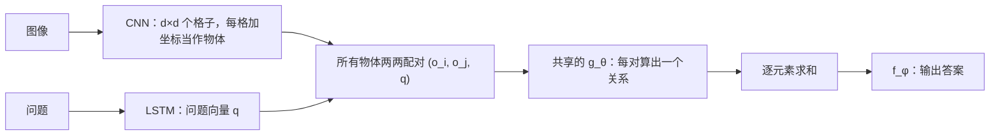

## 一句话总结

把“考虑每一对物体之间的关系”直接写进网络结构：对所有物体两两配对，用同一个函数 g 计算关系，求和后交给函数 f 得出答案。

## 解决什么问题

**关系推理**是指根据实体之间的关系（远近、异同、数量比较等）得出结论。论文举的例子：小孩想在公园里相距最远的两棵树之间赛跑，就得先估计并比较所有树之间的距离。

- 符号方法天然擅长关系推理，但存在符号落地问题，对任务和输入的小变化不鲁棒。
- 深度学习能从原始数据学表示、抗噪声，但在“关系稀疏而复杂”的问题上往往需要大量数据。

论文的实验进一步说明：看似很简单的关系推理，对 CNN 和多层感知机（MLP）这样强大的结构来说也出奇地难。

## 核心思想

### 1. 关系网络的形式

最简单的形式只有一行：

`RN(O) = f_φ( Σ_{i,j} g_θ(o_i, o_j) )`

- 输入是一组“物体” `O = {o_1, …, o_n}`，每个是一个向量。
- `g_θ` 对每一对物体输出一个“关系”向量；`f_φ` 把所有关系的和变成最终输出。两者都是 MLP，端到端可训练。

设计思路和 CNN、RNN 类似：CNN 把“平移不变”写进结构，RNN 把“序列依赖”写进结构，RN 则把“考虑成对关系”写进结构，不需要再从数据里学出来。

### 2. 三个优点

- **学会推断关系**：RN 考虑所有物体对，并不事先知道哪些关系真正存在、各是什么意思，需要自己学出来。用图论的话说，输入相当于一张完全有向图。如果事先知道只需考虑哪些对，也可以只输入这些对。
- **数据效率高**：所有物体对共用同一个 g。若用 MLP 一次性吃下所有物体，它得在权重里学出 n² 个相同的函数；RN 改为每个样本做 n² 次前向计算、只学一次关系函数。
- **作用于集合**：求和使输出与物体顺序无关。

### 3. “物体”从哪里来

RN 只处理物体，不直接处理图像或文字。论文的一个核心贡献是说明，相对无结构的中间表示也能当作物体：

- **像素**：128×128 的图像经过 4 个卷积层得到 d×d 个 k 维向量，每个格子加上坐标标记就当作一个“物体”。它可能对应背景、某个实物、纹理或几个实物的组合，由训练决定。
- **状态描述**：CLEVR 的状态矩阵每行就是一个物体的坐标、颜色、形状、材质、尺寸，直接输入。
- **自然语言**（bAbI）：取问题之前最多 20 个句子，标上相对位置，用 LSTM 各自编码成一个物体。

问题由 LSTM 编码成向量 q，作为条件加入每一对：`a = f_φ( Σ_{i,j} g_θ(o_i, o_j, q) )`。论文的理由是：关系是否存在、有何意义取决于问题本身。

## 关键公式或机制

### 实验结果（摘自论文）

- **CLEVR（像素）**：95.5%，超过人类的 92.6%，比数据集发布时只用像素和问题训练的最好模型（68.5%）高出 27 个百分点。作者特别指出提升集中在“比较属性”和“计数”这类依赖关系的问题上。另有一项研究报告 96.9%，但用到了生成问题的“函数程序”作为额外监督，不可直接比较。
- **CLEVR（状态描述）**：96.4%，说明 RN 对输入形式不敏感。
- **Sort-of-CLEVR**：作者自建的数据集，每张图 6 个彩色形状，关系问题和非关系问题分开。CNN+RN 两类问题都超过 94%；CNN+MLP 在非关系问题上也能达到这个水平，关系问题却停在 63%，其中“最近 / 最远”类只有 52.3%。
- **bAbI**：20 个文本问答任务通过 18 个（准确率超过 95% 记为通过），没有灾难性失败；作者说明只用了单个随机种子选出的模型。
- **动态物理系统**：10 个小球，部分由看不见的弹簧或刚性约束相连。推断全部连接正确的场景占 93%，数出连接成几个系统的正确率 95%；参数量相当的 MLP 两个任务都不比随机猜测好。

### 作者对原因的推测

RN 加进相对简单的 CNN + LSTM 结构后，CLEVR 准确率从 68.5% 升到 95.5%。作者推测：RN 承担了关系推理，CNN 就能专注处理局部空间结构。“处理”和“推理”的分工很重要，ResNet 这类强大的视觉网络未必适合推理任意关系。

## 图解

图解：CNN 把图像变成一组物体，LSTM 把问题编码成向量 q；所有物体两两配对并附上 q，由同一个 g_θ 计算关系，求和后由 f_φ 给出答案。

## 关键原话

> "the capacity to compute relations is baked into the RN architecture without needing to be learned"

## 和 Anthropic 笔记的对应

| Anthropic 笔记 | 对得上的地方 |
|---|---|
| [“think”工具：让 Claude 在复杂工具调用中停下来想一想](../notes/claude-think-tool.md) | RN 的提升来自给网络加一个专门负责推理的部件，让其他部件专注于各自擅长的处理。think 工具也是给模型单独留出一个推理步骤。只是类比：一个是网络结构，一个是工具设计。 |
| [构建高效的智能体：从简单可组合的模式出发](../notes/building-effective-agents.md) | 论文强调 RN 简单、即插即用，可以接到已有的 CNN、LSTM 后面。那篇同样主张用简单、可组合的部件搭系统。 |

## 读的时候要注意

- **复杂度是平方级**：所有物体两两配对，计算量随物体数平方增长。作者也提到，未来可以用注意力过滤不重要的关系来控制计算量。
- **“超过人类”要看具体基准**：95.5% 对 92.6% 是 CLEVR 这个合成数据集上的比较，场景由程序生成，不能直接推广到真实世界的视觉推理。
- **bAbI 结果的统计稳健性**：作者坦言只跑了一个种子，而其他模型的结果有时会有超过 ±3 个任务的波动。
- **版本差异**：NeurIPS 会议版摘要的最后一句与 arXiv 版不同，具体正文改动本笔记未逐一比对（待核实）。

## 30u30 对应单元

- 30u30 的 [Day 19 单元](https://github.com/Ojhaharsh/30u30/tree/main/papers/19_relational_reasoning)（仓库采用 CC BY-NC-ND 4.0，本笔记没有使用其内容）。
- 路线位置：[30u30 导读](../resources/r-30u30.md) 的补完段，单元 4（Day 19 → 20 → 21 → 22）。

## 延伸阅读

- [Day 20：关系循环神经网络](./p-20-relational-rnn.md)：同一作者把关系推理搬进记忆模块，用注意力让记忆彼此交互。
- [Day 21：神经消息传递](./p-21-neural-message-passing.md)：在图上做关系计算的更一般框架。
- [Day 16：顺序很重要](./p-16-order-matters.md)：另一种处理集合输入的思路。

---

*本笔记依据 2026-10-18 抓取的在线原文撰写，仅为导读与总结。原文：Adam Santoro, David Raposo, David G. T. Barrett, Mateusz Malinowski, Razvan Pascanu, Peter Battaglia, Timothy Lillicrap,[《A simple neural network module for relational reasoning》](https://arxiv.org/abs/1706.01427), NIPS 2017。*
