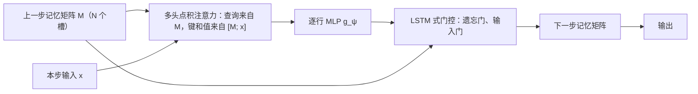

## 一句话总结

记忆不只要能存、能取，还要能彼此“交流”：把一组记忆槽放进循环网络，每个时间步让它们用多头点积注意力互相读取并读入新输入，模型就更擅长跨时间比较信息。

## 解决什么问题

论文把**关系推理**定义为理解实体之间如何关联、并用这种理解完成更高层目标。例子：给公园长椅到各棵树的距离排序，比较的是“距离”这种关系，只看每棵树自己的位置是得不出答案的。

在时间维度上，关系推理意味着比较不同时刻看到的信息。作者认为现有结构各有短板：

- **LSTM** 把所有信息塞进一个共同的隐藏向量，不容易分门别类地存放，也就不容易让信息彼此关联。
- **记忆增强网络**（如 DNC）用一个分槽的记忆矩阵解决了“分开存放”，但记忆写进去之后，彼此之间很难再交互。

作者的假设：如果结构上偏向“让记忆彼此交互”，模型就能更好地理解记忆之间的关系。

## 核心思想

### 1. 用多头点积注意力让记忆互相更新

设记忆矩阵 M 的每一行是一个记忆槽 m_i。用线性投影得到查询、键、值：`Q = M W^q`，`K = M W^k`，`V = M W^v`，然后做缩放点积注意力（与 Day 13 的 Transformer 相同）：

`A_θ(M) = softmax( M W^q (M W^k)ᵀ / √d_k ) · M W^v`

输出与 M 形状相同，可以看作对 M 的一次“更新提议”：每个记忆槽都混入了其他槽的信息。**多头**则是把这个操作分成 h 组各自做、再拼接，作者的直觉是不同的头可以把不同信息送给不同的目标。

### 2. 用同一个操作读入新输入

新观测 x 到来时，只需把 x 拼到键和值里，查询仍只来自 M：

`M̃ = softmax( M W^q ([M; x] W^k)ᵀ / √d_k ) · [M; x] W^v`

这样输出大小仍与记忆相同。同一个注意力操作既完成记忆之间的交互，也完成新信息的写入。

### 3. 嵌入 LSTM 的门控

为了引入循环，作者把记忆矩阵当作二维 LSTM 的细胞状态：每个记忆槽有自己的遗忘门和输入门，候选更新来自注意力输出再经过 g_ψ（作者发现按行的 MLP 加层归一化效果最好）。实践中不需要输出门。门控可以按单元做，也可以按整行记忆做（称为“记忆门控”）。

由于所有记忆槽共享参数，**改变记忆槽数量不改变参数量**。可调的超参数包括槽数、每槽大小、头数、注意力步数、门控方式和 g_ψ。

和 Transformer 的区别：作者强调注意力只在**同一时间步的记忆槽之间**进行，不是对过去所有时刻的表示做注意力，因此每步的计算量不随序列长度增长。

## 关键公式或机制

### 实验任务与结果（摘自论文）

- **第 N 远向量**（N^th Farthest）：输入一串随机向量，问“离向量 m 第 n 远的是哪个”。模型必须计算所有向量到 m 的距离并隐式排序，排序的是距离关系而不是向量本身；而 m 可能已经存进记忆，也可能还没出现。16 维输入时，LSTM 和 DNC 的最佳批准确率都不超过 30%，RMC 稳定达到 91%。32 维时 RMC 也能达到相近水平，但只有少数种子和配置做到。
- **程序求值**（Learning to Execute）：输入伪代码字符，输出执行结果。RMC 在加法、控制、完整程序上分别是 99.9%、99.6%、79.0%，完整程序一项比 LSTM（66.1%）、DNC（69.5%）、EntNet（73.4%）都高；复制、反转、加倍这几个记忆任务所有模型都接近解决。
- **Mini Pacman**（只能看到智能体周围 5×5 的视野，部分可观测）：RMC 677 分，LSTM 550 分；给完整观测时 1159 对 598。
- **语言建模**：WikiText-103 测试困惑度 31.6（此前最好 33），Project Gutenberg 42.0（LSTM 45.5），GigaWord 38.3（LSTM 43.7）。作者概括为比已发表的最好结果低 1.4–5.4，相对改进 5%–12%。语言建模实验只用了 **1 个记忆槽**。

### 注意力分析

在第 N 远任务中，看到 m 之前，模型似乎把输入信息转存到一两个槽里；看到 m 之后，所有槽都倾向于去注意写入了 m 的那几个槽。作者也提醒，一轮注意力之后信息就会高度分散，这类解读未必准确。

## 图解

图解：每个时间步，记忆槽通过多头点积注意力互相读取并读入新输入，经逐行 MLP 得到候选更新，再由遗忘门和输入门与旧记忆合并，形成下一步的记忆矩阵。

## 关键原话

> "we consider our results primarily as evidence of improved function"

这句话出自讨论部分，作者借此说明：他们只能证明模型在需要关系推理的任务上表现更好，无法确定设计选择与“关系推理能力”之间的因果关系。

## 和 Anthropic 笔记的对应

| Anthropic 笔记 | 对得上的地方 |
|---|---|
| [面向 AI 智能体的上下文工程](../notes/effective-context-engineering-for-ai-agents.md) | 作者在讨论中设想：先无损地积累一段时间的记忆，再把它压缩进循环核心，然后处理下一段。这与智能体在上下文快满时做压缩、保留要点再继续的思路相近。只是类比：一个是网络内部状态，一个是提示里的 token。 |
| [长时运行智能体的有效 harness](../notes/effective-harnesses-for-long-running-agents.md) | RMC 用固定数量的记忆槽承载长序列的信息，而不是保留全部历史。长时间运行的智能体同样要用有限的外部记录（进度文件、提交记录）在多个会话之间传递状态。只是类比。 |

## 读的时候要注意

- **作者不主张因果解释**：模型表现更好，不等于它“学会了关系推理”的方式与设计初衷一致。
- **语言建模只用了 1 个槽**：作者说明这主要是参数量和算力的权衡，并不是说一个槽最适合语言建模；槽数与每槽大小的比例可能要按任务调。
- **基线比较的范围**：语言建模的对比对象是当时已发表的 LSTM、卷积和准循环网络结果，没有和同期的大型 Transformer 语言模型比较。
- **会议版差异**：arXiv 现行版标注为“工作进行中”，与 NeurIPS 2018 会议版的差别本笔记未核对（待核实）。
- **BoxWorld 结果在附录**：另一项强化学习任务 BoxWorld 的结果只在附录给出，本笔记没有摘录。

## 30u30 对应单元

- 30u30 的 [Day 20 单元](https://github.com/Ojhaharsh/30u30/tree/main/papers/20_Relational_RNNs)（仓库采用 CC BY-NC-ND 4.0，本笔记没有使用其内容）。
- 路线位置：[30u30 导读](../resources/r-30u30.md) 的补完段，单元 4（Day 19 → 20 → 21 → 22）。

## 延伸阅读

- [Day 19：关系网络](./p-19-relational-reasoning.md)：同一团队更早的关系推理模块，处理的是一组静态物体。
- [Day 13：Attention Is All You Need](./p-13-attention-is-all-you-need.md)：RMC 直接采用的多头点积注意力。
- [Day 17：神经图灵机](./p-17-neural-turing-machines.md)：分槽外部记忆的前身。
- [Day 2：理解 LSTM](./p-02-understanding-lstm.md)：RMC 借用的门控机制。

---

*本笔记依据 2026-10-18 抓取的在线原文撰写，仅为导读与总结。原文：Adam Santoro, Ryan Faulkner, David Raposo, Jack Rae, Mike Chrzanowski, Theophane Weber, Daan Wierstra, Oriol Vinyals, Razvan Pascanu, Timothy Lillicrap,[《Relational recurrent neural networks》](https://arxiv.org/abs/1806.01822), NeurIPS 2018。*
