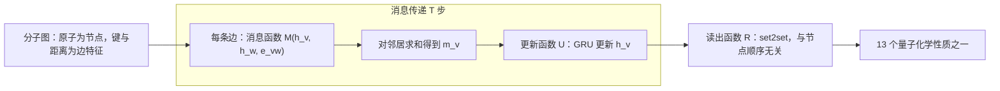

## 一句话总结

很多图神经网络其实是同一个模板：每个节点按轮次接收邻居的“消息”并更新自己的状态，最后把所有节点状态汇总成整张图的预测。把它们统一起来，再在模板里认真调出最好的组合。

## 解决什么问题

分子性质预测在化学、药物发现和材料科学中很重要。精确的量子力学计算（论文用的是密度泛函理论 DFT）很慢：QM9 中一个含 9 个重原子的分子在单核 CPU 上要算约 1 小时，17 个重原子的分子可能要 8 小时。

当时用机器学习做化学预测，主要靠人工设计分子特征。论文认为这有点像卷积网络普及之前的计算机视觉：神经网络已经有人用了，但缺少足够的实证说明“带合适归纳偏置的结构”能在这个领域胜出。

分子天然是**图**：原子是节点，化学键是边。合适的模型应当对图同构保持不变，即同一个分子换一种节点编号方式，预测结果不应改变。

## 核心思想

### 1. 消息传递框架

前向计算分两个阶段。

**消息传递阶段**，运行 T 步。每一步，节点 v 收集所有邻居 w 发来的消息并更新状态：

- `m_v^{t+1} = Σ_{w ∈ N(v)} M_t(h_v^t, h_w^t, e_vw)`
- `h_v^{t+1} = U_t(h_v^t, m_v^{t+1})`

**读出阶段**，把所有节点的最终状态变成整张图的输出：

- `ŷ = R({h_v^T | v ∈ G})`

消息函数 M_t、更新函数 U_t、读出函数 R 都是可学习的可微函数。R 作用于一组节点状态，必须与节点顺序无关，整个模型才对图同构不变。

### 2. 已有模型都是特例

论文逐一说明至少 8 个已有模型可以用这个框架描述，只是三个函数的选法不同，例如：分子指纹卷积网络（Duvenaud 等）、门控图神经网络 GG-NN（Li 等）、交互网络（Battaglia 等）、分子图卷积（Kearnes 等）、深度张量网络（Schütt 等）、基于图拉普拉斯的谱方法等。

作者的立场是：既然已有这么多变体，社区应该在一个有实际价值的问题上把这一类方法推到极限，而不是继续发明新名字。

### 3. 作者探索的变体

以 GG-NN 为起点（更新函数用 GRU，各步共享权重）：

- **消息函数**：GG-NN 的矩阵乘法只支持离散边类型；作者提出 **边网络**（edge network），用一个神经网络把连续的边特征向量映射成 d×d 矩阵 `A(e_vw)`，再乘以邻居状态。也试了让消息同时依赖收发双方状态的“成对消息”。
- **虚拟图元素**：给没有直接相连的原子对加一种“虚拟边”；或加一个与所有节点相连的**主节点**，作为每个节点每一步都会读写的全局草稿区。两者都让信息能跨越较远的距离传播。
- **读出函数**：除 GG-NN 原有的读出，还用了 Day 16 的 **set2set**，它专为集合设计，比简单求和表达力更强。
- **多塔**（towers）：把 d 维节点状态切成 k 份，各自做消息传递再用一个共享网络混合。稠密图上单步消息传递的计算量是 O(n²d²)，多塔降到 O(n²d²/k)；k = 8、n = 9、d = 200 时推理速度约快 1 倍。

## 关键公式或机制

### 数据与评测

- QM9：约 13 万个由 H、C、O、N、F 组成、最多 9 个重原子的有机小分子，每个分子有 13 个由 DFT 算出的性质（原子化能、振动频率、HOMO/LUMO 能级、偶极矩、极化率等），对应 13 个回归任务。论文随机取 1 万个做验证、1 万个做测试，其余训练。
- 结果用“误差比”报告：平均绝对误差除以化学界公认的**化学精度**阈值，小于 1 即达到化学精度。

### 主要结果

- 最好的单模型（记为 enn-s2s）：边网络消息函数 + set2set 读出 + 把氢原子作为显式节点。再取验证误差最低的 5 个模型做集成，进一步提升。
- 在 13 个目标上都超过了此前最好结果，其中 11 个达到化学精度。
- 两个重要发现：输入完整的边特征（键类型 + 空间距离）、把氢原子显式建模，对多个目标很关键；每个目标单独训练一个模型，始终优于 13 个目标联合训练，有时误差可降 40%。
- 不给空间信息、只给分子拓扑时，加虚拟边、主节点或 set2set 读出都能让 13 个目标全部改善，其中 set2set 版本在 5 个目标上达到化学精度。不过作者说明这组实验用了“部分电荷”作为输入，它本身是 DFT 的计算结果，实际应用中拿不到；表 2 的最好成绩没有用这个特征。
- 多塔结构原本是为了提速，但在 13 个目标中有 12 个上泛化也更好。
- 作者在脚注中指出，神经网络的推理速度比 DFT 快约 30 万倍。

## 图解

图解：分子图的每个节点在 T 步中反复收集邻居消息、用 GRU 更新状态，最后由与节点顺序无关的读出函数（set2set）给出性质预测。

## 关键原话

> "we reformulate existing models into a single common framework we call Message Passing Neural Networks (MPNNs)"

## 和 Anthropic 笔记的对应

这是一篇图神经网络与化学的论文，Anthropic 工程博客的笔记没有直接讨论它。下面是类比：

| Anthropic 笔记 | 对得上的地方 |
|---|---|
| [我们如何构建多智能体研究系统](../notes/multi-agent-research-system.md) | MPNN 的主节点是所有节点都能读写的全局草稿区，让信息不必一跳一跳地传播。多智能体系统中，主智能体也承担汇总和分发信息的角色。只是类比：一个是网络结构，一个是系统架构。 |
| [构建高效的智能体：从简单可组合的模式出发](../notes/building-effective-agents.md) | 论文主张先把已有方法统一成一个框架，在实际问题上把它推到极限，不轻易发明新结构。那篇同样建议先用简单、已知的模式，确有需要再增加复杂度。 |

## 读的时候要注意

- **“化学精度”是相对 DFT 标签而言**：QM9 的标签本身是 DFT 近似值，不是实验测量值；达到化学精度只说明拟合 DFT 足够好。
- **分子规模很小**：QM9 最多 9 个重原子。作者自己在结论中指出，推广到比训练集更大的图是重要的未来方向，使用空间信息时尤其困难。
- **数据规模的写法不一**：摘要图示和引言写约 13 万或 134k 个分子，训练部分写 130462 个，可能与数据清洗有关（待核实：论文未说明差异原因）。
- **部分电荷特征**：表 3、表 4 的实验用了实际中拿不到的 DFT 输出特征，读这两组结果时要注意。
- **框架很宽泛**：几乎任何在图上做局部聚合的模型都能写成 MPNN，框架本身不保证效果，效果取决于三个函数的具体选择和调参。

## 30u30 对应单元

- 30u30 的 [Day 21 单元](https://github.com/Ojhaharsh/30u30/tree/main/papers/21_Neural_Message_Passing)（仓库采用 CC BY-NC-ND 4.0，本笔记没有使用其内容）。
- 路线位置：[30u30 导读](../resources/r-30u30.md) 的补完段，单元 4（Day 19 → 20 → 21 → 22）。

## 延伸阅读

- [Day 19：关系网络](./p-19-relational-reasoning.md)：可以看成在完全图上只做一步消息传递。
- [Day 16：顺序很重要](./p-16-order-matters.md)：本文读出函数用的 set2set 来自这篇。
- [Day 20：关系循环神经网络](./p-20-relational-rnn.md)：用注意力让记忆槽之间交换信息，与本文作者提出的“对传入消息加注意力”的方向相呼应。

---

*本笔记依据 2026-10-18 抓取的在线原文撰写，仅为导读与总结。原文：Justin Gilmer, Samuel S. Schoenholz, Patrick F. Riley, Oriol Vinyals, George E. Dahl,[《Neural Message Passing for Quantum Chemistry》](https://arxiv.org/abs/1704.01212), ICML 2017。*
