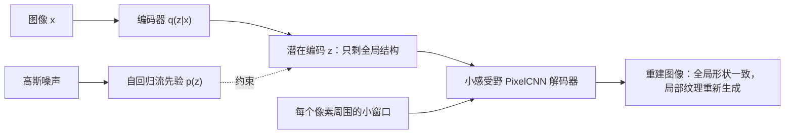

## 一句话总结

既然 VAE 总是把“解码器自己能搞定的信息”留给解码器，那就故意给解码器一个很小的视野，让它只能搞定局部纹理；这样潜在编码就只剩下全局结构，成为一种可控的“有损压缩”。

## 解决什么问题

表示学习希望学到对下游任务有用的表示。比如对图像来说，好的表示也许只描述全局结构（有什么物体、什么风格），而丢掉具体纹理和噪声。

两类生成模型各有长短：

- **VAE**（变分自编码器）有清晰的潜在变量结构，适合学表示，但密度估计不够强。
- **自回归模型**（RNN、MADE、PixelRNN/PixelCNN）密度估计非常强，但没有随机潜在变量，很少用来学表示。

很自然的想法是把两者结合：VAE 的潜在变量 + 自回归解码器。但此前的尝试一再发现，自回归部分会解释数据中的全部结构，潜在变量完全不被使用。文献通常把它归咎于“优化困难”，并用削弱解码器（例如对解码器做 dropout）的办法来缓解。论文要回答：为什么必须削弱？能不能利用这一点？

## 核心思想

### 1. VAE 并不总是在“自编码”

VAE 优化变分下界：

`L(x) = E_q(z|x)[log p(x|z)] − D_KL(q(z|x) ‖ p(z))`

第一项像重构误差，第二项像正则项，所以 VAE 常被看成一种正则化自编码器。但作者指出，这种解释没有说明它在什么条件下一定会重构出原图。

### 2. 比特返还编码的解释

作者借用 **比特返还编码**（bits-back coding，Day 4 Hinton 与 van Camp 的思路）把 VAE 看成一个两段式编码：先传 z，再传给定 z 时 x 的误差。按比特返还方式计算，期望编码长度正好是负的变分下界，并且可以写成：

`C_BitsBack = E[ −log p(x) + D_KL(q(z|x) ‖ p(z|x)) ] ≥ H(data) + E[ D_KL(q(z|x) ‖ p(z|x)) ]`

也就是说，只要近似后验 q 不等于真实后验，使用潜在编码就要多付一笔额外的编码代价。于是：

- 如果解码器 p(x|z) **不用 z 也能把数据建模好**（比如强大的 RNN 自回归解码器），最优解就是干脆不用 z，令 q(z|x) 等于先验，额外代价为零。
- 这不只是优化问题：即使优化得完美，在真实后验难以精确逼近的实际模型中，潜在编码在最优点也应该被忽略。

作者称之为**信息偏好**：能由解码器在局部建模的信息就留在局部，只有剩下的部分才放进 z。

### 3. 有损编码：显式安排信息放在哪里

既然如此，就可以反过来利用它：让解码器**能**建模我们不希望表示里包含的信息，但**不能**建模我们希望表示捕捉的信息。

例如想要不含纹理的全局表示，就让解码器只看像素周围一个小窗口：

`p_local(x|z) = Π_i p(x_i | z, x_WindowAround(i))`

纹理这类局部统计量会被小窗口解码器完全建模，物体形状这类长程依赖只能通过 z 传递。这样得到的 VAE 只对数据做“有损”的自编码，这就是论文题目的含义。作者也指出，反过来让解码器只看大幅下采样的图像，就会把局部高频信息推到 z 里。

### 4. 用自回归流作先验

为了减小上面那笔额外代价，作者把先验 p(z) 参数化为一个**自回归流**（AF），从简单的高斯噪声变换而来。论文推导表明：AF 先验在编码路径上等价于已有的逆自回归流（IAF）后验，但在生成路径上多了一段更深的变换，在相同训练代价下模型更具表达力。

## 关键公式或机制

### 实验设置

VLAE 在论文中指“使用 AF 先验和自回归解码器的 VAE”。二值图像实验的解码器是 6 层、卷积核为 3 的掩码卷积 PixelCNN，感受野只覆盖一个小邻域；训练时用 free bits 稳定优化。

### 主要结果（摘自论文）

- **有损压缩**：在静态二值化 MNIST 上，VLAE 平均每张图的潜在编码约 19.2 比特；结构相同但用因子化解码器的普通 VAE 约 37.3 比特，说明 VLAE 的压缩更“有损”。把编码“解压”回图像时，全局形状保留下来，但笔画宽度等局部细节会被重新生成，不是逐像素复原。
- **局限**：在小区域变化更有意义的 OMNIGLOT 上，有时连语义也没保住。作者强调：表示里该保留什么取决于任务和数据集，要据此设计解码器。
- **密度估计**（静态二值化 MNIST 测试集负对数似然，越低越好）：IAF VAE 79.88，换成 AF 先验 79.30，VLAE 79.03，优于 PixelRNN 的 79.20。用同一套在 MNIST 上调好的超参数，在动态二值化 MNIST、Caltech-101 Silhouettes 上明显刷新纪录，在 OMNIGLOT 上与此前最好成绩持平。
- **CIFAR10**：DenseNet 版 VLAE 为 2.95 bits/dim，在变分训练的潜在变量模型中最好，也优于 PixelRNN（3.00）和 Gated PixelCNN（3.03），略逊于 PixelCNN++（2.92）。
- **感受野控制编码内容**：在 CIFAR10 上，解码器感受野越大，潜在编码保留的形状越粗略。颜色在局部很好预测，常常被排除在编码之外；如果让解码器只看灰度邻域，颜色信息就被推进编码，解压出的物体更容易辨认。

## 图解

图解：编码器把图像变成潜在编码 z，先验由高斯噪声经自回归流得到；解码器只能看到每个像素周围的小窗口，局部纹理由它自己生成，全局结构只能依靠 z 传递。

## 关键原话

> "information that can be modeled locally by decoding distribution p(x|z) without access to z will be encoded locally and only the remainder will be encoded in z."

## 和 Anthropic 笔记的对应

| Anthropic 笔记 | 对得上的地方 |
|---|---|
| [面向 AI 智能体的上下文工程](../notes/effective-context-engineering-for-ai-agents.md) | VLAE 的思路是：编码里只放“局部推不出来”的全局信息，局部细节交给解码器现场生成。上下文工程做压缩或按需检索时也面临同样的取舍：哪些信息必须保留在上下文里，哪些可以在需要时再取回或推断。只是类比。 |
| [长时运行智能体的有效 harness](../notes/effective-harnesses-for-long-running-agents.md) | 论文强调“保留什么”要根据下游任务设计，否则编码可能丢掉真正重要的东西（如 OMNIGLOT 上的语义）。长时运行智能体在会话之间传递进度记录时，同样要事先想清楚交接内容，不能指望自动压缩恰好留下关键信息。 |

## 读的时候要注意

- **信息偏好是渐近结论**：作者明确说它只在变分下界优化得足够好时成立，所以论文仍然使用 free bits、KL 退火等技巧来平滑优化。
- **“全局表示”不一定是你想要的**：OMNIGLOT 的例子说明，小感受野解码器丢掉的未必只是无关细节，设计时要按任务调整。
- **只做了图像**：作者把其他数据类型留给未来工作。
- **数字对比要看表格**：各数据集上的完整对比在论文表 1 至表 5，本笔记只摘录了部分；OMNIGLOT 等表格在 PDF 文本提取中排版错乱，具体数值请以原文为准（待核实）。

## 30u30 对应单元

- 30u30 的 [Day 23 单元](https://github.com/Ojhaharsh/30u30/tree/main/papers/23_variational_lossy_autoencoder)（仓库采用 CC BY-NC-ND 4.0，本笔记没有使用其内容）。
- 路线位置：[30u30 导读](../resources/r-30u30.md) 的补完段，单元 5（Day 23 → 24 → 28）。

## 延伸阅读

- [Day 4：用最短描述长度让神经网络保持简单](./p-04-keeping-nn-simple-mdl.md)：比特返还编码的来源。
- [Day 5：最小描述长度原理入门](./p-05-mdl-tutorial.md)：两段式编码与描述长度的一般框架。
- [Day 26：Kolmogorov 复杂性](./p-26-kolmogorov-complexity.md)：“压缩”与“结构”关系的理论基础。

---

*本笔记依据 2026-10-18 抓取的在线原文撰写，仅为导读与总结。原文：Xi Chen, Diederik P. Kingma, Tim Salimans, Yan Duan, Prafulla Dhariwal, John Schulman, Ilya Sutskever, Pieter Abbeel,[《Variational Lossy Autoencoder》](https://arxiv.org/abs/1611.02731), ICLR 2017。*
