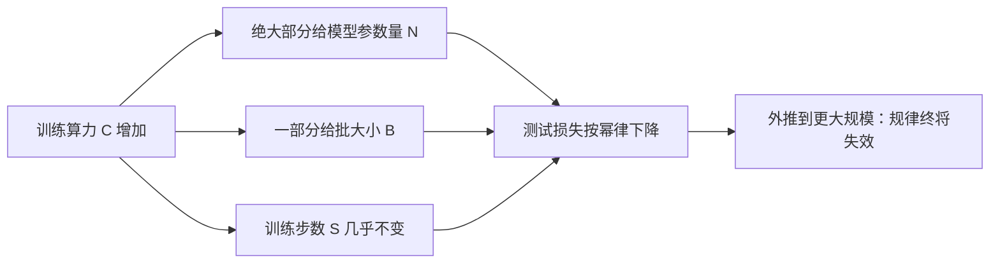

## 一句话总结

只要不被另外两个因素卡住，语言模型的损失就随**参数量 N、数据量 D、训练算力 C** 各自按幂律平滑下降；于是可以用小模型的实验去预测大模型的表现，并据此决定算力该怎么花。

## 解决什么问题

2020 年之前，大家知道“更大的模型、更多的数据通常更好”，但说不清：

- 好多少？能不能提前预测？
- 加层数、加宽度、加注意力头，哪个更重要？
- 算力预算固定时，该训一个大模型少跑几步，还是训一个小模型跑到收敛？

本文用大量实验（主要是只有解码器的 Transformer，在 WebText2 上训练）给出定量答案。

## 核心思想

论文开头列出的主要发现（笔者概括）：

1. **强依赖规模，弱依赖形状**：在合理范围内，深度、宽度等结构超参数影响很小；N 只计非嵌入参数。
2. **平滑的幂律**：损失和 N、D、C 各自呈幂律关系，趋势跨越六个数量级以上，在最大规模处也没看到偏离。
3. **过拟合有统一规律**：N 和 D 同步增长时损失稳定下降；只增加其一会进入收益递减。损失惩罚取决于 `N^0.74 / D`，也就是模型每扩大 8 倍，数据大约只需扩大 5 倍。
4. **训练曲线可外推**：从训练早期的曲线就能大致预测训练更久后的损失。
5. **迁移随测试表现提升**：在其他分布的文本上评测，损失和训练分布上的损失高度相关，只差一个大致恒定的偏移。
6. **大模型更省样本**：达到同样损失，大模型用的优化步数和数据都更少。
7. **收敛不划算**：固定算力下，最优做法是训练很大的模型，并在远未收敛时停下。
8. **最优批大小**：大致只取决于损失，可以用梯度噪声尺度估计；对最大的模型，收敛时约 100–200 万个 token。

## 关键公式或机制

### 1. 三条单变量幂律

在不被另外两个因素卡住时（下列数值是论文给出的拟合值，依赖其分词方式和数据集）：

| 关系 | 形式 | 指数 | 常数 |
|---|---|---|---|
| 损失 vs 参数量 | `L(N) = (N_c / N)^α_N` | α_N ≈ 0.076 | N_c ≈ 8.8×10¹³ 个非嵌入参数 |
| 损失 vs 数据量 | `L(D) = (D_c / D)^α_D` | α_D ≈ 0.095 | D_c ≈ 5.4×10¹³ 个 token |
| 损失 vs 最优算力 | `L(C_min) = (C_c / C_min)^α_C` | α_C ≈ 0.050 | C_c ≈ 3.1×10⁸ PF-天 |

指数都很小：参数量翻倍，损失只按 2 的 0.076 次方的比例下降。正因为提升“慢而稳”，才需要成数量级地加规模。

### 2. 算力的粗略估算

训练算力近似为 `C ≈ 6 · N · B · S`（B 为批大小，S 为步数，B·S 就是处理的 token 数）。常数 6 来自前向和反向传播每个参数每个 token 的运算量。

### 3. 固定算力下怎么分

论文拟合出：算力每增加，最优分配大致是 `N ∝ C^0.73`、`B ∝ C^0.24`、`S ∝ C^0.03`。也就是说，**多出来的算力绝大部分应该用来把模型变大**，批大小适度增加，训练步数几乎不变；数据用量随算力增长较慢（约 `C^0.27`）。

### 4. 论文自己指出的矛盾

在“矛盾与一个猜想”一节，作者推算：如果把这些规律外推到比实验高几个数量级的规模，按算力最优路线预测的损失会低于数据量所允许的下限，所以这些规律**在那之前必然失效**。作者猜想这个交点可能对应 Transformer 语言模型能达到的最佳性能，但这只是猜想。

## 图解

图解：按论文的拟合，算力增加时主要用来扩大模型参数量，批大小适度增加，训练步数几乎不变；损失随之按幂律下降，但作者也指出外推到足够大的规模时这一规律必然失效。

## 关键原话

> "Performance depends strongly on scale, weakly on model shape"

## 和 Anthropic 笔记的对应

| Anthropic 笔记 | 对得上的地方 |
|---|---|
| [为长时间运行的应用开发设计 harness](../notes/harness-design-long-running-apps.md) | 那篇说 harness 里每个组件都编码了一个“模型自己做不到什么”的假设，新模型出来要重新检验哪些组件还承重。缩放定律给了这个做法一个背景：模型能力随规模可预期地提升，今天必要的脚手架明天可能多余。 |
| [规模化 Managed Agents：把大脑和双手解耦](../notes/managed-agents.md) | 那篇的设计目标之一是让接口在模型和 harness 迭代时保持稳定，避免被某一代模型的局限绑死；参考资料里也提到“苦涩的教训”。思路和本文“规模持续带来收益”的结论一致。属于背景上的呼应。 |
| [构建高效的智能体](../notes/building-effective-agents.md) | “从最简单的方案开始，复杂度带来可测量收益才加”——在模型能力持续提升的前提下，少搭会过时的复杂结构是合理的工程选择。 |

## 读的时候要注意

- **最优分配比例后来被修正**：DeepMind 2022 年的 Chinchilla 论文认为当时的大模型普遍训练数据不足，模型大小和训练 token 数应该等比例增长（模型翻倍、数据也翻倍），并用 700 亿参数、约 4 倍数据的模型胜过更大的模型。差异的原因（如学习率调度、实验规模范围）本笔记未展开核实（待核实）。
- **拟合常数不能直接搬用**：N_c、D_c 等数值依赖论文的分词器（BPE、词表 50257）、数据集和“非嵌入参数”的计法，换个设置就要重新拟合。
- **损失不等于能力**：本文预测的是交叉熵损失，不是具体任务的表现；某项能力会不会随规模平滑出现，本文没有回答。
- **作者自己的限定**：附录中作者承认缺少坚实的理论解释，第 6.3 节也指出规律必然在某处失效。不要把它读成“规模无限有效”的证明。
- **“六个数量级”指的是实验覆盖的范围**：外推到范围之外是另一回事。

## 30u30 对应单元

- 30u30 的 [Day 25 单元](https://github.com/Ojhaharsh/30u30/tree/main/papers/25_scaling_laws)（仓库采用 CC BY-NC-ND 4.0，本笔记没有使用其内容）。
- 路线位置：[30u30 导读](../resources/r-30u30.md) 的原理支线 P4。

## 延伸阅读

- [Training Compute-Optimal Large Language Models（Chinchilla）](https://arxiv.org/abs/2203.15556)：对本文最优分配结论的主要修正。
- [Day 13：Attention Is All You Need](./p-13-attention-is-all-you-need.md)：本文研究的模型架构。

---

*本笔记依据 2026-10-18 抓取的在线原文撰写，仅为导读与总结。原文：Jared Kaplan 等,[《Scaling Laws for Neural Language Models》](https://arxiv.org/abs/2001.08361), arXiv 2020。*
