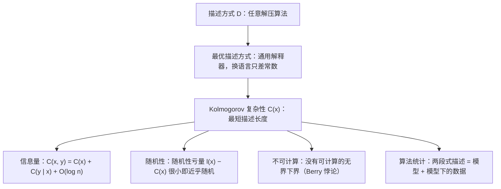

## 一句话总结

一个对象有多少信息，就看描述它最少需要多少比特：能输出它的最短程序越短，它越简单；几乎压缩不了的，就是随机的。

## 解决什么问题

香农熵度量的是一个**随机变量**的平均信息量，必须先有一个概率分布。但很多时候我们关心的是**单个对象**：一部小说、一段 DNA、一串实验数据到底有多少信息？为它们找一个“典型”的概率分布很勉强。书中举的例子：如果把所有曾经存在过的物种的基因组当作一个集合，元素数量远不到 2^1000，平均分配概率得到的熵不到 1000 比特，显然不合理。

书的前言引用了 Kolmogorov 当年提出的两个问题：

1. 能不能让信息论（以及“信息量”这个概念）摆脱概率？
2. 能不能把“随机”这个直观概念发展为“不可压缩”，即描述它的规律无法再缩短？

这本书系统地回答这两个问题，作者来自 Kolmogorov 在莫斯科大学发起的讨论班。

## 核心思想

### 1. 描述方式与复杂性

把“解压程序”抽象为**描述方式** D：任何一个以二进制串为输入、二进制串为输出的算法（可以对某些输入不停机，也不限运行时间）。若 D(y) = x，就说 y 是 x 的一个描述。x 相对 D 的复杂性是它最短描述的长度：

`C_D(x) = min{ l(y) : D(y) = x }`

这个定义显然依赖 D：对任何一个字符串，都可以专门设计一个 D 让它的复杂性为 0。

### 2. 最优描述方式（Solomonoff–Kolmogorov 定理）

关键定理：存在一个描述方式 D，**不比任何其他描述方式差**，即对每个 D′ 都有常数 c，使所有 x 满足：

`C_D(x) ≤ C_D′(x) + c`

构造方法是一个“通用解释器”：输入的开头是一段自定界的程序 P，后面是数据 y，D 就把 P 作用在 y 上。书里用的类比是自解压档案：文件开头是一小段解压程序，后面是被压缩的内容。

固定一个最优描述方式，就得到 Kolmogorov 复杂性 C(x)。换成另一个最优方式，结果只差一个有界的常数（大致是用一种语言写另一种语言的解释器所需的长度）。作者强调：因此谈论**某一个固定字符串**的复杂性或比较两个固定字符串谁更简单，并没有严格意义；Kolmogorov 复杂性的所有结论本质上都是**渐近的**。

### 3. 复杂性就是信息量

- 信息量不超过长度：`C(x) ≤ l(x) + O(1)`。
- 算法变换不增加信息（最多增加一个只依赖于该算法的常数）。
- 引入条件复杂性 C(x | y)（解压时可以免费看到 y），就有 Kolmogorov–Levin 定理：对长度不超过 n 的字符串，`C(x, y) = C(x) + C(y | x) + O(log n)`。书中称这可能是关于 Kolmogorov 复杂性的第一个非平凡结论。
- 于是 `C(x) − C(x | y)` 可以看作“y 中关于 x 的信息量”。书中举例：可以用 C(原文 | 译文) / C(原文) 衡量翻译丢失了多少信息。

### 4. 随机就是不可压缩

- 计数论证：复杂性小于 n 的字符串少于 2^n 个。所以长度为 100 的字符串中，复杂性低于 90 的不到 2^−10。绝大多数字符串几乎不可压缩。
- 书中的思想实验：抛 80000 次硬币得到 10000 字节，可以打赌没有任何事先存在的压缩软件能把它压缩超过 10 字节。
- 把 `l(x) − C(x)` 定义为**随机性亏量**。对有限字符串，随机与非随机之间没有明确分界；要划清界限，需要转向无穷序列（Martin-Löf 随机性），并用另一种版本的复杂性（单调复杂性）来刻画。

### 5. 不可计算性与 Berry 悖论

C(x) **不可计算**，而且不存在任何可计算的、无上界的下界。证明是 Berry 悖论（“不能用十四个以内英文单词定义的最小自然数”）的形式化：假如能找到“第一个复杂性大于 N 的字符串”，那么这个字符串只需要约 log₂N 比特加一个常数就能描述，N 足够大时就矛盾了。

## 关键公式或机制

### 与香农熵的关系（第 7 章）

书中给出的直观说法：香农熵只考虑**频率**上的规律，Kolmogorov 复杂性考虑**所有算法上**的规律，所以一般后者更小；但如果一个对象由只具有频率规律的随机过程产生，两者以很高的概率接近。一个具体结论（定理 146）：长度为 N、字母频率为 p₁…p_k 的字符串满足

`C(x) / N ≤ h(p₁, …, p_k) + O(log N) / N`

### 书的结构（按目录）

- 第 1–2 章：普通复杂性、成对与条件复杂性、复杂性作为信息量。
- 第 3 章：Martin-Löf 随机性。
- 第 4–6 章：先验概率与前缀复杂性、单调复杂性、各种复杂性的统一框架。
- 第 7 章：香农熵与 Kolmogorov 复杂性。
- 第 8–13 章：应用、随机性的频率与博弈方法、不等式、公共信息、多源信息论、信息与逻辑。
- 第 14 章：**算法统计**，讨论给定一份不可重复的数据时，什么样的“两段式描述”（模型 + 模型下的数据）算合理的解释。
- 附录：复杂性与概率论基础；Uspensky 面向中学生和本科生的一篇随机性讲座。

### 奥卡姆剃刀

导论把“好的理论”解释为对实验数据更短的描述：开普勒的理论用更少的参数给出同样甚至更高的精度，比托勒密的本轮更好。作者也说明，用复杂性解释“预测”是 Solomonoff 的主要动机，这超出了本书范围，推荐读 Hutter 的书。

## 图解

图解：从任意解压算法出发，最优描述方式给出与语言无关到一个常数的 Kolmogorov 复杂性；它可以用来定义单个对象的信息量和随机性，可以支撑算法统计中的两段式描述，但本身不可计算。

## 关键原话

> "Roughly speaking, Kolmogorov complexity means “compressed size”."

## 和 Anthropic 笔记的对应

这是一本数学专著，Anthropic 工程博客的笔记没有直接讨论它。下面是类比：

| Anthropic 笔记 | 对得上的地方 |
|---|---|
| [面向 AI 智能体的上下文工程](../notes/effective-context-engineering-for-ai-agents.md) | 那篇主张用尽量少而信息密度高的 token 达到目标。Kolmogorov 复杂性给“信息密度”提供了一个理想化的定义：去掉一切可以由规律推出的冗余后剩下的长度。只是类比：真实的上下文压缩无法求出最短描述。 |
| [构建高效的智能体：从简单可组合的模式出发](../notes/building-effective-agents.md) | 导论把奥卡姆剃刀解释为“更短的描述就是更好的解释”。那篇也主张优先选择简单方案，只在确有收益时增加复杂度。 |

## 读的时候要注意

- **这是专著，不是论文**：500 多页，大量内容是定理证明和习题。本笔记只依据导论和几章开头，没有覆盖前缀复杂性、单调复杂性、Martin-Löf 随机性的细节（待核实：后续章节的具体结论本笔记未逐条核对）。
- **常数无法忽略的场合**：所有结论都只到一个常数或对数项，对短字符串几乎没有意义。书中估计常见语言之间的转换常数可能在几百到几千比特。
- **不可计算**：任何实际使用（比如用 gzip 的输出长度近似）都只是上界，不能当作真实的复杂性。
- **“应用”不是工程应用**：作者在导论中明确说明，书里的应用只是在复杂性和其他重要概念之间建立联系，不是实际的工程用途。
- **OCR 文本**：本笔记所用的扫描版文字由 OCR 提取，公式符号常有识别错误，引用公式时以 PDF 页面为准。
- **符号不统一**：书中普通复杂性记作 C(x)，前缀复杂性记作 K(x)；其他文献（包括 Kolmogorov 本人）用法不同，读其他资料时要注意。

## 30u30 对应单元

- 30u30 的 [Day 26 单元](https://github.com/Ojhaharsh/30u30/tree/main/papers/26_kolmogorov_complexity)（仓库采用 CC BY-NC-ND 4.0，本笔记没有使用其内容）。
- 路线位置：[30u30 导读](../resources/r-30u30.md) 的 P6 理论段（压缩、复杂性、通用智能）：Day 4、5、26 · 6、7 · 27。

## 延伸阅读

- [Day 5：最小描述长度原理入门](./p-05-mdl-tutorial.md)：把“最短程序”换成可计算的模型族，得到实用的 MDL。
- [Day 4：用最短描述长度让神经网络保持简单](./p-04-keeping-nn-simple-mdl.md)：描述长度在神经网络中的早期应用。
- [Day 6：复杂动力学第一定律](./p-06-first-law-complexodynamics.md)、[Day 7：咖啡自动机](./p-07-coffee-automaton.md)：用 Kolmogorov 复杂性及其可计算近似讨论“有趣程度”。
- [Day 27：机器超级智能](./p-27-machine-super-intelligence.md)：用 Solomonoff 归纳和 Kolmogorov 复杂性定义通用智能。

---

*本笔记依据 2026-10-18 抓取的在线原文撰写，仅为导读与总结。原文：A. Shen, V. A. Uspensky, N. Vereshchagin,[《Kolmogorov Complexity and Algorithmic Randomness》](https://www.lirmm.fr/~ashen/kolmbook-eng-scan.pdf), American Mathematical Society, Mathematical Surveys and Monographs, Vol. 220, 2017。*
