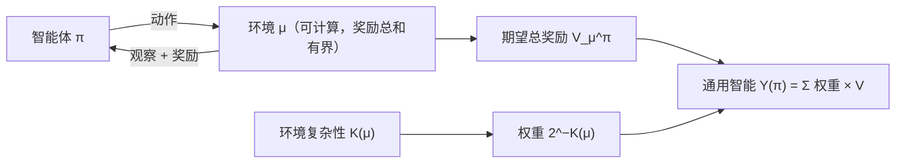

## 一句话总结

先回答“智能是什么”：在很多种环境里都能实现目标的能力。再把它写成一个公式：让智能体在所有可计算的环境里各跑一遍，越简单的环境权重越大，加权平均得分就是它的“通用智能”。

## 解决什么问题

作者在前言里指出，人工智能的书和论文很少认真讨论“智能到底是什么”，通常只提一下图灵测试、说一句“智能难以定义”，就转向具体算法了。这篇论文研究的是理论上“极其智能”的系统，所以必须先把智能说清楚。

论文的主线有三条：

1. 智能的定义与测量：从大量已有定义中归纳出一个非形式化定义，再把它形式化。
2. **通用人工智能理论**（universal artificial intelligence）：介绍 Solomonoff 归纳和 Hutter 的 AIXI 智能体，研究它们在哪些环境里能学到最优行为。
3. 理论的边界：可计算的智能体逼近这些理想模型会遇到什么根本限制，以及超级智能机器带来的长远问题。

## 核心思想

### 1. 非形式化定义

第 1 章汇总了心理学家、AI 研究者和各类集体声明中的定义（附录收集了 70 多条，作者称可能是现存最大的智能定义合集）。作者从中提炼出几个共同点：智能是个体与外部环境互动时表现出的属性；它与实现目标、获得成功有关；它强调学习和适应，因为环境并不完全已知。归纳成一句话：

**智能衡量的是智能体在广泛环境中实现目标的能力。**（英文原句见“关键原话”）

作者强调，这个定义不规定需要哪些具体能力（推理、规划、记忆……），而是看这些能力综合起来产生的效果。

### 2. 从 Solomonoff 归纳到 AIXI

- **Solomonoff 归纳**处理被动的序列预测：对所有可计算的假设按 `2^−K` 赋先验（K 是 Kolmogorov 复杂性，越简单的假设先验越高），再用贝叶斯规则更新。作者介绍，它能很快学会最优地预测任何具有可计算概率分布的序列；最大似然、最小描述长度、最大熵等统计原则都可以看作它的特例。但它不可计算。
- **智能体—环境模型**：在每一轮，智能体发出动作，环境返回观察和奖励。环境不必是马尔可夫的，也不必假设对手按最优方式行动。
- **AIXI**：Hutter 把 Solomonoff 的模型与序贯决策理论结合，得到一个通用智能体。作者介绍的已知结论是：只要通用智能体在某种环境中原则上能收敛到最优，AIXI 就会收敛；而且它是 **Pareto 最优**的，即不存在另一个智能体能在所有环境里表现一样好、又在至少一个环境里严格更好。作者因此把它当作超级智能体的理论模型。
- 第 3 章整理了多种环境类别之间的关系，并指出在哪些类别中通用智能体能学到最优行为。

### 3. 通用智能的形式定义（第 4 章）

把非形式化定义里的每个词都换成数学对象：

- “智能体”是一个策略 π，“目标”由环境给出的奖励表示，“实现目标的能力”是期望总奖励 `V_μ^π`（要求所有环境的奖励总和有界，作者认为这样就不需要额外的折扣因子）。
- “广泛环境”取为**所有可计算的**、奖励总和有界的环境。作者的理由：所有概率测度的集合太大，其中很多环境无法有限描述，也没有可学习的结构。
- 无穷多个环境不能平均加权。作者按**奥卡姆剃刀**给简单的环境更高的权重：`2^−K(μ)`。

于是：

`Υ(π) := Σ_{μ ∈ E} 2^{−K(μ)} · V_μ^π`

即智能体在“通用分布”下的期望表现。

作者讨论了几个细节：

- **按复杂性加权，而不是按难度加权**：一个很复杂、但无论做什么都给满分奖励的环境，其实很“容易”。作者坚持按复杂性加权，以便平均而言奖励那些正确使用奥卡姆剃刀的智能体。
- **“傻运气游戏”**：桌上摆着 20 张 10 美元，每次回答“是”就拿走一张，回答“否”则被收回。聪明人到第 13 轮会坚持答“是”，却不知道这一轮答“是”会被枪击；一个没看出规律的人反而因为运气活下来。作者用这个例子说明，智能看的是“采取最可能成功的行动”，而不是在某一次碰巧成功。

## 关键公式或机制

### 这个定义的性质（作者自评）

- **形式化、客观**：给定参考机器后完全确定，不依赖主观标准。
- **不实用**：K 不可计算，无法直接做成测试。作者设想的近似方法是随机生成环境程序、按程序长度加权打分，或从短到长枚举环境（这时要能重置智能体，防止它学会枚举方式“作弊”）。
- 作者把它定位为“定义而不是测试”，并类比随机性的定义：理想定义用不可计算的 Kolmogorov 复杂性，实践中只能用一组统计检验去近似；不能为了好测而把定义改成“通过这几项检验就算随机”。
- 论文还把它与图灵测试、压缩测试、C-Test 等十多种机器智能测试做了对比。

### 可计算智能体的极限（第 5 章）

作者在第 6 章开头总结第 5 章的结论：能预测所有中等 Kolmogorov 复杂度以下序列的可计算预测器，本身必然非常复杂，而且由于哥德尔不完备性，在数学上无法被找到。出路可能是考虑同时计入时间和空间的资源受限复杂性，但这个理论本身很难处理。此外，即使先验可以替换成可计算的版本，AIXI 对未来的搜索时间仍随前瞻深度指数增长。

### 一个落地尝试（第 6 章）

作者从统计原理推导出一个**不需要学习率参数**的时序差分（TD）更新规则：形式上类似 TD(λ)，但学习率由一个针对每次状态转移的公式自动给出。实验中它在多种设置下优于 TD(λ)，并被扩展到 Sarsa(λ) 和 Q(λ)。作者说明推导来自 Hutter 未发表的手稿。

### 讨论：超级智能是好主意吗（第 7 章）

作者引用阿克顿勋爵“权力导致腐败”的话：权力本身无所谓好坏，但会放大意图；按定义，超级智能机器能在广泛环境中实现广泛目标，接近“绝对权力”。他认为如果提前认真准备，不仅可能避免灾难，还可能带来前所未有的繁荣，并希望 AIXI 理论能被用于研究智能机器的安全性。

## 图解

图解：智能体与环境循环交互，发出动作、收到观察和奖励；在每个可计算环境中的期望总奖励按 2^−K(μ) 加权，求和得到智能体的通用智能 Υ(π)。

## 关键原话

> "Intelligence measures an agent’s ability to achieve goals in a wide range of environments."

## 和 Anthropic 笔记的对应

| Anthropic 笔记 | 对得上的地方 |
|---|---|
| [构建高效的智能体：从简单可组合的模式出发](../notes/building-effective-agents.md) | Legg 用“智能体发出动作、环境返回观察和奖励”的循环形式化定义智能；那篇用“LLM 根据环境反馈调用工具、循环往复”定义智能体。两者都以“与环境的循环交互”为核心，区别在于：Legg 关心理论上的最优表现，那篇关心工程上何时值得用智能体。 |
| [Chip Huyen：Agents（智能体）](../resources/r-chip-huyen-agents.md) | Chip Huyen 认为智能体由“所处环境 + 可用动作（工具）集合”来定义，与 Legg 形式化里的“环境 μ + 动作空间”对得上；不同的是 Legg 还用奖励来定义目标，并在所有环境上求平均。 |
| [Simon Willison 的博客：几个推荐入口](../resources/r-simon-willison.md) | Simon 收集了大量“agent”定义后采用了“在循环中运行工具以达成目标”；Legg 也是先收集 70 多条智能定义，再归纳出“在广泛环境中实现目标”。两边都落在“目标 + 与环境循环交互”上。 |
| [揭秘 AI 智能体评测](../notes/demystifying-evals-for-ai-agents.md) | Υ 在“所有环境”上取加权平均，作者承认实践中只能抽取有限的环境样本来估计，这正是评测套件要面对的问题。“傻运气游戏”说明只看单次结果会误判能力，评测里区分结果与过程记录、看多次试验，也是在避免这种误判。只是类比。 |

## 读的时候要注意

- **定义依赖参考机器**：K(μ) 取决于所选的通用图灵机，不同选择会改变环境的权重，作者在“完全确定”时也加了“给定参考机器”这个前提。
- **不可计算，也难以近似**：作者自己的第 5 章说明了逼近的根本困难，所以这个公式更像一个思想工具，而不是能直接比较两个现有系统的尺子。
- **AIXI 的结论有条件**：收敛到最优只在原则上可能的环境中成立；更强的“快速收敛”结论在一些设置下已被证明不可能，在另一些设置下仍是开放问题（作者在摘要中说明）。
- **“超级智能”的含义**：论文所说的超级智能体是 AIXI 这样需要无限计算资源的理论对象，不是对某个现实系统的评价。
- **哪些是作者本人的工作**：作者在前言里逐章说明了贡献，第 2 章是对已有理论（主要是 Hutter 的工作）的通俗介绍，第 4 章的公式和第 5 章后半部分的结果是他本人的。
- **第 7 章写于 2008 年**：其中提到的机构、人物和观点反映的是当时的情况。

## 30u30 对应单元

- 30u30 的 [Day 27 单元](https://github.com/Ojhaharsh/30u30/tree/main/papers/27_MSI)（仓库采用 CC BY-NC-ND 4.0，本笔记没有使用其内容）。
- 路线位置：[30u30 导读](../resources/r-30u30.md) 的 P6 理论段（压缩、复杂性、通用智能）：Day 4、5、26 · 6、7 · 27。

## 延伸阅读

- [Day 26：Kolmogorov 复杂性](./p-26-kolmogorov-complexity.md)：本文 2^−K 权重的来源。
- [Day 5：最小描述长度原理入门](./p-05-mdl-tutorial.md)：作者把 MDL 看作 Solomonoff 归纳的特例之一。
- [Day 29：PPO](./p-29-ppo.md)：同样基于“智能体—环境—奖励”框架的实用强化学习算法。
- [Day 30：从人类偏好中学习](./p-30-rlhf-human-preferences.md)：当奖励难以直接写出时，如何从人类反馈中学到奖励。

---

*本笔记依据 2026-10-18 抓取的在线原文撰写，仅为导读与总结。原文：Shane Legg,[《Machine Super Intelligence》](https://sonar.ch/documents/317954/files/2008INFO002.pdf), Doctoral Dissertation, University of Lugano, 2008。*
