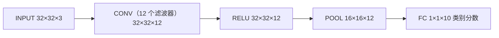

## 一句话总结

卷积网络就是普通神经网络加上一个关于图像的假设：特征只需要看局部，而且在一个位置有用的特征在其他位置也有用。由此得到局部连接和参数共享，参数量大幅减少；剩下的工作主要是把每一层的尺寸算对。

## 解决什么问题

讲义开头就点明普通全连接网络处理图像的问题：一张 200×200×3 的图片，第一层的**每个**神经元就有 120,000 个权重，参数量迅速膨胀，而且容易过拟合。卷积网络明确假设输入是图像，把这个假设写进结构，前向计算更高效，参数也少得多。

这份讲义是 30u30 书单里唯一一篇课程讲义，作用是给后面读 [AlexNet](./p-08-alexnet.md)、[ResNet](./p-09-resnet.md)、[空洞卷积](./p-11-dilated-convolutions.md) 打基础。

## 核心思想

### 1. 三维的“体”

卷积网络的每一层都把一个三维的激活体（宽 × 高 × 深）变换成另一个三维激活体。讲义特别说明这里的“深度”指激活体的第三个维度（比如 RGB 的 3 个通道），不是网络有多少层。CIFAR-10 的输入是 32×32×3，最后的输出是 1×1×10，即 10 个类别分数。

主要有三种层：卷积层（CONV）、池化层（POOL）、全连接层（FC），另外把 ReLU 也单独写成一层。CONV 和 FC 有参数，ReLU 和 POOL 是固定函数。

### 2. 卷积层的三个设计

- **局部连接**：每个神经元只连接输入的一小块区域，这块区域的大小叫感受野（即滤波器大小 F）。连接在宽和高上是局部的，在深度上永远是全的。例如 5×5 的滤波器作用在 32×32×3 的输入上，每个神经元有 5×5×3 = 75 个权重外加 1 个偏置。
- **空间排列**：输出体的大小由三个超参数决定：深度（滤波器个数 K）、步长 S、零填充 P。
- **参数共享**：假设“一个特征在位置 (x, y) 有用，在别的位置也有用”，于是同一个深度切片里的所有神经元共用一组权重。这样前向计算就变成用滤波器在输入上做卷积，这也是“卷积层”名字的由来。

讲义以 AlexNet 第一层为例算了一遍：输出 55×55×96 = 290,400 个神经元，每个有 11×11×3 = 363 个权重和 1 个偏置。如果不共享，光这一层就有 105,705,600 个参数；共享之后只有 96 组权重，共 34,848 个权重加 96 个偏置。

讲义也指出参数共享并不总是合理：比如输入是居中对齐的人脸，不同位置应该学到不同的特征（眼睛、头发），这时可以放松共享，改用**局部连接层**。

### 3. 池化层

池化层夹在连续的卷积层之间，逐步缩小空间尺寸，以减少参数和计算，从而控制过拟合。最常见的是 2×2、步长 2 的最大池化，会丢掉 75% 的激活；深度不变，也没有参数。讲义提到，有人主张完全去掉池化、改用偶尔加大卷积步长，作者认为未来的架构可能很少甚至不用池化层。

### 4. 全连接层与卷积层可以互相改写

两者都在算点积，区别只在于卷积层是局部连接加参数共享。所以任何全连接层都能写成卷积层：看 7×7×512 输入、输出 4096 维的全连接层，等价于 F = 7、K = 4096 的卷积层。好处是可以把整个网络一次“滑过”一张更大的图：384×384 的图片前向一次，就得到 6×6 个位置的类别分数，比把原网络在 36 个裁剪上分别跑一遍高效得多，因为这些计算是共享的。

### 5. 架构的经验规则

- 最常见的堆叠模式：`INPUT -> [[CONV -> RELU]*N -> POOL?]*M -> [FC -> RELU]*K -> FC`，通常 N ≤ 3、K < 3。
- **用多个小滤波器代替一个大滤波器**：三层 3×3 卷积的感受野与一层 7×7 相同，但多了两次非线性，参数也更少（27C² 对 49C²，C 为通道数）。代价是反向传播时要多存中间结果。
- 卷积层用小滤波器、步长 1，并用 P = (F−1)/2 的零填充保持空间尺寸不变，把下采样全部交给池化层，这样尺寸最好算。
- 讲义的实用建议是“don’t be a hero”：90% 以上的应用不必自己设计架构，直接下载当前在 ImageNet 上效果最好的预训练模型，在自己的数据上微调。

## 关键公式或机制

**卷积层输出尺寸**：

`W₂ = (W₁ − F + 2P) / S + 1`，`H₂` 同理，`D₂ = K`

参数量：每个滤波器 F·F·D₁ 个权重，共 (F·F·D₁)·K 个权重和 K 个偏置。

结果必须是整数，否则这组超参数无效。讲义举了个例子：AlexNet 论文说输入是 224×224，但 (224 − 11)/4 + 1 不是整数，用 227 才能得到 55。作者猜测 Alex 用了论文里没提到的 3 像素零填充（这是作者本人的猜测，见 [Day 8 笔记](./p-08-alexnet.md)）。

**池化层输出尺寸**：`W₂ = (W₁ − F) / S + 1`，深度不变，通常不做零填充。

**实现方式**：讲义介绍了 im2col，把每个感受野拉成一列，把滤波器拉成一行，整个卷积就变成一次大矩阵乘法，可以利用高度优化的 BLAS。缺点是输入值会被重复复制，比较占内存。

**VGGNet 账本**：讲义逐层列出 VGG 的激活大小和参数量：总参数约 138M，前向每张图约 93MB 内存（反向大约翻倍）。**大部分内存和计算花在前面的卷积层，大部分参数在最后的全连接层**，仅第一个全连接层就有约 1 亿个权重。

**显存估算**：显存有三个来源：中间激活（及其梯度）、参数（及其梯度和优化器缓存，通常要乘以 3 左右）、杂项（数据批次等）。把数值个数乘 4 字节换算成 GB；装不下时最常见的办法是减小批大小，因为大部分显存被激活占用。

## 图解

图解：讲义里给 CIFAR-10 举的最简单的卷积网络。卷积层用零填充保持空间尺寸、改变深度；ReLU 不改变尺寸；池化层把宽和高减半；全连接层输出 10 个类别分数。

## 关键原话

> "Instead of rolling your own architecture for a problem, you should look at whatever architecture currently works best on ImageNet, download a pretrained model and finetune it on your data."

## 和 Anthropic 笔记的对应

| Anthropic 笔记 | 对得上的地方 |
|---|---|
| [构建高效的智能体：从简单可组合的模式出发](../notes/building-effective-agents.md) | 讲义的“don’t be a hero”主张先用已被验证的架构，不要从零自己设计；那篇也建议从最简单的方案开始，只在确有收益时才增加复杂度。只是类比。 |
| [面向 AI 智能体的上下文工程](../notes/effective-context-engineering-for-ai-agents.md) | 讲义的显存账本要求先算清激活、参数、杂项各占多少，再决定在哪里妥协（例如只在第一层用大步长）；上下文工程同样把有限的上下文窗口当作需要精打细算的预算。只是类比。 |

## 读的时候要注意

- **这是讲义，不是论文**：没有实验，也没有同行评审。文中的经验规则来自作者 2015–2016 年前后的实践。
- **时间点**：讲义写到 ResNet 是“当前最好”（注明截至 2016 年 5 月 10 日），提到的 GPU 显存（3/4/6GB，最好的约 12GB）、Caffe 和 Torch7 等工具也都是当时的状况。之后出现的批归一化变体、深度可分离卷积、视觉 Transformer 等都不在其中。
- **归一化层**：讲义说归一化层“已经不流行”，从上下文（模仿生物大脑的抑制机制、参见 cuda-convnet 文档）看，指的是 AlexNet 时代的局部响应归一化之类，不包括批归一化，讲义在 ResNet 部分也提到 ResNet 大量使用批归一化。
- **AlexNet 输入尺寸**：224 还是 227 是作者根据公式做的推断，“补了 3 像素零填充”是他自己的猜测，原论文没有说明。
- **空洞卷积的记法**：讲义把普通卷积称为“dilation 0”，而 [Yu 和 Koltun 的论文](./p-11-dilated-convolutions.md) 和多数框架把普通卷积记为 dilation 1，读的时候要注意换算。
- **在线版会更新**：页面托管在 GitHub 上，社区一直在提交修订；本笔记依据 2026-10-18 抓取的版本。

## 30u30 对应单元

- 30u30 的 [Day 28 单元](https://github.com/Ojhaharsh/30u30/tree/main/papers/28_CS231n)（仓库采用 CC BY-NC-ND 4.0，本笔记没有使用其内容）。
- 路线位置：[30u30 导读](../resources/r-30u30.md) 的补完段，单元 5（Day 23 → 24 → 28）；导读也建议可以提前读它，作为 CNN 入门。

## 延伸阅读

- [Day 8：AlexNet](./p-08-alexnet.md)：讲义里反复拿来举例的网络。
- [Day 9：ResNet](./p-09-resnet.md)：讲义写作时“当前最好”的架构。
- [Day 11：空洞卷积](./p-11-dilated-convolutions.md)：讲义提到的扩大感受野的方法。
- [Day 12：Dropout](./p-12-dropout.md)：另一种防止过拟合的手段。
- [Day 24：GPipe](./p-24-gpipe.md)：当一张卡的显存装不下模型时怎么办。

---

*本笔记依据 2026-10-18 抓取的在线原文撰写，仅为导读与总结。原文：Andrej Karpathy 等，[《Convolutional Neural Networks (CNNs / ConvNets)》](https://cs231n.github.io/convolutional-networks/)，Stanford CS231n 课程讲义。*
