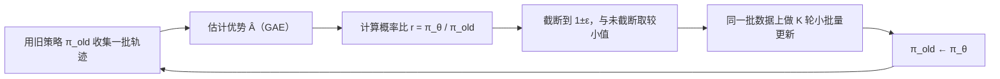

## 一句话总结

想要信赖域方法（TRPO）那样“每步别走太远”的稳定性，又不想要它的二阶优化复杂度：PPO 用一个截断后的替代目标，只用一阶优化就达到类似效果。

## 解决什么问题

强化学习里的策略梯度方法：让智能体按当前策略和环境交互、收集数据，估计每个动作比平均好多少（优势），然后提高好动作的概率。问题在于：

- **普通策略梯度样本效率低**：论文指出，在同一批轨迹上反复优化这个损失缺乏理论依据，实践中常导致破坏性的过大更新，所以通常一批数据只更新一步。
- **TRPO 稳定但复杂**：它用 KL 散度约束新旧策略的差距，需要共轭梯度等二阶近似，实现麻烦，也不方便和共享参数的网络结构（如策略和价值函数共用一个网络）、dropout 等组件配合。

目标是：**像 TRPO 一样稳，像普通策略梯度一样好写，还能在一批数据上多更新几轮。**

## 核心思想

- 定义新旧策略在同一动作上的**概率比** `r_t(θ)`：等于 1 表示没变，大于 1 表示新策略更倾向这个动作。
- 直接最大化“概率比 × 优势”会把策略推得很远，所以把概率比**截断**在 `[1−ε, 1+ε]` 内。
- 再在“截断前”和“截断后”两个目标里**取较小值**：只在改变会让目标变好时忽略超出部分，在改变会让目标变差时照常计入。论文称这是对未截断目标的悲观下界。
- 因为每一步都受限，同一批数据可以安全地跑多轮（K 个 epoch）小批量更新。

## 关键公式或机制

### 1. 截断替代目标

- 概率比：`r_t(θ) = π_θ(a_t | s_t) / π_θold(a_t | s_t)`
- 目标：`L^CLIP(θ) = E_t[ min( r_t(θ)·Â_t , clip(r_t(θ), 1−ε, 1+ε)·Â_t ) ]`

`Â_t` 是优势估计，论文实验中 ε 取 0.2 效果最好。直观地看：

- 优势为正（好动作）：概率比涨过 1+ε 后不再有额外奖励，阻止一步把概率拉得太高。
- 优势为负（坏动作）：概率比降过 1−ε 后不再有额外奖励，阻止一步把概率压得太低。

```anim
id: ppo-clip
component: function-plot
caption: PPO 单个样本的截断目标随概率比 r 的变化（Â 取 ±1 为示意）
alt: 折线图：横轴是新旧策略的概率比 r，纵轴是单个样本的目标值。优势为正时，目标随 r 线性上升，到 r = 1+ε 后变平；优势为负时，目标在 r 小于 1−ε 时保持平坦，r 增大时线性下降。平坦段表示梯度为零。
params:
  epsilon: { min: 0.05, max: 0.5, step: 0.05, default: 0.2, label: "ε", note: 论文实验取值 }
  advantage: { options: [1, -1], default: 1, labels: ["好动作 Â = +1", "坏动作 Â = −1"] }
  r: { min: 0, max: 2, step: 0.05, default: 1, label: "概率比 r", draggable: true }
  notes:
    - Â 取 ±1 为示意；真实优势是估计出来的任意实数
    - 单个样本的目标；实际是一批样本的平均（论文第 3 节）
  paper_note:
    at: [0.1, 0.2, 0.3]
    text: 论文表 1（第 6.1 节，7 个连续控制环境 × 21 次运行的平均归一化分数）：ε = 0.1 → 0.76，ε = 0.2 → 0.82，ε = 0.3 → 0.70；不截断也不加惩罚 → −0.39。
steps:
  - text: r = 1 表示新旧策略给出同样的概率，三条线在这里重合
    state: { r: 1, advantage: 1 }
  - text: 好动作超过 1+ε 后目标不再增加，梯度为 0，不会一步把概率拉得太高
    state: { r: 1.5, advantage: 1 }
  - text: 好动作的 r 掉到 1−ε 以下时不截断，目标变差会被如实计入
    state: { r: 0.5, advantage: 1 }
  - text: 坏动作反过来；只截断“会让目标变好”的那一侧，所以 L^CLIP 是未截断目标的下界
    state: { r: 0.5, advantage: -1 }
```

### 2. 另一种做法：自适应 KL 惩罚

论文也给了一个对照方案：目标里减去 `β × KL(旧策略, 新策略)`，每轮更新后看实际 KL `d`：比目标值 `d_targ` 的 1/1.5 还小就把 β 减半，比 1.5 倍还大就把 β 翻倍。作者说明实验里它不如截断目标，收录它是因为它是重要的基线。

### 3. 完整目标与算法

- 策略和价值函数共享网络时，总目标 = 截断目标 − c1 × 价值函数平方误差 + c2 × 策略熵奖励（鼓励探索）。
- 优势用截断的广义优势估计（GAE，参数 λ）计算。
- 算法循环：N 个并行执行者各跑 T 步收集数据 → 计算优势 → 在这批数据上用小批量随机梯度做 K 轮优化 → 用新策略替换旧策略。

### 4. 实验结果（论文所写）

**替代目标对比**（7 个 MuJoCo 连续控制环境，每个 100 万步，21 次运行的平均归一化分数）：

| 设置 | 平均归一化分数 |
|---|---|
| 不截断、不惩罚 | −0.39 |
| 截断，ε = 0.1 / 0.2 / 0.3 | 0.76 / 0.82 / 0.70 |
| 自适应 KL | 0.68–0.74 |
| 固定 KL | 0.62–0.72 |

分数经过归一化：随机策略记 0，各环境最好结果记 1。不加任何约束得到负分，即比随机策略还差，论文指出这是因为个别环境（如 HalfCheetah）出现了很低的分数。这和“不加约束容易一步走太远”的说法一致。

**Atari 49 个游戏**，和 A2C、ACER 比较“赢下的游戏数”：

| 指标 | A2C | ACER | PPO | 平局 |
|---|---|---|---|---|
| 整个训练期间的平均回合奖励（偏向学得快） | 1 | 18 | 30 | 0 |
| 最后 100 个回合的平均奖励（偏向最终表现） | 1 | 28 | 19 | 1 |

PPO 学得更快，但最终表现上 ACER 赢的游戏更多。论文还展示了 3D 人形机器人奔跑、转向的连续控制任务。

## 图解



图解：每轮先用旧策略收集轨迹并用 GAE 估计优势，再用概率比构造截断目标，在同一批数据上做 K 轮小批量更新，最后把新策略设为下一轮的旧策略。

## 关键原话

> "we only ignore the change in probability ratio when it would make the objective improve, and we include it when it makes the objective worse."

## 和 Anthropic 笔记的对应

PPO 本身是强化学习优化算法，Anthropic 工程博客的笔记没有直接讨论它。下面的对应都是**类比**，帮助把“优化一个代理目标”的风险和评测实践联系起来：

| Anthropic 笔记 | 对得上的地方 |
|---|---|
| [揭秘 AI 智能体评测](../notes/demystifying-evals-for-ai-agents.md) | PPO 只会最大化你给它的奖励信号；评分器设计里的“防止被绕过或钻空子”，在强化学习里对应奖励被利用（reward hacking）的问题。评分器有漏洞，优化越强，漏洞越容易被找到。 |
| [BrowseComp 中的评测察觉](../notes/eval-awareness-browsecomp.md) | 模型找到评测源码解密答案，是“优化目标和真实意图不一致”的一个极端例子。和 PPO 没有直接关系，但说明了被优化的系统会走出设计者没想到的路径。 |
| [基础设施噪声](../notes/infrastructure-noise.md) | PPO 论文用 21 次运行、3 次试验的平均来比较算法；那篇提醒排行榜上几个百分点的差距可能只是环境配置差异。两者都提示：单次运行的分数不足以下结论。 |

## 读的时候要注意

- **PPO 是一族方法**：截断版是主角，KL 惩罚版是对照；后来说“PPO”一般指截断版。
- **实现细节影响很大**：一般认为开源实现中有不少论文正文没有展开的工程细节，不同实现之间的效果也有差异（待核实：本笔记未逐一核对具体实现）。
- **Atari 结果不是全面碾压**：按最终表现，ACER 赢的游戏更多。
- **从游戏到语言模型**：后来的 InstructGPT 用 PPO 在人类偏好训练出的奖励模型上微调语言模型，并在目标里混入预训练梯度（PPO-ptx）。这一步的完整配方在 InstructGPT 论文里，不在本文。
- **“近端”的含义**：指每次更新都留在旧策略附近，不是某种新的数学结构。

## 30u30 对应单元

- 30u30 的 [Day 29 单元](https://github.com/Ojhaharsh/30u30/tree/main/papers/29_PPO)（仓库采用 CC BY-NC-ND 4.0，本笔记没有使用其内容）。
- 路线位置：[30u30 导读](../resources/r-30u30.md) 的原理支线 P5（Day 29 → 30）。

## 延伸阅读

- [Day 30：基于人类偏好的深度强化学习](./p-30-rlhf-human-preferences.md)：奖励从哪里来。
- [Training language models to follow instructions with human feedback（InstructGPT）](https://arxiv.org/abs/2203.02155)：PPO 用到语言模型上。

---

*本笔记依据 2026-10-18 抓取的在线原文撰写，仅为导读与总结。原文：John Schulman 等,[《Proximal Policy Optimization Algorithms》](https://arxiv.org/abs/1707.06347), arXiv 2017。*
